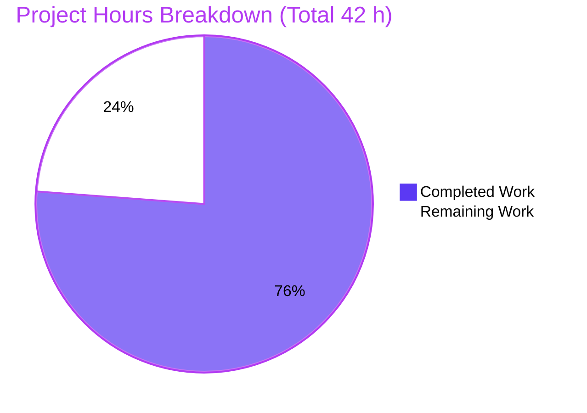
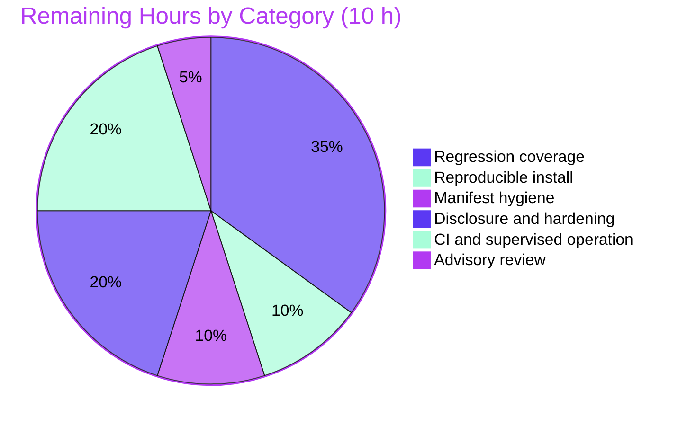

# 1. Executive Summary

## 1.1 Project Overview

This project turns a two-file Node.js HTTP fixture into a small Express service. It adds Express as the sole runtime dependency and serves a second fixed-text route, `GET /good-evening`, returning exactly `Good evening\n` at status 200 with a bare `text/plain`, while `GET /` keeps returning `Hello, World!\n`. The process contract is unchanged: the service binds `127.0.0.1:3000` and prints one readiness line once the bind succeeds. Scope is two files, two route registrations and one manifest block — no UI, storage, configuration, authentication or automated tests.

## 1.2 Completion Status


| Metric | Hours |
|---|---|
| Total Project Hours | 42 |
| Completed Hours (AI + Manual) | 32 |
| Remaining Hours | 10 |

**76.2% complete** = 32 ÷ (32 + 10) × 100. All ten deliverable checks — the five requirements R1–R5 and the five validation criteria — are delivered and verified; the remaining hours are the production-readiness items in Section 2.2.

## 1.3 Key Accomplishments

- Express is the only dependency (`^5.0.0`), declared once and required once; `npm ls` shows `express@5.3.0` and nothing else.
- `GET /good-evening` returns `200`, bare `text/plain`, 13 bytes (`server.js:9`).
- `GET /` still returns `200`, bare `text/plain`, 14 bytes, byte for byte (`server.js:8`).
- Both bodies are fixed literals; request data never changes a byte.
- The listener binds `127.0.0.1:3000` only and prints one 41-byte readiness line after a successful bind.
- A duplicate bind exits 1 with no readiness line and leaves the live instance serving.
- Unregistered paths and methods get Express's defaults — `404` for other paths, framework answers for `HEAD` and `OPTIONS`.
- The change is two files, 12 insertions and 8 deletions; lockfile and README untouched.

## 1.4 Critical Unresolved Issues

All ten deliverable checks are delivered and verified. Six production-readiness items remain open; all six need human work.

| Issue | Impact | Owner | ETA |
|---|---|---|---|
| 1. No automated test suite or regression gate exists — the only npm script is npm's placeholder, which exits 1 | The byte-exact responses and the readiness gate are protected only by manual checks; a later edit can silently break them | Application owner | 1 day |
| 2. The committed `package-lock.json` still records a zero-dependency graph | `npm ci` refuses the tree (`EUSAGE`, "Missing: express@5.3.0 from lock file"); installs must use `npm install --no-package-lock` | Application owner | 0.5 day |
| 3. The two `200` responses carry no security-header set and disclose `X-Powered-By: Express` | Matters only if the process is ever bound beyond loopback; reads as an oversight in any hardening review | Application owner | 0.5 day |
| 4. Pre-existing manifest defects: `"main": "index.js"` names no file, `scripts.test` always fails, and no Node version floor is declared for Express 5 | `npm start` and `npm test` mislead; an old runtime fails at require time rather than at install | Application owner | 2 hours |
| 5. No CI pipeline or supervised start/stop definition, and a failed bind exits through an uncaught exception whose stack names the checkout path | Deployment and failure triage are manual; a supervisor sees a crash rather than a one-line message | Application owner | 1 day |
| 6. No dependency advisory review of the installed 65-package graph | Advisory exposure of the `express@5.3.0` tree is unknown | Application owner | 2 hours |

## 1.5 Access Issues

No access issues identified: the public npm registry needs no credential, and no service, database or secret is involved.

## 1.6 Recommended Next Steps

1. **[High]** Add a regression suite for both contracts and the readiness gate, wired to the `test` script.
2. **[High]** Regenerate and commit `package-lock.json`, verify `npm ci`, and document that install command.
3. **[Medium]** Fix manifest hygiene: repoint or drop `main`, declare the Node floor, keep `test` running the suite.
4. **[Medium]** Add the security-header set and suppress `X-Powered-By` before any non-loopback bind.
5. **[Medium]** Add CI and a supervised start/stop with a one-line bind-failure message.

# 2. Project Hours Breakdown

## 2.1 Completed Work Detail

| Component | Hours | Description |
|---|---|---|
| Express as the sole runtime dependency | 3 | `package.json:11-13` declares `"express": "^5.0.0"` and nothing else; `server.js:1` requires it once. `npm ls --depth=0` lists `express@5.3.0` and no other top-level package. |
| `GET /good-evening` route and response contract | 6 | `server.js:9` registers the route as one chained statement: status 200, header literal `text/plain`, body `Good evening\n`. Observed on the wire as 200, bare `text/plain`, 13 bytes. |
| `GET /` preserved byte for byte | 3 | `server.js:8` carries the removed handler's three response values unchanged, so the existing 14-byte `Hello, World!\n` response survives the conversion to a route registration. |
| Listener conversion and process contract | 3.5 | `app.listen(port, hostname, …)` replaces `server.listen` with the same `127.0.0.1`, the same port 3000 and the same readiness text; no shutdown or lifecycle handling was added. |
| Readiness gating on a successful bind | 4 | `server.js:13` re-throws a bind error inside the callback Express itself registers as the server's `'error'` listener, so a port conflict exits 1 with no readiness line instead of announcing a healthy start. |
| Exact `text/plain` engineering decision | 2 | Both routes set the header at Node level, because Express widens a string content type to `text/plain; charset=utf-8`. The one-line rationale at `server.js:7` keeps that decision from being reversed. |
| Scope restraint across manifest, lockfile, README and diff | 3 | Seven pre-existing manifest members keep their values and order; `package-lock.json` and `README.md` are untouched; the two pre-existing manifest defects are left as they are; the diff stays at 12 insertions and 8 deletions. |
| Wire-level verification against the validation criteria | 7.5 | Both route contracts, request independence, the framework's defaults for unregistered input, the readiness gate, the duplicate-bind path and the process lifecycle were exercised, alongside the compile and dependency gates. |
| **Total completed** | **32** | Delivered and verified against the specification's five requirements and five validation criteria. |

## 2.2 Remaining Work Detail

| Category | Hours | Priority |
|---|---|---|
| Automated regression coverage for the delivered contracts (route bodies, exact content type, request independence, readiness gate, duplicate-bind path) | 3.5 | High |
| Reproducible dependency resolution — regenerate and commit `package-lock.json`, verify `npm ci`, then switch the documented install command | 1 | High |
| Manifest hygiene and runtime contract — dangling `main`, non-functional `test` script, absent Node version floor for Express 5 | 1 | Medium |
| Disclosure and hardening baseline before any non-loopback bind — suppress `X-Powered-By`, add the security-header set, decide the bind policy | 2 | Medium |
| CI pipeline and supervised start/stop, including a one-line bind-failure message instead of an uncaught stack trace | 2 | Medium |
| Dependency advisory review of the installed `express@5.3.0` graph | 0.5 | Low |
| **Total remaining** | **10** | |

## 2.3 Estimation Basis and Confidence

Completed hours cover the implementation of each delivered element and the verification that proved it, sized from the element's own complexity: two fixed-text registrations, one manifest block, one listener conversion, one failure-path guard and the wire-level checks behind them. Confidence is high for the completed figures — the scope is two files, every requirement is fully specified, and every response value was observed on the wire rather than inferred.

Remaining hours are the production-readiness items the change itself excluded: a regression net, a committed dependency graph, manifest hygiene, a hardening baseline and a deployment definition. Confidence is medium for these estimates because each depends on decisions the owner has not yet made, such as the test runner, the header set and the deployment target. No remaining hour is rework of delivered behaviour.

# 3. Test Results

Each row below records checks executed against this checkout: the static gates, plus a running instance on `127.0.0.1:3000` and a port-substituted copy for the contention and lifecycle cases. No test framework is configured, so the harness column names the tools actually used. Total: **23 executed, 23 passed, 0 failed**.

| Area / Category | Framework | Tests | Passed | Failed | Coverage | What This Proves |
|---|---|---|---|---|---|---|
| Preserved route `GET /` | `curl` + `od`/`md5` | 3 | 3 | 0 | — | The pre-existing response survives byte for byte: status 200, bare `text/plain`, 14-byte `Hello, World!\n` (md5 `bea8252f…`). |
| New route `GET /good-evening` | `curl` + `od`/`md5` | 3 | 3 | 0 | — | The new route returns the specified status, type and 13-byte body `Good evening\n` (md5 `fbd4309e…`). |
| Exact content type on both routes | header capture | 1 | 1 | 0 | — | Neither response carries a charset parameter, so the type is exactly `text/plain`. |
| Express dispatch defaults | `curl` path/method probes, `HEAD`, `OPTIONS` | 4 | 4 | 0 | — | Unregistered input is answered by the framework, not by an authored handler: `/anything` → 404 (147 B), `POST /` → 404 (140 B), `HEAD` → 200 with an empty body, `OPTIONS` → 200 with the framework's `Allow` answer. |
| Listener, readiness and lifecycle | process run + `/proc/net/tcp` | 5 | 5 | 0 | — | One `LISTEN` socket on `127.0.0.1:3000`, one 41-byte readiness line per successful start, and a clean `SIGTERM` (exit 143) that leaves no listening socket. |
| Failed-bind path | duplicate process run | 4 | 4 | 0 | — | A port conflict exits 1 with zero readiness lines and `EADDRINUSE` naming the address and port, and the live instance is unaffected. |
| Request independence | `cmp` of response bodies | 1 | 1 | 0 | — | A query string, `Authorization` and `Cookie` produce bytes identical to a plain request. |
| Compile and dependency gates | `node --check`, `npm ls --depth=0` | 2 | 2 | 0 | — | `server.js` compiles and the single declared dependency is installed as `express@5.3.0`. |
| **Total** | | **23** | **23** | **0** | | |

No coverage figure is quoted: the project configures no coverage tooling.

## Not Covered

- **Automated tests of any kind.** The repository contains no test file, framework or runner, and its only npm script is npm's placeholder, which exits 1 by design. Every result above came from commands run by hand, so nothing guards the byte-exact contract or the readiness gate against a future edit.
- **Load and soak behaviour.** Throughput, concurrency limits, slow-client handling and long-run stability were not exercised.
- **A lockfile-strict install path.** `npm ci` refuses this tree (`EUSAGE`, "Missing: express@5.3.0 from lock file"), so the dependency graph is exercised only through `npm install --no-package-lock`.
- **Dependency advisories.** No audit or CVE review of the 65 installed packages was performed.
- **Exposure beyond loopback.** The hardening posture of a non-loopback deployment (security headers, transport security, request logging, rate limiting) is untested because the listener binds `127.0.0.1` only.
- **Any rendered surface.** The service returns two plain-text bodies and renders nothing, so there is no UI, asset or browser behaviour to test.

# 4. Runtime Validation & UI Verification

Each line below was driven against a live process in this checkout; the observation is what the wire or the process returned.

- ✅ **Service start and readiness** — `node server.js` printed exactly one line, `Server running at http://127.0.0.1:3000/` (41 bytes), and held a single listening socket, `127.0.0.1:3000`.
- ✅ **`GET /good-evening`** — `200`, `Content-Type: text/plain`, `Content-Length: 13`, body bytes `47 6f 6f 64 20 65 76 65 6e 69 6e 67 0a`.
- ✅ **`GET /`** — `200`, `Content-Type: text/plain`, `Content-Length: 14`, body bytes `48 65 6c 6c 6f 2c 20 57 6f 72 6c 64 21 0a`.
- ✅ **Request independence** — a request with a query string, `Authorization: Bearer …` and a `Cookie` returned bytes identical to a plain request on both routes.
- ✅ **Unregistered path** — `GET /anything` returned `404 text/html; charset=utf-8`, 147 bytes, from the framework's own error page.
- ✅ **Unregistered method** — `POST /` returned `404`, 140 bytes; no application handler answered it.
- ✅ **`HEAD /good-evening`** — `200`, `Content-Type: text/plain`, zero body bytes.
- ✅ **`OPTIONS /good-evening`** — `200`, `Content-Type: text/plain`, 9 bytes (`GET, HEAD` from the framework).
- ✅ **Failed bind** — a second process on the occupied port exited 1, printed zero readiness lines and raised `Error: listen EADDRINUSE: address already in use 127.0.0.1:3000` at `server.js:13`, while the running instance kept answering `200` with 13 bytes.
- ✅ **Process lifecycle** — `SIGTERM` exited 143, left no listening socket on 3000 and made the port refuse connections.

**Never exercised at runtime:** any bind address other than `127.0.0.1`; a lockfile-strict install (`npm ci` refuses the tree before it installs anything); sustained load, soak or slow-client behaviour; a dependency advisory audit of the installed graph; and any rendered surface, since the service returns two plain-text bodies and nothing else.

# 5. Compliance & Quality Review

## 5.1 Compliance Matrix

| # | Deliverable | Verified Status | Evidence |
|---|---|---|---|
| 1 | `GET /good-evening` returns the exact contract | ✅ Pass | `server.js:9`; wire: `200`, bare `text/plain`, 13 bytes, md5 `fbd4309e…` |
| 2 | `GET /` preserved byte for byte | ✅ Pass | `server.js:8`; wire: `200`, bare `text/plain`, 14 bytes, md5 `bea8252f…` |
| 3 | Express is the sole new dependency | ✅ Pass | `package.json:11-13`, `server.js:1`; `npm ls --depth=0` → `express@5.3.0` only |
| 4 | Manifest minimalism — one block, seven members preserved | ✅ Pass | Eight top-level keys, the original seven in place and order, `dependencies` last |
| 5 | Two-file change, nothing added or deleted | ✅ Pass | `git diff --name-status` over the branch → `M package.json`, `M server.js`; no `A`/`D` entry |
| 6 | Lockfile and README untouched | ✅ Pass | Both absent from the diff; md5 `158033d2…` and `3c7ee542…` unchanged |
| 7 | No tests, documentation edits, handlers, configuration or unrequested hardening added | ✅ Pass | Zero matches for `app.use`, `app.all`, `app.disable`, `process.env`, `process.on`, `require('http')`, `res.send`; no test or doc artefact |
| 8 | Listener and process contract — same bind, one readiness line, no shutdown code | ✅ Pass | `server.js:3-4,11-14`; one `LISTEN` on `127.0.0.1:3000`; readiness 41 bytes once; `SIGTERM` → 143 |
| 9 | A failed bind is not announced as readiness | ✅ Pass | Duplicate bind → exit 1, zero readiness lines, `EADDRINUSE` naming `127.0.0.1:3000` |
| 10 | Framework defaults answer unregistered input | ✅ Pass | `/anything` → 404 (147 B), `POST /` → 404 (140 B), `HEAD`/`OPTIONS` answered by Express |
| 11 | Automated test coverage of the delivered behaviour | ❌ Not present | No test file, framework or runner exists; `npm test` exits 1 with npm's placeholder |
| 12 | Reproducible, lockfile-strict install | ❌ Not present | `npm ci` refuses the tree (`EUSAGE`, "Missing: express@5.3.0 from lock file") |

## 5.2 AAP & Rule Divergences and Gaps

| # | What the Specification Required | What Was Delivered Instead | Why It Diverged | Impact | What a Human Should Do |
|---|---|---|---|---|---|
| D1 | `res.set('Content-Type', 'text/plain')` on both registrations, as the illustrated target file shows | `res.status(200).setHeader('Content-Type', 'text/plain').end(…)` at `server.js:8-9` | The normative contract requires the header value to be exactly `text/plain`, and Express widens `res.set`'s string type through `mime.contentType` to `text/plain; charset=utf-8`. The pre-existing handler already set the header at Node level, so keeping it is also the smaller diff. | None — the wire value is bare `text/plain`, as required | Nothing. Keep the Node-level setter; the rationale is recorded at `server.js:7` |
| D2 | An `app.listen(port, hostname, () => { … })` callback taking no arguments | `app.listen(port, hostname, (err) => { if (err) throw err; … })` at `server.js:11-14` | Express registers that callback as the server's `'error'` listener, so without the guard a failed bind printed the readiness line and exited 0, which the specification's requirement that readiness be emitted only after a successful bind forbids | None — the base file's failure behaviour is restored: exit 1, no readiness line, the port named | Nothing. Keep the guard; the rationale is recorded at `server.js:12` |
| D3 | A twelve-line, comment-free target file | Fifteen lines: one guard statement plus two rationale comments (`server.js:7`, `server.js:12`) | Each comment records a constraint that is invisible from the code — the content-type widening and the error-listener seam — and that a later editor would otherwise reverse, silently breaking D1 or D2 | Static source-text comparison with the illustrated file shows a delta; no behavioural impact | Nothing. If literal line-for-line conformance is ever required, delete the two comments only, never the guard |

**D1 — the content type setter.** The target file the specification illustrates uses `res.set`, but the response contract it states says the header value must be exactly `text/plain`, with no charset parameter. On `express@5.3.0` as installed here, `res.set` routes the value through `mime.contentType`, which appends `; charset=utf-8` to any `text/*` type, while the Node-level `setHeader` transmits the value verbatim. The pre-change handler at `server.js:8` already used `setHeader`, so the delivered routes preserve an existing, working line rather than introducing a new form. A reader can confirm the outcome with `curl -sD - http://127.0.0.1:3000/good-evening`, which shows `Content-Type: text/plain`. Decision for the owner: keep the Node-level setter and treat the illustration as superseded.

**D2 — the listen callback signature.** Express 5's `app.listen` wraps the trailing function argument with `once()` and registers it as the server's `'error'` listener as well as its listening callback. With a zero-argument callback, a port conflict invoked it with an error that was ignored: the process printed `Server running at http://127.0.0.1:3000/`, swallowed `EADDRINUSE` and exited 0 without ever listening. The guard at `server.js:13` re-throws that error, so the behaviour matches the base file — exit 1, no readiness line, the address and port named. Decision for the owner: keep the guard; it is what makes the readiness line trustworthy, and it adds no handler, middleware or response.

**D3 — file size and comments.** The delivered file is fifteen lines, not the twelve the illustration shows, because of the guard statement and two one-line comments at `server.js:7` and `server.js:12`. Each comment explains a constraint a reader cannot see from the code: why the header is set at Node level, and why the bind error must be re-thrown rather than ignored. Removing either invites a later edit that silently reintroduces a charset parameter or a false readiness signal. Decision for the owner: accept the three extra lines; if a literal line-for-line match with the illustration is ever required, delete the comments and keep the guard.

**Rule compliance.** Neither user-specified rule was departed from. Rule 1 (`build-prompt-rule`, body `abcd`) and Rule 2 (`test ruleewe`, body `asdasdsadas`) both have non-semantic placeholder bodies that state no requirement, constraint or standard, so the delivered code can neither satisfy nor violate them, and nothing was invented from their names. The absences the change requires — no test suite, no committed lockfile, no documentation edits, no handlers, no environment configuration, no hardening — are compliance with the change's own constraints, not gaps against them; their consequences are the open items in Section 1.4 and the remaining hours in Section 2.2.

# 6. Risk Assessment

Risks below are forward-looking: what could still go wrong with this service in use, not what happened while it was built.

| Risk | Category | Severity | Probability | Mitigation | Status |
|---|---|---|---|---|---|
| The byte-exact response contract has no automated guard; an edit that swaps `setHeader` for `res.set` or `res.send` silently reintroduces `; charset=utf-8` and no gate notices | Technical | High | Medium | Add the regression suite in Section 2.2; keep the rationale comment at `server.js:7` | Open |
| The readiness guard depends on Express 5's `app.listen` seam; a downgrade to Express 4 would make the guard inert and restore false readiness on a failed bind | Technical | Medium | Low | Pin the major version or add the duplicate-bind case to the regression suite | Open |
| The dependency is pinned only by a caret range with no committed lockfile, so two installs can pick different 5.x trees | Integration | Medium | Medium | Commit a lockfile and install with `npm ci` (Section 2.2) | Open |
| `npm ci` refuses this tree because the committed lockfile records a zero-dependency graph, so a lockfile-strict pipeline cannot install it | Integration | Medium | High | Use `npm install --no-package-lock`, or commit the regenerated lockfile | Open |
| Both routes are unauthenticated and the `127.0.0.1` bind literal is the entire access control; publishing the port or making the bind configurable would expose both routes | Security | High | Low | Keep the bind literal fixed; add authentication at the same time the bind address changes | Accepted |
| `X-Powered-By: Express` is disclosed on every response and the two `200` responses carry no CSP, `nosniff`, HSTS or `Cache-Control`, while the framework's own 404 does | Security | Low | High | Add the security-header set and suppress the banner in the first change allowed to add middleware | Accepted |
| No request logging, rate limiting or body-size limit; a partial request line holds a connection until Node's header timeout | Operational | Medium | Medium | Add access logging and limits before exposing the service beyond loopback | Accepted |
| A failed bind exits through an uncaught exception whose stack names `server.js:13` and the absolute checkout path | Operational | Low | Medium | Replace with a one-line message and an explicit non-zero exit when an error path is permitted | Accepted |

Risks marked Accepted are deliberate consequences of the change's own constraints — no hardening, no handlers, no logging were requested — and they become live the moment the process is bound somewhere other than loopback. Risks marked Open are the items carrying the remaining hours in Section 2.2.

# 7. Visual Project Status



**Completed 32 hours (76.2%) · Remaining 10 hours (23.8%) · Total 42 hours.**



| Remaining Category | Hours | Priority |
|---|---|---|
| Regression coverage | 3.5 | High |
| Reproducible install | 1 | High |
| Manifest hygiene | 1 | Medium |
| Disclosure and hardening | 2 | Medium |
| CI and supervised operation | 2 | Medium |
| Advisory review | 0.5 | Low |
| **Total** | **10** | |

# 8. Summary & Recommendations

The project delivers its full specification: Express is the sole dependency, `GET /good-evening` returns `200` with a bare `text/plain` and exactly thirteen bytes, `GET /` is unchanged at fourteen bytes, and the process still binds `127.0.0.1:3000` and announces readiness once, only after the bind succeeds. Every one of the ten deliverable checks — the five requirements and the five validation criteria — was exercised against a running instance rather than inferred from the source: both route contracts at byte level, request independence, the framework's answers to unregistered input, the duplicate-bind path and the shutdown lifecycle. On that basis the AAP-scoped completion stands at **76.2%** (32 of 42 hours), with the delivered work finished and verified.

The remaining 23.8% (10 hours) is not unfinished behaviour. It is the production-readiness layer the change itself excluded: an automated regression suite (3.5 h), a committed dependency graph so `npm ci` works (1 h), manifest hygiene for the dangling `main`, the failing `test` placeholder and the absent Node floor (1 h), a disclosure and hardening baseline for any bind other than loopback (2 h), a CI pipeline with a supervised start/stop and a one-line bind-failure message (2 h), and a dependency advisory review (0.5 h). Each is a decision the owner must make; none is a repair of what shipped.

The critical path to production is short and ordered: give the two byte-exact contracts a regression net first, because that is the only thing standing between a future edit and a silent content-type or readiness regression; then commit the dependency graph so installs are reproducible and CI can run `npm ci`; then decide the deployment shape — if the process stays on `127.0.0.1`, the hardening items can wait, and if it moves, they cannot. The bind literal in `server.js:3` is the service's entire access control and the first thing to review in any change that touches it.

Success metrics for the handover are concrete: both routes answer their exact bytes on every request, one readiness line appears per successful start and none on a failed bind, the compile gate and dependency check pass, and the diff remains two files. All of them hold today, and all of them are reproducible from Section 9's commands within a minute on a clean checkout.

Production readiness: **ready for its stated purpose** — a two-route plain-text fixture on loopback — and **not yet ready as a general-purpose service**. The gaps that separate the two are the six open items above, all of which are additions the change's own constraints ruled out rather than anything left unfinished.

# 9. Development Guide

Every command below was executed in this checkout; the expected outputs are the ones observed.

## 9.1 System Prerequisites

- **Node.js 22.x** — verified on `v22.23.5`. Express 5 needs a modern runtime; nothing in the manifest declares a floor, so the version is a prerequisite rather than an enforced constraint.
- **npm 11.x** — verified on `11.21.0`.
- A POSIX shell and **`curl`** for the verification steps. `od`/`hexdump` are useful for byte-level checks.
- No database, message broker, cache, container, credential or environment variable is involved. There is no compiler, bundler, transpiler or type-checker: `server.js` runs as shipped.

## 9.2 Environment Setup and Dependency Installation

Run everything from the checkout root. The install must not write a lockfile:

```bash
# from the repository root
CI=true npm install --no-package-lock --no-audit --no-fund
```

Observed output: exit 0, `up to date` on a warm tree (a clean install resolves `express@5.3.0` plus 64 transitive packages). `package-lock.json` stays byte-identical (md5 `158033d2354b83cdca5cfb1e4f8fcef7`) and `git status --porcelain` stays empty.

Do **not** run a bare `npm install` (it rewrites the lockfile) or `npm ci` (it refuses this tree — see 9.6). No environment variables or secrets are read by the application at any point.

## 9.3 Static Gates

```bash
node --check server.js      # exit 0, no output
npm ls --depth=0            # exit 0: hello_world@1.0.0 -> express@5.3.0 only
```

`npm test` exits 1 with `Error: no test specified`; that is npm's placeholder script, not a failing test. No lint, format or type-check tooling is configured, so these two commands are the whole static gate.

## 9.4 Application Startup

```bash
node server.js
```

Expected: exactly one line on stdout — `Server running at http://127.0.0.1:3000/` (41 bytes) — and a single listening socket on `127.0.0.1:3000`. The bind address and port are hard-coded in `server.js:3-4`; the process reads no configuration and accepts no flags.

Stop it with `Ctrl-C`, or `kill -TERM <pid>`. Observed: exit status 143, the listening socket disappears and the port refuses connections. There is no shutdown handler — the default Node lifecycle releases the port.

**If port 3000 is already in use**, do not edit the repository's port literal. Copy the file outside the checkout, change only that literal, and point `NODE_PATH` at the checkout's dependencies:

```bash
cp server.js ../server-local.js
sed -i "s/const port = 3000;/const port = 30991;/" ../server-local.js
NODE_PATH="$PWD/node_modules" node ../server-local.js
```

Observed with this copy: one readiness line for the chosen port, both routes byte-identical, `404` for `/anything`, exit 143 on `SIGTERM`.

## 9.5 Verification Steps

In a second shell, with the service running:

```bash
curl -s -o /dev/null -w "%{http_code} %{content_type} %{size_download}\n" http://127.0.0.1:3000/
# expected: 200 text/plain 14

curl -s -o /dev/null -w "%{http_code} %{content_type} %{size_download}\n" http://127.0.0.1:3000/good-evening
# expected: 200 text/plain 13

curl -s http://127.0.0.1:3000/good-evening | od -An -c
# expected:  G   o   o   d       e   v   e   n   i   n   g  \n

curl -s http://127.0.0.1:3000/ | od -An -c
# expected:  H   e   l   l   o   ,       W   o   r   l   d   !  \n

curl -s -o /dev/null -w "%{http_code} %{content_type} %{size_download}\n" http://127.0.0.1:3000/anything
# expected: 404 text/html; charset=utf-8 147

curl -s -o /dev/null -w "%{http_code}\n" -X POST http://127.0.0.1:3000/
# expected: 404

curl -s -I -o /dev/null -w "%{http_code} %{content_type}\n" http://127.0.0.1:3000/good-evening
# expected: 200 text/plain

curl -s -X OPTIONS -o /dev/null -w "%{http_code} %{content_type} %{size_download}\n" http://127.0.0.1:3000/good-evening
# expected: 200 text/plain 9
```

If a `Content-Type` anywhere reads `text/plain; charset=utf-8`, the route has been changed to `res.set`/`res.send`; restore `res.setHeader` at `server.js:8-9`.

## 9.6 Troubleshooting

| Symptom | Cause | Resolution |
|---|---|---|
| `Error: listen EADDRINUSE: address already in use 127.0.0.1:3000`, exit 1, no readiness line | Another process holds the port. The guard at `server.js:13` re-throws the bind error on purpose. | Stop the other process, or run the port-substituted copy from 9.4. |
| `npm ci` fails with `npm error code EUSAGE` and `Missing: express@5.3.0 from lock file` | The committed lockfile still records a zero-dependency graph. | Use `npm install --no-package-lock` until the lockfile is regenerated and committed. |
| `npm test` exits 1 with `Error: no test specified` | npm's placeholder script; no test suite exists yet. | Nothing to fix — add a real suite and point the script at it (Section 2.2). |
| A readiness line appears but nothing listens | Only possible on an Express 4.x line, where `app.listen` does not pass the bind error to the callback. | Keep the declared `^5.0.0` range, or re-add the error check when Express changes. |
| `Cannot find module 'express'` | Dependencies are not installed, or `NODE_PATH` does not point at the checkout. | Re-run the install from 9.2, or set `NODE_PATH` as in 9.4. |
| `Content-Type: text/plain; charset=utf-8` | A route was changed to `res.set` or `res.send`. | Restore the Node-level `setHeader` form at `server.js:8-9`. |

## 9.7 Example Usage

```bash
# start the service
node server.js &
# VERIFY the new route
curl -s http://127.0.0.1:3000/good-evening
# Good evening

# the preserved route
curl -s http://127.0.0.1:3000/
# Hello, World!

# confirm the response is not influenced by the request
curl -s "http://127.0.0.1:3000/good-evening?probe=1" -H 'Authorization: Bearer probe' | md5sum
# fbd4309eb57f3d71a573201934425d10

# stop the service
kill -TERM %1
```

# 10. Appendices

## Appendix A. Command Reference

| Purpose | Command | Expected result |
|---|---|---|
| Install dependencies without touching the lockfile | `CI=true npm install --no-package-lock --no-audit --no-fund` | Exit 0; `express@5.3.0` resolved; lockfile unchanged |
| Compile gate | `node --check server.js` | Exit 0, no output |
| Dependency check | `npm ls --depth=0` | Exit 0; `hello_world@1.0.0` → `express@5.3.0` |
| Test script (placeholder) | `npm test` | Exit 1, `Error: no test specified` — by design |
| Start the service | `node server.js` | One readiness line; socket on `127.0.0.1:3000` |
| Stop the service | `kill -TERM <pid>` or `Ctrl-C` | Exit 143; port released |
| Check both routes | `curl -s -o /dev/null -w "%{http_code} %{content_type} %{size_download}\n" http://127.0.0.1:3000/good-evening` | `200 text/plain 13` |
| List listeners without `ss`/`lsof` | `awk '$4=="0A" {print $2}' /proc/net/tcp` | Rows such as `0100007F:0BB8` (127.0.0.1:3000) |
| Changed files against the fixture baseline | `git diff --name-status a6f7f58..HEAD` | `M package.json`, `M server.js` |

## Appendix B. Port Reference

| Port | Address | Purpose | Configurable |
|---|---|---|---|
| 3000 | `127.0.0.1` | The one HTTP listener, set by the `port` constant at `server.js:4` | No — hard-coded; change a copy of the file, never the repository |

There are no other listeners, no outbound connections and no admin, metrics or health port.

## Appendix C. Key File Locations

| Path | Role |
|---|---|
| `server.js` | The whole application: one `require`, two `GET` registrations (`:8-9`), the listener and readiness line (`:11-14`), two rationale comments (`:7`, `:12`) |
| `package.json` | Manifest; the only added member is `dependencies` at `:11-13` |
| `package-lock.json` | Committed at `lockfileVersion` 3 with a zero-dependency graph; intentionally unchanged |
| `README.md` | Fixture note ("Do not touch!"); intentionally unchanged |

## Appendix D. Technology Versions

| Component | Version | Notes |
|---|---|---|
| Node.js | v22.23.5 | Verified host runtime; no version floor declared in the manifest |
| npm | 11.21.0 | Install must use `--no-package-lock` |
| express | 5.3.0 resolved from `^5.0.0` | Sole runtime dependency; 64 transitive packages |
| CommonJS | — | `require()` style; the manifest declares no `type` field |

## Appendix E. Environment Variable Reference

None. The application reads no environment variable: the bind address, port and both response bodies are literals in `server.js`. It starts and serves correctly with an empty environment, and `PORT`, `HOST` and `NODE_ENV` have no effect on it.

## Appendix F. Developer Tools Guide

| Need | Tool | Notes |
|---|---|---|
| Request and header inspection | `curl -sD -` | The project's primary verification tool |
| Byte-level body proof | `od -An -c` / `od -An -tx1`, `wc -c`, `md5sum` | Confirms 13/14 bytes and the single trailing LF |
| Listener inspection | `/proc/net/tcp` (state `0A`) | `ss`, `netstat`, `lsof` and `fuser` are not installed in this container |
| Compile check | `node --check` | The only static gate; no linter or type-checker exists |
| Test runner | none configured | `npm test` is npm's placeholder that exits 1 |

## Appendix G. Glossary

| Term | Meaning |
|---|---|
| Bare `text/plain` | The header value with no parameters — specifically no `; charset=utf-8` |
| Readiness line | The single `Server running at http://127.0.0.1:3000/` line printed once the bind succeeds |
| Failed bind | A start that cannot take port 3000 (normally `EADDRINUSE`); must exit non-zero with no readiness line |
| Framework default | The response Express itself produces for an unregistered path or method — a `404 text/html` page, or its `HEAD`/`OPTIONS` answers |
| Fixture | A minimal service used to exercise HTTP behaviour locally, not a general-purpose application |
| Zero-dependency graph | The state of the committed lockfile, which records no dependencies while the manifest declares Express |
