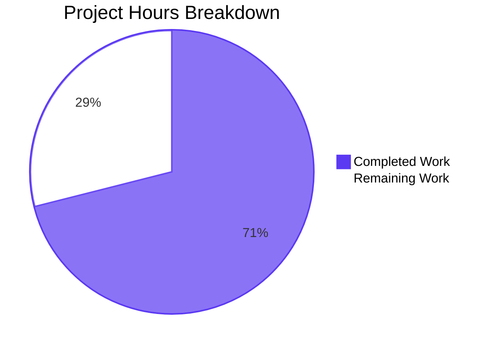
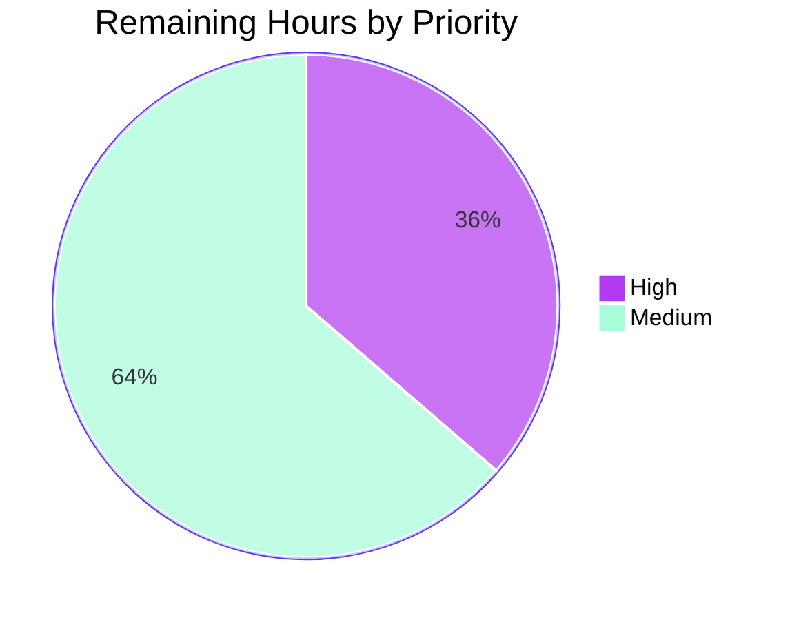

# 1. Executive Summary

## 1.1 Project Overview

A zero-dependency Node.js HTTP fixture answers one route and is supervised. Its single request listener returns a static JSON body on the exact path `/status`, with the declared length derived from the serialized payload so header and body cannot disagree, and keeps the original plain-text greeting byte for byte on every other URL. A three-line PM2 config supervises the process under the package's own name, the manifest declares how to start it, and one ignore rule keeps an installed dependency tree out of version control. Maintainers and probes gain a supervised, correctly framed endpoint with no new package, build or container.

## 1.2 Completion Status

Four paths at the repository root carry the change: two created (`ecosystem.config.js`, `.gitignore`), two modified (`server.js`, `package.json`), eleven inserted lines and no deletions against baseline `a6f7f58`. The lockfile and `README.md` are untouched.



| Metric | Hours |
| --- | --- |
| Total Hours | 19.0 |
| Completed Hours (Baseline: Human with agentic-assist) | 13.5 |
| Remaining Hours | 5.5 |
| Percent Complete | 71% |

Calculation: 13.5 / 19.0 = 71.05%, reported as **71%**.

## 1.3 Key Accomplishments

- ✅ `/status` answers `200`, `application/json`, `Content-Length: 15` and `{"status":"ok"}` for eight HTTP methods.
- ✅ The declared length is derived from the serialized body, so the two cannot drift; a changed payload moves the declared value with it (7, 15, 28 and 34 bytes).
- ✅ `HEAD /status` returns the same headers as `GET` with no body.
- ✅ Every other URL keeps the byte-identical `Hello, World!\n` across 17 variants.
- ✅ PM2 supervises one app named `hello_world`, including restart, recovery, stop and delete.
- ✅ `scripts.start` declared first; package identity and test placeholder preserved verbatim.
- ✅ One ignore rule; the lockfile stays tracked and byte-identical to the baseline, and the dependency graph is empty.
- ✅ Zero comments in all four files; repository formatting preserved.

## 1.4 Critical Unresolved Issues

0 of the 6 scope items are incomplete; 10 items remain open in five groups.

| Issue | Impact | Owner | ETA |
| --- | --- | --- | --- |
| **Product decisions left open (3):** the manifest's `main` still names the absent `index.js`; `/status` variants (trailing slash, query, case, percent-encoding) return the greeting; the supervised process binds loopback only | A consumer honouring `main`, or addressing a variant path, gets a failure or the greeting; the supervised endpoint is reachable from its host alone | Repository owner | Before the next change to the listener |
| **Accepted maintenance caveat (1):** `HEAD /` omits the 14-byte length that `HEAD /status` sends | A HEAD-based client sees an asymmetry between the two routes | Maintainer of `server.js` | On the next edit of the greeting |
| **Operating constraints (3):** port 3000 is a fixed literal, so one instance runs host-wide and a held port leaves the supervised app `errored` until a manual restart; the PM2 launch resolves against the invoking directory; the fixed app name collides on a shared daemon | Concurrent starts fail; a launch from another directory fails with `Script not found`; a same-named app on a shared daemon is restarted rather than refused | Operator | Documented; applies to every run |
| **Standing verification gap (1):** no test runner, linter, type check or CI exists or may be added | Nothing catches a future drift in either response contract; the checks in Section 3 are manual | Repository owner | Before the next change |
| **Record alignment (2):** the specification states four added lines / eighteen total, and that the branch carries no length header of its own | The record disagrees with the code that ships; a reader acting on the second statement would break the HEAD parity this endpoint provides | Repository owner | With the next specification edit |

## 1.5 Access Issues

No access issues identified: no credential, secret, registry account, external service or environment variable is required; `server.js` reads no `process.env` and the manifest declares no dependency. The loopback port and the shared PM2 daemon are host resources, not access-controlled ones.

| System/Resource | Type of Access | Issue Description | Resolution Status | Owner |
| --- | --- | --- | --- | --- |
| None outstanding | — | No credential, secret, registry, service account or network path is required by this project | N/A | — |

## 1.6 Recommended Next Steps

1. **[High]** Reconcile the specification's sizing clause and its length-header statement with the delivered branch.
2. **[High]** Run the documented acceptance sequence on the target host and record the operating constraints beside it.
3. **[Medium]** Add a regression harness for both response contracts.
4. **[Medium]** Settle the three open questions and re-verify after any change.

# 2. Project Hours Breakdown

## 2.1 Completed Work Detail

Every row traces to a requirement in the agreed scope and to evidence a reader can open — a file and line, a commit, or a check in Section 3.

| Component | Hours | Description |
| --- | --- | --- |
| `/status` route, response contract and HEAD parity (`server.js:7-12`) | 4.0 | Exact-path guard, JSON content type, declared length and serialised body; contract established across eight HTTP methods, header-set parity between HEAD and GET, and keep-alive framing under the declared length |
| Derived response length (`server.js:8,10,11`) | 0.5 | One serialization feeding both the header value and the written body, so the declared length and the payload cannot desynchronise; proportionality confirmed at 7, 15, 28 and 34 bytes |
| Greeting fall-through preservation (`server.js:13-15`) | 1.5 | Byte-identical `200`/`text/plain`/`Hello, World!\n` proven for 17 lookalike, cased, slashed and percent-encoded URLs and for a non-GET request on the greeting path |
| PM2 supervision (`ecosystem.config.js`) | 2.0 | Three-line data module: one app, name matched to the package, script resolved by path; lifecycle proved through start, restart, abrupt kill with automatic recovery, stop and delete |
| Manifest start script (`package.json:7`) | 0.5 | `"start": "node server.js"` as the first `scripts` entry, with identity, key order and the test placeholder preserved verbatim |
| Ignore rule and version-control hygiene (`.gitignore`) | 0.5 | Single `node_modules/` rule, enforcement proven for nested paths, and the lockfile confirmed to stay tracked and visible |
| Zero-dependency and lockfile posture | 1.5 | Empty declared and resolved dependency graph, no installed tree at any point, `package-lock.json` byte-identical to the baseline before and after every run |
| Static gates, comment and format discipline, forbidden-artefact closure | 1.5 | Compile of both scripts and parse of both manifests, comment census, line and byte counts, and a tree sweep confirming no test, lint, format, CI, container or documentation artefact |
| Runtime launch, bind and readiness behaviour, operator acceptance evidence | 1.5 | All three launch paths serving identical payloads, loopback-only bind, exactly one readiness line per start, port conflict refused cleanly, port released on stop |
| **Total** | **13.5** | |

## 2.2 Remaining Work Detail

| Category | Hours | Priority |
| --- | --- | --- |
| Reconcile the specification with the delivered branch (sizing clause and length-header statement) | 1.0 | High |
| Owner acceptance run of the documented operator sequence on the target host, with the operating constraints recorded beside it | 1.0 | High |
| Regression protection for the two response contracts — a harness that keeps the status payload and the greeting fixed | 2.0 | Medium |
| Settlement of the three open questions (manifest `main` target, status-path variants, bind scope) | 1.5 | Medium |
| **Total** | **5.5** | |

Completed 13.5 hours + remaining 5.5 hours = **19.0 total hours**; 13.5 / 19.0 = **71% complete**. No Low-priority work remains open: the declared length is derived from the body that is written, which was the only item in that band.

## 2.3 Estimation Basis and Confidence

Hours are counted for work the agreed scope and the path to production call for, and for nothing else. Three exclusions are deliberate: the by-design absences the scope forbids (authentication, TLS, security headers, CORS, rate limiting, request logging, health endpoints, environment handling, a test suite, a linter, CI, containers, documentation) are decisions, not outstanding effort; the empty harness capture directories in the checkout are not deliverables; and the six pre-existing specification requirements the new path narrows are owner-authorised, so restating them is a wording task already counted in the first row of Section 2.2, not new engineering.

Confidence is high for the completed hours: every row is backed by a file the reader can open and a check that was executed, and the code volume is small enough to read in full. Confidence in the remaining estimate is medium: the acceptance run and the specification edit are well bounded, while the regression harness could cost more if it has to run without adding a test runner to the delivered package, and the three open questions may each expand into implementation once decided.

# 3. Test Results

Everything below was executed in this checkout at commit `b562d98` on Node v22.23.5, npm 11.21.0 and PM2 7.1.2. Totals across the seven categories: **138 checks executed, 138 passed, 0 failed**. There is no coverage tool in this project — no runner, no linter, no instrumentation — so coverage is reported as not measured rather than estimated.

| Area / Category | Framework | Tests | Passed | Failed | Coverage | What This Proves |
| --- | --- | --- | --- | --- | --- | --- |
| Compile and manifest gates | `node --check`, `JSON.parse` | 4 | 4 | 0 | Not measured — no coverage tool configured | Both tracked scripts compile and both JSON files parse, so the tree is loadable as delivered |
| Source-contract and repository-posture assertions | Shell assertions over the tree and `git` history | 52 | 52 | 0 | Not measured | Every value the scope fixes is present and unmodified: exact-path guard, a derived length with no numeric literal anywhere in the file, a single serialization, one built-in import, bind literals, the greeting triple, the three-line supervisor config, `start` as the first script, preserved identity, the one-line ignore rule, line and byte counts, no dependency key, an empty locked graph, ignore-rule enforcement, and the lockfile and `README.md` byte-identical to the baseline |
| Response contracts on `/status` and the greeting path | `curl`, raw sockets, `curl --path-as-is` | 31 | 31 | 0 | Not measured | For GET, HEAD, POST, PUT, PATCH, DELETE, OPTIONS and TRACE: `200`, one `application/json` header, `Content-Length: 15`, the exact 15-byte body, a zero-length HEAD body and HEAD/GET header-set equality; and every target that is not exactly `/status` still returns the 14-byte greeting byte for byte |
| Startup, bind and readiness | `node`, `ss`, stdout capture | 6 | 6 | 0 | Not measured | One 41-byte readiness line per start, nothing on stderr, the listener owned by the started process and bound to `127.0.0.1:3000` alone, and the port released on stop |
| Framing, connection reuse and port conflict | `curl` write-out, pipelined raw sockets | 11 | 11 | 0 | Not measured | Two pipelined requests on one socket are framed and ordered correctly under the declared length, a connection is reused for a second request, and a second binder exits non-zero on `EADDRINUSE` while the running instance keeps serving a single listener |
| Launch paths and supervision lifecycle | `node`, `npm`, PM2, `curl` | 30 | 30 | 0 | Not measured | `node server.js`, `npm start` and the supervised app serve identical payloads; one app named `hello_world` resolves the entry file and working directory to this checkout; restart, abrupt kill with automatic recovery, stop and delete leave nothing behind; the startup line is captured in the supervisor's output log |
| Derived-length proportionality | Scratch copies on their own ports | 4 | 4 | 0 | Not measured | The declared length follows the payload — 15, 7, 28 and 34 bytes, each equal to the bytes sent, the last being a byte count rather than a character count — so the header cannot drift from the body |

**Not Covered.** The capabilities below were delivered or relied upon but are not exercised by any automated check, and nothing here runs automatically at all — there is no test runner, linter, type check or CI pipeline in the project, and the checks above are manual. Before release, a human should:

- **Re-run the two response contracts after any edit.** No automated guard exists, so a change to `server.js` is caught only by repeating the `/status` and greeting checks in Section 9.
- **Exercise a real package install.** No `npm install` was run, because it would create `node_modules/` and rewrite the lockfile, both outside this change; dependency-free startup is proven, the install path is not.
- **Confirm supervision on the target host.** The supervised lifecycle was exercised here, but the fixed port, the shared daemon and the fixed application name behave differently on a host that runs other copies of this fixture.
- **Verify automatic recovery under the operator's own PM2 daemon.** Recovery after an abrupt kill was observed here; a daemon configured with different defaults is unverified.
- **Exercise the startup failure path.** A held port produces an unhandled `error` event and a non-zero exit; that behaviour was observed but is not covered by any check, and no readiness probe exists to distinguish a running process from a serving one.
- **No browser, DOM, accessibility, visual or performance surface exists to test** — responses are plain text and JSON from a built-in handler. **No authentication, session, data store or external integration exists to test** either.

# 4. Runtime Validation & UI Verification

The project has no user interface: every response is plain text or JSON produced by a built-in `http` handler, there is no HTML, stylesheet, client script or DOM, so no browser, visual, responsive or accessibility validation applies. What was driven instead is the service itself, on its literal loopback port, through each of its three launch paths.

- ✅ **Start-up and bind** — `node server.js` prints exactly one 41-byte readiness line and binds `127.0.0.1:3000`; nothing is written to stderr.
- ✅ **`/status` contract** — GET, HEAD, POST, PUT, PATCH, DELETE, OPTIONS and TRACE each answer `200`, `application/json`, `Content-Length: 15` and the exact 15-byte `{"status":"ok"}`.
- ✅ **Derived length** — with the payload changed on scratch copies, the declared length moved with it (7, 15, 28 and 34 bytes), each time equal to the bytes actually sent; the multi-byte case declared 34 bytes for a 31-character body.
- ✅ **HEAD parity** — `HEAD /status` returns `200` with a header set identical to GET (Date excluded) including `Content-Length: 15`, and a zero-length body.
- ✅ **Greeting fall-through** — `/`, `/x`, `/status?x=1`, `/status/`, `//status`, `/statuses`, `/STATUS`, `/status%2F`, `/status%20`, `/health`, `/metrics` and six further variants all return `200`, `text/plain` and the byte-identical 14-byte greeting; no 404 anywhere.
- ✅ **Framing and connection reuse** — HEAD then GET pipelined on one socket produce two framed `200` responses with two declared lengths and one intact body; a second request reuses the connection.
- ✅ **`npm start`** — npm banner, `> node server.js`, exactly one application readiness line, both payloads served, port released on stop.
- ✅ **PM2 supervision** — one app named `hello_world`, online in fork mode with the entry file and working directory resolved to this checkout; restart returns it serving, an abrupt `kill -9` is recovered automatically, `stop` releases the port, `delete` removes it, and the startup line appears in the supervisor's output log.
- ✅ **Port conflict** — a second `node server.js` exits non-zero on `EADDRINUSE` while the first instance keeps serving, leaving exactly one listener.
- ✅ **Repository posture after every run** — working tree clean, `package-lock.json` and `README.md` byte-identical to the baseline, no `node_modules`, nothing left listening.

**Never exercised at runtime.** No package install was performed, so the install flow and any resolution behaviour are unverified; the fixture runs without one. No authentication, session, data store, message queue or outbound call exists, so no such integration was driven. The supervisor's behaviour was observed only under this host's daemon and its defaults, not under an operator-specific PM2 configuration. And the acceptance sequence has not been run on the target host alongside other copies of the fixture, where the fixed port, the shared daemon and the fixed application name interact differently.

# 5. Compliance & Quality Review

## 5.1 Compliance Matrix

| # | Deliverable | Benchmark | Status | Evidence |
| --- | --- | --- | --- | --- |
| 1 | `/status` guarded branch | Functional correctness | ✅ PASS | `server.js:7-12`; guard present once and returns before the greeting statements |
| 2 | `/status` response contract for any method | Interface compliance | ✅ PASS | Eight methods verified end to end: status line, single JSON content type, declared length 15, exact 15-byte body |
| 3 | HEAD header parity | Protocol conformance | ✅ PASS | Header sets equal to GET with Date excluded; zero-length body |
| 4 | Greeting preserved for every other URL | Backward compatibility | ✅ PASS | 17 variants plus a non-GET on the greeting path; byte-identical 14-byte body, no 404 |
| 5 | Declared length derived from the payload | Framing integrity | ✅ PASS | `server.js:8,10,11`; declared value tracked the payload at 7, 15, 28 and 34 bytes, each equal to the bytes sent |
| 6 | PM2 supervision | Operability | ✅ PASS | Three-line module, one app, name matched to the package, full lifecycle including automatic recovery and the captured startup line |
| 7 | Manifest start script and identity preservation | Packaging integrity | ✅ PASS | `"start": "node server.js"` first in `scripts`; name, version, description, `main`, author, licence and the test placeholder verbatim |
| 8 | Ignore rule and lockfile integrity | Repository hygiene | ✅ PASS | Single `node_modules/` rule enforced for nested paths; lockfile tracked and byte-identical to the baseline |
| 9 | Zero-dependency posture | Dependency governance | ✅ PASS | No dependency, engine or type key; `npm ls --depth=0` reports an empty tree; runs with nothing installed |
| 10 | Forbidden-artefact closure | Scope discipline | ✅ PASS | Eight tracked files; no test, lint, format, CI, container or documentation artefact; README untouched |
| 11 | Comment and formatting discipline | Code style | ✅ PASS | Zero comment lines in both scripts; two-space indent, single quotes, semicolons, JSON key order preserved |
| 12 | Change size against the directed budget | Change discipline | ✅ PASS | 20 lines, 6 added against the baseline, a 6-line `/status` branch and no comments — the minimum that removes the hardcoded length |

## 5.2 AAP & Rule Divergences and Gaps

No user-specified rules exist for this work, so there are no user-rule divergences. Six divergences or gaps were identified. Four are sanctioned departures from the plan's shape — the size of the change, the mechanism of the length header, the shape of the handler edit and the runtime verification; one is the sanctioned narrowing of six pre-existing specification requirements; and the sixth is a record gap the owner closes with the edit below. Behaviour is not among them: the service matches the agreed contract in every respect.

| What the AAP/Rule Required | What Was Delivered Instead | Why It Diverged | Impact | Remediation |
| --- | --- | --- | --- | --- |
| `server.js` budget: "4 added lines, total 18" | 6 added lines, 20 total (`server.js:7-12`); 0 comments and every other style clause met | The owner directed the length to be made inseparable from the body, which needs one branch-local binding and one header statement — **Sanctioned** | None behavioural; two lines over a change-size budget, no other file affected | Nothing required to ship. Restate the budget as six added / twenty total |
| The branch carries no length header of its own; the length is Node-computed | An explicit `Content-Length` derived from the serialized body (`server.js:10`) | The same owner direction; dropping the header would remove the HEAD/GET header parity this endpoint provides — **Sanctioned** | The specification's statement is stale for HEAD; a reader acting on it would break that parity while every GET check still passed | One-line correction to the statement, best made with the sizing clause above |
| No handler change beyond four lines; "Refactoring: none" | One branch-local `const body` and `Buffer.byteLength(body)` per request; no helper, router or hoisted constant, inline handler form and position unchanged | The derivation needs both; the owner's direction confines the edit to the branch — **Sanctioned** | None; the handler's shape, parameters and position are unchanged | None |
| No background process and no port binding during implementation | The service was started on its loopback port and driven over HTTP to establish wire-level behaviour, then stopped; port released, supervised app deleted, tree clean | Header parity on HEAD, framing under a declared length and byte-identical greetings cannot be established by reading source — **Sanctioned** (delivery environment) | None residual — nothing was left running and no artefact was produced | None. The operator acceptance run in Section 2.2 re-establishes the same evidence on the target host |
| Six pre-existing specification requirements: F-002-RQ-001, F-002-RQ-002, F-002-RQ-004, F-004-RQ-004, F-006-RQ-002, §1.3.3 — **Sanctioned** | Each is narrowed or falsified by the new path: `/status` returns JSON, the handler reads `req.url`, a start script is declared, and the tracked-file set moved by four paths | The change request itself authorises these departures; the requirements were written before the path existed | Each requirement now holds for every path other than `/status`, or has different evidence | Restate each in the specification as part of the same documentation edit |
| The specification describes what the code ships | It still states four added / eighteen total and that the branch carries no length header of its own, while `server.js` is twenty lines and declares that header — **Expected** | The specification is refreshed once the work lands and `README.md` forbids its own modification, so its text trails the code by design rather than by accident | A reader of that document is told the opposite of what ships, and may "restore" a budget the code has outgrown | The owner's documentation edit, counted in Section 2.2 |

**Size budget (`server.js:7-12`).** The branch is six lines where the plan allowed four, and the file is twenty where it allowed eighteen. The two extra lines are the local binding that serializes the body once and the header statement that measures it; without them the declared length is a second literal describing the first, and the two can be edited apart. Because the owner asked for that coupling to be removed, the operative limit is the smallest change that removes the hardcoded value, and this is it. Nothing in the code needs to change for release; the specification should state six added and twenty total so the next reader measures against the delivered shape.

**Length header (`server.js:10`).** The plan states that the branch needs no length header of its own, which is true only where Node derives one — that is, for a GET that sends a body. A HEAD response has no body to measure, so a branch without the header would answer HEAD and GET with different header sets, and the same plan asks for them to agree. The delivered line declares the length from the serialized body, so both methods carry `Content-Length: 15` and the value cannot drift from the fifteen bytes written. The statement in the specification should be corrected rather than the code, since acting on it would remove the parity deliberately provided.

**Six narrowed specification requirements.** F-002-RQ-001 and F-002-RQ-002 hold that every request, regardless of path or method, returns `text/plain`; F-002-RQ-004 that request data is never read; F-004-RQ-004 that `npm start` works although no start script is declared; F-006-RQ-002 that the tracked-file set matches the baseline with zero drift; and §1.3.3 that routing, JSON serialisation and observability endpoints are absent by design. The request that produced this change authorises each departure, so they are sanctioned rather than defects. Closing them is documentation work: restate each as holding for every path other than `/status`, or as having different evidence, in the same edit as the two statements above.

**Specification drift under `blitzy/documentation/`.** The specification still sizes the change at four added and eighteen total lines and still states that the branch carries no length header of its own, while `server.js` is twenty lines and declares the header explicitly. That document is refreshed once the work lands and `README.md` forbids edits to itself, so the overlap is expected and no automated pass should close it. It is nonetheless the one item that will mislead an engineer who reads it before the code: the owner should make the edit described above before the next change to the listener, and treat the code — not the specification — as the description of what ships.

# 6. Risk Assessment

Risks below are forward-looking — what could still go wrong once this is in use. Integration risk is nil and is therefore absent from the table: the fixture declares no dependency, opens no outbound connection, reads no data store and calls no external service, so there is nothing to integrate, mock or provision.

| Risk | Category | Severity | Probability | Mitigation | Status |
| --- | --- | --- | --- | --- | --- |
| No test runner, linter, type check or CI exists, so a change that compiles but misbehaves reaches the host undetected | Technical | Medium | Medium | Add the minimal harness for both response contracts before the next edit to the listener | Open |
| Framing correctness rests on the branch writing the body exactly once; a second write or a different argument to `res.end` would desynchronise the declared length, and the server is not created with `strictContentLength`, so the mistake would truncate or hang rather than throw | Technical | Medium | Low | Keep one write per response, as the branch does, and re-run the two contract checks after any edit to the payload | Open |
| Port `3000` is a fixed literal with no override: one instance runs host-wide, and a held port leaves the supervised app `errored` after repeated bind attempts, recoverable only by a manual restart or delete | Operational | Medium | High | Stop any direct instance before starting under supervision; probe the port rather than trusting process status | Open — by design |
| The PM2 `script` is a relative path resolved against the invoking directory, so launching the config from elsewhere fails with `Script not found` and registers no app | Operational | Medium | Medium | Always launch from the repository root; `npm start` is directory-independent because npm sets the script's working directory | Documented |
| The fixed application name is host-global on a shared daemon: starting a second app of that name restarts the owner's process instead of failing | Operational | Medium | Medium | Confirm the name is absent before starting and delete it immediately after | Documented |
| Loopback is the only access control: no TLS, no security headers, no CORS policy and no rate limiting | Security | High | Low | Keep the bind on the loopback interface; add a terminator with TLS, headers, CORS and rate limiting before any wider exposure | Accepted — by design |
| No request logging, and the log sinks are not rotated, so an abusive or failing client leaves no audit trail and a bind-failure storm grows the error log without bound | Operational | Low | High | Monitor sink size and add log rotation before running on a shared host | Open |
| The listener has no `'error'` handler and no readiness probe exists, so a bind failure exits with a stack trace and restart churn, and `online` in the process list does not prove the socket is serving | Technical | Low | Medium | Follow the documented launch ordering and treat a non-serving process as a failed start; probe `/status` rather than reading process state | Accepted |

# 7. Visual Project Status

Completed work (dark blue) against remaining work (white), on the same 19-hour basis used in Sections 1.2 and 2.2.


The 5.5 remaining hours by priority: High 2.0 (record alignment and the owner acceptance run), Medium 3.5 (regression protection and the three open decisions). No Low-priority hours remain.



| Remaining Category | Hours | Priority |
| --- | --- | --- |
| Record alignment | 1.0 | High |
| Owner acceptance run | 1.0 | High |
| Regression protection | 2.0 | Medium |
| Open-decision settlement | 1.5 | Medium |
| **Total** | **5.5** | |

# 8. Summary & Recommendations

The project delivers the change it was scoped to: one new path on an existing built-in HTTP listener, a supervisor for that process, a declared start command and a single ignore rule, across four files at the repository root with eleven insertions and no deletions. `server.js` answers `/status` with `200`, `application/json`, `Content-Length: 15` and the byte-exact body `{"status":"ok"}` for every method — HEAD included, with a header set identical to GET — and keeps its original plain-text greeting, byte for byte, for every other URL. The declared length is now derived from the serialized body, so the two cannot move apart: change the payload and the header follows it. `ecosystem.config.js` supervises the same entry file under the package's own name, `package.json` declares how to start it, and `.gitignore` keeps an installed dependency tree out of version control without masking the lockfile.

It was exercised, not merely read. 138 checks across seven categories all pass: compile and parse gates, 52 source-contract and repository-posture assertions, 31 response-contract checks spanning eight methods and seventeen greeting-path variants, six start-up and bind checks, eleven framing and port-conflict checks, 30 launch and lifecycle checks spanning `node server.js`, `npm start` and the supervised process, and four proportionality checks proving the declared length tracks the payload. The dependency graph is empty, the lockfile and `README.md` are byte-identical to the baseline, and the working tree is clean after every run.

**AAP-scoped completion is 71%** — 13.5 completed hours out of 19.0. The gap is not missing code: every one of the six items in the agreed scope is present and verified. The 5.5 remaining hours are owner-side work the code cannot do for itself — a one-hour documentation edit to reconcile the specification's sizing clause and its length-header statement with what ships, a one-hour acceptance run of the documented operator sequence on the target host, two hours to add the regression protection the project otherwise lacks, and 1.5 hours to settle the three questions the scope deliberately left open. No Low-priority work remains open.

Success for the next release means four measurable things: the specification and the code agree on the change's shape; the acceptance sequence passes on the target host in the documented order; a regression in either response contract is caught by something other than a person reading `server.js`; and the three open questions have answers recorded next to the code rather than in a conversation. None of the four is a redesign.

**Production readiness: ready for its intended use, with named caveats.** This is a loopback-only fixture under process supervision, not a public service, and on that definition it is complete and clean — its security posture is sound, it is zero-dependency, it exposes no secret, reflects no request data and leaks no internal detail to clients. It is not ready to leave the loopback interface: it has no TLS, no security headers, no CORS policy, no rate limiting, no audit trail and no readiness probe, and the fixed port and fixed application name make it a single-instance, host-scoped service. Treat the two High-priority rows in Section 2.2 as the gate before the next change touches the listener.

# 9. Development Guide

Every command below was executed against this repository before publication; the expected output shown is the output observed.

### System prerequisites

- **Node.js v22.23.5** — the only runtime. The repository declares no `engines` field and no `.nvmrc`, so any Node capable of the built-in `http` module, `res.setHeader` and `Buffer.byteLength` will run it; the version above is what was verified.
- **npm 11.21.0** — used only to run the declared start script and to inspect the dependency graph.
- **PM2 7.1.2** — optional, required only for supervised operation.
- `curl`, `ss` (iproute2) and `git` for the verification steps. No database, message queue, container runtime or external service is involved.

### Environment setup

There is nothing to configure. `server.js` reads no `process.env`, the manifest declares no dependency, and no credential, secret, endpoint or certificate is used. The bind address and port are literals in the source (`server.js:3-4`), so no environment variable can change them.

### Dependency installation

**Install nothing.** `package.json` has no dependency, devDependency, peerDependency or optionalDependency key, and `package-lock.json` resolves zero packages (`lockfileVersion` 3 with a single root entry). Running `npm install` would create `node_modules/` and rewrite the lockfile, both of which this change deliberately avoids.

```bash
# Confirm the posture rather than installing anything
npm ls --depth=0          # expected: hello_world@1.0.0 └── (empty)
```

### Application startup

Run from the repository root, in this order.

```bash
# 1. Compile and parse gate — no output, exit 0
node --check server.js
node --check ecosystem.config.js
node -e "JSON.parse(require('fs').readFileSync('package.json','utf8'))"

# 2. Start directly
node server.js
# expected, one line only:
# Server running at http://127.0.0.1:3000/

# 3. Or start through the manifest (Ctrl-C to stop; identical behaviour)
CI=true npm start
# expected:
# > hello_world@1.0.0 start
# > node server.js
# Server running at http://127.0.0.1:3000/
```

Stop a direct run with `Ctrl-C` — or, if it was started in the background, by signalling the PID that owns the port — before starting under PM2. The port is a literal, so two instances cannot coexist:

```bash
ss -ltnp 'sport = :3000'                      # identify the current owner
kill "$(ss -ltnp 'sport = :3000' | grep -o 'pid=[0-9]*' | head -1 | cut -d= -f2)"
ss -ltn 'sport = :3000' || echo "port free"
```

### Verification steps

```bash
# The new route: status line, headers, exact body
curl -si http://127.0.0.1:3000/status
# expected:
# HTTP/1.1 200 OK
# Content-Type: application/json
# Content-Length: 15
# ... Date, Connection, Keep-Alive ...
#
# {"status":"ok"}

# The declared length is derived from the serialized body, not a second literal
grep -n 'Content-Length' server.js        # one line: res.setHeader('Content-Length', Buffer.byteLength(body));

# HEAD carries the same headers and no body
curl -sI http://127.0.0.1:3000/status
# expected: 200, application/json, Content-Length: 15, no body

# The pre-existing greeting, unchanged, for every other path
curl -s http://127.0.0.1:3000/                 # Hello, World!
curl -s http://127.0.0.1:3000/status/          # Hello, World!   (exact-path boundary)
curl -s 'http://127.0.0.1:3000/status?x=1'     # Hello, World!   (query is not the path)

# The listener is loopback-only
ss -ltnp 'sport = :3000'
# expected: LISTEN ... 127.0.0.1:3000 ...
```

### Supervision with PM2

```bash
# Only launch when the name is free and the port is free
pm2 list | grep -q hello_world || echo "name free"
ss -ltn 'sport = :3000' || echo "port free"

pm2 start ecosystem.config.js     # expected: App [hello_world] launched (1 instances)
pm2 logs hello_world --lines 3 --nostream   # expected: Server running at http://127.0.0.1:3000/
curl -s http://127.0.0.1:3000/status
pm2 restart hello_world           # returns online and serving; restart counter increments
pm2 stop hello_world              # port released; requests then fail to connect
pm2 delete hello_world            # removed from the process list
```

The config resolves `./server.js` against the directory you launch from, so run `pm2 start ecosystem.config.js` from the repository root. The application name is fixed by the config, so on a shared daemon confirm `pm2 list` shows no `hello_world` first and delete it immediately after — `--name` does not override a name declared in the file.

### Example usage

```bash
# A client that sizes the payload with HEAD and then fetches it
curl -sI http://127.0.0.1:3000/status | grep -i content-length   # Content-Length: 15
curl -s  http://127.0.0.1:3000/status | wc -c                    # 15
curl -s  http://127.0.0.1:3000/status | od -c                    # { " s t a t u s " : " o k " }
```

### Troubleshooting

| Symptom | Cause | Resolution |
| --- | --- | --- |
| `Error: listen EADDRINUSE: address already in use 127.0.0.1:3000` with an `Unhandled 'error' event` trace, exit 1 | Another process owns the literal port; the listener has no `'error'` handler, so Node prints its stack and exits | Stop the other instance (`ss -ltnp 'sport = :3000'` for its PID) before starting this one |
| `[PM2][ERROR] Error: Script not found: <dir>/server.js` | `pm2 start` was run from a directory other than the repository root, so the relative `script` did not resolve | Re-run from the repository root, or use `npm --prefix <repo> start` |
| A PM2 app shows `errored` with a rising restart counter | The port was held during startup; with the default restart policy the app keeps failing and will not recover on its own when the port frees | `pm2 restart hello_world` (or `pm2 delete hello_world` and start again) once the port is free |
| `pm2 list` shows the app `online` but requests fail | `online` reflects the process, not the listener | Probe `http://127.0.0.1:3000/status`; the only readiness signal the app emits is its single startup line |
| `npm test` prints `Error: no test specified` and exits 1 | The manifest carries npm's placeholder test script, preserved deliberately; the project has no test suite | Do not use `npm test` as a gate. Use the compile/parse gate shown above |
| `wc -l package.json` reports 11 lines | The file has no final newline, as at the baseline commit | Not a defect; the file has 12 content lines. Do not add a newline — it would show as a change to a line this work does not own |
| A second supervised app of the same name replaces the first | The config declares a fixed name, and PM2 restarts an existing app rather than refusing the start | Confirm the name is absent before starting; use one instance per host |
| A client that sizes the response with HEAD on `/` gets no length | The greeting path leaves framing to Node, which sends no length for a bodyless HEAD response; only `/status` declares one | Expected asymmetry, recorded in Section 1.4. Size the status payload, not the greeting, with HEAD |

# 10. Appendices

## A. Command Reference

| Purpose | Command | Expected result |
| --- | --- | --- |
| Compile the entry file | `node --check server.js` | Exit 0, no output |
| Compile the supervisor config | `node --check ecosystem.config.js` | Exit 0, no output |
| Whole-package gate | `node --check server.js && node --check ecosystem.config.js && node -e "JSON.parse(require('fs').readFileSync('package.json','utf8'));JSON.parse(require('fs').readFileSync('package-lock.json','utf8'));console.log('manifests OK')"` | Exit 0, `manifests OK` |
| Start directly | `node server.js` | One line: `Server running at http://127.0.0.1:3000/` |
| Start through the manifest | `CI=true npm start` | npm banner, then the same single line |
| Start under supervision | `pm2 start ecosystem.config.js` | `App [hello_world] launched (1 instances)` |
| Inspect the supervised log | `pm2 logs hello_world --lines 3 --nostream` | The startup line, prefixed by PM2 |
| Restart / stop / remove | `pm2 restart hello_world`, `pm2 stop hello_world`, `pm2 delete hello_world` | Online and serving; port released; entry removed |
| Fetch the new route | `curl -si http://127.0.0.1:3000/status` | `200`, `application/json`, `Content-Length: 15`, body `{"status":"ok"}` |
| Fetch the greeting | `curl -s http://127.0.0.1:3000/` | `Hello, World!` |
| Confirm the length is derived | `grep -n 'Content-Length' server.js` | One matching line, valued `Buffer.byteLength(body)` |
| Confirm no hardcoded length survives | `grep -cw 15 server.js` | No output (exit 1) |
| Check the listener | `ss -ltnp 'sport = :3000'` | One listener on `127.0.0.1:3000` |
| Confirm the dependency graph | `npm ls --depth=0` | `hello_world@1.0.0` with an empty tree |
| Confirm the ignore rule applies | `git check-ignore -v --no-index node_modules/pkg/index.js` | `.gitignore:1:node_modules/` |
| Confirm the lockfile is not ignored | `git check-ignore -v --no-index package-lock.json` | No match, exit 1 — the lockfile stays tracked |
| List the declared scripts | `npm pkg get scripts` | `start` and `test` only |

## B. Port Reference

| Port | Interface | Protocol | Purpose | Notes |
| --- | --- | --- | --- | --- |
| 3000 | `127.0.0.1` | HTTP/1.1, plaintext | The only listener the application opens | Fixed literal in `server.js:4`; cannot be overridden by an environment variable; one instance per host; outbound use of the same port is unrelated |

## C. Key File Locations

| Path | Lines | Role |
| --- | --- | --- |
| `server.js` | 20 | Entry point and the single HTTP request listener: the `/status` JSON branch with its derived length, and the greeting fall-through |
| `ecosystem.config.js` | 3 | PM2 supervision: one app named `hello_world` running `./server.js` |
| `package.json` | 12 content lines | Package identity, `scripts.start` and the preserved test placeholder; no dependency key |
| `package-lock.json` | 13 | Lockfile at `lockfileVersion` 3 with a single root entry and zero resolved packages; byte-identical to the baseline |
| `.gitignore` | 1 | The single rule `node_modules/` |
| `README.md` | 2 | Pre-existing project note, untouched |

## D. Technology Versions

| Component | Version verified | Declared in the repository |
| --- | --- | --- |
| Node.js | v22.23.5 | Nothing — no `engines` field, no `.nvmrc` |
| npm | 11.21.0 | Nothing |
| PM2 | 7.1.2 | Nothing — the operator's own CLI, not a package of this project |
| Module system | CommonJS | No `type` field in the manifest |
| Lockfile format | `lockfileVersion` 3 | `package-lock.json:4` |
| Application dependencies | None | No dependency key exists, and none may be added within this scope |

## E. Environment Variable Reference

| Variable | Read by the application | Purpose |
| --- | --- | --- |
| — | None | `server.js` contains no `process.env` reference. `CI=true` is used only to keep npm non-interactive when running `npm start`, and is consumed by npm, not by the application. The bind address and port are literals and ignore inherited values such as `PORT` and `HOST`. |

## F. Developer Tools Guide

| Tool | Use in this project |
| --- | --- |
| `node --check` | The only static gate the project has: it compiles both scripts without binding a port or running any code |
| `curl` | Drives every runtime check — status line, headers, exact byte counts and the fall-through paths |
| `ss` (`iproute2`) | Confirms the listener exists on `127.0.0.1:3000` only, and that the port is released after a stop |
| `pm2` | Supervises the process and captures its single startup line; also the source of the `errored` state after a port conflict |
| `git check-ignore` | Proves the ignore rule enforces for nested paths and does not mask the lockfile |
| `sha256sum` | Proves `package-lock.json` and `README.md` remain byte-identical to the baseline |
| `od -c` / `wc -c` | Proves exact payload bytes: 15 for the JSON body, 14 for the greeting, 41 for the readiness line |

## G. Glossary

| Term | Meaning in this project |
| --- | --- |
| Exact-path boundary | The route matches `req.url` against the literal `/status` only; a query string, trailing slash, different case or percent-encoding falls through to the greeting |
| Fall-through | The three statements after the guard that produce the plain-text greeting for every URL the guard does not match |
| Derived length | The `Content-Length` value computed from the serialized body with `Buffer.byteLength`, so it measures the same bytes the response writes |
| Header parity | HEAD and GET on `/status` returning the same set of headers (Date excluded), which requires the length to be declared explicitly because Node sends no length for a suppressed HEAD body |
| Readiness line | The single line the process writes to stdout at startup, `Server running at http://127.0.0.1:3000/` |
| Supervised instance | The process started by PM2 from `ecosystem.config.js` rather than directly |
| Legacy disposition | The rule that every URL other than `/status` keeps its response byte for byte |
| Lockfile byte-identity | `package-lock.json` being identical to the baseline commit, proving no install ran and no dependency changed |
