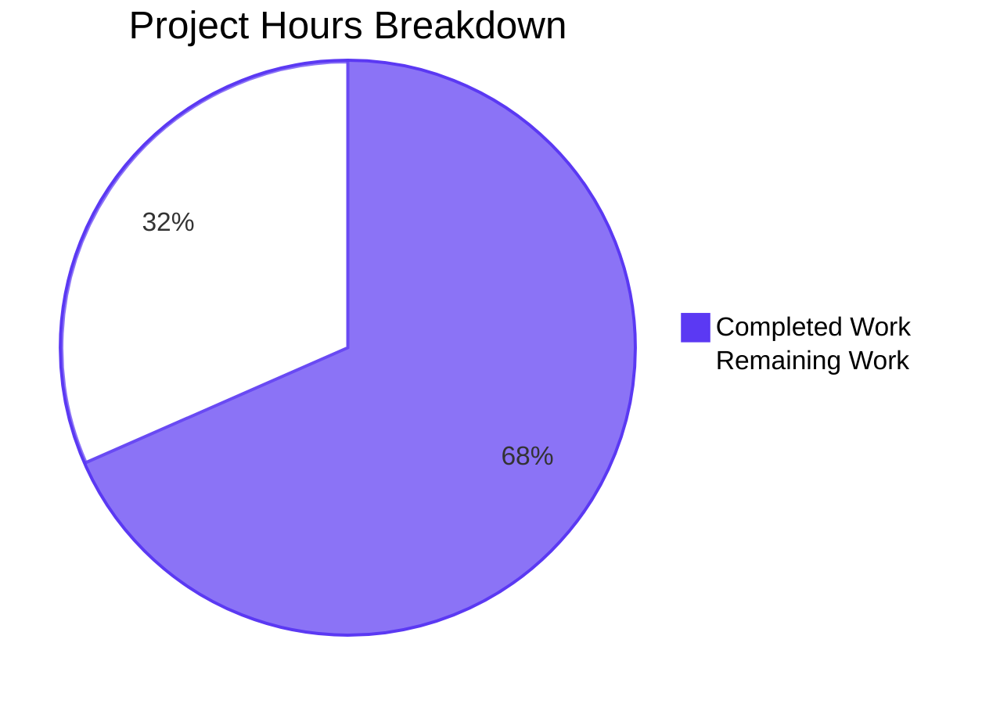
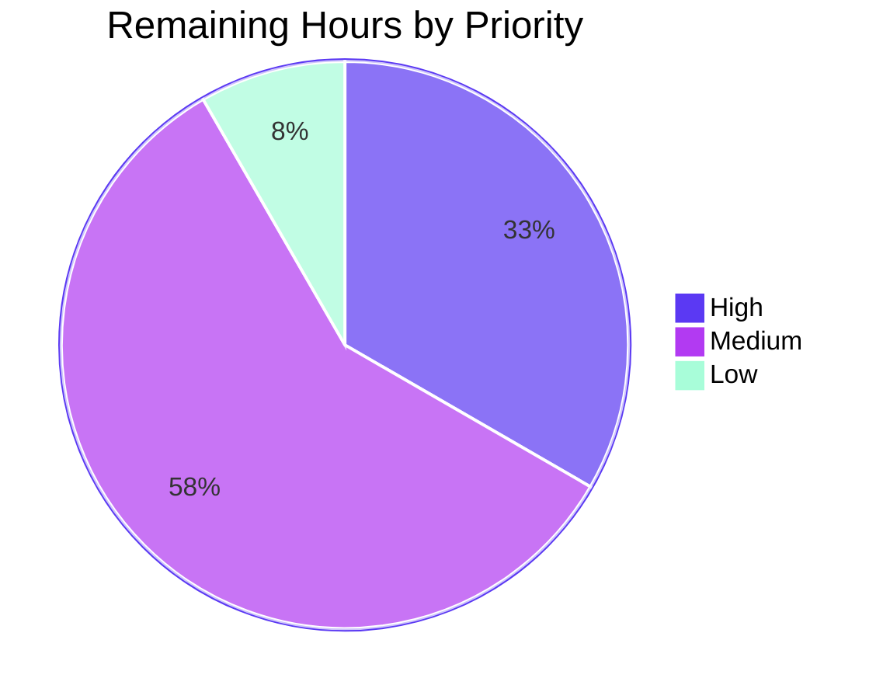

# 1. Executive Summary

## 1.1 Project Overview

A zero-dependency Node.js HTTP fixture gained one route and a supervisor. Its single request listener now answers the exact path `/status` with a static JSON body and keeps the original plain-text greeting, byte for byte, for every other URL; a three-line PM2 config supervises the process, the manifest declares how to start it, and one ignore rule keeps an installed tree out of version control. Maintainers and automated probes gain a supervised HTTP endpoint with no new package, transport, build or container.

## 1.2 Completion Status

Four files at the repository root: two created (`ecosystem.config.js`, `.gitignore`), two modified (`server.js`, `package.json`), ten insertions and no deletions against baseline `a6f7f58`.



| Metric | Hours |
| --- | --- |
| Total Hours | 19 |
| Completed Hours (AI + Manual) | 13 |
| Remaining Hours | 6 |
| Percent Complete | 68% |

Calculation: 13 / 19 = 68.4%, reported as **68%**.

## 1.3 Key Accomplishments

- ✅ `/status` answers `200`, `application/json`, `Content-Length: 15` and `{"status":"ok"}` for eight HTTP methods.
- ✅ `HEAD /status` returns the same headers as `GET` with no body.
- ✅ Every other URL keeps the byte-identical `Hello, World!\n` across 17 variants.
- ✅ PM2 supervises one app named `hello_world`, including restart, recovery, stop and delete.
- ✅ `scripts.start` declared first; package identity and test placeholder preserved verbatim.
- ✅ One ignore rule; the lockfile stays tracked and byte-identical to the baseline.
- ✅ Empty dependency graph; the fixture runs with nothing installed.
- ✅ Zero comments in all four files; repository formatting preserved.

## 1.4 Critical Unresolved Issues

0 of the 6 scope items are incomplete. 11 items remain open, in five groups whose counts sum to that total.

| Issue | Impact | Owner | ETA |
| --- | --- | --- | --- |
| **Product decisions left open (3):** the manifest's `main` still names the absent `index.js`; `/status` variants (trailing slash, query, case, percent-encoding) return the greeting; the supervised process binds loopback only | A consumer honouring `main`, or addressing a variant path, gets a failure or the greeting; the supervised endpoint is reachable from its host alone | Repository owner | Before the next change to the listener |
| **Accepted maintenance caveats (2):** the declared length is a literal coupled to the body at `server.js:9-10`; `HEAD /` omits the 14-byte length that `HEAD /status` now sends | A future edit to one line without the other truncates or hangs `/status`; a HEAD-based client sees an asymmetry between the two routes | Maintainer of `server.js` | On the next edit of the branch |
| **Operating constraints (3):** port 3000 is a fixed literal, so one instance runs host-wide and a held port leaves the supervised app `errored` until a manual restart; the PM2 launch resolves against the invoking directory; the fixed app name collides on a shared daemon | Concurrent starts fail; a launch from another directory fails with `Script not found`; a same-named app on a shared daemon is restarted rather than refused | Operator | Documented; applies to every run |
| **Standing verification gap (1):** no test runner, linter, type check or CI exists or may be added | Nothing catches a future drift in either response contract; the checks in Section 3 are manual | Repository owner | Before the next change |
| **Technical specification wording (2):** the sizing clause states four added lines / eighteen total, and the length-header statement claims the branch needs none | The record disagrees with the code that ships; the second claim holds for GET only | Repository owner | With the next specification edit |

## 1.5 Access Issues

No access issues identified: no credential, secret, registry account, external service or environment variable is required, `server.js` reads no `process.env` and the manifest declares no dependency. The loopback port and the shared PM2 daemon are host resources rather than access-controlled ones.

| System/Resource | Type of Access | Issue Description | Resolution Status | Owner |
| --- | --- | --- | --- | --- |
| None outstanding | — | No credential, secret, registry, service account or network path is required by this project | N/A | — |

## 1.6 Recommended Next Steps

1. **[High]** Reconcile the specification's sizing clause and length-header statement with the delivered code.
2. **[High]** Run the documented acceptance sequence on the target host and record the operating constraints.
3. **[Medium]** Add a regression harness for both response contracts.
4. **[Medium]** Settle the three open questions and re-verify after any change.
5. **[Low]** Decouple the declared response length from the body literal.

# 2. Project Hours Breakdown

## 2.1 Completed Work Detail

Every row traces to a requirement in the agreed scope and to evidence a reader can open — a file and line, a commit, or a check in Section 3.

| Component | Hours | Description |
| --- | --- | --- |
| `/status` route, response contract and HEAD parity (`server.js:7-11`) | 4.0 | Exact-path guard, JSON content type, explicit length and serialised body; contract established across eight HTTP methods, header-set parity between HEAD and GET, and keep-alive framing under the declared length |
| Greeting fall-through preservation (`server.js:12-14`) | 1.5 | Byte-identical `200`/`text/plain`/`Hello, World!\n` proven for 17 lookalike, cased, slashed and percent-encoded URLs and for a non-GET request on the greeting path |
| PM2 supervision (`ecosystem.config.js`) | 2.0 | Three-line data module: one app, name matched to the package, script resolved by path; lifecycle proved through start, restart, abrupt kill with automatic recovery, stop and delete |
| Manifest start script (`package.json:7`) | 0.5 | `"start": "node server.js"` as the first `scripts` entry, with identity, key order and the test placeholder preserved verbatim |
| Ignore rule and version-control hygiene (`.gitignore`) | 0.5 | Single `node_modules/` rule, enforcement proven for nested paths, and the lockfile confirmed to stay tracked and visible |
| Zero-dependency and lockfile posture | 1.5 | Empty declared and resolved dependency graph, no installed tree at any point, `package-lock.json` byte-identical to the baseline before and after every run |
| Static gates, comment and format discipline, forbidden-artefact closure | 1.5 | Compile of both scripts and parse of both manifests, comment census, line and size counts, and a tree sweep confirming no test, lint, format, CI, container or documentation artefact |
| Runtime launch, bind and readiness behaviour, operator acceptance evidence | 1.5 | All three launch paths serving identical payloads, loopback-only bind, exactly one readiness line per start, port conflict refused cleanly, port released on stop |
| **Total** | **13.0** | |

## 2.2 Remaining Work Detail

| Category | Hours | Priority |
| --- | --- | --- |
| Reconcile the technical specification with the delivered code (sizing clause and length-header statement) | 1.0 | High |
| Owner acceptance run of the documented operator sequence on the target host, with the operating constraints recorded beside it | 1.0 | High |
| Regression protection for the two response contracts — a harness that keeps the status payload and the greeting fixed | 2.0 | Medium |
| Settlement of the three open questions (manifest `main` target, status-path variants, bind scope) | 1.5 | Medium |
| Decouple the declared response length from the body literal so the two cannot desynchronise | 0.5 | Low |
| **Total** | **6.0** | |

Completed 13.0 hours + remaining 6.0 hours = **19.0 total hours**; 13.0 / 19.0 = **68% complete**.

## 2.3 Estimation Basis and Confidence

Hours are counted for work the agreed scope and the path to production call for, and for nothing else. Three exclusions are deliberate: the by-design absences the scope forbids (authentication, TLS, security headers, CORS, rate limiting, request logging, health endpoints, environment handling, a test suite, a linter, CI, containers, documentation) are decisions, not outstanding effort; the empty harness capture directories in the checkout are not deliverables; and the six pre-existing specification requirements the new path narrows are owner-authorised, so restating them is a wording task already counted in the first row of Section 2.2, not new engineering.

Confidence is high for the completed hours: every row is backed by a file the reader can open and a check that was executed, and the code volume is small enough to read in full. Confidence in the remaining estimate is medium: the acceptance run and the specification edit are well bounded, while the regression harness could cost more if it has to run without adding a test runner to the delivered package, and the three open questions may each expand into implementation once decided.

# 3. Test Results

Everything below was executed in this checkout at commit `9036b10` on Node v22.23.5, npm 11.21.0 and PM2 7.1.2. Totals across the seven categories: **111 checks executed, 111 passed, 0 failed**. There is no coverage tool in this project — no runner, no linter, no instrumentation — so coverage is reported as not measured rather than estimated.

| Area / Category | Framework | Tests | Passed | Failed | Coverage | What This Proves |
| --- | --- | --- | --- | --- | --- | --- |
| Compile and manifest gates | `node --check`, `JSON.parse` | 4 | 4 | 0 | Not measured — no coverage tool configured | Both tracked scripts compile and both JSON files parse, so the tree is loadable as delivered |
| Source-contract assertions | Shell assertions over the tree and `git` history | 27 | 27 | 0 | Not measured | Every value the scope fixes is present and unmodified: exact-path guard, JSON type, declared length, body literal, single built-in import, bind literals, single start script, preserved identity, one-line ignore rule, line and size counts, and the four-path, ten-insertion, no-deletion delta with the lockfile and README byte-identical |
| `/status` contract across methods | `curl` and raw sockets | 34 | 34 | 0 | Not measured | For GET, HEAD, POST, PUT, PATCH, DELETE, OPTIONS and TRACE: `200`, one `application/json` header, `Content-Length: 15`, the exact 15-byte body, a zero-length HEAD body, HEAD/GET header-set equality and no server banner or cookie |
| Greeting fall-through and exact-path boundary | `curl` | 18 | 18 | 0 | Not measured | Every URL that is not exactly `/status` — 17 variants including cased, slashed, percent-encoded and traversal-shaped forms, plus a POST on the greeting path — still returns `200`, `text/plain` and the byte-identical 14-byte greeting; no request returned 404 or any non-200 status |
| Input independence and message framing | `curl` with crafted headers and a raw-socket pipeline | 2 | 2 | 0 | Not measured | No request data is reflected into the body or any response header, and pipelined HEAD-then-GET on one connection yields two framed responses under the declared length |
| Launch paths and listener lifecycle | `node`, `npm`, PM2, `curl`, `ss` | 20 | 20 | 0 | Not measured | `node server.js`, `npm start` and the supervised app all serve identical payloads; one readiness line per start; the listener binds loopback only; a second binder exits non-zero on `EADDRINUSE` without disturbing the running instance; restart, abrupt kill with automatic recovery, stop and delete leave nothing behind |
| Dependency and version-control posture | `npm ls`, `npm test`, `git check-ignore`, `sha256sum` | 6 | 6 | 0 | Not measured | Empty dependency graph, the preserved `npm test` placeholder exits 1 as designed, the ignore rule enforces for nested paths, the lockfile stays tracked and byte-identical, and the working tree is clean after every run |

**Not Covered.** The capabilities below were delivered or relied upon but are not exercised by any automated check, and nothing here runs automatically at all — there is no test runner, linter, type check or CI pipeline in the project, and the checks above are manual. Before release, a human should:

- **Re-run the two response contracts after any edit.** No automated guard exists, so a change to `server.js` is caught only by repeating the `/status` and greeting checks in Section 9.
- **Exercise a real package install.** No `npm install` was run, because it would create `node_modules/` and rewrite the lockfile, both outside this change; dependency-free startup is proven, the install path is not.
- **Confirm supervision on the target host.** The supervised lifecycle was exercised here, but the fixed port, the shared daemon and the fixed application name behave differently on a host that runs other copies of this fixture.
- **Verify automatic recovery under the operator's own PM2 daemon.** Recovery after an abrupt kill was observed here; a daemon configured with different defaults is unverified.
- **Exercise the startup failure path.** A held port produces an unhandled `error` event and a non-zero exit; that behaviour was observed but is not covered by any check, and no readiness probe exists to distinguish a running process from a serving one.
- **No browser, DOM, accessibility, visual or performance surface exists to test** — responses are plain text and JSON from a built-in handler. **No authentication, session, data store or external integration exists to test** either.

# 4. Runtime Validation & UI Verification

The project has no user interface: every response is plain text or JSON produced by a built-in `http` handler, there is no HTML, stylesheet, client script or DOM, so no browser, visual, responsive or accessibility validation applies. What was driven instead is the service itself, on its literal loopback port, through each of its three launch paths.

- ✅ **Start-up and bind** — `node server.js` prints exactly one 41-byte readiness line and binds `127.0.0.1:3000`; nothing is written to stderr.
- ✅ **`/status` contract** — GET, HEAD, POST, PUT, PATCH, DELETE, OPTIONS and TRACE each answer `200`, `application/json`, `Content-Length: 15` and the exact 15-byte `{"status":"ok"}`.
- ✅ **HEAD parity** — `HEAD /status` returns `200` with a header set identical to GET (Date excluded) including `Content-Length: 15`, and a zero-length body.
- ✅ **Greeting fall-through** — `/`, `/status?x=1`, `/status/`, `//status`, `/statuses`, `/STATUS`, `/status%20`, `/health`, `/metrics` and eight further variants all return `200`, `text/plain` and the byte-identical 14-byte greeting; no 404 anywhere.
- ✅ **Input independence** — a probe header, cookie and `Accept: text/html` on `/status` leave the body and headers unchanged; nothing is echoed.
- ✅ **Framing and connection reuse** — HEAD then GET pipelined on one socket produce two framed `200` responses with two declared lengths and one intact body.
- ✅ **`npm start`** — npm banner, `> node server.js`, exactly one readiness line, both payloads served, port released on stop.
- ✅ **PM2 supervision** — one app named `hello_world`, online in fork mode with `pm_exec_path` at the repository's `server.js` and `pm_cwd` at the repository root; restart returns it serving, an abrupt `kill -9` is recovered automatically, `stop` releases the port and `delete` removes it.
- ✅ **Port conflict** — a second `node server.js` exits non-zero with `EADDRINUSE` while the first instance keeps serving; started under supervision with the port held, the app reaches an `errored` state after 15 restart attempts and records the conflict in its error log rather than serving on another port.
- ✅ **Repository posture after every run** — working tree clean, `package-lock.json` and `README.md` byte-identical to the baseline, no `node_modules`, nothing left listening.

**Never exercised at runtime.** No package install was performed, so the install flow and any resolution behaviour are unverified; the fixture runs without one. No authentication, session, data store, message queue or outbound call exists, so no such integration was driven. The supervisor's behaviour was observed only under this host's daemon and its defaults, not under an operator-specific PM2 configuration. And the acceptance sequence has not been run on the target host alongside other copies of the fixture, where the fixed port, the shared daemon and the fixed application name interact differently.

# 5. Compliance & Quality Review

## 5.1 Compliance Matrix

| # | Deliverable | Benchmark | Status | Evidence |
| --- | --- | --- | --- | --- |
| 1 | `/status` guarded branch | Functional correctness | ✅ PASS | `server.js:7-11`; guard present once and returns before the greeting statements |
| 2 | `/status` response contract for any method | Interface compliance | ✅ PASS | 34 checks across eight methods: status, single JSON content type, declared length 15, exact body |
| 3 | HEAD header parity | Protocol conformance | ✅ PASS | Header sets equal to GET with Date excluded; zero-length body |
| 4 | Greeting preserved for every other URL | Backward compatibility | ✅ PASS | 18 checks over 17 URL variants plus a non-GET on the greeting path; byte-identical 14-byte body |
| 5 | PM2 supervision | Operability | ✅ PASS | Three-line module, one app, name matched to the package, full lifecycle including automatic recovery |
| 6 | Manifest start script and identity preservation | Packaging integrity | ✅ PASS | `"start": "node server.js"` first in `scripts`; name, version, description, `main`, author, licence and the test placeholder verbatim |
| 7 | Ignore rule and lockfile integrity | Repository hygiene | ✅ PASS | Single `node_modules/` rule enforced for nested paths; lockfile tracked and byte-identical to the baseline |
| 8 | Zero-dependency posture | Dependency governance | ✅ PASS | No dependency, engine or type key; `npm ls --depth=0` reports an empty tree; runs with nothing installed |
| 9 | Forbidden-artefact closure | Scope discipline | ✅ PASS | No test, lint, format, CI, container or documentation artefact; README untouched |
| 10 | Comment and formatting discipline | Code style | ✅ PASS | Zero comment lines in both scripts; two-space indent, single quotes, semicolons, JSON key order preserved |
| 11 | Size budget for `server.js` | Change discipline | ⚠ PARTIAL | Five added lines / nineteen total against a stated four / eighteen; every other file meets its budget exactly |
| 12 | Operator acceptance evidence | Release readiness | ✅ PASS | All documented steps reproduce: readiness line, both payloads, header parity, supervised lifecycle |

## 5.2 AAP & Rule Divergences and Gaps

No user-specified rules exist for this work, so there are no user-rule divergences. Four divergences from the agreed scope were identified. Three need action from the owner — two corrections to the record and one restatement of requirements the request sanctioned — and one needs none. All four concern the size of the change and the accuracy of the record, never the behaviour of the service, which matches the agreed contract in every respect.

| What the AAP/Rule Required | What Was Delivered Instead | Why It Diverged | Impact | Remediation |
| --- | --- | --- | --- | --- |
| `server.js` budget: "4 added lines, total 18" | 5 added lines, 19 total (`server.js:9` sets `Content-Length: 15` explicitly); 0 comments and all other style clauses met | Another requirement in the same scope states that a HEAD response carries the same headers as GET. Node emits no `Content-Length` for a suppressed HEAD body, so the four-line form cannot satisfy both statements | None behavioural; one line over a change-size budget, no other file affected | Nothing required to ship. To restore the budget literally, restate it as five added lines / nineteen total |
| The branch carries no length header of its own | An explicit `Content-Length: 15` before `res.end` | Same cause: the statement holds for GET only. Verified behaviour: GET returns 15 bytes either way, HEAD returns none without the header | The specification's statement is stale for HEAD; a reader who acted on it would break HEAD parity while every GET check still passed | One-line correction to the statement, best made with the sizing clause above |
| No background process and no port binding during implementation | The service was started on its loopback port and driven over HTTP to establish wire-level behaviour, then stopped; port released, supervised app deleted, tree clean | Header parity on HEAD, message framing under a declared length and byte-identical greetings cannot be established by reading source | None residual — nothing was left running and no artefact was produced | None. The operator acceptance run in Section 2.2 re-establishes the same evidence on the target host |
| Six pre-existing specification requirements: F-002-RQ-001, F-002-RQ-002, F-002-RQ-004, F-004-RQ-004, F-006-RQ-002, §1.3.3 — **Sanctioned** | Each is narrowed or falsified by the new path: `/status` now returns JSON, the handler reads `req.url`, a start script is declared, and the tracked-file set moved by four paths | The change request itself authorises these departures; the requirements were written before the path existed | Each requirement now holds for every path other than `/status`, or has different evidence | Restate each requirement in the specification as part of the same documentation edit |

**Size budget (`server.js:9`).** The sizing clause is the one place where the delivered code does not match the agreed scope: five added lines and nineteen in total against a stated four and eighteen. The fifth line is `res.setHeader('Content-Length', 15);`. Node marks a response to a HEAD request bodyless and derives a length only while sending a body chunk, so a four-line branch cannot make HEAD's headers identical to GET's — which the same document requires. The owner must either accept five lines as the budget or restate it; nothing in the code needs to change for release.

**Length-header statement.** The same fifth line contradicts a second statement in the record, that the branch needs no length header of its own. That is true for GET and false for HEAD, where the body is suppressed before any length can be derived. The consequence is not academic: a reader who trusted the statement and removed the line would break HEAD parity while every GET check continued to pass, and nothing automated exists to catch it. Closing it is a one-line correction, best made in the same edit as the sizing clause.

**Binding a port during implementation.** The service was run while this change was built and verified so that wire-level behaviour could be observed — header parity on HEAD, framing under a declared length, and byte-identical greetings cannot be established by reading source. Nothing was left behind: the port was released, the supervised app was deleted, and the working tree was clean afterwards, with the lockfile and README byte-identical to the baseline. No action is required beyond the operator acceptance run already counted in Section 2.2.

**Six narrowed specification requirements.** F-002-RQ-001 and F-002-RQ-002 hold that every request, regardless of path or method, returns `text/plain`; F-002-RQ-004 that request data is never read; F-004-RQ-004 that `npm start` works although no start script is declared; F-006-RQ-002 that the tracked-file set matches the baseline with zero drift; and §1.3.3 that routing, JSON serialisation and observability endpoints are absent by design. The request that produced this change authorises each departure, so they are sanctioned rather than defects. Closing them is documentation work: restate each as holding for every path other than `/status`, or as having different evidence.

# 6. Risk Assessment

Risks below are forward-looking — what could still go wrong once this is in use. Nothing already settled during delivery appears here. Integration risk is nil and is therefore absent from the table: the fixture declares no dependency, opens no outbound connection, reads no data store and calls no external service, so there is nothing to integrate, mock or provision.

| Risk | Category | Severity | Probability | Mitigation | Status |
| --- | --- | --- | --- | --- | --- |
| The declared `Content-Length: 15` is a literal coupled to the body at `server.js:9-10`; editing one without the other truncates the response or hangs the client | Technical | High | Low | Derive the length from the payload, or treat the two lines as one edit; the regression harness in Section 2.2 would catch it | Open — accepted |
| No test runner, linter, type check or CI exists, so a change that compiles but misbehaves reaches the host undetected | Technical | Medium | Medium | Add the minimal harness for both response contracts before the next edit | Open |
| Port `3000` is a fixed literal with no override: one instance runs host-wide, and a held port leaves the supervised app `errored` after repeated bind attempts, recoverable only by a manual restart or delete | Operational | Medium | High | Stop any direct instance before starting under supervision; probe the port rather than trusting process status | Open — by design |
| The PM2 `script` is a relative path resolved against the invoking directory, so launching the config from elsewhere fails with `Script not found` and registers no app | Operational | Medium | Medium | Always launch from the repository root; `npm start` is directory-independent because npm sets the script's working directory | Documented |
| The fixed application name is host-global on a shared daemon: starting a second app of that name restarts the owner's process instead of failing | Operational | Medium | Medium | Confirm the name is absent before starting and delete it immediately after | Documented |
| Loopback is the only access control: no TLS, no security headers, no CORS policy and no rate limiting | Security | High | Low | Keep the bind on the loopback interface; add a terminator with TLS, headers, CORS and rate limiting before any wider exposure | Accepted — by design |
| No request logging, and the shared log sinks are not rotated, so an abusive or failing client leaves no audit trail and a bind-failure storm grows the error log without bound | Operational | Low | High | Monitor sink size and add log rotation before running on a shared host | Open |
| The listener has no `'error'` handler, so a bind failure terminates the process with a stack trace and restart churn rather than a controlled message | Technical | Low | Medium | Rely on the documented launch ordering; treat a non-serving process as a failed start rather than a healthy one | Accepted |

# 7. Visual Project Status

Completed work (dark blue) against remaining work (white), on the same 19-hour basis used in Sections 1.2 and 2.2.


The 6 remaining hours by priority: High 2.0 (specification alignment and the owner acceptance run), Medium 3.5 (regression protection and the three open questions), Low 0.5 (length hardening).



| Remaining Category | Hours | Priority |
| --- | --- | --- |
| Specification alignment | 1.0 | High |
| Owner acceptance run | 1.0 | High |
| Regression protection | 2.0 | Medium |
| Open-question decisions | 1.5 | Medium |
| Length hardening | 0.5 | Low |
| **Total** | **6.0** | |

# 8. Summary & Recommendations

The project delivers exactly the change it was scoped to: one new path on an existing built-in HTTP listener, a supervisor for that process, a declared start command and a single ignore rule, across four files at the repository root with ten insertions and no deletions. `server.js` answers `/status` with `200`, `application/json`, `Content-Length: 15` and the byte-exact body `{"status":"ok"}` for every method — HEAD included, with a header set identical to GET — and keeps its original plain-text greeting, byte for byte, for every other URL. `ecosystem.config.js` supervises the same entry file under the package's own name, `package.json` declares how to start it, and `.gitignore` keeps an installed dependency tree out of version control without masking the lockfile.

It was exercised, not merely read. 111 checks across seven categories all pass: compile and parse gates, 27 source-contract assertions, a 34-check method matrix over `/status`, 18 fall-through checks over lookalike and encoded URLs, framing checks over a reused connection, 20 launch and lifecycle checks spanning `node server.js`, `npm start` and the supervised process, and 6 dependency and version-control checks. The dependency graph is empty, the lockfile and README are byte-identical to the baseline, and the working tree is clean after every run.

**AAP-scoped completion is 68%** — 13 completed hours out of 19. The gap is not missing code: every one of the six items in the agreed scope is present and verified. The 6 remaining hours are owner-side work the code cannot do for itself — a one-hour documentation edit to reconcile the specification's sizing clause and its length-header statement with what ships, a one-hour acceptance run of the documented operator sequence on the target host, two hours to add the regression protection the project otherwise lacks, 1.5 hours to settle the three questions the scope deliberately left open, and half an hour to decouple the declared length from the body literal.

Success for the next release means four measurable things: the specification and the code agree on the change's shape; the acceptance sequence passes on the target host in the documented order; a regression in either response contract is caught by something other than a person reading `server.js`; and the three open questions have answers recorded next to the code rather than in a conversation. None of the four is a redesign.

**Production readiness: ready for its intended use, with named caveats.** This is a loopback-only fixture under process supervision, not a public service, and on that definition it is complete and clean — its security posture is sound, it is zero-dependency, it exposes no secret, reflects no request data and leaks no internal detail to clients. It is not ready to leave the loopback interface: it has no TLS, no security headers, no CORS policy, no rate limiting, no audit trail and no readiness probe, and the fixed port and fixed application name make it a single-instance, host-scoped service. Treat the two High-priority rows in Section 2.2 as the gate before the next change touches the listener.

# 9. Development Guide

Every command below was executed against this repository before publication; the expected output shown is the output observed.

### System prerequisites

- **Node.js v22.23.5** — the only runtime. The repository declares no `engines` field and no `.nvmrc`, so any Node capable of the built-in `http` module and `res.setHeader` will run it; the version above is what was verified.
- **npm 11.21.0** — used only to run the declared start script and to inspect the dependency graph.
- **PM2 7.1.2** — optional, required only for supervised operation.
- `curl`, `ss` (iproute2) and `git` for the verification steps. No database, message queue, container runtime or external service is involved.

### Environment setup

There is nothing to configure. `server.js` reads no `process.env`, the manifest declares no dependency, and no credential, secret, endpoint or certificate is used. The bind address and port are literals in the source (`server.js:3-4`), so no environment variable can change them.

### Dependency installation

**Install nothing.** `package.json` has no dependency, devDependency, peerDependency or optionalDependency key, and `package-lock.json` resolves zero packages (`lockfileVersion` 3 with a single root entry). Running `npm install` would create `node_modules/` and rewrite the lockfile, both of which this change deliberately avoids.

```bash
# Confirm the posture rather than installing anything
npm ls --depth=0          # expected: hello_world@1.0.0 └── (empty)
```

### Application startup

Run from the repository root, in this order.

```bash
# 1. Compile and parse gate — no output, exit 0
node --check server.js
node --check ecosystem.config.js
node -e "JSON.parse(require('fs').readFileSync('package.json','utf8'))"

# 2. Start directly
node server.js
# expected, one line only:
# Server running at http://127.0.0.1:3000/

# 3. Or start through the manifest (Ctrl-C to stop; identical behaviour)
CI=true npm start
# expected:
# > hello_world@1.0.0 start
# > node server.js
# Server running at http://127.0.0.1:3000/
```

Stop a direct run with `Ctrl-C` — or, if it was started in the background, by signalling the PID that owns the port — before starting under PM2. The port is a literal, so two instances cannot coexist:

```bash
ss -ltnp | grep ':3000'                       # identify the current owner
kill "$(ss -ltnp | grep ':3000' | sed 's/.*pid=\([0-9]*\).*/\1/')"
ss -ltn | grep ':3000' || echo "port free"
```

### Verification steps

```bash
# The new route: status line, headers, exact body
curl -si http://127.0.0.1:3000/status
# expected:
# HTTP/1.1 200 OK
# Content-Type: application/json
# Content-Length: 15
# ... Date, Connection, Keep-Alive ...
#
# {"status":"ok"}

# HEAD carries the same headers and no body
curl -sI http://127.0.0.1:3000/status
# expected: 200, application/json, Content-Length: 15, no body

# The pre-existing greeting, unchanged, for every other path
curl -s http://127.0.0.1:3000/                 # Hello, World!
curl -s http://127.0.0.1:3000/status/          # Hello, World!   (exact-path boundary)
curl -s 'http://127.0.0.1:3000/status?x=1'     # Hello, World!   (query is not the path)

# The listener is loopback-only
ss -ltnp | grep ':3000'
# expected: LISTEN ... 127.0.0.1:3000 ...
```

### Supervision with PM2

```bash
# Only launch when the name is free and the port is free
pm2 list | grep -q hello_world || echo "name free"
ss -ltn | grep -q ':3000' || echo "port free"

pm2 start ecosystem.config.js     # expected: App [hello_world] launched (1 instances)
pm2 logs hello_world --lines 3    # expected: Server running at http://127.0.0.1:3000/
curl -s http://127.0.0.1:3000/status
pm2 restart hello_world           # returns online and serving; restart counter increments
pm2 stop hello_world              # port released; requests then fail to connect
pm2 delete hello_world            # removed from the process list
```

The config resolves `./server.js` against the directory you launch from, so run `pm2 start ecosystem.config.js` from the repository root. The application name is fixed by the config, so on a shared daemon confirm `pm2 list` shows no `hello_world` first and delete it immediately after — `--name` does not override a name declared in the file.

### Example usage

```bash
# A client that sizes the payload with HEAD and then fetches it
curl -sI http://127.0.0.1:3000/status | grep -i content-length   # Content-Length: 15
curl -s  http://127.0.0.1:3000/status | wc -c                    # 15
curl -s  http://127.0.0.1:3000/status | od -c                    # { " s t a t u s " : " o k " }
```

### Troubleshooting

| Symptom | Cause | Resolution |
| --- | --- | --- |
| `Error: listen EADDRINUSE: address already in use 127.0.0.1:3000` and a non-zero exit | Another process owns the literal port; the listener has no `'error'` handler, so Node prints its stack and exits | Stop the other instance (`ss -ltnp \| grep :3000` for its PID) before starting this one |
| `[PM2][ERROR] Error: Script not found: <dir>/server.js` | `pm2 start` was run from a directory other than the repository root, so the relative `script` did not resolve | Re-run from the repository root, or use `npm --prefix <repo> start` |
| A PM2 app shows `errored` with a rising restart counter | The port was held during startup; with the default restart policy the app keeps failing and will not recover on its own when the port frees | `pm2 restart hello_world` (or `pm2 delete hello_world` and start again) once the port is free |
| `pm2 list` shows the app `online` but requests fail | `online` reflects the process, not the listener | Probe `http://127.0.0.1:3000/status`; the only readiness signal the app emits is its single startup line |
| `npm test` prints `Error: no test specified` and exits 1 | The manifest carries npm's placeholder test script, preserved deliberately; the project has no test suite | Do not use `npm test` as a gate. Use the compile/parse gate shown above |
| `wc -l package.json` reports 11 lines | The file has no final newline, as at the baseline commit | Not a defect; the file has 12 content lines. Do not add a newline — it would show as a change to a line this work does not own |
| A second supervised app of the same name replaces the first | The config declares a fixed name, and PM2 restarts an existing app rather than refusing the start | Confirm the name is absent before starting; use one instance per host |

# 10. Appendices

## A. Command Reference

| Purpose | Command | Expected result |
| --- | --- | --- |
| Compile the entry file | `node --check server.js` | Exit 0, no output |
| Compile the supervisor config | `node --check ecosystem.config.js` | Exit 0, no output |
| Whole-package gate | `node --check server.js && node -e "JSON.parse(require('fs').readFileSync('package.json','utf8'))"` | Exit 0, no output |
| Start directly | `node server.js` | One line: `Server running at http://127.0.0.1:3000/` |
| Start through the manifest | `CI=true npm start` | npm banner, then the same single line |
| Start under supervision | `pm2 start ecosystem.config.js` | `App [hello_world] launched (1 instances)` |
| Inspect the supervised log | `pm2 logs hello_world --lines 3` | The startup line, prefixed by PM2 |
| Restart / stop / remove | `pm2 restart hello_world`, `pm2 stop hello_world`, `pm2 delete hello_world` | Online and serving; port released; entry removed |
| Fetch the new route | `curl -si http://127.0.0.1:3000/status` | `200`, `application/json`, `Content-Length: 15`, body `{"status":"ok"}` |
| Fetch the greeting | `curl -s http://127.0.0.1:3000/` | `Hello, World!` |
| Check the listener | `ss -ltnp \| grep ':3000'` | One listener on `127.0.0.1:3000` |
| Confirm the dependency graph | `npm ls --depth=0` | `hello_world@1.0.0` with an empty tree |
| Confirm the ignore rule applies | `git check-ignore -v --no-index node_modules/pkg/index.js` | `.gitignore:1:node_modules/` |
| Confirm the lockfile is not ignored | `git check-ignore -v --no-index package-lock.json` | No match, exit 1 — the lockfile stays tracked |
| List the declared scripts | `npm pkg get scripts` | `start` and `test` only |

## B. Port Reference

| Port | Interface | Protocol | Purpose | Notes |
| --- | --- | --- | --- | --- |
| 3000 | `127.0.0.1` | HTTP/1.1, plaintext | The only listener the application opens | Fixed literal in `server.js:4`; cannot be overridden by an environment variable; one instance per host; outbound use of the same port is unrelated |

## C. Key File Locations

| Path | Lines | Role |
| --- | --- | --- |
| `server.js` | 19 | Entry point and the single HTTP request listener: the `/status` JSON branch and the greeting fall-through |
| `ecosystem.config.js` | 3 | PM2 supervision: one app named `hello_world` running `./server.js` |
| `package.json` | 12 content lines | Package identity, `scripts.start` and the preserved test placeholder; no dependency key |
| `package-lock.json` | 13 | Lockfile at `lockfileVersion` 3 with a single root entry and zero resolved packages; byte-identical to the baseline |
| `.gitignore` | 1 | The single rule `node_modules/` |
| `README.md` | 2 | Pre-existing project note, untouched |

## D. Technology Versions

| Component | Version verified | Declared in the repository |
| --- | --- | --- |
| Node.js | v22.23.5 | Nothing — no `engines` field, no `.nvmrc` |
| npm | 11.21.0 | Nothing |
| PM2 | 7.1.2 | Nothing — the operator's own CLI, not a package of this project |
| Module system | CommonJS | No `type` field in the manifest |
| Lockfile format | `lockfileVersion` 3 | `package-lock.json:4` |
| Application dependencies | None | No dependency key exists, and none may be added within this scope |

## E. Environment Variable Reference

| Variable | Read by the application | Purpose |
| --- | --- | --- |
| — | None | `server.js` contains no `process.env` reference. `CI=true` is used only to keep npm non-interactive when running `npm start`, and is consumed by npm, not by the application. The bind address and port are literals and ignore inherited values such as `PORT` and `HOST`. |

## F. Developer Tools Guide

| Tool | Use in this project |
| --- | --- |
| `node --check` | The only static gate the project has: it compiles both scripts without binding a port or running any code |
| `curl` | Drives every runtime check — status line, headers, exact byte counts and the fall-through paths |
| `ss` (`iproute2`) | Confirms the listener exists on `127.0.0.1:3000` only, and that the port is released after a stop |
| `pm2` | Supervises the process and captures its single startup line; also the source of the `errored` state after a port conflict |
| `git check-ignore` | Proves the ignore rule enforces for nested paths and does not mask the lockfile |
| `sha256sum` | Proves `package-lock.json` and `README.md` remain byte-identical to the baseline |
| `od -c` / `wc -c` | Proves exact payload bytes: 15 for the JSON body, 14 for the greeting, 41 for the readiness line |

## G. Glossary

| Term | Meaning in this project |
| --- | --- |
| Exact-path boundary | The route matches `req.url` against the literal `/status` only; a query string, trailing slash, different case or percent-encoding falls through to the greeting |
| Fall-through | The three statements after the guard that produce the plain-text greeting for every URL the guard does not match |
| Header parity | HEAD and GET on `/status` returning the same set of headers (Date excluded), which requires the length to be declared explicitly because Node sends no length for a suppressed HEAD body |
| Declared length | The `Content-Length: 15` header set in the branch, whose value is the byte length of `{"status":"ok"}` |
| Readiness line | The single line the process writes to stdout at startup, `Server running at http://127.0.0.1:3000/` |
| Supervised instance | The process started by PM2 from `ecosystem.config.js` rather than directly |
| Legacy disposition | The rule that every URL other than `/status` keeps its response byte for byte |
| Lockfile byte-identity | `package-lock.json` being identical to the baseline commit, proving no install ran and no dependency changed |
