# Technical Specification

# 1. Introduction

## 1.1 Executive Summary

This repository holds a deliberately minimal Node.js program whose entire implementation is four tracked files and 39 lines of content. The npm manifest declares the project as `hello_world` version `1.0.0`, described as "Hello world in Node.js", authored by `hxu` and licensed MIT (`package.json`). The single executable artifact, `server.js`, is a CommonJS script that requires only the Node.js built-in `http` module, creates one `http.Server`, binds it to the hard-coded address `127.0.0.1:3000`, and answers every request with status `200`, header `Content-Type: text/plain`, and the 14-byte body `Hello, World!\n` (`server.js` lines 1-14).

**Overview.** The repository is a single-process HTTP fixture with no dependencies, no configuration layer, no routing, no persistence and no test suite. `package-lock.json` confirms the dependency posture: `lockfileVersion` 3 with a single `packages` entry for the root project and no resolved packages, integrity hashes or transitive tree. The working tree is clean on branch `QA-win-linux-env`, with `main` also present, and history is a single commit `a6f7f58` ("Add files via upload").

**Core business problem.** No requirements document, roadmap or acceptance criteria exist in the repository. The declared purpose appears only in `README.md`, whose two lines are a `# hao-backprop-test` heading and the sentence "test project for backprop integration. Do not touch!" Taken with the remote name `existing-projects-qa-16-nov` and the `QA-win-linux-env` branch, the repository addresses a validation problem rather than an end-user one: it supplies a disposable, deterministic target against which an external integration pipeline ("backprop") can confirm that it can ingest, start, address and observe a real Node.js HTTP service. Determinism is built in — the host, port, status, content type and body are literals, the request object is never read (`req` is accepted and ignored in `server.js` line 6), and nothing is fetched at runtime. Where `package.json` instead frames the project as a language sample ("Hello world in Node.js"), the two sources describe the same artifact for different audiences; the README's "Do not touch!" instruction governs how the fixture may be modified.

**Key stakeholders and users.**

| Stakeholder | Relationship to the system | Evidence |
|---|---|---|
| Backprop integration owners | Consume the repository as an integration fixture that their pipeline must handle end to end | `README.md` |
| QA and environment engineers | Validate the fixture across operating-system variants and branches | Branches `QA-win-linux-env` and `main`; remote `existing-projects-qa-16-nov` |
| Project author and maintainer | Own the identity and licence recorded in the manifest and the history of the repository | `package.json` author `hxu`; commit author `Sandeep01Kumar`, 2026-11-16 |
| Automated HTTP clients | The only runtime consumers of the service: anonymous, unauthenticated, any path or method | `server.js` request handler |

No end user, account holder, operator console or administrative role exists. Nothing in the repository authenticates, identifies or distinguishes a caller.

**Expected business impact and value proposition.**

- **Zero supply-chain surface.** The manifest declares no `dependencies`, `devDependencies` or `engines`, and the lockfile resolves no third-party packages, so dependency audits, licence scans and vulnerability checks have nothing to resolve.
- **Trivially assertable oracle.** Because the handler never inspects the request, every request produces byte-identical output; this was confirmed by requesting `/`, a non-existent path, and a `POST /` and receiving `200`, `text/plain` and a 14-byte body each time.
- **Isolation by construction.** The listener is bound to the loopback address only; a connection attempt to the host's routable interface on port 3000 was refused, so the fixture cannot be reached from another machine.
- **Negligible maintenance footprint.** There is no build step, no bundler, no transpilation, no configuration file and no package installation; the runtime requirement is the Node.js built-in `http` module, and the project starts with `node server.js` or with `npm start` through npm's implicit default script.
- **Stable baseline.** The "Do not touch!" instruction plus a single-commit history means the fixture produces no diff noise, making it usable as a control case when comparing pipeline behaviour.

The value is entirely instrumental. The system performs no business transaction, exposes no domain data, and has no customer-facing or revenue-bearing function; its contribution is confidence that an integration path works against a known-good Node.js service.


## 1.2 System Overview

### 1.2.1 Project Context

**Business context and market positioning.** The repository is an internal engineering asset, not a product. Nothing in the four tracked files markets, prices or publishes it: there is no `repository`, `keywords`, `private`, `publishConfig` or `bugs` field in `package.json`, and no usage, installation or API documentation in `README.md`. Its positioning is functional — the simplest possible member of a QA corpus of existing projects, as the remote name `existing-projects-qa-16-nov` and the purpose statement in `README.md` indicate — and the MIT licence permits unrestricted reuse of its four files.

**Current system limitations.** The repository supersedes nothing. There is no prior version, migration note or decommissioned component to account for: `version` is `1.0.0` and the entire history is one commit, `a6f7f58` ("Add files via upload"). The limitations that matter are those of the fixture itself, and each is verifiable in the source:

| Limitation | Evidence |
|---|---|
| No routing or 404 behaviour; every path returns the greeting | `GET /does-not-exist` returned `200` with a 14-byte body |
| HTTP method is ignored; no verb semantics | `POST /` returned `200`; `req` is never read (`server.js` line 6) |
| No configuration layer; host and port are literals | `server.js` lines 3-4 (`'127.0.0.1'`, `3000`) |
| No automated tests; the test script is an npm placeholder that always fails | `package.json` `scripts.test`; `npm test` exits 1 |
| Manifest entry point is missing from the repository | `package.json` `main: "index.js"`, no `index.js` present |
| No error handling, graceful shutdown, TLS or request logging | Absent from `server.js`; only `server.listen` with a success callback |

**Integration with the existing enterprise landscape.** Runtime integration is limited to one inbound socket and one stdout stream. There are no outbound calls: `server.js` requires only the built-in `http` module, and no file in the repository contains an HTTP client, database driver, queue client or telemetry exporter. The remaining touchpoints are development-time invocations of the Node.js runtime and the npm CLI.

| Interface | Direction | Behaviour as observed |
|---|---|---|
| HTTP/1.1 on `127.0.0.1:3000` | Inbound | Plaintext; any path and any method receive `200`, `Content-Type: text/plain`, body `Hello, World!\n` |
| stdout via `console.log` | Outbound | Exactly one line at startup: `Server running at http://127.0.0.1:3000/` |
| `npm start` / `node server.js` | Dev-time | Both start the listener; `npm start` works through npm's implicit default `node server.js` script |
| `npm test` | Dev-time | Runs `echo "Error: no test specified" && exit 1`; always fails by design |

The integration the repository is named for — the backprop integration asserted in `README.md` — is external to the checkout. No client, contract, schema or pipeline definition for it is present here, so this specification documents the fixture it targets, not the pipeline that consumes it.

### 1.2.2 High-Level Description

**Primary system capabilities.**

- **Fixed-address HTTP listener.** Binds `127.0.0.1:3000` at startup and stays available until the process is terminated.
- **Uniform greeting response.** Answers every request with a hard-coded status, content type and body, regardless of path, headers, method or payload.
- **Startup confirmation.** Emits a single interpolated log line to stdout once the listener is accepting connections.
- **Project identity and licence declaration.** Records name, version, description, author and MIT licence in `package.json` so the fixture is identifiable in tooling and audits.
- **Reproducible dependency posture.** `package-lock.json` pins `lockfileVersion` 3 with an empty resolved graph, so any install in any environment yields the same (non-existent) dependency set.

**Major system components.**

| Component | File | Responsibility | Size |
|---|---|---|---|
| HTTP server | `server.js` | Creates the `http.Server`, defines the request handler, binds the loopback address, logs startup | 14 lines |
| npm manifest | `package.json` | Project identity, licence, `main` pointer, test script | 10 lines |
| Lockfile | `package-lock.json` | Records the empty dependency graph at `lockfileVersion` 3 | 13 lines |
| Purpose statement | `README.md` | Names the project `hao-backprop-test` and states the integration-test purpose and the do-not-modify constraint | 2 lines |

There are no other components: no modules to import, no exported functions, no classes, and no configuration, asset or data files. The repository root contains these four files and no sub-folders.

**Core technical approach.** A single OS process executes one CommonJS module. That module takes one static, bare require of the Node.js built-in `http`, declares two module-level constants for the bind address, constructs one `http.Server` with an inline anonymous arrow function as its request handler, and calls `server.listen(port, hostname, callback)`. The handler performs three statements — assign `res.statusCode`, set the header, end the response with a literal string — and never touches request-derived data, so no untrusted input reaches any sink. There is no framework, middleware chain, router, template engine, build step or environment-variable read.

```javascript
const server = http.createServer((req, res) => {
  res.end('Hello, World!\n');
});
```

**Component and data flow.** The repository's static structure and runtime path are shown below.

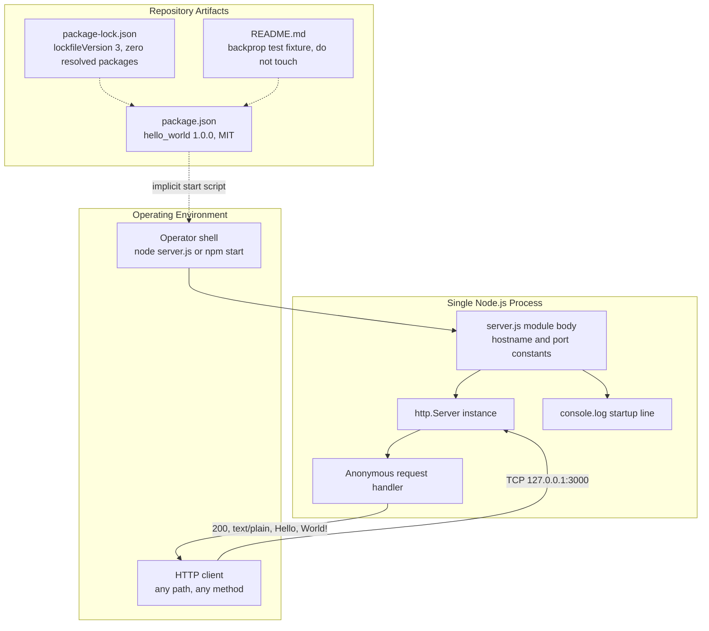

```mermaid
sequenceDiagram
    participant Op as Operator shell
    participant Proc as server.js process
    participant Srv as http.Server on 127.0.0.1:3000
    participant Cli as HTTP client
    Op->>Proc: node server.js (or npm start)
    Proc->>Srv: createServer(handler), listen(3000, '127.0.0.1')
    Srv-->>Op: "Server running at http://127.0.0.1:3000/"
    Cli->>Srv: request, any method and path
    Srv-->>Cli: 200, Content-Type text/plain, "Hello, World!\n"
    Note over Srv: Handler reads nothing from the request;<br/>response is identical every time
```

### 1.2.3 Success Criteria

The repository defines no formal acceptance criteria, SLAs or measurement instrumentation, so the objectives below are stated as criteria that the implementation can actually be held to, each with the evidence that establishes it today.

| Measurable objective | Criterion | Observed evidence |
|---|---|---|
| Listener availability | Process binds `127.0.0.1:3000` and announces itself on stdout | Startup log `Server running at http://127.0.0.1:3000/` captured under Node.js v22.23.4 |
| Response conformance | Every request returns `200`, `Content-Type: text/plain`, body `Hello, World!\n` | Verified for `/`, `/does-not-exist` and `POST /`; body measured at 14 bytes with `Content-Length: 14` |
| Network isolation | The service is unreachable outside the host | Connection to the routable interface (`10.11.2.21:3000`) was refused |
| Dependency freedom | Zero third-party packages declared or locked | No `dependencies` keys in `package.json`; lockfile holds only the root package entry |
| Start reproducibility | The same start commands work without installation or build | `node server.js` and `npm start` both reach the startup log line |
| Verification honesty | The declared test command fails rather than passing silently | `npm test` prints `Error: no test specified` and exits 1 |

**Critical success factors.**

- **Determinism.** Status, header and body are literals, not computed, so pipeline assertions are stable across runs and machines.
- **Minimality.** Four files, 39 lines and one built-in module keep the fixture's surface small enough to reason about exhaustively.
- **Isolation.** A loopback-only bind plus zero outbound traffic means the fixture neither depends on nor disturbs other services.
- **Immutability.** The `README.md` instruction "Do not touch!" is the governing change constraint; any edit invalidates its use as a baseline.
- **Environment parity.** The presence of `QA-win-linux-env` alongside `main` indicates the fixture is exercised on more than one operating system; the code contains nothing platform-specific, since it uses only the built-in `http` module and literals.

**Key performance indicators.** The system emits no metrics, counters, traces or health data — `console.log` on startup is the only output — so no KPI can be computed from inside the system. The indicators below are therefore external observations that a harness must capture, and they are the natural measures implied by the implementation.

| Indicator | Definition | Measurement source |
|---|---|---|
| Startup conformance | Exact startup line observed within the harness timeout | Harness capture of process stdout |
| Response conformance | Status, content type and body equal to the specified literals on every request | Harness HTTP client assertions |
| Dependency count | Number of resolved third-party packages; the target value is 0 | Inspection of `package-lock.json` |
| Fixture drift | Number of tracked-file changes against baseline commit `a6f7f58`; the target value is 0 | Repository history and working-tree state |

Throughput, latency and availability targets are not specified anywhere in the repository, and no load measurement exists against which to state one.


## 1.3 Scope

Scope for this system is unusually crisp because the entire implementation is visible in one 14-line file. Everything the process does, and nothing else, is described below.

### 1.3.1 In-Scope: Core Features and Functionalities

**Must-have capabilities.** These are the capabilities the system must retain to remain the fixture the `README.md` describes.

| Capability | Implemented behaviour | Location |
|---|---|---|
| Bind a fixed HTTP endpoint | Listener on `127.0.0.1` port `3000`, established by `server.listen(port, hostname, callback)` | `server.js` lines 3-4, 12-14 |
| Answer any request identically | `res.statusCode = 200`; `Content-Type: text/plain`; `res.end('Hello, World!\n')` | `server.js` lines 7-9 |
| Announce readiness | `console.log(\`Server running at http://${hostname}:${port}/\`)` inside the listen callback | `server.js` lines 12-14 |
| Declare project identity | `hello_world`, `1.0.0`, `main: index.js`, author `hxu`, MIT | `package.json` |
| Lock the (empty) dependency graph | `lockfileVersion` 3, `requires: true`, single root package entry | `package-lock.json` |

**Primary user workflows.**

1. **Start.** An operator or harness runs `node server.js` or `npm start` from the repository root. No install or build precedes it.
2. **Confirm readiness.** The harness reads the single startup log line, `Server running at http://127.0.0.1:3000/`, as the signal that the socket is accepting connections.
3. **Request.** Any HTTP client issues any method against any path on `127.0.0.1:3000` and receives the fixed greeting.
4. **Assert.** The client compares status, content type and body against the literals `200`, `text/plain` and `Hello, World!\n`.
5. **Terminate.** The process is stopped externally, by signal or harness teardown. There is no shutdown endpoint, drain period or cleanup logic in `server.js`.

**Essential integrations.** Only one integration is essential at runtime: an HTTP client capable of reaching the loopback interface on port 3000. Two development-time integrations are also in scope — the Node.js runtime executing CommonJS with the `http` built-in, and the npm CLI for `npm start` and `npm test`. The backprop integration that `README.md` names is the consumer of this fixture and is out of this repository's boundary; see 1.3.4.

**Key technical requirements.**

| Requirement | Value | Consequence if unmet |
|---|---|---|
| Node.js runtime with CommonJS and the built-in `http` module | Verified working on Node.js v22.23.4 with npm 11.21.0 | Process fails at `require('http')`; nothing listens |
| Loopback interface present and port 3000 free | Hard-coded; no override exists | `EADDRINUSE` on `listen` — reproduced when starting a second instance while the first held the port |
| Ability to capture process stdout | Single startup line, no log file or sink | Readiness signal is lost; the harness must fall back to socket polling |
| No environment variables or config files | None are read by any file in the repository | Configuration is impossible by design, not by omission of documentation |

### 1.3.2 In-Scope: Implementation Boundaries

**System boundary.** The system is one OS process, one TCP listening socket on `127.0.0.1:3000`, one in-memory `http.Server` object, and one stdout stream. It opens no outbound connection, reads no file at runtime, writes no file, and holds no state between requests; the handler closes over nothing but its own literals.

**User groups covered.**

| User group | Covered | Nature of coverage |
|---|---|---|
| Automated integration harness (backprop) | Yes | Anonymous requests; conformance assertions on a fixed response |
| QA and environment engineers | Yes | Manual or scripted start, request, observe and tear down |
| Developers performing a smoke check | Yes | Same as above, without installation |
| Authenticated or identified end users | No | No credential, session, account or role concept exists |
| Interactive human audience of the greeting | Incidentally | The greeting is a literal string, not a rendered product surface |

**Geographic and market coverage.** The listener is bound to the loopback address, so coverage is one host, reachable only from that host. There is no locale handling, no internationalisation and no time-zone logic; the only user-visible string is the fixed English literal `Hello, World!`. The runtime provides the `Date` response header automatically, which is the sole time-dependent element of a response.

**Data domains included.**

| Data domain | Treatment |
|---|---|
| Request data (path, headers, method, body) | Received by the socket and discarded; `req` is never read (`server.js` line 6) |
| Response payload | Fixed literal `Hello, World!\n`, 14 bytes |
| Configuration data | Two module-level constants compiled into the source |
| Operational logs | One startup line on stdout; no request, access or error logging |

No persistent data domain is in scope. The system stores nothing, so there is no schema, retention rule, backup or data-classification obligation attached to it.

### 1.3.3 Out-of-Scope: Explicitly Excluded Capabilities

Each exclusion below is an absence verified in the source, not a deferred feature.

| Excluded capability | Evidence of absence |
|---|---|
| Routing, URL matching and `404` handling | Non-existent paths return `200` and the greeting |
| HTTP method semantics (`GET`/`POST`/`PUT`/`DELETE` distinction) | All methods share one handler; `POST /` returned `200` |
| Request parsing, body consumption and payload validation | `req` is accepted but never referenced |
| Response serialisation (JSON, XML, HTML) | Only `res.end` with a plain-text literal |
| Configuration or environment overrides for host and port | Both are literals in `server.js` lines 3-4 |
| TLS/HTTPS, reverse-proxy or load-balancer integration | No `https`, `tls` or `net` module is required |
| Authentication, authorisation, sessions, CORS | No header other than `Content-Type` is set |
| Persistence, caching, database or queue access | No storage or client driver in any tracked file |
| Static asset or file serving | No filesystem module is required |
| Observability endpoints (health, readiness, metrics, traces) | No route beyond the universal handler and no instrumentation |
| Structured logging, log levels, log rotation | A single `console.log` call is the only logging statement |
| Graceful shutdown, signal handling, connection draining | Absent from `server.js` lines 12-14 |
| Automated tests, coverage, fixtures | `scripts.test` is the npm placeholder and exits 1 |
| Build, bundling, transpilation, lint and format tooling | No `devDependencies` and no config files exist |
| CI/CD pipelines, container images, infrastructure definitions | No workflow, `Dockerfile` or IaC file in the repository |
| Packaging and publication to a registry | No `private`, `publishConfig` or `files` field; `main` points at a missing `index.js` |

### 1.3.4 Out-of-Scope: Future Phases, Uncovered Integrations and Unsupported Use Cases

**Future phase considerations.** The repository contains no roadmap, backlog or changelog, so no future phase is committed. Three artefacts hint at work that was contemplated or is in progress elsewhere, and each is recorded as a signal only:

- `package.json` sets `main` to `index.js`, a file absent from the repository — the manifest describes a module entry point the checkout does not provide.
- `scripts.test` retains npm's generated placeholder — a test suite was never added, so automated verification must remain external.
- Branch `QA-win-linux-env` exists alongside `main`, indicating the fixture is being exercised in a cross-platform QA context rather than extended with features.

**Integration points not covered.**

| Integration point | Status |
|---|---|
| The backprop pipeline named in `README.md` | External; no client, contract or configuration for it exists here |
| Runners, schedulers or CI systems that start the fixture | Not present; start-up is manual or harness-driven |
| Reverse proxies, ingress controllers or TLS terminators | Not present; no `Host`-based or forwarded-header handling |
| Observability backends (metrics, traces, log aggregation) | Not present; the single stdout line is the only signal |
| Secret stores, identity providers, service registries | Not present; no credentials are needed or referenced |
| npm registry publication and distribution | Not configured |

**Unsupported use cases.**

| Use case | Why it is unsupported |
|---|---|
| Serving production or customer traffic | Loopback-only bind, no TLS, no error handling, no logging and no operational controls |
| Multi-tenant or authenticated APIs | No identity, session, authorisation or per-caller differentiation |
| Content APIs (JSON, HTML, files) | One plain-text literal is the only response the code can produce |
| Remote or cross-host access | Verified: a connection to a non-loopback interface on port 3000 is refused |
| Load and concurrency qualification | No benchmark exists in the repository, so no performance claim can be made for any load level |
| Running more than one instance per host | The port is hard-coded, so a second instance fails with `EADDRINUSE` |
| Localisation or localised content | A single English literal with no locale selection |

**Change governance.** `README.md` states "Do not touch!", which places every item above out of scope by policy as well as by implementation. Any addition — routing, configuration, tests, instrumentation — changes the fixture's character and must be treated as a new deliverable authorised by the fixture's owner rather than as an enhancement of this one.


## 1.4 References

- `server.js` — the entire runtime implementation: `http` require, `hostname = '127.0.0.1'` and `port = 3000` constants (lines 3-4), inline request handler setting `200`, `Content-Type: text/plain` and the body `Hello, World!\n` (lines 6-10), and `server.listen` with the startup log line (lines 12-14). Established the fixed response contract, the loopback-only bind and the absence of routing, request parsing, error handling and shutdown logic.
- `package.json` — project identity (`hello_world` 1.0.0), description "Hello world in Node.js", `main: "index.js"` (absent from the repository), the placeholder `scripts.test` that exits 1, author `hxu` and MIT licence; also the absence of any `dependencies`, `devDependencies`, `engines`, `repository`, `private` or `publishConfig` field.
- `package-lock.json` — `lockfileVersion` 3 with `requires: true` and a single root package entry, establishing that zero third-party packages are resolved or locked.
- `README.md` — the two-line purpose statement: heading `# hao-backprop-test` and "test project for backprop integration. Do not touch!", which supplies the project's declared integration purpose and its do-not-modify constraint.
- Repository root folder (`""`) — confirmed the four-file, sub-folder-free structure and the absence of any test, CI, container, configuration or documentation artifact; also confirmed no `.blitzyignore` file exists.
- `.git/` metadata — single commit `a6f7f58` ("Add files via upload", author `Sandeep01Kumar`, 2026-11-16), branches `QA-win-linux-env`, `main`, `origin/main` and `origin/QA-win-linux-env`, and remote `existing-projects-qa-16-nov`; established the cross-platform QA context and the absence of prior system versions.
- Runtime observation (Node.js v22.23.4, npm 11.21.0) — executed `node server.js` and `npm start`; captured the startup line `Server running at http://127.0.0.1:3000/`; received `HTTP/1.1 200 OK`, `Content-Type: text/plain`, `Content-Length: 14` and body `Hello, World!\n` for `/`, for `/does-not-exist` and for `POST /`; confirmed a refused connection on the non-loopback interface; and confirmed `npm test` exits 1 with `Error: no test specified`. No external web sources were consulted.


# 2. Product Requirements

## 2.1 Feature Catalog

Every feature below is derived from the four tracked files of the repository — `server.js`, `package.json`, `package-lock.json` and `README.md` — at baseline commit `a6f7f58`. The repository exposes seven features in total. Each is implemented, so every status is **Completed**; no entry is Proposed, Approved or In Development. Capabilities the system does not have (routing, method semantics, request parsing, configuration, TLS, authentication, persistence, static serving, observability endpoints, structured logging, graceful shutdown, automated tests, build tooling, CI/CD and packaging) are recorded as exclusions in 1.3.3 and are intentionally absent from this catalog.

Feature-set version: 2.0.0-1, established against baseline `a6f7f58` on branch `QA-win-linux-env`.

### 2.1.1 Feature Metadata Summary

| Feature ID | Feature Name | Feature Category | Priority Level |
|---|---|---|---|
| F-001 | Loopback HTTP Listener Binding | Networking and Runtime | Critical |
| F-002 | Uniform Greeting Response | Response Contract | Critical |
| F-003 | Startup Readiness Announcement | Observability and Startup | High |
| F-004 | Zero-Dependency Locked Runtime Posture | Dependency and Build Management | High |
| F-005 | Project Identity and Licence Declaration | Project Metadata | Medium |
| F-006 | Fixture Purpose Documentation and Change Governance | Documentation and Governance | Medium |
| F-007 | Process Lifecycle and Teardown | Operations and Lifecycle | Medium |

| Feature ID | Status | Implementation Evidence | Requirement Count |
|---|---|---|---|
| F-001 | Completed | `server.js` lines 3-4, 12-14 | 4 |
| F-002 | Completed | `server.js` lines 6-10 | 5 |
| F-003 | Completed | `server.js` lines 12-14 | 3 |
| F-004 | Completed | `package.json` (no dependency keys); `package-lock.json` | 4 |
| F-005 | Completed | `package.json` lines 2-11 | 4 |
| F-006 | Completed | `README.md` lines 1-2 | 2 |
| F-007 | Completed | `server.js` lines 12-14 (no signal handling) | 3 |

### 2.1.2 F-001 — Loopback HTTP Listener Binding

**Overview.** `server.js` requires the Node.js built-in `http` module, declares two module-level constants — `hostname = '127.0.0.1'` (line 3) and `port = 3000` (line 4) — and calls `server.listen(port, hostname, callback)` (lines 12-14). The process therefore opens exactly one TCP listening socket, bound to the loopback address on a fixed port, and holds it until the process ends.

**Business Value.** It gives the external integration pipeline that `README.md` names a real Node.js HTTP service on a predictable address at zero cost. Because the address is a literal, consumer assertions never need service discovery, and because the bind is loopback-only, the fixture cannot be reached from another host and cannot disturb neighbouring services.

**User Benefits.** A harness or engineer can hard-code the probe URL `http://127.0.0.1:3000/` with no configuration step. There is nothing to look up, no port to negotiate and no environment variable to set; verified behaviour shows `PORT=4000` and `HOST=0.0.0.0` are ignored.

**Technical Context.** Host and port are compiled into the source, so the address is identical on Linux and Windows and across both repository branches. Starting a second instance while the first holds the port raises an unhandled `EADDRINUSE` error event on `127.0.0.1:3000`, the Node.js runtime prints the stack and the process exits with code 1 — the code registers no `error` listener on the server. A connection to the host's routable interface (`10.11.2.21:3000`) is refused, confirming the loopback bind is the only exposure.

| Dependency Type | Item | Evidence or Consequence of Absence |
|---|---|---|
| Prerequisite features | None | F-001 is the first runtime capability; F-002 and F-003 cannot occur until the socket is bound |
| System dependencies | Node.js built-in `http` module; loopback interface; free TCP port 3000 | `server.js` line 1, lines 3-4 |
| External dependencies | None | `package.json` declares no dependencies; `package-lock.json` resolves none |
| Integration requirements | An HTTP/1.1 client able to reach `127.0.0.1:3000`, and a supervisor that runs `node server.js` or `npm start` | Startup line observed: `Server running at http://127.0.0.1:3000/` |

### 2.1.3 F-002 — Uniform Greeting Response

**Overview.** One inline anonymous arrow function (lines 6-10) serves every request. It assigns `res.statusCode = 200`, sets `Content-Type: text/plain`, and ends the response with the literal `Hello, World!\n`. The `req` parameter is accepted but never read, so no path, method, header or body influences the output.

**Business Value.** The fixture is a byte-identical oracle: the same request-independent response on every call makes pipeline assertions exact, keeps results comparable across runs and machines, and turns any deviation into an unambiguous signal that the fixture or the pipeline under test has drifted.

**User Benefits.** QA engineers need one expected response for every probe rather than a per-endpoint matrix. Non-existent paths, unusual verbs, query strings and request bodies all yield the same result, so a test can assert status, content type and body without setup or cleanup.

**Technical Context.** Verified against Node.js v22.23.4: `GET /`, `GET /nope?x=1` and `POST /` with a JSON body each returned `200`, `text/plain` and a 14-byte body; `od` confirms the bytes `H e l l o ,   W o r l d ! \n`. The Node.js runtime supplies the framing headers automatically — `Date`, `Connection: keep-alive`, `Keep-Alive: timeout=5` and `Content-Length: 14` — while `HEAD /` returns `200` with no body and no `Content-Length`.

| Dependency Type | Item | Evidence or Consequence of Absence |
|---|---|---|
| Prerequisite features | F-001 | The handler runs only once the listener accepts connections |
| System dependencies | `http.ServerResponse` default header emission and HTTP/1.1 framing | Observed headers: `Date`, `Connection`, `Keep-Alive`, `Content-Length` |
| External dependencies | None | The handler calls no library, no filesystem and no network |
| Integration requirements | Any HTTP/1.1 client; no headers, credentials or content negotiation required | Verified across GET, POST and HEAD |

### 2.1.4 F-003 — Startup Readiness Announcement

**Overview.** The `server.listen` callback logs one interpolated template literal, `Server running at http://${hostname}:${port}/`, to stdout. That line is the only runtime output the program produces.

**Business Value.** A single deterministic readiness line lets an integration pipeline gate its first request on observed output instead of sleep-and-retry heuristics, which removes a common source of flakiness in service start-up checks.

**User Benefits.** An operator sees the exact bound address printed once, in a stable format that is trivial to grep, and receives no further output to sift through during the run.

**Technical Context.** The log is written only from the listen success callback, so its appearance implies the socket is accepting connections. There is no logging framework, log level, log file, access log or error log, and no shutdown line — after `SIGTERM` the process log contains only the startup line. Because the line is the sole readiness signal, losing stdout leaves a harness with socket polling as its only fallback.

| Dependency Type | Item | Evidence or Consequence of Absence |
|---|---|---|
| Prerequisite features | F-001 | The callback fires only after a successful bind |
| System dependencies | A writable stdout stream and working `console.log` | `server.js` line 13 |
| External dependencies | None | No log shipper, agent or collector is configured |
| Integration requirements | The harness must capture the child process's stdout and match the expected line | Verified exact output: `Server running at http://127.0.0.1:3000/` |

### 2.1.5 F-004 — Zero-Dependency Locked Runtime Posture

**Overview.** `package.json` carries no `dependencies`, `devDependencies`, `peerDependencies`, `optionalDependencies` or `engines` field, and `package-lock.json` records `lockfileVersion` 3 with `requires: true` and a single `packages` entry for the root project (`""`). No third-party package is declared, resolved, hashed or installed, and the runtime path uses only the built-in `http` module.

**Business Value.** A zero third-party surface means dependency audits, licence scans and vulnerability checks have nothing to resolve, and there is no upstream package that can change or disappear. Any environment that can run Node.js can run the fixture identically, which is what makes it usable as a stable control case.

**User Benefits.** The project starts from a fresh checkout with no `npm install` and no build, bundle or transpile step; `node server.js` and `npm start` both reach the startup line. Cloning and running requires no registry access.

**Technical Context.** `scripts` holds only npm's generated `test` placeholder, so `npm start` succeeds through npm's implicit default `node server.js` script while `scripts.start` is `undefined`. No bundler, transpiler, linter, formatter or engine constraint is declared anywhere in the repository.

| Dependency Type | Item | Evidence or Consequence of Absence |
|---|---|---|
| Prerequisite features | None | The posture is a property of the manifests, independent of runtime features |
| System dependencies | A Node.js runtime executing CommonJS with the `http` built-in | Verified on Node.js v22.23.4 with npm 11.21.0 |
| External dependencies | None; the empty graph means the npm registry is never contacted to run the fixture | `package-lock.json` holds only the root entry |
| Integration requirements | Clone-and-run, with the npm CLI needed only for `npm start` and `npm test` | Both invocations verified from the repository root |

### 2.1.6 F-005 — Project Identity and Licence Declaration

**Overview.** `package.json` (10 lines) records `name: hello_world`, `version: 1.0.0`, `description: "Hello world in Node.js"`, `main: index.js`, the placeholder `test` script, `author: hxu` and `license: MIT`. `package-lock.json` repeats name, version and licence in its root entry.

**Business Value.** Auditable identity lets the fixture be found, versioned and licence-cleared in engineering inventories, and the MIT grant permits unrestricted reuse of its four files. The `1.0.0` version plus baseline commit `a6f7f58` give consumers a fixed reference point for comparison.

**User Benefits.** Tooling can read the identity directly, and npm surfaces it during script execution (`> hello_world@1.0.0 start`). Licence reviewers get an unambiguous `MIT` with no dependency licences to reconcile.

**Technical Context.** The declared entry point is not satisfied: `main` names `index.js`, which is absent, so `require('./')` fails with `MODULE_NOT_FOUND` for that path. The runnable artifact is `server.js` executed directly. `scripts.test` is the npm placeholder `echo "Error: no test specified" && exit 1`, so `npm test` exits 1 rather than passing silently.

| Dependency Type | Item | Evidence or Consequence of Absence |
|---|---|---|
| Prerequisite features | None | Pure manifest metadata |
| System dependencies | Node.js and npm manifest parsing | `node -e "require('./package.json')"` returns the seven keys |
| External dependencies | None | No registry metadata, publisher or repository field is set |
| Integration requirements | Licence and inventory tooling reads `license: MIT`; consumers must start `server.js`, not the declared `main` | `require('./')` → `MODULE_NOT_FOUND` for `index.js` |

### 2.1.7 F-006 — Fixture Purpose Documentation and Change Governance

**Overview.** `README.md` is two lines: the heading `# hao-backprop-test` and the sentence "test project for backprop integration. Do not touch!". It states the fixture's purpose and imposes an explicit immutability constraint.

**Business Value.** The purpose statement ties the repository to the backprop integration that consumes it, and the do-not-modify instruction protects the baseline: a fixture that changes silently invalidates any comparison a pipeline draws against it.

**User Benefits.** A newcomer learns in one line that the code is a test target, not a product, and that changes are governed rather than welcome. Reviewers can cite the instruction when rejecting unsolicited edits.

**Technical Context.** The file contains no code, configuration, badge, link, installation or usage instruction. Its heading (`hao-backprop-test`) differs from the manifest name (`hello_world`), so tooling and documentation present two identifiers for the same artifact; `package.json` frames it as a language sample, `README.md` as an integration fixture.

| Dependency Type | Item | Evidence or Consequence of Absence |
|---|---|---|
| Prerequisite features | None | Documentation-only artifact with no runtime effect |
| System dependencies | None | Plain-text Markdown |
| External dependencies | None | The backprop pipeline it names is external; no client, contract or configuration for it exists here |
| Integration requirements | Human and governance review only | `README.md` lines 1-2 |

### 2.1.8 F-007 — Process Lifecycle and Teardown

**Overview.** Lifecycle is entirely external: `server.js` registers only the listen success callback, and the process runs until a supervisor or signal stops it. Termination closes the listening socket immediately; there is no shutdown endpoint, connection drain or cleanup hook.

**Business Value.** Teardown is trivially reliable because there is nothing to flush and no drain window to wait for. That keeps repeated pipeline runs cheap and makes port reuse predictable between cycles.

**User Benefits.** A harness can restart the fixture back-to-back: after `SIGTERM` the port 3000 listener is gone and a freshly started instance binds successfully. No orphaned state has to be cleaned between runs.

**Technical Context.** `SIGTERM` ends the process without writing an additional log line; that was verified by capturing stdout for the whole process lifetime, which contained only the startup line. Because the module holds no persistent state — no database handle, cache, file lock or open outbound connection — abrupt termination cannot corrupt anything.

| Dependency Type | Item | Evidence or Consequence of Absence |
|---|---|---|
| Prerequisite features | F-001 | There is no lifecycle to end until the socket is bound |
| System dependencies | OS process signals (`SIGTERM`, `SIGINT`) and kernel socket close | `server.js` lines 12-14 contain no `process.on` handler |
| External dependencies | None | No process manager, service unit or container runtime is defined in the repository |
| Integration requirements | The supervisor sends the signal and waits for process exit; no HTTP shutdown path exists | Post-termination connection to `127.0.0.1:3000` refused; rebind succeeded |


## 2.2 Functional Requirements Table

Requirements use the identifier form `F-XXX-RQ-YYY`, where `XXX` is the owning feature. Priority follows MoSCoW as applied to a test fixture: **Must-Have** requirements define conformance of the fixture itself; **Should-Have** requirements define properties a consumer harness depends on but that do not change the response contract; no **Could-Have** requirements exist, because every capability present in the source is already required by the fixture's stated purpose in `README.md`. Complexity is **Low** for all 25 requirements: each is satisfied by a literal in `server.js` or a field in a manifest, and the whole runtime path is three statements inside one handler.

The request lifecycle below maps the run-time requirements to the path an observed request takes; the static structure and component flow are diagrammed in 1.2.2, and the boundary analysis in 1.3 governs which capabilities are absent by design.

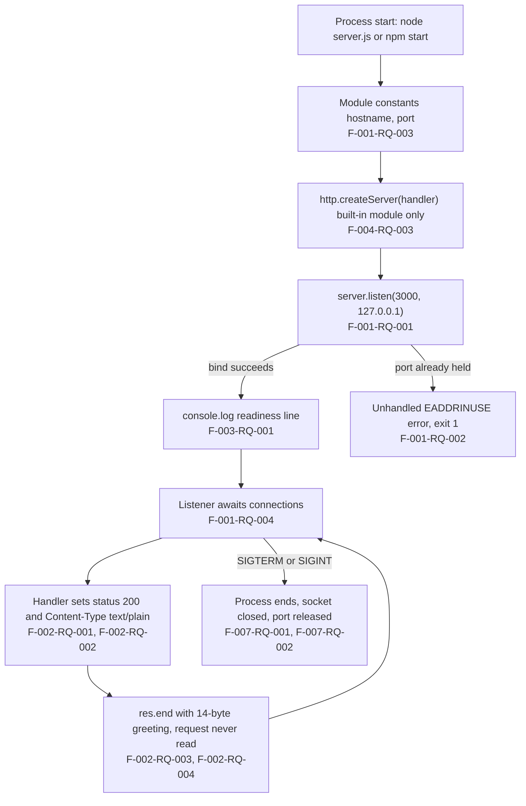

### 2.2.1 F-001 — Loopback HTTP Listener Binding

| Requirement ID | Description | Acceptance Criteria | Priority |
|---|---|---|---|
| F-001-RQ-001 | The process binds one listening socket to `127.0.0.1` on TCP port 3000. | After `node server.js`, a TCP connect to `127.0.0.1:3000` succeeds and an HTTP request receives a response; no other port is opened. | Must-Have |
| F-001-RQ-002 | The process surfaces bind failure as a hard error rather than falling back to another port or degrading silently. | With port 3000 already held, a second `node server.js` emits `EADDRINUSE` for `127.0.0.1:3000` and exits with code 1. | Must-Have |
| F-001-RQ-003 | The bind address is fixed in source and cannot be altered by configuration. | Starting with `PORT=4000 HOST=0.0.0.0` still binds `127.0.0.1:3000`; no environment variable or config file is read by any tracked file. | Must-Have |
| F-001-RQ-004 | The listener remains available for the whole process lifetime, with no idle timeout or self-shutdown. | Requests issued any time between startup and termination succeed; the socket is closed only when the process ends. | Must-Have |

| Requirement ID | Complexity | Input Parameters | Output or Response |
|---|---|---|---|
| F-001-RQ-001 | Low | `hostname = '127.0.0.1'`, `port = 3000` (`server.js` lines 3-4) | Bound TCP socket; startup callback invocation |
| F-001-RQ-002 | Low | Occupied port 3000 | Unhandled `error` event on the server, Node.js stack trace on stderr, exit code 1 |
| F-001-RQ-003 | Low | None accepted — constants only | Same bind regardless of environment |
| F-001-RQ-004 | Low | Elapsed time | Continuous availability of `127.0.0.1:3000` |

| Requirement ID | Performance Criteria | Data Requirements | Security Requirements |
|---|---|---|---|
| F-001-RQ-001 | Bind completes within the harness start-up timeout; timing is OS-dependent and no target is specified in the repository | None stored | Listener reachable only from the local host; verified unreachable on `10.11.2.21:3000` |
| F-001-RQ-002 | Failure reported immediately at `listen`, no retry loop | None | Failure must not be masked as success |
| F-001-RQ-003 | Not applicable | None | No configuration surface, so no configuration-based privilege escalation path exists |
| F-001-RQ-004 | No throughput, latency or availability target is declared anywhere in the repository | None | No authentication or authorisation on the socket; exposure is limited by the loopback bind |

### 2.2.2 F-002 — Uniform Greeting Response

| Requirement ID | Description | Acceptance Criteria | Priority |
|---|---|---|---|
| F-002-RQ-001 | Every HTTP request receives status `200`, regardless of path or method. | `GET /`, `GET /does-not-exist`, `GET /nope?x=1` and `POST /` all return status code `200`. | Must-Have |
| F-002-RQ-002 | Every response carries the header `Content-Type: text/plain`, exactly, with no charset parameter or vendor suffix. | Response headers contain `Content-Type: text/plain` for every probe. | Must-Have |
| F-002-RQ-003 | The response body is the 14-byte literal `Hello, World!` followed by a newline. | Body byte length is 14 and the bytes equal `48 65 6c 6c 6f 2c 20 57 6f 72 6c 64 21 0a`; a body without the trailing `\n` fails. | Must-Have |
| F-002-RQ-004 | The response is independent of all request data: no path, method, header, query string or body influences it, and request data is never read. | Identical status, content type and body for arbitrary paths, verbs, headers and JSON payloads; `req` is not referenced in the handler. | Must-Have |
| F-002-RQ-005 | Framing and date headers produced by the Node.js runtime are passed through unmodified. | Responses include `Date`, `Connection: keep-alive`, `Keep-Alive: timeout=5` and, for bodied methods, `Content-Length: 14`; `HEAD /` returns `200` with no body and no `Content-Length`. | Should-Have |

| Requirement ID | Complexity | Input Parameters | Output or Response |
|---|---|---|---|
| F-002-RQ-001 | Low | HTTP request line; any method, any path | `200` status line |
| F-002-RQ-002 | Low | None | `Content-Type: text/plain` |
| F-002-RQ-003 | Low | None | `Hello, World!\n` (14 bytes) |
| F-002-RQ-004 | Low | Request headers, query, body — all ignored | Same response as for a request with no payload |
| F-002-RQ-005 | Low | Protocol version and method | `Date`, `Connection`, `Keep-Alive`, `Content-Length` emitted by Node.js |

| Requirement ID | Performance Criteria | Data Requirements | Security Requirements |
|---|---|---|---|
| F-002-RQ-001 | No target declared; 20 concurrent probes all returned `200` | None | Uniform status reveals no resource existence, so path enumeration gains nothing |
| F-002-RQ-002 | Header emitted with the response, no transformation | Static literal | Plain-text type prevents content sniffing into an active type such as HTML |
| F-002-RQ-003 | Body written in a single `res.end` call | Fixed 14-byte literal, no serialisation | No request data is reflected, so no injection sink exists |
| F-002-RQ-004 | Independent of payload size; request bodies are discarded, not buffered by application code | Request data received and dropped | No parsing or deserialisation, so no parser vulnerability class applies |
| F-002-RQ-005 | `Keep-Alive: timeout=5` bounds idle persistence between requests | None | No custom headers are set, so no header-injection surface exists |

### 2.2.3 F-003 — Startup Readiness Announcement

| Requirement ID | Description | Acceptance Criteria | Priority |
|---|---|---|---|
| F-003-RQ-001 | The process writes exactly one line to stdout on readiness: `Server running at http://127.0.0.1:3000/`. | Captured stdout for a full process lifetime contains that line once, byte-identical, with no prefix or decoration. | Must-Have |
| F-003-RQ-002 | The line is emitted only after the socket is accepting connections. | The line appears from the `listen` success callback; when the bind fails, no readiness line is printed. | Must-Have |
| F-003-RQ-003 | The process writes no other output during normal operation. | Over a run of many requests and a termination, stdout and stderr contain only the startup line. | Must-Have |

| Requirement ID | Complexity | Input Parameters | Output or Response |
|---|---|---|---|
| F-003-RQ-001 | Low | `hostname`, `port` interpolated into a template literal | One stdout line |
| F-003-RQ-002 | Low | Listen callback invocation | Ordering guarantee between bind and log |
| F-003-RQ-003 | Low | Request traffic; `SIGTERM` | No additional writes; no access, error or shutdown log |

| Requirement ID | Performance Criteria | Data Requirements | Security Requirements |
|---|---|---|---|
| F-003-RQ-001 | Emitted once, immediately after bind | None stored | Log line exposes only the loopback address already implied by the source |
| F-003-RQ-002 | No polling or delay between bind and log | None | A premature readiness signal would let a harness probe a closed socket; the callback ordering prevents it |
| F-003-RQ-003 | Constant output volume regardless of request count | No log file, rotation or retention | Absence of request logging means caller data is never written to disk |

### 2.2.4 F-004 — Zero-Dependency Locked Runtime Posture

| Requirement ID | Description | Acceptance Criteria | Priority |
|---|---|---|---|
| F-004-RQ-001 | The manifest declares no third-party packages. | `package.json` contains no `dependencies`, `devDependencies`, `peerDependencies` or `optionalDependencies` key. | Must-Have |
| F-004-RQ-002 | The lockfile records an empty dependency graph at `lockfileVersion` 3. | `package-lock.json` reports `lockfileVersion: 3`, `requires: true`, and `packages` holding only the `""` root entry with name, version and licence. | Must-Have |
| F-004-RQ-003 | The fixture starts with no install, build, bundle or transpile step, using Node.js built-in modules only. | From a fresh checkout with no `node_modules`, `node server.js` reaches the startup line; the only `require` in the repository is `require('http')`. | Must-Have |
| F-004-RQ-004 | `npm start` launches the server even though no `start` script is declared. | `npm start` prints `> hello_world@1.0.0 start` and `> node server.js`, then the startup line. | Should-Have |

| Requirement ID | Complexity | Input Parameters | Output or Response |
|---|---|---|---|
| F-004-RQ-001 | Low | Manifest parsed by Node.js or npm | Absence of dependency keys |
| F-004-RQ-002 | Low | Lockfile parsed by npm | Empty resolved graph |
| F-004-RQ-003 | Low | Node.js process start | Startup line without `npm install` |
| F-004-RQ-004 | Low | `npm start` invocation | Implicit default script run |

| Requirement ID | Performance Criteria | Data Requirements | Security Requirements |
|---|---|---|---|
| F-004-RQ-001 | Not applicable | None | Zero supply-chain surface: no package can change or disappear upstream; licence scan resolves only `MIT` |
| F-004-RQ-002 | Not applicable | Only the root package entry, with no `resolved` URL or `integrity` hash | No third-party artefact is fetched or verified at install time |
| F-004-RQ-003 | Start-up cost limited to Node.js boot; no network access during start | No install artefacts | No unreviewed code executes at runtime |
| F-004-RQ-004 | Equivalent to running `node server.js` directly | None | npm's implicit default does not add tooling or dependencies |

### 2.2.5 F-005 — Project Identity and Licence Declaration

| Requirement ID | Description | Acceptance Criteria | Priority |
|---|---|---|---|
| F-005-RQ-001 | The manifest declares the project identity and licence. | `package.json` contains `name: hello_world`, `version: 1.0.0`, `description: Hello world in Node.js`, `author: hxu`, `license: MIT` and `main: index.js`. | Must-Have |
| F-005-RQ-002 | The lockfile mirrors the identity of the manifest. | `package-lock.json` root entry has the same `name`, `version` and `license` as `package.json`. | Should-Have |
| F-005-RQ-003 | The declared verification command must never report a passing test suite it does not have. | `npm test` prints `Error: no test specified` and exits with code 1. | Should-Have |
| F-005-RQ-004 | The unresolved manifest entry point is documented, and `server.js` is the sole runnable artifact. | No `index.js` exists; `require('./')` fails with `MODULE_NOT_FOUND`; `node server.js` starts the listener. | Should-Have |

| Requirement ID | Complexity | Input Parameters | Output or Response |
|---|---|---|---|
| F-005-RQ-001 | Low | Manifest literal values | Identity readable by `require('./package.json')` and npm |
| F-005-RQ-002 | Low | Manifest values | Identical `name`, `version`, `license` in the lockfile root entry |
| F-005-RQ-003 | Low | `npm test` invocation | `Error: no test specified`, exit code 1 |
| F-005-RQ-004 | Low | `require('./')` resolution | `MODULE_NOT_FOUND` for `index.js`; direct `node server.js` succeeds |

| Requirement ID | Performance Criteria | Data Requirements | Security Requirements |
|---|---|---|---|
| F-005-RQ-001 | Not applicable | Seven ordered manifest keys, no secrets | No credential, token or personal data beyond the author handle `hxu` |
| F-005-RQ-002 | Not applicable | Consistency between the two manifests | Lockfile carries no registry URLs or identifiers |
| F-005-RQ-003 | Fails immediately | None | Prevents a false green signal in CI that would misrepresent test coverage |
| F-005-RQ-004 | Not applicable | None | Consumers are steered to the file the checkout actually ships |

### 2.2.6 F-006 — Fixture Purpose Documentation and Change Governance

| Requirement ID | Description | Acceptance Criteria | Priority |
|---|---|---|---|
| F-006-RQ-001 | The repository states, in `README.md`, that it is a backprop integration test project. | `README.md` contains the heading `# hao-backprop-test` and the sentence naming a test project for backprop integration. | Must-Have |
| F-006-RQ-002 | The repository carries the do-not-modify governance constraint and is used as an immutable baseline. | `README.md` states "Do not touch!"; the tracked-file set matches baseline `a6f7f58` with zero drift. | Must-Have |

| Requirement ID | Complexity | Input Parameters | Output or Response |
|---|---|---|---|
| F-006-RQ-001 | Low | Reader opening `README.md` | Two-line purpose statement |
| F-006-RQ-002 | Low | Change proposal | Governance instruction requiring owner authorisation before any edit |

| Requirement ID | Performance Criteria | Data Requirements | Security Requirements |
|---|---|---|---|
| F-006-RQ-001 | Not applicable | Plain-text Markdown, no code or configuration | No operational detail is disclosed beyond the fixture's purpose |
| F-006-RQ-002 | Not applicable | Baseline commit `a6f7f58` as the reference state | Immutability prevents unrequested behaviour changes from reaching the pipeline |

### 2.2.7 F-007 — Process Lifecycle and Teardown

| Requirement ID | Description | Acceptance Criteria | Priority |
|---|---|---|---|
| F-007-RQ-001 | Termination on `SIGTERM` or `SIGINT` ends the process promptly, without a drain window or shutdown logging. | After `SIGTERM`, the process exits and no additional line appears on stdout. | Should-Have |
| F-007-RQ-002 | Termination releases port 3000 so a subsequent instance can bind. | After termination, a new `node server.js` reaches the startup line; before the new instance starts, a connection is refused. | Must-Have |
| F-007-RQ-003 | The process holds no persistent state requiring flush or recovery on abrupt termination. | No database, cache, file handle, lock file or outbound connection is opened by any tracked file. | Must-Have |

| Requirement ID | Complexity | Input Parameters | Output or Response |
|---|---|---|---|
| F-007-RQ-001 | Low | `SIGTERM` or `SIGINT` from the supervisor | Process exit; no shutdown message |
| F-007-RQ-002 | Low | Process exit | Closed listening socket; port reusable |
| F-007-RQ-003 | Low | Abrupt exit at any moment | No artefacts or partial state left behind |

| Requirement ID | Performance Criteria | Data Requirements | Security Requirements |
|---|---|---|---|
| F-007-RQ-001 | Exit is immediate; no graceful-shutdown deadline is defined | None | In-flight requests are abandoned rather than completed, which is acceptable for a single-response fixture |
| F-007-RQ-002 | Port reuse immediately after exit, limited only by OS socket teardown | None | No lingering privileged listener |
| F-007-RQ-003 | Not applicable | No persistent data domain exists | Nothing persists to be exposed or recovered after the run |

### 2.2.8 Traceability Matrix

| Requirement ID | Implementation Evidence | Verification Method | Related Section |
|---|---|---|---|
| F-001-RQ-001 | `server.js` lines 3-4, 12-14 | Start process, connect to `127.0.0.1:3000` | 1.3.1 |
| F-001-RQ-002 | `server.js` lines 12-14 (no `error` listener) | Start a second instance while the first runs; expect `EADDRINUSE`, exit 1 | 1.2.1 |
| F-001-RQ-003 | `server.js` lines 3-4 (literals, no `process.env` read) | Start with `PORT`/`HOST` set; observe unchanged bind | 1.3.3 |
| F-001-RQ-004 | `server.js` line 12 (`listen` only, no timeout logic) | Probe the socket before and after requests; observe persistence | 1.3.2 |
| F-002-RQ-001 | `server.js` line 7 | HTTP status assertions on `/`, `/nope?x=1`, `POST /` | 1.2.2 |
| F-002-RQ-002 | `server.js` line 8 | Response header assertion | 1.2.2 |
| F-002-RQ-003 | `server.js` line 9 | Byte-level body comparison (`od`) | 1.2.3 |
| F-002-RQ-004 | `server.js` line 6 (`req` unused) | Replay identical probes with varied path, method, headers, body | 1.3.2 |
| F-002-RQ-005 | `server.js` lines 7-9 (no header removal) | Inspect full response headers for GET and HEAD | 1.2.2 |
| F-003-RQ-001 | `server.js` lines 12-14 | Capture child stdout and match line exactly | 1.2.3 |
| F-003-RQ-002 | `server.js` line 12 callback | Compare log presence on success versus bind failure | 1.2.3 |
| F-003-RQ-003 | `server.js` (only `console.log` call) | Capture stdout and stderr across a full run | 1.3.1 |
| F-004-RQ-001 | `package.json` (no dependency keys) | Manifest inspection | 1.3.1 |
| F-004-RQ-002 | `package-lock.json` lines 4-12 | Lockfile inspection | 1.3.1 |
| F-004-RQ-003 | `server.js` line 1 | Start from a checkout without `node_modules` | 1.2.2 |
| F-004-RQ-004 | `package.json` `scripts` (no `start`) | Run `npm start` and read npm's script banner | 1.2.1 |
| F-005-RQ-001 | `package.json` lines 2-10 | Manifest inspection | 1.2.2 |
| F-005-RQ-002 | `package-lock.json` lines 7-11 | Compare manifest and lockfile root entry | 1.3.1 |
| F-005-RQ-003 | `package.json` line 7 | Run `npm test`; assert exit code 1 | 1.2.3 |
| F-005-RQ-004 | `package.json` line 5; absent `index.js` | `require('./')`; assert `MODULE_NOT_FOUND` | 1.2.1 |
| F-006-RQ-001 | `README.md` lines 1-2 | Read file; assert heading and purpose sentence | 1.1 |
| F-006-RQ-002 | `README.md` line 2; single commit `a6f7f58` | Diff working tree against baseline commit | 1.3.4 |
| F-007-RQ-001 | `server.js` lines 12-14 (no `process.on`) | Send `SIGTERM`; assert exit and unchanged stdout | 1.3.3 |
| F-007-RQ-002 | `server.js` line 12 | Terminate, confirm refusal, restart and confirm startup line | 1.3.2 |
| F-007-RQ-003 | All tracked files (no storage client or file I/O) | Inspect repository for persistence calls | 1.3.2 |


## 2.3 Feature Relationships

The relationships below are those visible in the source. The repository has no module graph — `server.js` contains no imports beyond the built-in `http` module and exports nothing — so feature coupling is expressed through shared statements, shared files and the order in which they execute, not through interfaces.

### 2.3.1 Feature Dependency Map

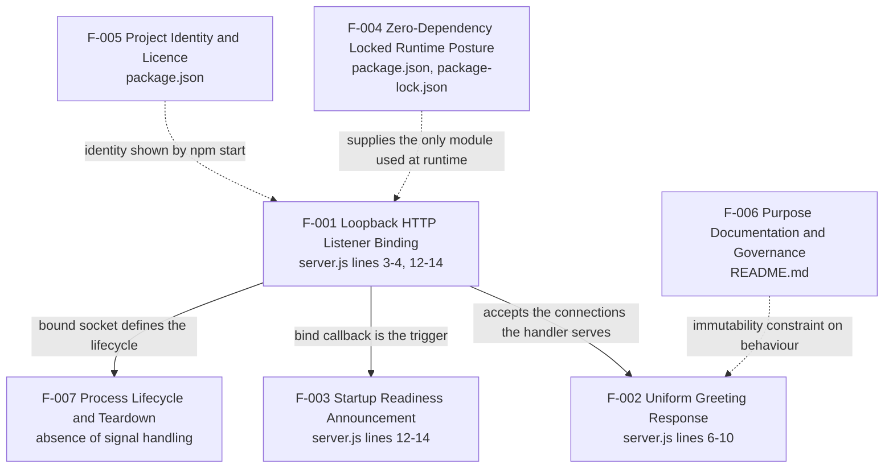

| Feature | Depends On | Nature of the Dependency |
|---|---|---|
| F-001 | None | Hard prerequisite for every other runtime feature; binds before any response or log occurs |
| F-002 | F-001 | Handler executes only for connections the listener accepts (`server.js` lines 6, 12) |
| F-003 | F-001 | Log statement lives only inside the `listen` success callback (`server.js` lines 12-14) |
| F-004 | None | Manifest and lockfile properties, independent of runtime execution |
| F-005 | None | Manifest metadata; surfaced by npm when a script runs (`> hello_world@1.0.0 start`) |
| F-006 | None | Documentation artifact; constrains the other features by policy rather than by code |
| F-007 | F-001 | There is no process lifecycle to end until the socket is bound |

### 2.3.2 Integration Points

| Integration Point | Direction | Features Involved | Contract Observed |
|---|---|---|---|
| HTTP/1.1 over TCP `127.0.0.1:3000` | Inbound | F-001, F-002 | Any method, any path → `200`, `Content-Type: text/plain`, 14-byte body |
| Process stdout | Outbound | F-003 | Exactly one line: `Server running at http://127.0.0.1:3000/` |
| Process signals (`SIGTERM`, `SIGINT`) | Inbound from supervisor | F-007 | Immediate exit, no shutdown output, port released |
| npm CLI — `npm start` | Development time | F-001, F-004, F-005 | npm runs its implicit default `node server.js`; prints `hello_world@1.0.0` |
| npm CLI — `npm test` | Development time | F-005 | `Error: no test specified`, exit code 1 |
| Backprop integration pipeline | External, unmodelled | F-006 | Named in `README.md` only; no client, endpoint list or contract exists in the repository |

### 2.3.3 Shared Components

| Shared Component | Used By | Role |
|---|---|---|
| Node.js built-in `http` module (the single `require`) | F-001, F-002, F-004 | Provides `createServer`, the `http.Server` and its request/response objects; the only import in the repository |
| `http.ServerResponse` instance `res` | F-002 | Carries the status assignment, the header set and the final `res.end` body write |
| Module constants `hostname` and `port` | F-001, F-003 | Bind address for `listen` and the values interpolated into the startup line, so the log cannot disagree with the actual bind |
| `package.json` | F-004, F-005 | Declares the empty dependency set, the identity fields, the `test` placeholder and the unused `main` pointer |
| `package-lock.json` | F-004, F-005 | Locks the empty graph at `lockfileVersion` 3 and mirrors name, version and licence |

### 2.3.4 Common Services

No service layer exists. The system has one process, one handler and no middleware, framework, router, configuration service, logging service, cache, queue or shared client. The facilities the features do rely on are supplied by the platform, not by the repository:

| Facility | Provided By | Consumed By |
|---|---|---|
| TCP socket handling and HTTP/1.1 framing | Node.js `http` module | F-001, F-002 |
| Process startup and CommonJS module loading | Node.js runtime | F-001, F-004 |
| stdout stream | Node.js runtime / host process manager | F-003 |
| Signal delivery and socket cleanup | Operating system | F-007 |
| Script invocation and manifest identity display | npm CLI | F-004, F-005 |

Because F-001 through F-007 share nothing beyond these platform facilities and the two manifest files, a defect in one feature cannot cascade through a shared library; the practical coupling is that any change to the response literals in F-002 immediately changes the assertions a consumer of F-001 can make, which is precisely the drift that F-006 governs.


## 2.4 Implementation Considerations

No performance, capacity or reliability target is declared anywhere in the repository — there is no SLA, benchmark, metrics endpoint or load test. The tables below therefore separate what the code constrains (technical, security, maintenance) from what is merely observed (start-up and response behaviour under the probes described in 2.2.8), and they state plainly where no target exists rather than implying one.

### 2.4.1 Technical Constraints, Performance and Scalability

| Feature | Technical Constraints | Performance Requirements | Scalability Considerations |
|---|---|---|---|
| F-001 | Address is a compile-time literal (`server.js` lines 3-4); no `process.env`, argv or config file is read; one socket per process; a second instance cannot bind | Bind completes within the harness start-up timeout; no numeric target is specified in the repository | One port per host means one instance per host; there is no clustering, worker pool or `SO_REUSEPORT` use, so vertical or horizontal scaling of the fixture itself is not supported |
| F-002 | Handler is synchronous and reads nothing from `req`; body is a 14-byte literal; no content negotiation, compression, keep-alive tuning or streaming | No stated target; 20 concurrent requests all returned `200`; responses are written in a single `res.end` call | Because the handler holds no per-request state, concurrency is bounded only by the Node.js event loop and OS backlog; no scaling mechanism is implemented or needed at fixture scale |
| F-003 | Output is a single `console.log` to stdout; no log framework, level control, structured format or file sink | One write at start-up, then no further writes regardless of request volume | Log volume is constant, so it neither grows with traffic nor requires rotation |
| F-004 | Node.js runtime with CommonJS required; zero third-party packages; no build, bundle or transpile step | Start-up cost limited to Node.js boot plus module load; no installation step | Every host runs the same empty dependency graph, so environment parity is inherent; there is no artefact to distribute |
| F-005 | Manifest `main` points at absent `index.js`; scripts hold only the failing `test` placeholder | Not applicable | Not applicable — metadata only |
| F-006 | Two-line `README.md`; instructions are policy, not automation | Not applicable | Not applicable |
| F-007 | No signal handlers, no drain, no shutdown endpoint; termination is supervisor-driven | Exit is immediate; no graceful-shutdown deadline exists | Repeated start/stop cycles are safe because no state survives a run and the port is released on exit |

### 2.4.2 Security Implications and Maintenance Requirements

| Feature | Security Implications | Maintenance Requirements |
|---|---|---|
| F-001 | Loopback bind limits exposure to the local host (verified refused on `10.11.2.21:3000`); plaintext HTTP only, no TLS; bind failure is surfaced rather than masked | Keep the two literals aligned with the startup log if the address ever changes; port 3000 must be free on the host |
| F-002 | No authentication, authorisation, session or CORS; no request data is reflected, parsed or deserialised, so no injection or deserialisation sink exists; `text/plain` prevents sniffing into an active content type | Response literals are the fixture's contract: any edit to `200`, `text/plain` or `Hello, World!\n` changes every consumer assertion and must be treated as a breaking change |
| F-003 | The line discloses only the loopback address already present in source; no caller data is logged, so no log-injection or PII exposure path exists | Preserve the exact line text and the single-emission guarantee; do not add request or error logging without owner authorisation |
| F-004 | Zero supply-chain surface: nothing to audit, licence-scan or patch upstream; no unreviewed code executes at runtime | Keep the dependency keys absent and the lockfile at `lockfileVersion` 3; adding any package changes the fixture's audit posture |
| F-005 | No secrets, tokens or personal data beyond the author handle; MIT licence permits unrestricted reuse | Two known deviations to leave documented, not silently "fixed": `main: index.js` resolves to `MODULE_NOT_FOUND`, and `npm test` always exits 1 |
| F-006 | No operational detail beyond the fixture's purpose; the do-not-modify instruction also limits unrequested exposure of behaviour | Maintain zero drift against baseline `a6f7f58`; new files — workflows, `Dockerfile`, `.env`, tests — require owner authorisation |
| F-007 | Abandoned in-flight requests on abrupt exit are acceptable because each response is a single literal; no privileged listener lingers | Teardown must remain signal-driven; do not introduce a shutdown endpoint or drain window without authorisation |

### 2.4.3 Assumptions and Constraints

**Assumptions carried by this section.**

| ID | Assumption | Basis |
|---|---|---|
| A-1 | A Node.js runtime capable of CommonJS and the built-in `http` module is present on the host | Verified with Node.js v22.23.4 and npm 11.21.0 |
| A-2 | Port 3000 is free on the loopback interface when the fixture starts | `server.js` line 4; `EADDRINUSE` observed when it is not |
| A-3 | The consumer can capture process stdout and address `127.0.0.1:3000` from the same host | The only two runtime interfaces the code provides |
| A-4 | The fixture is used as a comparison baseline rather than as a service with functional requirements of its own | `README.md` purpose statement and the blank npm `test` script |
| A-5 | The backprop pipeline referenced in `README.md` is defined outside this repository | No client, contract or configuration for it exists here |

**Constraints that bound the requirements.**

| ID | Constraint | Effect on Requirements |
|---|---|---|
| C-1 | "Do not touch!" in `README.md` | Any change to F-001 to F-007 is a new, owner-authorised deliverable rather than an enhancement |
| C-2 | Host, port, status, content type and body are literals with no configuration layer | Requirements cannot specify configurable behaviour; every value is fixed |
| C-3 | No automated tests exist and `npm test` exits 1 by design | All 25 requirements are verified externally by harness probes, not by in-repository tests |
| C-4 | No persistence, logging framework or observability instrumentation is present | Requirements state values as observable externally only; nothing is measured inside the process |
| C-5 | One process, one socket, one handler, no dependencies | Requirements stay within a three-statement request path; scope of any change stays small and reviewable |

**Requirement version tracking.** The requirement set is versioned against the repository baseline, because the repository carries a single commit and no changelog.

| Item | Baseline | Version | Change Note |
|---|---|---|---|
| Feature set F-001 to F-007 | `a6f7f58` | 1.0 | Initial capture; every feature marked Completed because each is implemented and verified |
| Requirement set F-001-RQ-001 to F-007-RQ-003 | `a6f7f58` | 1.0 | 25 requirements, all Low complexity, 19 Must-Have and 6 Should-Have |
| Verification evidence | Branch `QA-win-linux-env`, Node.js v22.23.4, npm 11.21.0 | 1.0 | Runtime, header, byte-level, failure-mode and teardown observations recorded against this baseline |

The requirement set is superseded whenever the tracked-file set, the response literals, the bind address, the startup line, the manifest identity or the dependency graph changes; each such change alters at least one acceptance criterion above and must be reflected here before the fixture is used as a baseline again.


## 2.5 References

**Repository artifacts cited as evidence.**

- `server.js` — the only executable artifact: `require('http')` (line 1), the `hostname`/`port` literals (lines 3-4), the uniform handler setting `200`, `Content-Type: text/plain` and the 14-byte body (lines 6-10), the `listen` call and startup log (lines 12-14); establishes F-001, F-002, F-003 and F-007, and the absence of signal handling, routing, error handling and configuration reads.
- `package.json` — identity and metadata (`hello_world`, `1.0.0`, description, `main: index.js`, author `hxu`, MIT), the `test` placeholder script, and the absence of dependency, `engines`, `private` and `start` entries; establishes F-004 and F-005.
- `package-lock.json` — `lockfileVersion` 3, `requires: true`, and a single root `packages[""]` entry with no resolved packages, URLs or hashes; establishes the empty, locked dependency graph of F-004 and the identity mirror of F-005.
- `README.md` — the `# hao-backprop-test` heading and the sentence "test project for backprop integration. Do not touch!"; establishes F-006 and the governance constraint C-1.
- Repository root (`""`) — confirmed to contain exactly these four files and no sub-folders, so the feature set above is exhaustive for the checkout.

**Verified behaviour used as acceptance evidence.**

- Startup stdout captured from `node server.js`: `Server running at http://127.0.0.1:3000/`.
- HTTP probes on `127.0.0.1:3000`: `GET /`, `GET /nope?x=1` and `POST /` with a JSON body each returned `200`, `text/plain`, 14 bytes; headers included `Date`, `Connection: keep-alive`, `Keep-Alive: timeout=5`, `Content-Length: 14`; `HEAD /` returned `200` with no body and no `Content-Length`; 20 concurrent requests all returned `200`.
- Failure and isolation probes: connection to `10.11.2.21:3000` refused; a second instance failed with `EADDRINUSE` on `127.0.0.1:3000` and exit code 1; `PORT=4000` and `HOST=0.0.0.0` were ignored.
- Tooling probes: `npm start` ran npm's implicit default `node server.js` and printed `> hello_world@1.0.0 start`; `npm test` printed `Error: no test specified` and exited 1; `require('./')` failed with `MODULE_NOT_FOUND` for `index.js`.
- Lifecycle probes: `SIGTERM` ended the process with no additional stdout; the port was released and a new instance bound successfully.
- Git metadata: single commit `a6f7f58` ("Add files via upload"), branches `main` and `QA-win-linux-env` (identical trees), no tags; used as the baseline for F-006 and for requirement versioning.

**Related specification sections.**

- 1.1 Executive Summary — stakeholders, business problem and value proposition that the feature priorities reflect.
- 1.2 System Overview — component inventory and the flowcharts in 1.2.2 that this section's requirement map extends.
- 1.3 Scope — the definitive list of excluded capabilities that this section deliberately omits from the catalog.
- 1.4 References — repository-level reference list.

**External sources.** None. The section was written from the repository alone; no web source was consulted, and the observed runtime versions (Node.js v22.23.4, npm 11.21.0) were read from the execution environment rather than from documentation.


# 3. Technology Stack

## 3.1 Programming Languages

The repository contains exactly one programming language at runtime — JavaScript on the Node.js runtime — plus the two data/documentation formats npm requires. A case-insensitive sweep of all four tracked files for the tokens `python`, `typescript`, `swift`, `kotlin`, `objective-c`, `react`, `tailwind`, `electron` and `terraform` returned no matches, and a census of file extensions found only `.js` (1 file), `.json` (2 files) and `.md` (1 file). Nothing in the default-stack catalogue of alternative languages and platforms applies to this system.

### 3.1.1 Language Inventory by Platform and Component

| Component | File (lines) | Language | Language level actually used | Module system |
|---|---|---|---|---|
| HTTP service (the only executable artifact) | `server.js` (14) | JavaScript / ECMAScript | ES2015 subset: `const` bindings (L1, L3, L4, L6), arrow function (L6), template literal (L13). No classes, generators, `async`/`await`, optional chaining, destructuring or type annotations | CommonJS — one static `require('http')` (L1); no `import`/`export` anywhere |
| npm manifest | `package.json` (10) | JSON (npm package schema) | npm manifest keys only; no custom keys | Not applicable (npm reads it as a data document) |
| npm lockfile | `package-lock.json` (13) | JSON | npm `lockfileVersion` 3 | Not applicable |
| Purpose statement and change policy | `README.md` (2) | Markdown | One level-1 heading plus one sentence of plain text | Not applicable |

Line counts total 39 across the four files — the same figure recorded in 1.2.2 and used as the whole-system size in 1.2.3. Only `server.js` is executed; the two JSON files are consumed by the npm CLI, and the Markdown file is consumed by humans only.

### 3.1.2 Selection Criteria and Justification

The language choice follows from the fixture's stated purpose (`README.md` line 2: "test project for backprop integration") and from the three properties that purpose demands: start with no installation step, resolve no dependencies, and open one socket plus emit one log line.

| Selection criterion | How JavaScript on Node.js satisfies it | Evidence |
|---|---|---|
| Zero install, zero dependency resolution | A single built-in module (`http`) provides the whole HTTP surface, so no package is downloaded before first run | `server.js` L1; empty dependency graph in `package-lock.json` |
| One process, one file, one response | The language's standard library exposes `http.createServer` and a mutable response object, so the entire behaviour fits in 11 non-blank lines | `server.js` L6-14 |
| Determinism for pipeline assertions | Status, header and body are string and numeric literals, not computed values | `server.js` L7-9 |
| Cross-platform parity | Nothing in the source is platform-specific; only the `http` built-in and literals are used, consistent with the `QA-win-linux-env` branch alongside `main` | `server.js` whole file; `git branch -a` |
| Metadata and documentation without extra tooling | npm's native formats are JSON, and a two-line Markdown file needs no generator | `package.json`, `package-lock.json`, `README.md` |

JSON and Markdown are present because the package manager and human readers require them, not because any code parses or transforms them at runtime: `server.js` reads no file.

### 3.1.3 Language Constraints and Dependencies

| Constraint | Detail | Evidence |
|---|---|---|
| Runtime version is undeclared | `package.json` has no `engines`, `packageManager`, `os` or `cpu` field, so no Node.js version is enforced or advertised | `package.json` (all keys enumerated); `node -e` field probe returned `undefined` for each |
| Only indirect, lockfile-derived floor | The sole version signal in the repository is `"lockfileVersion": 3`, a format npm 9 and later write; npm 9 declares `engines.node` of `^14.17.0 \|\| ^16.13.0 \|\| >=18.0.0`, so a Node.js line able to host npm 9 or later is the practical floor implied by the lockfile | `package-lock.json` L4; npm CLI v9 docs and npm/cli v9.0.0 `engines` field [web] |
| Language-level floor is lower than the lockfile floor | The ES2015 constructs used are supported by every Node.js line since 4.x, so the source itself imposes no constraint beyond the lockfile's | `server.js` L1, L6, L13 |
| CommonJS is fixed | With no `"type": "module"`, `.js` resolves as CommonJS; adding ESM would require either a `type` field or `.mjs`, neither present | `package.json`; `server.js` L1 |
| No language tooling exists | No `tsconfig.json`, `.babelrc`, `.eslintrc`, `.prettierrc`, `.editorconfig` or `.npmrc`/`.nvmrc` file is present, so no compilation, transformation, linting or version pinning step can occur | directory listing of the repository root (`.git` prune); dotfile check |
| Source reaches the runtime verbatim | With no build or transpile step, the deployed artifact is the source file itself | `package.json` `scripts` holds only the `test` placeholder; no build script |
| Verified execution baseline | The checkout was exercised successfully on Node.js v22.23.4 with npm 11.21.0; the startup line and the HTTP response both appeared | runtime probe of `node server.js` and `npm start`; see 1.2.3 and 2.4.3 (A-1) |

Two dependency relationships bind the languages together. First, `server.js` depends on the Node.js standard library only, never on `package.json`'s `main` field — which points at an absent `index.js` (`package.json` L5) and therefore cannot be used as an entry contract; `require('./')` fails with `MODULE_NOT_FOUND` naming `index.js`. Second, `package-lock.json` depends on `package.json` for identity only: it repeats `name`, `version` and `license` and records no dependency information, because there is none to record.

**Security implications.** The single static `require('http')` of a built-in module means no third-party code is parsed or executed at load time, and the absence of a `node_modules` directory removes local module-shadowing as an attack path. The source contains no `eval`, `Function` constructor, `vm` usage, dynamic `require`, `child_process` or deserialization call, so no code-execution or injection sink exists at the language level (consistent with 2.4.2, F-002 and F-004). The corresponding cost is that the runtime version is unpinned: the same source may be executed by any Node.js line the host provides, so reproducibility beyond "any Node.js able to run npm 9 or later" is not asserted anywhere in the repository.


## 3.2 Frameworks & Libraries

No third-party framework or library is present. The complete library surface of this system is the Node.js standard library, of which exactly one module — `http` — is required, and the whole framework surface is that module's server API. The tables below register every component with a version or an explicit statement that no version is declared.

### 3.2.1 Component and Version Register

| Component | Version | Where it is declared | Verified value in this environment |
|---|---|---|---|
| Node.js runtime | Not declared in the repository (`engines` and `packageManager` absent); implied floor `^14.17.0 \|\| ^16.13.0 \|\| >=18.0.0` from `lockfileVersion` 3, which npm 9+ writes | Undeclared — `package.json`; indirect signal in `package-lock.json` L4 | v22.23.4 |
| npm CLI | Not declared; `>= 9` implied by `lockfileVersion` 3 (npm 7 and 8 write version 2 to the root lockfile; v3 is readable back to npm 7) | Undeclared — no `packageManager` field, no `.nvmrc` | 11.21.0 |
| `node:http` built-in | Bundled with the runtime; no separate version exists | Node.js distribution | Bundled with v22.23.4 |
| Lockfile format | `lockfileVersion` 3, `requires: true` | `package-lock.json` L4-5 | As declared |
| HTTP protocol in use | HTTP/1.1, plaintext, `Connection: keep-alive` with `Keep-Alive: timeout=5` (Node.js server default) | Emergent from `http.createServer` + `server.listen` | Observed on the wire |
| Project package | `hello_world` 1.0.0, MIT licence | `package.json` L2-3, L10; `package-lock.json` L2-3, L10 | As declared |
| Response contract | `200`, `text/plain`, body `Hello, World!\n` (14 bytes) | `server.js` L7-9 | Observed: `Content-Length: 14` |

### 3.2.2 Libraries in Use

| Library | Version | Role in the system | Justification |
|---|---|---|---|
| `node:http` (built-in) | Bundled with Node.js v22.23.4; `createServer`, `server.listen`, `ServerResponse.statusCode`, `setHeader`, `end` are stable across every Node.js line in the implied range | Creates the `http.Server`, parses the incoming HTTP/1.1 request, serialises the response and manages the keep-alive connection | The fixture needs one listener with one fixed response. A built-in module satisfies that with no package download, no lockfile entry, no integrity hash and no upstream to patch, which is precisely the posture recorded as F-004 |
| `console` (global) | Bundled with the runtime | Emits the single startup line that a harness consumes as its readiness signal | It is the only output channel the code uses; adding a logging library would introduce the dependency the fixture is built to avoid |
| npm CLI | `>= 9` (implied); verified 11.21.0 | Supplies `npm start` (through npm's implicit default script, `node server.js`) and `npm test` | The repository is an npm-managed package; the CLI is the only tool the manifest implies |

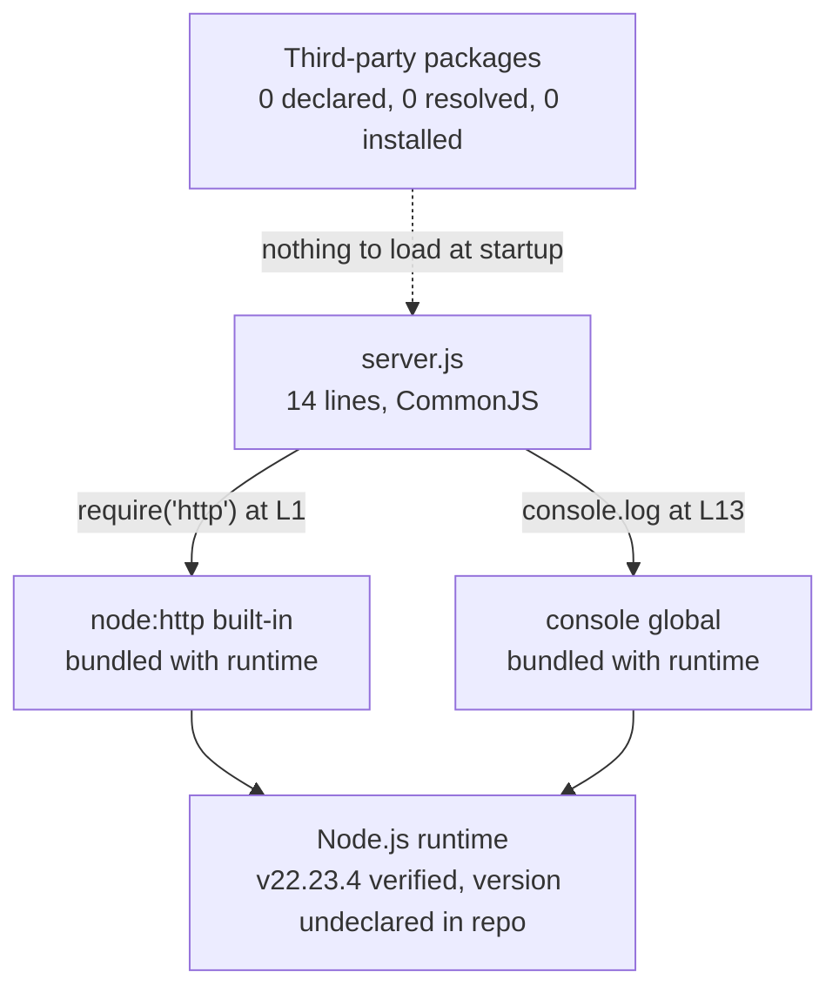

### 3.2.3 Frameworks Explicitly Absent

| Candidate framework class | Status | Evidence of absence |
|---|---|---|
| Web framework (Express, Fastify, Koa) | Absent | Case-insensitive sweep for `express`, `fastify`, `koa` across all tracked files returned no matches; the only `require` is `http` (`server.js` L1) |
| Routing, middleware or validation library | Absent | No routing call exists; `req` is never read (`server.js` L6), and every path returns `200` (verified for `/`, `/does-not-exist`, `/nope?x=1`) |
| Template engine or serialiser (JSON/XML/HTML) | Absent | The only response write is `res.end('Hello, World!\n')` (`server.js` L9) |
| Test framework (Jest, Mocha) | Absent | `scripts.test` is npm's placeholder `echo "Error: no test specified" && exit 1` (`package.json` L7); no framework token appears in any file |
| Lint, format or type-check toolchain (ESLint, Prettier, TypeScript) | Absent | No configuration file and no `devDependencies` key exist |
| Bundler or transpiler (webpack, Vite, Babel) | Absent | No configuration file, no build script, no dependency |

Each absence is a design consequence rather than an omission: 1.3.3 records routing, method semantics, request parsing and response serialisation as out of scope, and any of those frameworks would either add behaviour the fixture must not have or add a dependency graph it must not have.

### 3.2.4 Compatibility and Integration Requirements

| Integration point | Requirement | Evidence / consequence |
|---|---|---|
| Launch contract | Start the process by file path — `node server.js` or `npm start` — never through the package `main` field | `package.json` L5 sets `main: "index.js"`, a file absent from the repository; `require('./')` fails with `MODULE_NOT_FOUND` naming `index.js` |
| npm `start` compatibility | No `start` script is declared, so `npm start` relies on npm's implicit default script, which runs `node server.js`; this works only while the entry file keeps that name | `package.json` L6-8; verified run printed `> hello_world@1.0.0 start`, `> node server.js`, then the startup line, and the socket answered `200` / `text/plain` / 14 bytes |
| Lockfile compatibility | The lockfile must stay at `lockfileVersion` 3; an npm 7 or 8 install would rewrite it to version 2, which is drift from baseline `a6f7f58` | `package-lock.json` L4; npm CLI docs [web] |
| Runtime API compatibility | Only long-stable `node:http` members are used, so any Node.js line that supports CommonJS and `http.createServer`/`listen` is sufficient | `server.js` L1, L6-14 |
| Request-listener signature | `http.createServer((req, res) => …)` — a two-parameter listener; the `req` binding is accepted and never referenced, so no request-derived data reaches a sink | `server.js` L6 |
| Response API surface | `res.statusCode = 200`, `res.setHeader('Content-Type', 'text/plain')`, `res.end(...)`; Node computes `Content-Length` (14) and sets `Date`, `Connection: keep-alive` and `Keep-Alive: timeout=5` | `server.js` L7-9; verified response headers |
| Bind semantics | `server.listen(port, hostname, callback)` with literals; no `process.env` override is read, so `PORT` and `HOST` are ignored | `server.js` L3-4, L12; environment-variable probe left the bind unchanged |
| Failure behaviour | No `'error'` listener is attached to the server, so a bind failure surfaces as an unhandled `EADDRINUSE` event and the process exits 1 | reproduced by starting a second instance while the first held port 3000 |

**Security implications of these choices.** Using only built-ins eliminates the version-conflict and abandoned-package risks that framework pinning normally addresses, and it removes all transitive code from the attack surface. The trade-off is that the system inherits every default of its runtime: plaintext HTTP/1.1, the 5-second keep-alive timeout, Node's default header set, and no server-side request limits or timeouts configured by the application. Those defaults are acceptable only for a loopback-bound fixture (see 3.4), and any change to the framework surface — a web framework, a logger, a test runner — alters the audit posture recorded in 2.4.2 (F-004) and requires owner authorisation under the `README.md` "Do not touch!" constraint.


## 3.3 Open Source Dependencies

The repository resolves no third-party or open-source library. Its package manifests are present and valid, but the dependency graph they describe contains exactly one node — the root package itself — so there is no library to version, license, patch or audit.

### 3.3.1 Manifests, Registry and Declared Packages

| Artifact | Registry / format | Version | Declared dependencies | Locked packages |
|---|---|---|---|---|
| `package.json` | npm package manifest (public npm registry is the implied default; no `.npmrc` exists to override it) | `1.0.0` (L3) | None. `dependencies`, `devDependencies`, `peerDependencies`, `optionalDependencies` and `bundledDependencies` keys are all absent | Not applicable |
| `package-lock.json` | npm lockfile, `"lockfileVersion": 3`, `"requires": true` (L4-5) | Matches the manifest, `1.0.0` (L3) | None | 1 entry: the root package, keyed `""` (L6-11) |
| `node_modules/` | npm install output | Not present in the checkout | Not applicable | 0 installed |

Field-level facts behind that table, all read directly from the two manifests:

- Direct dependencies: **0**. No dependency key of any kind is present in `package.json`.
- Transitive dependencies: **0**. The `packages` object in `package-lock.json` has no `node_modules/*` members, no `resolved` URLs and no `integrity` hashes.
- Installed packages: **0**. There is no `node_modules` directory, and `npm install` has nothing to fetch.
- Registry override: **none**. No `.npmrc` file exists, so the public npm registry would be used if a dependency were ever added.
- Registry publication: **not configured**. `package.json` has no `private`, `publishConfig`, `files` or `repository` field, and `main` points at an absent `index.js` (L5), so the package is not a distributable artifact.

### 3.3.2 Dependency and Version Management Posture

| Aspect | Position | Evidence |
|---|---|---|
| Version pinning strategy | None required, because nothing is installed. The only versioned artifacts are the project itself (`1.0.0`) and the lockfile format (`3`) | `package.json` L3; `package-lock.json` L3-4 |
| Toolchain pinning | npm and Node.js versions are unpinned — no `packageManager`, `engines`, `.nvmrc` or `.npmrc` | `package.json`; root directory listing |
| Reproducibility mechanism | Reproducibility comes from an empty graph rather than from pins: every host resolves the same zero packages | `package-lock.json` L6-11 |
| Supply-chain surface | Zero third-party code, therefore no CVE tracking, no upstream patch obligation, no abandoned-package risk, and no licence obligation from any dependency | Both manifests in full |
| Offline operation | The runtime cannot require registry access: no download occurs at start or at run time | `server.js` L1 requires only the built-in `http` |
| Licence of record | MIT, declared by the project itself — not inherited from a dependency | `package.json` L10; `package-lock.json` L10 |
| Change constraint | Adding any package would contradict F-004 and the `README.md` instruction "Do not touch!", so it is an owner-authorised deliverable, not an enhancement | `README.md` L2; 2.4.2 (F-004), 2.4.3 (C-1, C-5) |

**Security implications.** The supply-chain risk profile is as small as it can be for an npm project: an empty dependency tree means an empty SBOM beyond the root package, no registry trust decision, no post-install script from any package, and nothing to audit when a dependency advisory is published. The residual risks are the unpinned runtime version (3.1.3) and the risk that a future `npm install` of anything at all reintroduces the audit surface this fixture deliberately avoids; the lockfile's emptiness is therefore a property to preserve, not an artefact to regenerate.


## 3.4 Third-Party Services

The system integrates with no third-party service of any kind. Every category the section requires — external APIs, authentication providers, monitoring tools, cloud services — is empty, and each emptiness is verifiable in the source rather than inferred from missing documentation.

### 3.4.1 Service Inventory

| Service category | Services present | Evidence of absence |
|---|---|---|
| External APIs and outbound integrations | None | The only `require` in the repository is `http` (`server.js` L1), and it is used exclusively as a server (`createServer`, `listen`). No HTTP client call (`http.request`, `https`, `fetch`), no `net`, `tls`, `dns` or `dgram` module, and no request to any hostname exists |
| Authentication and identity providers (Auth0, OAuth, OIDC, JWT, sessions) | None | No `Authorization` header is read or written; the single header set is `Content-Type` (`server.js` L8); no credential, token, cookie, account or role concept appears in any file; sweep for `auth0`, `oauth`, `jwt` returned no matches |
| Monitoring, APM, tracing, log aggregation | None | No exporter, agent, SDK, metrics or health endpoint exists. The only output statement is `console.log` at startup (`server.js` L13), writing to stdout with no sink |
| Cloud platform services (AWS, Azure, GCP) | None | Sweep for `aws`, `azure`, `gcp` across all tracked files returned no matches; no SDK, no region or endpoint setting, no credential read, no `process.env` access anywhere |
| Managed data services (MongoDB Atlas, managed SQL, Redis, object storage) | None | No database or cache driver, connection string or client library in any file (see 3.5) |
| AI or model services (LangChain and equivalents) | None | Sweep for `langchain` returned no matches; no outbound call exists to reach a model endpoint |
| Secrets and configuration services (vaults, parameter stores) | None | No configuration is fetched: `hostname` and `port` are literals (`server.js` L3-4) and no environment variable is read |
| Source-control hosting | GitHub, reachable only at development time | The `origin` remote points at a GitHub-hosted repository, and the tool is used for clone/push only. It is never invoked by `server.js` and is not a runtime dependency |

### 3.4.2 Runtime Integration Requirements

| Requirement | Status for this system |
|---|---|
| Outbound network egress | Not required and not possible from the code: no client module is loaded and no hostname is referenced |
| DNS resolution by the application | Not performed |
| Credentials, tokens or certificates provisioned | None; no file or environment variable supplies one |
| Time synchronisation or external clock service | None; the `Date` response header is generated locally by Node.js from the host clock |
| Inbound exposure beyond the host | Not present: the listener binds `127.0.0.1:3000`, and a connection to the non-loopback interface `10.11.2.21:3000` was refused (recorded in 1.2.3 and 2.4.2) |
| Consumer of the fixture | The backprop integration named in `README.md` L2 is an external consumer with no client, contract or configuration inside this checkout (see 1.3.4); it is therefore not a service integration of this repository |

### 3.4.3 Security Implications

The absence of third-party services is the system's principal security control and its principal functional limitation, and both effects are structural rather than configured:

- **No egress means no exfiltration path.** With no outbound client, no credential store and no telemetry exporter, there is no channel over which request data could leave the host — and indeed the handler never captures request data (`req` is unread, `server.js` L6).
- **No third-party trust boundary.** Nothing outside the host must be available for the system to function, so an outage of an identity provider, a cloud region or a monitoring backend cannot affect it.
- **No inbound protection.** The mirror image of that isolation is that the service has no TLS, no authentication, no authorisation and no rate limiting (2.4.2, F-001 and F-002). Loopback binding is the only access control, which is why any redirection of the bind address or any exposure through a proxy would remove the system's sole protection and must be treated as a security change rather than an operational one.


## 3.5 Databases & Storage

The system has no database, no cache and no storage service. Nothing is written to disk at runtime, nothing is read from disk at runtime, and no state survives the process, so there is no persistence strategy to describe beyond the literals compiled into the source.

### 3.5.1 Storage Inventory

| Storage category | Present | Evidence |
|---|---|---|
| Primary database (relational or document) | None | No driver, connection string, ORM/ODM or query statement in any tracked file; no `mongodb`, `postgres`, `mysql`, `sqlite` token anywhere |
| Secondary or replica database | None | No secondary connection exists, because no primary does |
| Cache (in-memory distributed or external) | None | No `redis`/`memcached` client and no cache structure in `server.js`; every response is regenerated per request |
| Object or file storage | None | The `fs` module is not required; no path is constructed; no upload or download handling exists; `req` is never read (`server.js` L6) |
| Embedded store or local file database | None | No file is opened at runtime; the only files in the repository are source and metadata |
| Persistent log sink | None | The single `console.log` (`server.js` L13) writes to stdout; no file, rotation or aggregation target exists |
| Session or conversation store | None | No cookie, session identifier or caller identity concept exists (see 3.4.1) |

### 3.5.2 State and Persistence Strategy

All state is process-local and ephemeral. The complete inventory of runtime state is: two module-level constants (`hostname = '127.0.0.1'` at `server.js` L3, `port = 3000` at L4), the `http.Server` instance assigned at L6, and the inline request handler. There is no module-level data structure, counter or cache that a request could read or mutate.

| Data | Where it lives | Lifetime | Persistence |
|---|---|---|---|
| Bind address and port | Two `const` bindings in `server.js` L3-4 — compiled into source, not read from configuration | Process lifetime | Only as long as the source file itself |
| Server object and listening socket | Heap and OS socket table, created by `http.createServer`/`server.listen` (L6, L12) | From startup until the process exits | None; the port is released on exit |
| Request data (path, headers, method, body) | Received by the socket and discarded; `req` is never referenced (L6) | Duration of one request dispatch | Never retained |
| Response payload | The literal `'Hello, World!\n'`, 14 bytes, produced per request by `res.end` (L9) | Duration of one response | Not retained; regenerated identically each time |
| Startup message | `console.log` output (L13) | The process's stdout stream | Only if the supervisor captures and stores it, which is outside this repository |
| Dependency graph | `package-lock.json`, an empty graph at `lockfileVersion` 3 | Repository lifetime | Version-controlled, never written by the process |
| Project identity | `package.json` name, version, author and licence | Repository lifetime | Version-controlled |

Two consequences follow directly from this table. First, restarts are stateless and idempotent: nothing is lost, nothing must be recovered, and no initialisation sequence exists (2.4.1, F-007). Second, the system's only durable data are its four tracked files under Git, which is the repository's sole persistence mechanism; the values that resemble configuration (host and port) are persisted as source literals rather than in a configuration store, matching constraint C-2 in 2.4.3.

### 3.5.3 Caching

No application-level caching exists. There is no memoisation, no response cache headers, no `Cache-Control` or `ETag` emitted, and no in-process cache object. The only reuse mechanism on the path is the HTTP connection itself: Node.js keeps the socket open with `Connection: keep-alive` and `Keep-Alive: timeout=5` (observed on the wire), which reuses the TCP connection but caches no payload — each request on a reused connection regenerates the same 14-byte body.

### 3.5.4 Security and Maintenance Implications

- **No data-at-rest obligations.** With no store, there is no encryption-at-rest requirement, no retention or deletion policy, no backup or restore procedure, no data classification and no residency question to answer.
- **No injection or deserialization sink.** No query is constructed, because no data store is queried; no payload is parsed, because `req` is never read (consistent with 2.4.2, F-002).
- **No migration or schema management.** There is no schema, so no migration tool, version table or rollback path exists.
- **The absence must be preserved deliberately.** Introducing a store — even an in-memory one — would add state across requests and end the fixture's statelessness, changing the requirements in 2.2 whose acceptance criteria assume a fixed, identical response and a process that leaves nothing behind.


## 3.6 Development & Deployment

Development and deployment for this system consist of a Git checkout followed by a single foreground command. There is no build step, no package install, no container image, no infrastructure definition and no pipeline: the source file that is committed is the exact file the runtime executes.

### 3.6.1 Development Tooling Inventory

| Concern | Status | Evidence |
|---|---|---|
| Source control | Git; `origin` points at a GitHub-hosted repository; one commit `a6f7f58` ("Add files via upload", 2026-11-16 13:06:40 +0530) adding 4 files / 40 insertions; branches `main` and `QA-win-linux-env`; no tags or releases | `git log`, `git branch -a`, `git remote -v`, `git tag` (empty) |
| Package manager | npm; the lockfile format `lockfileVersion` 3 is written by npm 9 and later [web]; verified with npm 11.21.0. No `.npmrc` and no `.nvmrc`, so neither registry nor Node.js version is pinned | `package-lock.json` L4; root directory listing |
| Build system | None. No `build`/`compile`/`bundle` script, no bundler or transpiler configuration, no `tsconfig.json`; `scripts` contains only the `test` placeholder (`package.json` L6-8) | `package.json`; extension census of the repository |
| Dependency installation step | None required — `npm install` would resolve zero packages, so a checkout is immediately runnable | `package-lock.json` L6-11 |
| Test tooling | None. No Jest, Mocha or other runner, no `test/` or `__tests__` directory, no coverage configuration; `npm test` prints `Error: no test specified` and exits 1 by design | `package.json` L7; verified `npm test` run |
| Lint, format, type-check | None — no ESLint, Prettier, TypeScript or editor configuration file exists | root directory listing (no `.eslintrc*`, `.prettierrc*`, `.editorconfig`) |
| Editor/IDE configuration | None present in the checkout | root directory listing |
| Debugging or profiling tooling | None; the only diagnostic output is the startup line | `server.js` L13 |

### 3.6.2 Build, Containerization, Infrastructure and CI/CD

| Stage | Status | Evidence of absence | Consequence |
|---|---|---|---|
| Build / transpile / bundle | Absent | No build script in `package.json`; no configuration file for webpack, Vite or Babel | Source is the artifact; there is no output directory or artifact to version |
| Containerization | Absent | No `Dockerfile`, `docker-compose.yml` or `.dockerignore`; no image reference anywhere | Deployment is a host-level process run, so there is no base image to patch and no registry to authenticate against |
| Infrastructure as Code | Absent | No Terraform/HCL, CloudFormation or other IaC file; sweep for `terraform` returned no matches | No provisioned resource, no state file and no drift to reconcile |
| CI/CD pipeline | Absent | No `.github/` directory, no `.gitlab-ci.yml`, no other pipeline definition | Nothing is automatically built, tested, scanned or deployed; and because `npm test` always exits 1, any pipeline that gated on it would fail by design |
| Packaging / artefact publication | Absent | No `private`, `publishConfig` or `files` field; `main` names an absent `index.js` (`package.json` L5) | The package is not published or installed as a module; the launch contract is the file path, not the package name |
| Secrets in the delivery path | None | No pipeline and no configuration layer exist, so no CI secret, credential or environment file is managed here | The usual CI secret-hygiene controls are not applicable, and none can be bypassed |

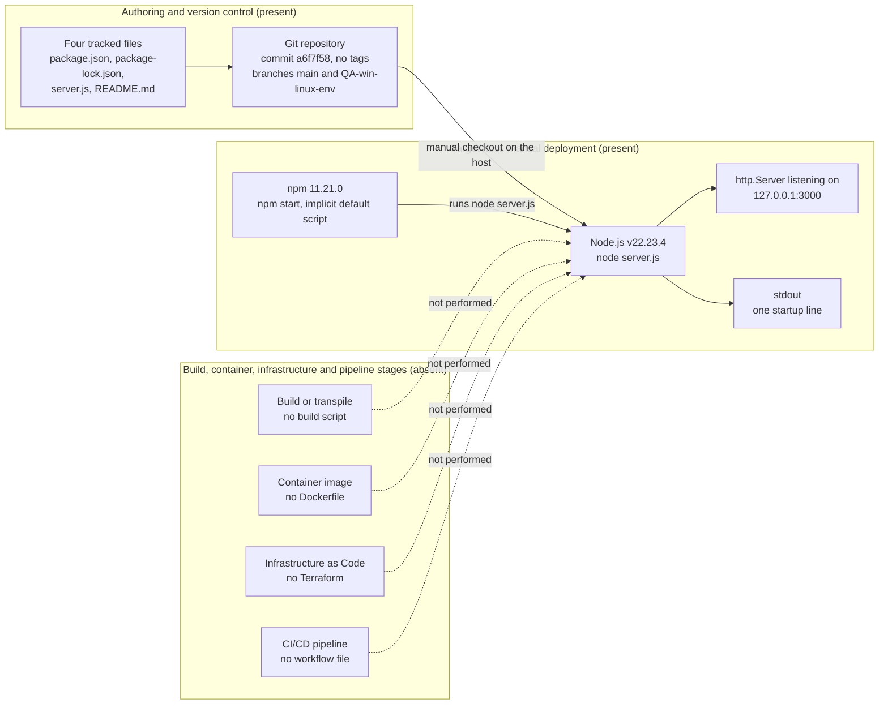

### 3.6.3 Deployment Procedure and Runtime Requirements

The deployment procedure has two steps, both verified in this environment: obtain the checkout on the target host, then run the process from the repository root.

| Step | Command | Observed result |
|---|---|---|
| 1. Obtain the source | `git clone` of the GitHub-hosted `origin`, or a copy of the four files | Four files present; no install step follows |
| 2. Start the service | `node server.js` — or `npm start`, which reaches the same command through npm's implicit default script | Startup line `Server running at http://127.0.0.1:3000/` on stdout |
| 3. Verify | Any HTTP request to `127.0.0.1:3000` on any path or method | `200`, `Content-Type: text/plain`, body `Hello, World!\n` (14 bytes) |
| 4. Stop | External signal or harness teardown; `SIGTERM` ends the process immediately with no drain | Port released immediately; no shutdown logging |

| Deployment prerequisite | Requirement | Evidence / failure mode |
|---|---|---|
| Node.js runtime | Any line able to run the used `http` APIs with CommonJS; `lockfileVersion` 3 implies npm 9+ and therefore Node.js `^14.17.0 \|\| ^16.13.0 \|\| >=18.0.0`. No version is declared in the repository | Process fails at `require('http')` if no runtime is present; verified on v22.23.4 |
| Loopback interface and free port 3000 | Address and port are literals with no override | A second instance on the same host fails with an unhandled `EADDRINUSE` error event and exits 1; `PORT`/`HOST` environment variables are ignored |
| Working directory | Repository root, or any directory, provided the entry is invoked by path — `server.js` reads no file and uses no relative path | `require('http')` is a bare built-in specifier; no `__dirname` or path use exists |
| stdout capture | The single startup line is the readiness signal, so the supervisor must capture stdout or fall back to socket polling | No log file, health endpoint or metrics route exists |
| Same-host client | The listener is unreachable from other hosts | Connection to `10.11.2.21:3000` refused (2.4.2, F-001) |
| Process supervision | None configured — no systemd unit, PM2/foreman configuration, cluster or worker process | One process, one socket; restart on exit is the operator's or harness's responsibility |

**Deployment topology.** One process per host, one listening socket, no horizontal or vertical scaling mechanism: the fixed port makes a second instance on the same host impossible, and no clustering or `SO_REUSEPORT` use exists (2.4.1, F-001). Environment parity across operating systems is inherent, since nothing used is platform-specific; the checkout was exercised on Linux, and the presence of `QA-win-linux-env` alongside `main` indicates the same files are also run on Windows, though that was not verified here.

**Security implications.** The delivery model removes several common risks outright — no pipeline to compromise, no CI secrets to leak, no base image to patch, no IaC state to protect, and no registry credential to store. It also removes the controls that a pipeline would provide: nothing scans the four files, nothing verifies that `npm test` passes (it cannot), and the runtime version is unconstrained, so two hosts may run the same source on different Node.js lines. The remaining exposure is entirely the runtime's: plaintext HTTP on a loopback address with no authentication, which is safe only while the bind stays loopback (3.4.3) and which any containerisation, proxy or bind-address change would convert into a security change requiring owner authorisation under the `README.md` "Do not touch!" constraint.


## 3.7 References

**Repository files and folders**

- `package.json` — Project identity (`hello_world` 1.0.0, MIT, author `hxu`); `main` pointing at the absent `index.js` (L5); the sole `scripts.test` placeholder (L6-8); and the confirmed absence of `engines`, `packageManager`, `type`, `private`, `repository`, `files` and every dependency key.
- `package-lock.json` — `"lockfileVersion": 3` and `"requires": true` (L4-5); the single root package entry proving an empty dependency graph with no `resolved` URLs or `integrity` hashes (L6-11); MIT licence at L10.
- `server.js` — The entire executable artifact (14 lines): `require('http')` (L1), the `hostname`/`port` literals (L3-4), the `http.createServer` handler with `statusCode`, `setHeader` and `end` (L6-10), and `server.listen` with the startup `console.log` (L12-14); establishes the language level, the CommonJS module system and the absence of configuration, TLS, logging and shutdown logic.
- `README.md` — The two-line statement of purpose ("test project for backprop integration") and the "Do not touch!" change constraint.
- Repository root `""` — The complete tracked set of four files and the absence of any sub-folder, `node_modules`, `.npmrc`, `.nvmrc`, `.gitignore`, `.editorconfig`, `Dockerfile`, `docker-compose.yml`, `.github/`, `.gitlab-ci.yml`, IaC or build/lint configuration; also the source of the `.js`/`.json`/`.md` extension census and the case-insensitive keyword sweep whose zero matches establish the absent languages, frameworks and services.
- Git metadata (`.git/`, read with `git log`, `git branch -a`, `git remote -v`, `git tag`, `git show --stat`) — Single commit `a6f7f58e7f9a31d7db526458d65b6556ffdf6daf` (2026-11-16 13:06:40 +0530, 4 files / 40 insertions); branches `main` and `QA-win-linux-env`; GitHub-hosted `origin`; no tags.

**External sources**

- [web] npm CLI v9 documentation, `package-lock.json` (https://docs.npmjs.com/cli/v9/configuring-npm/package-lock-json) — Defines `lockfileVersion` 3 as the version used by npm v9 and states its backwards compatibility to npm v7.
- [web] npm CLI v9 configuration reference, `lockfile-version` (https://docs.npmjs.com/cli/v9/using-npm/config) — Establishes that npm 9 writes version 3 for a new lockfile.
- [web] `@npmcli/arborist` CHANGELOG, npm/cli v9.0.0 (https://raw.githubusercontent.com/npm/cli/v9.0.0/workspaces/arborist/CHANGELOG.md) — Records "use v3 lockfiles by default" (arborist 6.0.0, 2022-10-19), the change bundled in npm 9.
- [web] npm 9.0.0 `package.json` `engines` field (https://raw.githubusercontent.com/npm/cli/v9.0.0/package.json) — Source of the implied Node.js floor `^14.17.0 || ^16.13.0 || >=18.0.0`.
- [web] Node.js 18.14.0 release notes (https://nodejs.org/en/blog/release/v18.14.0) — Corroborates npm 9's suitability as the default npm in the 14/16/18 LTS lines.
- [web] npm CLI v7 and v8 documentation (https://docs.npmjs.com/cli/v7/using-npm/config, https://docs.npmjs.com/cli/v8/using-npm/config) — Establish that npm 7 and 8 emit `lockfileVersion` 2 for the root lockfile, so version 3 identifies an npm 9+ origin.

**Internal cross-references**

- Technical Specification sections 1.2 (System Overview), 1.3 (Scope) and 2.4 (Implementation Considerations) — Used for the verified runtime baseline (Node.js v22.23.4, npm 11.21.0), the loopback isolation result, and the requirement, assumption and constraint identifiers (F-001, F-002, F-004, F-007, A-1, C-1, C-2, C-5) cited throughout this section.


# 4. Process Flowchart

## 4.1 Workflow Landscape and Scope

The system executes four workflows, and all of them are visible in the nine executable lines of `server.js`. **W-1** starts the process and announces readiness; **W-2** answers any HTTP request; **W-3** ends the process and releases the port; **W-4** covers the alternate developer entry points (`npm start`, `npm test`, `require('./')`). No fifth workflow exists. A text search of all four tracked files for `process.on`, `process.env`, `process.exit`, `setTimeout`, `setInterval`, `try`, `catch`, `throw`, `if`, `else`, `switch`, `for`, `while`, `fs.`, `readFile` and `writeFile` matched only `server.js` lines 1, 7, 8, 9, 12 and 13 — so there is no conditional, loop, timer, signal handler, environment read or filesystem call from which a longer flow could be built.

The diagrams in this section therefore model what the code actually does, including every branch that the Node.js runtime takes on the application's behalf — HTTP parsing rejections, header framing, keep-alive expiry and the default action on `SIGTERM`. Where a conventional process-flowchart element has no counterpart (routing decisions, batch windows, retries, authorisation gates), the sub-section says so and names the evidence for the absence rather than inventing a step.

### 4.1.1 Workflow Inventory

| ID | Workflow | Trigger | Terminal condition | Features | Diagram |
|---|---|---|---|---|---|
| W-1 | Process start and readiness | `node server.js` or `npm start` from a checkout | Readiness line on stdout, or exit code 1 | F-001, F-003, F-004 | 4.2.1 |
| W-2 | Request–response cycle | TCP connect plus any HTTP request to `127.0.0.1:3000` | Response written; socket held for keep-alive or closed | F-002 | 4.2.2 |
| W-3 | Teardown and port release | `SIGTERM`/`SIGINT` from a supervisor, or process stop | Process gone, listening socket closed, port 3000 reusable | F-007, F-003 | 4.2.3 |
| W-4 | Developer invocation paths | `npm start`, `npm test`, `require('./')` | W-1's terminal state, or an intentional failure exit | F-004, F-005 | 4.2.4 |

W-1 and W-2 are the only workflows with runtime business value: W-1 makes the fixture addressable (`F-001-RQ-001`, `F-003-RQ-001`), and W-2 delivers the greeting contract that consumers assert against (`F-002-RQ-001` to `F-002-RQ-004`). W-3 matters because it releases the single fixed port, and W-4 matters because npm's implicit default script is what makes a start command work without a `start` entry in `package.json` (`F-004-RQ-004`).

### 4.1.2 Actors, System Boundaries and Swim Lanes

Every diagram in this section uses swim lanes to keep owned responsibilities separate. The lanes are fixed for all workflows.

| Lane | Actor or system | Responsibility in the flow | Evidence |
|---|---|---|---|
| Operator / harness | External human or automated pipeline | Spawns the process, captures stdout, issues requests, sends signals | `README.md` purpose statement; `F-003-RQ-002` readiness gating |
| HTTP client | `curl`, a harness probe, any HTTP/1.1 client on the same host | Opens the TCP connection and asserts the response literals | Verified with `curl` and with raw sockets |
| npm CLI | Development-time tool | Resolves scripts and, for `npm start`, runs the implicit default `node server.js` | `package.json` `scripts`; observed banner `> hello_world@1.0.0 start` / `> node server.js` |
| Node.js runtime (v22.23.4) | In-boundary infrastructure | Module loading, HTTP parsing, response framing, default signal action | Built-in `http` module only, `server.js` line 1 |
| Application handler | The only application logic | Three unconditional response statements | `server.js` lines 6-10 |
| Operating system | Host kernel and loopback interface | Binds and closes the socket, enforces loopback-only reachability | Connection to `10.11.2.21:3000` refused; port reusable after exit |

**System boundary.** The process boundary is crossed at exactly two points. Inbound, a single TCP listening socket on `127.0.0.1:3000` accepts connections from the same host only. Outbound, a single stdout stream carries one startup line. There is no third crossing: `server.js` requires only the built-in `http` module, and no tracked file reads a file, opens a database connection, calls an HTTP client or reads an environment variable.

**User touchpoints.** Two real touchpoints exist and both are observable: the readiness line an operator watches for, and the HTTP response a client receives. The greeting itself is the only user-facing payload; there is no page, form, CLI prompt or interactive surface.

### 4.1.3 High-Level System Workflow

The diagram traces one full lifecycle — spawn, bind, readiness, request service, termination — with each swim lane owning only the steps it performs.

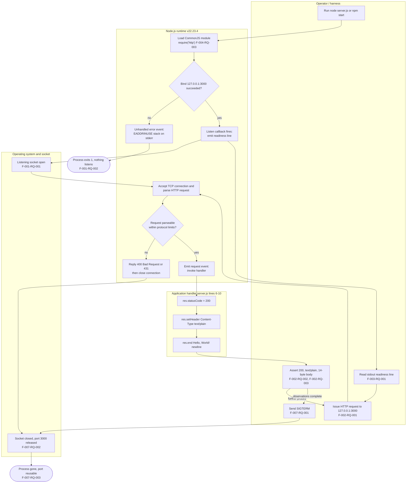

Reading the diagram: the two diamonds are the whole of the application's control flow, and neither belongs to application code — the bind outcome is resolved by the operating system before the `listen` callback runs, and the request-parse outcome is resolved by the Node.js HTTP parser before the handler is entered. Once the handler is reached, the path to `EndOk` is unconditional.

### 4.1.4 Workflow Concepts With No Counterpart

| Concept | Status in this repository | Evidence |
|---|---|---|
| Routing or URL matching branch | Absent; every path reaches the same handler | `GET /anything?x=1` returned `200` with the 14-byte body |
| Method-based branch | Absent; `req` is never read | `server.js` line 6; `POST /` returned `200` |
| Request body processing or payload validation | Absent; a `POST` declaring `Content-Length: 1000000` with no body sent still received `200` immediately | Raw-socket probe against `server.js` |
| Batch or scheduled sequence | Absent; no timer, cron, queue or worker construct exists | Text search for `setTimeout`/`setInterval` found nothing |
| Event or message consumption | Absent; the sole asynchronous entry point is the HTTP `request` event | `server.js` line 6 |
| Outbound call, retry or compensation | Absent; no client library, no `try`/`catch`, no retry loop | Text search of all four files |
| Authorisation checkpoint | Absent; the loopback bind is the only access control | `1.3.3`; cross-host connection refused |
| Persistence or recovery step | Absent; no state survives a request or a run | `F-007-RQ-003` |

These absences are design decisions recorded as exclusions in `1.3.3`, not deferred work. The remainder of this section documents the flows that do execute, then states plainly, per sub-section, which required flowchart element has nothing to attach to.


## 4.2 Core Business Processes

The end-to-end user journey the repository supports is short enough to state in five steps, and it is the journey the backprop integration harness performs: obtain the checkout, start the process, wait for the readiness line, issue requests and assert the fixed response, then terminate the process. Steps 1 and 3-5 happen outside the code; only step 2 and the response inside step 4 are implemented here. Each workflow below maps that journey onto the code path that serves it.

### 4.2.1 W-1 — Process Start and Readiness

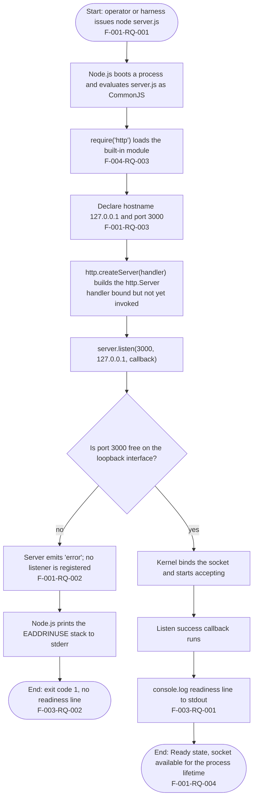

| Step | Actor | Action | Business rule or guard | Requirement |
|---|---|---|---|---|
| 1 | Operator/harness | Invoke `node server.js` (or `npm start` → same command) | No install or build may precede it | `F-004-RQ-003` |
| 2 | Runtime | Load the module and the built-in `http` module | Only built-ins are permitted; no third-party package may be required | `F-004-RQ-001`, `F-004-RQ-003` |
| 3 | Application | Declare `hostname = '127.0.0.1'` and `port = 3000` | Address is a literal; environment and config overrides are ignored | `F-001-RQ-003` |
| 4 | Application | Construct the server with the inline handler | Exactly one handler, one server, one socket | `F-001-RQ-001` |
| 5 | OS/runtime | `listen(3000, '127.0.0.1', callback)` binds the socket | Port must be free and the loopback interface present | `F-001-RQ-001` |
| 6 | Runtime | On bind failure, emit `'error'` | No `error` listener is registered, so the runtime treats it as fatal | `F-001-RQ-002` |
| 7 | Runtime | On bind success, invoke the callback | The callback is the only place readiness is signalled | `F-003-RQ-002` |
| 8 | Application | `console.log` the interpolated readiness line | Exactly one line, byte-identical, emitted once | `F-003-RQ-001`, `F-003-RQ-003` |
| 9 | Runtime | Keep the listener open until the process ends | No idle timeout, no self-shutdown, no reload | `F-001-RQ-004` |

Observed behaviour at each branch: on success, stdout contained exactly `Server running at http://127.0.0.1:3000/` and remained the only output for the whole process lifetime. On failure — a second instance started while the first held the port — stderr carried an `Unhandled 'error' event` stack naming `EADDRINUSE: address already in use 127.0.0.1:3000`, stdout carried no readiness line, and the process exited with code 1. Setting `PORT=4000` or `HOST=0.0.0.0` changes nothing, because `server.js` reads no environment variable.

**Timing.** The readiness line is written from the `listen` success callback, so its appearance is proof that the socket is accepting connections; there is no polling interval or artificial delay between bind and log. The absolute start-up duration is dominated by Node.js boot and is not measured or constrained anywhere in the repository, and no start-up deadline exists for a supervisor to honour.

### 4.2.2 W-2 — Request–Response Cycle

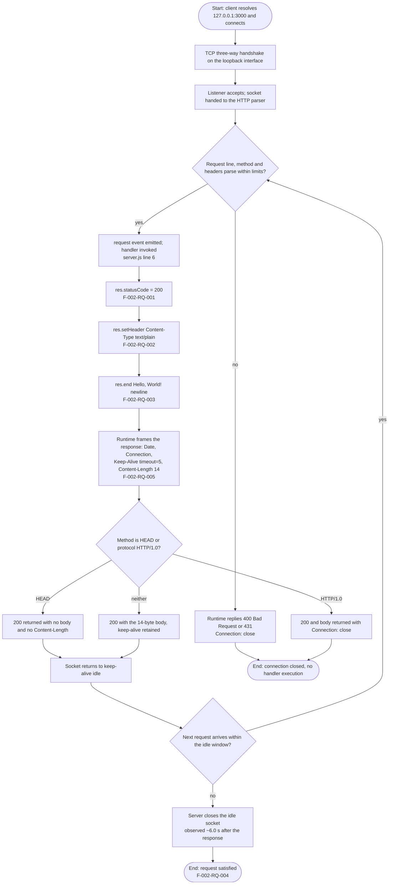

| Step | Actor | Action | Business rule or guard | Requirement |
|---|---|---|---|---|
| 1 | Client | Connect to `127.0.0.1:3000` | Same host only; other interfaces refuse the connection | `F-001-RQ-001` |
| 2 | Runtime | Parse the request line, method and headers | Unknown methods and malformed lines are rejected before the handler | Runtime protocol handling |
| 3 | Runtime | Emit `request` and invoke the handler | Exactly one handler serves every path and method | `F-002-RQ-004` |
| 4 | Handler | Set status `200` | Constant, not computed from request data | `F-002-RQ-001` |
| 5 | Handler | Set `Content-Type: text/plain` | Exact value, no charset parameter | `F-002-RQ-002` |
| 6 | Handler | `res.end('Hello, World!\n')` | 14 bytes including the trailing newline; single write | `F-002-RQ-003` |
| 7 | Runtime | Add `Date`, `Connection`, `Keep-Alive`, `Content-Length` | Framing headers are runtime-owned and must pass through unmodified | `F-002-RQ-005` |
| 8 | Runtime | Reuse or close the connection | Idle sockets are not held indefinitely | `F-002-RQ-005` |

Observed behaviour confirms the diagram's branches and, equally important, its missing branches. `GET /`, `GET /anything?x=1`, `POST /`, `HEAD /`, `localhost:3000` and an HTTP/1.0 request without a `Host` header each received `200`; no path-level or method-level decision executed. A malformed request line (`NOT-HTTP`) and an unrecognised method (`FROB`) each received `HTTP/1.1 400 Bad Request` with `Connection: close`; a 20 KB header value received `HTTP/1.1 431 Request Header Fields Too Large`. In all three rejections the handler never ran, so those are runtime decisions, not application error paths. A `POST` declaring `Content-Length: 1000000` whose body was never sent received `200` with the full body immediately, because no code reads `req`. `HEAD` returned `200` with no body and no `Content-Length`, and the response to the HTTP/1.0 request carried `Connection: close`.

**Timing.** Per-request round-trip time over loopback measured 0.7-1.0 ms with `curl` (`time_total`), two hundred sequential requests completed in 1.070 s of wall clock including process spawn for each `curl`, and fifty concurrent requests all returned `200` within 32 ms. The keep-alive idle socket was observed closing 6,011 ms after the response, consistent with the `Keep-Alive: timeout=5` header the runtime announces. None of these figures is a target; the repository declares no latency, throughput or timeout requirement in `server.js` or in any manifest.

### 4.2.3 W-3 — Teardown and Port Release

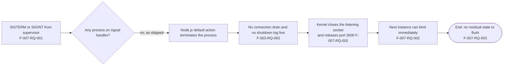

| Step | Actor | Action | Business rule or guard | Requirement |
|---|---|---|---|---|
| 1 | Supervisor | Send `SIGTERM` or `SIGINT` | Termination is always external; no shutdown endpoint exists | `F-007-RQ-001` |
| 2 | Runtime | Apply the default signal action | No handler is registered, so no custom teardown runs | `F-007-RQ-001` |
| 3 | Runtime | Exit without draining or logging | stdout carries only the startup line for the whole lifetime | `F-003-RQ-003` |
| 4 | OS | Close the socket and release port 3000 | Port must become immediately reusable | `F-007-RQ-002` |
| 5 | — | Nothing to flush or repair | No database, cache, file handle, lock file or outbound connection exists | `F-007-RQ-003` |

Observed behaviour: after `SIGTERM` the process exited with code 143 (128 + 15) and printed nothing further; a fresh instance then bound the same port successfully. A client that opened a socket, sent a request and destroyed it immediately produced no server-side output, did not disturb the process, and the next request still received `200` — so abandoned connections leave no recovery work behind.

### 4.2.4 W-4 — Developer Invocation Paths

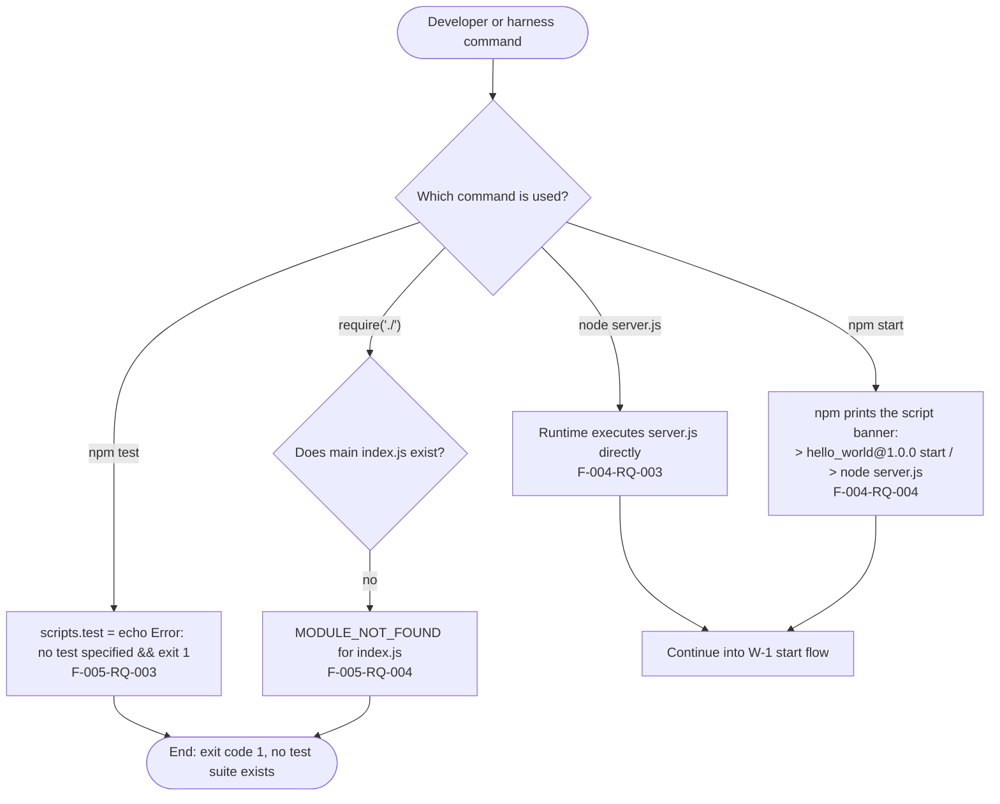

| Command | Path taken | Observed result | Requirement |
|---|---|---|---|
| `node server.js` | Direct execution of the only runnable artifact | Readiness line, then normal W-1/W-2 behaviour | `F-004-RQ-003` |
| `npm start` | No `start` script is declared, so npm runs its implicit default `node server.js` | Banner `> hello_world@1.0.0 start`, then `> node server.js`, then the readiness line | `F-004-RQ-004` |
| `npm test` | Placeholder script `echo "Error: no test specified" && exit 1` | `Error: no test specified`, exit code 1 | `F-005-RQ-003` |
| `require('./')` | `main` names `index.js`, which is absent from the checkout | `Cannot find module .../index.js`, exit code 1 | `F-005-RQ-004` |

`npm test` and `require('./')` are deliberate failure flows. They are documented here so that a reader of the flowcharts does not mistake their non-zero exits for defects: `F-005-RQ-003` requires the test command to fail rather than report a suite that does not exist, and `F-005-RQ-004` records the unresolved `main` entry as a known deviation. Neither path reaches the listener, and no CI pipeline consumes them, because no pipeline definition exists in the repository (`3.6.2`).

### 4.2.5 Decision Point Inventory

Only two decisions in the entire lifecycle are made by code the repository owns — and both are made by the runtime, not the handler.

| # | Decision | Decided by | Guard | Outcome when true | Outcome when false |
|---|---|---|---|---|---|
| D-1 | Can the socket bind to `127.0.0.1:3000`? | OS/runtime during `listen` | Port free, loopback present | W-1 continues to readiness | Unhandled `'error'`, exit 1 |
| D-2 | Does the request parse within protocol limits? | Node.js HTTP parser | Valid request line and method, headers under the size limit | Handler invoked | `400` or `431`, `Connection: close` |
| D-3 | Is the method `HEAD`? | Runtime response writer | Method comparison | Body suppressed | Body written |
| D-4 | Has the keep-alive idle window elapsed? | Runtime socket timer | `keepAliveTimeout`, announced as `timeout=5` | Socket closed | Socket held for reuse |
| D-5 | Has a termination signal arrived? | Runtime default signal action | Any `SIGTERM`/`SIGINT` | Process exits, port released | Process keeps serving |

The handler itself contains no branch: three statements execute in a fixed order for every request (`server.js` lines 7-9), which is why `F-002-RQ-004` — response independent of all request data — holds unconditionally rather than by careful condition ordering.

### 4.2.6 Error Handling Paths Within These Workflows

The complete error taxonomy, notification flow, retry and recovery treatment is in 4.7. The flows above encounter exactly four error states:

| Error state | Workflow | Where handled | Client-visible effect |
|---|---|---|---|
| `EADDRINUSE` on bind | W-1 | Not handled; process terminates with exit 1 and a stderr stack | Nothing listens, so a probe receives `ECONNREFUSED` |
| `400 Bad Request` | W-2 | Runtime parser, before the handler | Status line and `Connection: close`; body is empty |
| `431 Request Header Fields Too Large` | W-2 | Runtime parser, before the handler | Status line and `Connection: close` |
| `MODULE_NOT_FOUND` for `index.js` | W-4 | Runtime module resolver | Non-interactive: exit 1 with a stack trace |

No error state exists inside the handler, because no operation it performs can fail conditionally: it assigns two constants and ends the response.


## 4.3 Integration Workflows

The fixture participates in exactly one runtime integration: an HTTP client on the same host talking to `127.0.0.1:3000`. There is no outbound integration of any kind — no HTTP client, database driver, queue client, mail or telemetry exporter appears in any tracked file, and the only `require` in the repository is `require('http')` (`server.js` line 1). The integration that `README.md` names, the backprop pipeline, consumes this fixture from outside the checkout and owns every step on its side of the socket.

### 4.3.1 The Single Inbound Interface

The service exposes one implicit endpoint with no routing table: every method on every path is served identically. The contract is therefore a byte-level one, and it is the whole of the interface.

| Contract element | Value | Evidence |
|---|---|---|
| Address | `127.0.0.1:3000`, plaintext HTTP/1.1, loopback only | `server.js` lines 3-4, 12; connection to `10.11.2.21:3000` refused |
| Methods accepted | Any recognised HTTP method; unknown tokens are rejected by the parser | `GET`, `POST`, `HEAD` returned `200`; `FROB` returned `400` |
| Paths accepted | Any, including absent resources and query strings | `GET /anything?x=1` returned `200` |
| Request headers required | None; no `Host` requirement is enforced at application level and no header is read | HTTP/1.0 request without `Host` returned `200` |
| Request body | Ignored and never read; the response does not wait for it | `POST` with `Content-Length: 1000000` and no body returned `200` immediately |
| Status | `200` | `F-002-RQ-001` |
| Content type | `text/plain`, exactly | `F-002-RQ-002` |
| Body | `Hello, World!` followed by a newline, 14 bytes | `F-002-RQ-003` |
| Framing headers | `Date`, `Connection: keep-alive`, `Keep-Alive: timeout=5`, `Content-Length: 14` (absent on `HEAD`) | `F-002-RQ-005` |
| Authentication | None; no credential, header or token is examined | `1.3.3` |
| Error responses produced by the application | None; the runtime produces `400`, `431` and network-level failures | Raw-socket probes |

**API interactions.** Because the handler never reads `req`, there is no request-driven behaviour to sequence: no parameter binding, no content negotiation, no versioning, no pagination, no rate limiting and no idempotency key. A client interacts with the fixture by asserting three literals, and every other property of its request is discarded by the socket.

### 4.3.2 Integration Sequence Diagram

The sequence covers one satisfied run, with the bind-failure alternative the only other outcome the fixture can produce. Each participant is a swim lane in the integration.

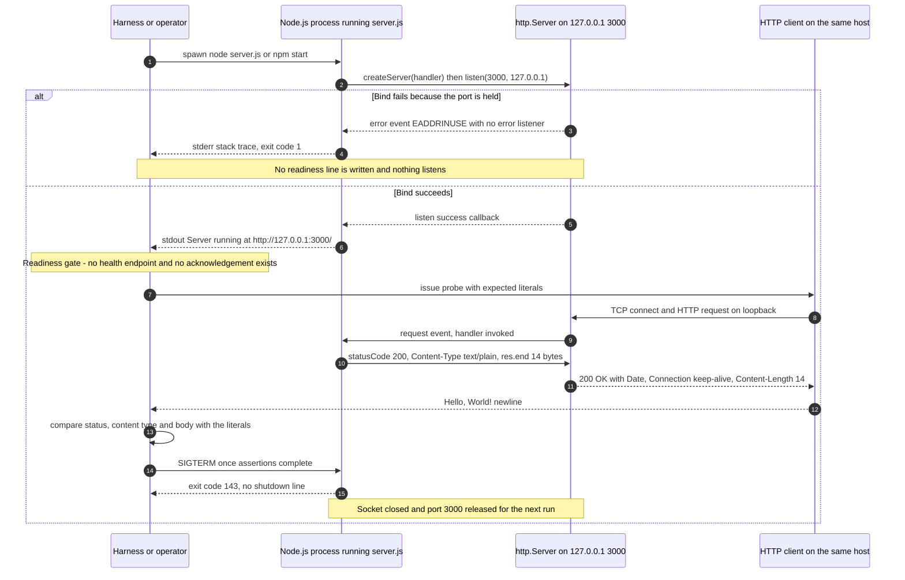

The sequence has one ordering constraint that matters: the harness must not probe before it has seen the readiness line, because the line is emitted only from the `listen` success callback (`F-003-RQ-002`). Conversely, a probe that arrives before the bind returns `ECONNREFUSED`, which is indistinguishable from "not started yet" — the fixture offers no health or readiness endpoint to disambiguate the two.

### 4.3.3 Data Flow Across the Boundary

| Direction | What crosses | Where it originates | Persistence |
|---|---|---|---|
| Inbound | TCP segments carrying an HTTP request line, headers and optionally a body | The client's socket | None; the handler reads none of it |
| Inbound | Request data consumed by the runtime parser only | Node.js HTTP parser | None; parser state is per-socket and discarded when the socket closes |
| Outbound | One HTTP response: status line, `Content-Type` literal, runtime framing headers, 14-byte body | `server.js` lines 7-9 plus runtime | None |
| Outbound (process) | One stdout line at start-up | `server.js` line 13 | None; no log file, shipper or collector |
| Outbound (process) | Exit code and, on bind failure, a stderr stack trace | Node.js runtime | None |

No data is stored anywhere in the flow. The only state that survives between two requests is the TCP connection itself, and it survives only while the keep-alive window is open. This is what makes a repeated run comparable to a previous one: nothing the earlier run did can influence the later one.

### 4.3.4 Event Processing and Batch Sequences

| Workflow type | Status | Evidence of absence |
|---|---|---|
| Event consumption (queue, topic, stream) | Absent | No client library, no `require` beyond `http`, no listener registration beyond the server's request event |
| Event publication or webhooks | Absent | No outbound request in any tracked file |
| Scheduled or batch processing | Absent | No `setTimeout`, `setInterval`, cron entry or worker script; single commit history shows no removed scheduler |
| Background workers or job queues | Absent | One process, one module, no cluster or worker-thread use |
| Stream processing or chunked handling | Absent | Response is a single `res.end` with a literal; no `pipe`, `write` loop or stream API use |

The only asynchronous event the process handles is the HTTP `request` event, dispatched by the runtime to the single handler. There is consequently no batch window, no checkpoint, no exactly-once or at-least-once concern, and no ordering guarantee to document beyond per-connection ordering imposed by TCP.

### 4.3.5 The External Pipeline Boundary

`README.md` names the consumer — "test project for backprop integration" — and the fixture supplies the two signals such a pipeline needs: a readiness line to gate on and a deterministic response to assert. Everything else in that integration lives outside this repository, and `1.3.4` records it as out of scope.

| Pipeline step | Owner | Fixture's contribution | Where the evidence lives |
|---|---|---|---|
| Obtain the checkout | Pipeline | Four tracked files, no install or build step | `package.json`, `package-lock.json` |
| Start the service | Pipeline | `node server.js`, or `npm start` via npm's implicit default script | `server.js` line 12; observed npm banner |
| Detect readiness | Pipeline | Single stdout line, emitted after bind | `server.js` line 13; `F-003-RQ-002` |
| Probe and assert | Pipeline | Fixed `200`, `text/plain`, 14-byte body on any path or method | `server.js` lines 7-9 |
| Tear down and re-run | Pipeline | Immediate exit on signal, port released, no residual state | `F-007-RQ-001` to `F-007-RQ-003` |

Because the fixture neither calls nor is called by any other system than that client, no API gateway, service discovery, retry budget, circuit breaker or message contract appears in any diagram in this section.


## 4.4 Flowchart Requirements Coverage

### 4.4.1 Element-by-Element Coverage

The table records, for each flowchart element the specification asks for, where this section satisfies it and — where nothing exists to model — the evidence for the absence.

| Flowchart element | Where covered | Status and basis |
|---|---|---|
| Start and end points | Every diagram in 4.2 and 4.1.3 uses explicit start/end nodes | Present. W-1 ends at readiness or exit 1; W-2 ends at a served response or a closed connection; W-3 ends at port release |
| Process steps | 4.2.1 to 4.2.4 step tables, each row tied to a requirement ID | Present. Nine steps in W-1, eight in W-2, five in W-3, four invocation paths in W-4 |
| Decision diamonds | 4.2.5 inventory (D-1 to D-5) and the diamonds in each flow | Present but minimal. No decision is made by application code; all five are taken by the OS or the Node.js runtime |
| System boundaries | 4.1.2 boundary statement; swim lanes in every diagram | Present. Two boundary crossings only: the loopback socket inbound and stdout outbound |
| User touchpoints | 4.1.2 touchpoint list; 4.2.1 readiness step; 4.2.2 response step | Two touchpoints: the readiness line and the HTTP response. No UI, prompt or interactive surface exists |
| Error states | 4.2.6 summary; 4.7.1 full taxonomy | Four application-visible states: `EADDRINUSE`, `400`, `431`, `MODULE_NOT_FOUND` |
| Recovery paths | 4.7.5 recovery procedures | Operator-driven only. The process performs no self-recovery |
| Timing and SLA constraints | 4.4.2 and the timing notes in 4.2.1 to 4.2.2 | Partially applicable. Observable timings exist; no declared target exists |
| Swim lanes for actors and systems | All diagrams, using mermaid subgraphs or named participants | Present. Lanes: operator/harness, HTTP client, npm CLI, Node.js runtime, application handler, operating system |
| Validation rules per step | 4.5.1 business rules, 4.5.2 data validation | Three literal rules enforced in code; protocol validation delegated to the runtime |
| Authorisation checkpoints | 4.5.3 | Absent by design; the loopback bind is the only access control |
| Compliance checks | 4.5.4 | Only the MIT licence declaration and the absence of personal data apply |

### 4.4.2 Timing and SLA Considerations

No service-level objective, latency budget, throughput target, availability window or timeout constant exists in the repository: `server.js` sets no timer, no `timeout` option on the server, and no deadline anywhere. The values below are therefore observations and protocol announcements, not commitments.

| Timing aspect | Observation | Basis |
|---|---|---|
| Readiness signalling | Emitted from the `listen` success callback with no polling interval or artificial delay; no readiness line is written when the bind fails | `server.js` lines 12-14; `F-003-RQ-002` |
| Start-up duration | Not measured or bounded; dominated by Node.js boot and OS bind | No timing code or target in the source |
| Per-request latency | 0.7-1.0 ms `time_total` over loopback | Three `curl` samples against a running instance |
| Sequential throughput | 200 sequential requests in 1.070 s wall, including one `curl` process spawn per request | Timed loop |
| Concurrency | 50 concurrent requests all returned `200` within 32 ms; an earlier probe of 20 concurrent requests also returned all `200` | Parallel client probes |
| Response write | One `res.end` call; no streaming, chunking or asynchronous work between the three statements | `server.js` lines 7-9 |
| Connection reuse window | Announced as `Keep-Alive: timeout=5`; the idle socket was observed closing 6,011 ms after the response | Response headers and raw-socket timing |
| Other protocol timers | Not set by the application; whatever the runtime applies is invisible in the repository | No timeout configuration in any tracked file |
| Termination | Immediate on signal; observed exit code 143 with no drain window | `SIGTERM` probe |
| Port reuse after exit | Immediate; the next instance bound successfully | Sequential start-stop-start probe |

**What a consumer may rely on.** Exactly three timing properties hold by construction: the readiness line follows a successful bind, a response is written in a single operation once the handler runs, and the process releases the port when it exits. Everything else — how fast a probe is answered, how many requests a host can serve, how long start-up takes — is measured behaviour on this machine, not a guarantee the fixture makes.

**SLA statement.** The repository defines no SLA and contains no instrumentation from which one could be computed: there are no counters, timers, metrics or traces, and `console.log` at start-up is the only output the process ever produces (`F-003-RQ-003`). A pipeline that needs a probe deadline or a restart budget must set and enforce it on its own side of the socket.


## 4.5 Validation Rules and Checkpoints

### 4.5.1 Business Rules Enforced at Each Step

Eight rules govern the flows. Each is enforced by a literal in the source or by the absence of a capability, and each is checkable from outside the process.

| # | Rule | Step where it applies | Enforcement mechanism | Requirement |
|---|---|---|---|---|
| R-1 | The service listens on `127.0.0.1:3000` and nowhere else | W-1 step 5 | Two module constants passed to `listen`; no environment or config read | `F-001-RQ-001`, `F-001-RQ-003` |
| R-2 | One instance per host; a bind failure must surface, never be masked | W-1 step 6 | No `error` listener and no port fallback, so the runtime terminates the process | `F-001-RQ-002` |
| R-3 | Every request is answered with `200`, `text/plain` and the 14-byte greeting | W-2 steps 4-6 | Three unconditional statements; `req` never read | `F-002-RQ-001` to `F-002-RQ-004` |
| R-4 | Exactly one readiness line, written only after a successful bind | W-1 steps 7-8 | The only `console.log`, inside the `listen` callback | `F-003-RQ-001`, `F-003-RQ-002` |
| R-5 | No other runtime output, in any volume of traffic | W-2, W-3 | No request, access, error or shutdown logging exists | `F-003-RQ-003` |
| R-6 | The runtime path uses built-in modules only | W-1 steps 1-2, W-4 | `require('http')` is the only import; the dependency graph is empty | `F-004-RQ-001` to `F-004-RQ-003` |
| R-7 | `npm test` must fail rather than report a suite that does not exist | W-4 | Placeholder script `echo ... && exit 1` | `F-005-RQ-003` |
| R-8 | The tracked file set is an immutable baseline | Any change proposal, outside runtime | `README.md` instruction "Do not touch!" plus zero drift against commit `a6f7f58` | `F-006-RQ-002` |

R-1 to R-7 are runtime rules; R-8 is a change-time rule with no runtime checkpoint. Nothing between them validates a caller: there is no rule about who may call, with what payload, at what rate, from where beyond the loopback interface itself.

### 4.5.2 Data Validation Requirements

| Validation concern | Application behaviour | Runtime behaviour | Evidence |
|---|---|---|---|
| Request syntax | Not examined | Rejects a malformed request line with `400 Bad Request` and `Connection: close` | `NOT-HTTP` probe returned `400`; handler not invoked |
| HTTP method vocabulary | Not examined | Rejects an unrecognised method token with `400 Bad Request` | `FROB / HTTP/1.1` returned `400` |
| Header size | Not examined | Rejects an over-large header block with `431 Request Header Fields Too Large` | 20 KB header value returned `431` |
| Request body content, type or length | Never read | Body is not buffered by application code | `POST` declaring `Content-Length: 1000000` with no body sent received `200` immediately |
| Query string and path | Not parsed | Passed through untouched | `GET /anything?x=1` returned `200` |
| Content negotiation | Not performed | `Content-Type` is always `text/plain`; no `Accept` handling exists | `F-002-RQ-002` |
| Response validation | Not performed | Framing headers computed by the runtime; body length is the literal 14 bytes | `F-002-RQ-005` |

The application layer therefore has **zero input validation requirements**, and that is a property of the design rather than an omission: because `req` is never referenced, no untrusted value reaches a sink, so there is no injection, deserialisation, path-traversal or injection-into-response concern to validate against. All validation that occurs in the flow belongs to the Node.js HTTP parser and happens before the handler is entered.

### 4.5.3 Authorization and Authentication Checkpoints

| Checkpoint | Status | Consequence |
|---|---|---|
| Authentication (credential, token, certificate, mTLS) | Absent | Any process on the host that can reach the loopback interface is served |
| Authorisation (role, scope, per-caller differentiation) | Absent | Every caller receives the same response; no resource is protected or hidden |
| Session or cookie handling | Absent | No `Set-Cookie`, no session store, no state per caller |
| CORS, origin or forwarded-header handling | Absent | No request header is read, so no origin policy is applied |
| Rate limiting or quota | Absent | Request volume is bounded only by the event loop and the OS backlog |
| Transport security | Absent, plaintext HTTP on loopback | No `https` or `tls` module is required; no certificate exists |
| Network-level control (compensating) | Present | Bind is `127.0.0.1` only; a connection to the routable interface `10.11.2.21:3000` was refused |

The loopback bind is the sole access control in the system, and it is the reason the absent checkpoints are acceptable: exposure is limited to processes on the same host. This makes the bind address a security boundary in the flowchart rather than a convenience — any change to it, or the introduction of a proxy or container network in front of the fixture, would convert the flow into one that requires authentication and would need owner authorisation under the `README.md` constraint (`3.4.3`, `3.6.3`).

### 4.5.4 Regulatory and Compliance Checks

| Compliance concern | Position | Evidence |
|---|---|---|
| Licence obligations | MIT declared in the manifest and mirrored in the lockfile root entry; no third-party licence to reconcile | `package.json`, `package-lock.json` |
| Personal data processing | None. No request data is stored or logged, and no caller identifier is captured | `server.js` lines 6-10 never read `req`; no logging beyond the startup line |
| Data retention | Not applicable. Nothing is persisted, so no retention or deletion obligation attaches | `F-007-RQ-003` |
| Audit trail | Absent. The process cannot evidence who called or when; the only trace is the client's own record | `F-003-RQ-003` |
| Encryption in transit | Absent. Plaintext HTTP over loopback only | `1.3.3` |
| Accessibility, localisation, consent, PCI or health-data scope | Not applicable. The only payload is the fixed English literal `Hello, World!` and no user data enters the flow | `1.3.2` |
| Change governance as a compliance control | Present. "Do not touch!" plus baseline commit `a6f7f58` makes silent behaviour change a governance failure | `README.md`, `F-006-RQ-002` |

No regulatory checkpoint executes inside any workflow. The compliance posture is entirely a consequence of two design facts — the fixed plain-text payload and the loopback-only bind — and both are recorded here so a reader can see that the absence of compliance gates is deliberate and bounded.


## 4.6 Technical Implementation: State Management

### 4.6.1 Process State Model

The system has no application state machine in code — no state variable, no status field, no transition function. The states that exist are held by the OS and the runtime: whether the process has loaded, whether a socket is bound, and whether the process is alive. The state diagram below models exactly that.

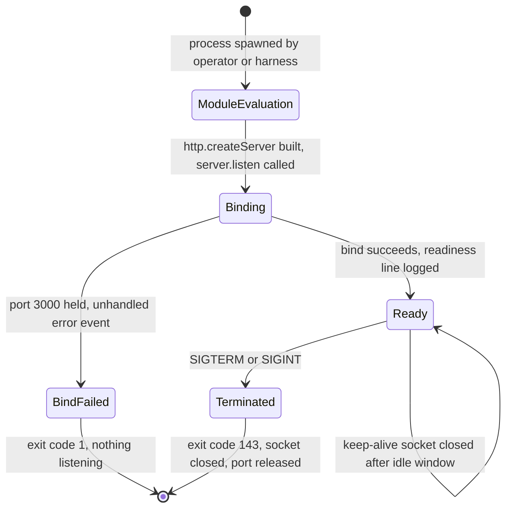

Two properties of this model drive the rest of the section. First, `Ready` is the only steady state, and the process can leave it only by terminating — there is no degraded, draining, restarting or error state. Second, every self-transition returns the process to a byte-identical state, because serving a request writes nothing that a later request can read.

### 4.6.2 State Transition Table

| From | To | Trigger | Guard | Side effect | Persisted? |
|---|---|---|---|---|---|
| (none) | Module evaluation | `node server.js` or `npm start` | A Node.js runtime is on the host | Module body runs; `http` module loaded | No |
| Module evaluation | Binding | Module body reaches `server.listen` | None | `http.Server` object created in memory | No |
| Binding | Ready | Kernel grants the bind | Port 3000 free on `127.0.0.1` | Readiness line written to stdout once | No |
| Binding | Bind failed | Kernel refuses the bind | Port already held | `'error'` event unhandled; stack printed to stderr | No |
| Ready | Ready | HTTP request parsed | Request accepted by the parser | Three response statements executed; 14 bytes written | No |
| Ready | Ready | Keep-alive idle window elapses | No new request on the socket | Socket closed, listener still accepting | No |
| Ready | Terminated | `SIGTERM` or `SIGINT` | None | Default signal action; no drain, no log | No |
| Terminated / bind failed | (none) | Process exit | None | Listening socket closed; port reusable | No |

No transition has a guard that application code evaluates, and no transition writes durable state. A restart therefore begins from exactly the same state as the first run, which is what makes the fixture usable as a comparison baseline (`F-006-RQ-002`).

### 4.6.3 Data Persistence Points

| Persistence point | Present? | Detail |
|---|---|---|
| Database or key-value store | No | No driver is required or declared; the dependency graph is empty |
| File write | No | No `fs` module use anywhere; no log file, no lock file, no temp file |
| Queue, topic or outbox | No | No client library and no outbound connection |
| In-process cache or memoisation | No | The handler holds no state; the response literal is a constant in the source |
| Session or cookie store | No | No `Set-Cookie` header is emitted and no session identifier exists |
| Process stdout | Yes, stream only | One startup line; consumed by a terminal or supervisor, never persisted by the program |
| Socket state | Transient | Per-connection buffers and parser state in the runtime; discarded when the socket closes |

The consequence for the flowcharts is direct: no step needs a rollback, no step can leave partial data behind, and abrupt termination at any moment is safe (`F-007-RQ-003`). It also means the system cannot answer any question about what it has served, which is why an external harness must keep its own record.

### 4.6.4 Caching Requirements

| Caching mechanism | Status | Evidence |
|---|---|---|
| Application-level cache | None | No module-level mutable state, no memoisation, no cache client |
| HTTP cache directives on the response | None emitted | The only header the application sets is `Content-Type`; no `Cache-Control`, `ETag`, `Last-Modified` or `Expires` |
| Conditional request handling | None | No request header is read, so `If-None-Match`/`If-Modified-Since` cannot be honoured |
| Content compression | None | No `Accept-Encoding` handling, no compression middleware |
| Connection reuse | Present, but not caching | The runtime keeps an idle socket open, announced as `Keep-Alive: timeout=5`; it caches no response object |
| Client-side caching | Undetermined by the service | Because no cache directive is set, caching behaviour is left to the client and any intermediary |

The uniform response is trivially cacheable in content — it never varies — yet the service gives no caching guidance, and a consumer that caches it does so on its own initiative. Nothing in the repository requires a cache to be warmed, invalidated or bypassed, and no flow step depends on one.

### 4.6.5 Transaction Boundaries and Concurrency

**Transaction boundaries.** The only unit of work in the system is a single response. It begins when the runtime invokes the handler and ends at `res.end` (`server.js` lines 7-9), which writes status, headers and body in one operation. There is no multi-step mutation, no second resource to keep consistent, and therefore no commit, rollback, compensation or idempotency mechanism. A request that fails after the handler returns — a client disconnect, for instance — leaves nothing to undo; a destroyed client socket produced no server-side output and did not disturb the process.

**Concurrency.** Requests are handled on the Node.js event loop, one handler invocation at a time, and each invocation is synchronous: it runs to `res.end` without yielding. There is no shared mutable state between invocations, so no lock, mutex, atomic or isolation level applies and no interleaving can be observed by a caller. Measured behaviour is consistent with that model: 50 concurrent requests all returned `200` within 32 ms, and the earlier probe of 20 concurrent requests also returned all `200`. Concurrency limits are therefore set by the runtime and the OS backlog rather than by anything in `server.js`, and the fixed port means the only way to add capacity is to add hosts.


## 4.7 Error Handling and Recovery

### 4.7.1 Error Taxonomy

| ID | Error | Trigger | Detected by | Handler invoked? | Client sees | Process effect |
|---|---|---|---|---|---|---|
| E-1 | `EADDRINUSE` | Port 3000 already held when `listen` runs | Kernel via the server's `'error'` event | No | Connection refused / nothing listening | Unhandled `error` event, stack on stderr, exit code 1 |
| E-2 | No Node.js runtime | `node`/`npm` absent from the host | Shell | No | Connection refused | No process is created |
| E-3 | `MODULE_NOT_FOUND` | `require('./')` resolves `main` to the absent `index.js` | Node.js module resolver | No | Not applicable (development-time path) | Throw, exit code 1 |
| E-4 | `400 Bad Request` | Malformed request line or unrecognised method token | Node.js HTTP parser | No | `HTTP/1.1 400 Bad Request`, `Connection: close`, empty body | None; process keeps serving |
| E-5 | `431 Request Header Fields Too Large` | Header block exceeds the runtime's limit | Node.js HTTP parser | No | `HTTP/1.1 431 ...`, `Connection: close` | None |
| E-6 | `ECONNREFUSED` | Probe sent while nothing is bound | Client stack | No | Connect failure at the client | None |
| E-7 | Client abort or reset | Peer closes the socket mid-exchange | Node.js socket layer | Handler had already returned | None | None; the next request still returns `200` |
| E-8 | Uncaught exception inside the handler | Not reachable in the shipped flow — the handler only assigns literals | Would be an uncaught exception, since no `try`/`catch` and no `error` listener exist | — | Connection dropped | Would terminate the process |

Only E-1, E-4, E-5, E-6 and E-7 were exercised against the running fixture; E-2 and E-3 follow from the absence of the runtime and of `index.js` respectively, and E-8 is a design statement: the source contains no `try`, no `catch` and no `error` listener, so any exception raised in the handler would surface as an uncaught exception and end the process. No error class has an application-level handler, because no application-level operation can fail conditionally.

### 4.7.2 Error Handling Flowchart

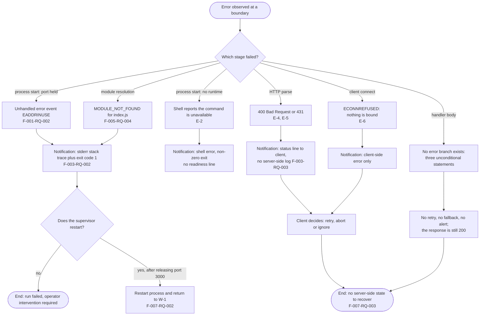

The chart has no application-owned box: every error is detected, reported and resolved by the runtime, the shell or the consumer. The one box the code contributes is the absence of a branch — the handler cannot take an error path, so the response is identical whether the failure happened before it ran or not at all.

### 4.7.3 Retry Mechanisms

| Layer | Retry behaviour | Evidence |
|---|---|---|
| Bind retry | None. A failed `listen` is not retried, and there is no delay, backoff or alternate port | No loop or timer in `server.js`; second instance exited 1 immediately |
| Request retry | None. The handler runs once per request; a failure is not re-attempted | Single unconditional invocation path |
| Outbound call retry | Not applicable; no outbound call exists | No client library; `http` used only as a server |
| Connection retry | None. The server does not reconnect to anything | Listening socket only |
| Supervisor-level restart | Outside the fixture; the only viable recovery mechanism | `F-007-RQ-002` makes a restarted instance bind cleanly |
| Client-level retry | Outside the fixture; a consumer may re-probe an idempotent uniform endpoint | `F-002-RQ-004` makes every probe safe to repeat |

Because the response does not depend on the request, client retries carry no risk of double effect. The absence of server-side retry is therefore not a reliability gap for consumers: it moves the entire retry decision to the party that owns the run.

### 4.7.4 Fallback Processes

| Fallback | Status | Consequence |
|---|---|---|
| Alternative port when 3000 is taken | Absent by requirement | `F-001-RQ-002` mandates a hard failure rather than a silent degrade |
| Degraded or cached response on error | Absent | No cache or alternative payload exists |
| Readiness acknowledgement other than stdout | Absent | If stdout is lost, the harness must fall back to socket polling |
| Secondary process or standby instance | Absent | One process, one socket; a second instance cannot bind the same port |
| Silent success on failure | Explicitly rejected | A missing readiness line plus exit code 1 is the contract for a failed start |

The design intent is that a failure is loud and unambiguous: the fixture never substitutes a different address, a different payload or a different exit status. A consumer therefore cannot mistake a failed start for a slow one once the process exit code is observed — though a probe alone cannot distinguish the two before that point, which is why the readiness line exists.

### 4.7.5 Error Notification Flows

| Notification channel | Content | Consumer of the signal | Requirement |
|---|---|---|---|
| Process exit code | `0` on normal signal termination by `timeout`-style stop, `1` on bind or module failure, `143` on `SIGTERM` | Supervisor, harness, CI step result | `F-001-RQ-002`, `F-007-RQ-001` |
| stdout | Exactly one readiness line on success; nothing on bind failure | Harness readiness gate | `F-003-RQ-001`, `F-003-RQ-002` |
| stderr | Node.js stack trace for `EADDRINUSE` or `MODULE_NOT_FOUND` | Operator or harness log capture | Observed in both failure probes |
| HTTP status line | `200` on served requests, `400`/`431` from the parser, connection refusal at the client | The calling client | E-4, E-5, E-6 |
| Log file, log shipper, metrics, traces, alerts, health endpoint | Absent | Nobody; no such consumer can be configured | `F-003-RQ-003`, `1.3.3` |

Two properties are worth stating explicitly because they shape the notification flow. First, the absence of the readiness line is itself a failure signal, and the only one available before the process exits. Second, no error is ever logged in structured or retainable form: the stack trace exists only on the captured stderr stream, so a run whose stderr was discarded leaves no evidence of why the start failed.

### 4.7.6 Recovery Procedures

| Symptom | Diagnosis | Recovery action | Verification |
|---|---|---|---|
| Start exits 1 with `EADDRINUSE` on `127.0.0.1:3000` | Another instance, or another process, holds the port | Stop the holding process, then start the fixture again | Readiness line appears; probe returns `200` |
| Start exits 1 with `Cannot find module .../index.js` | `require('./')` was used instead of the entry script | Run `node server.js` or `npm start` | Readiness line appears (`F-005-RQ-004`) |
| Probe fails with `ECONNREFUSED` | Nothing is bound; the process is not running or has crashed | Start the process and gate on the readiness line | Access log of the client shows `200` |
| Probe receives `400` or `431` | The client sent a malformed request line, an unsupported method or oversized headers | Correct the client request; no server action is required | Next well-formed probe returns `200` |
| No readiness line but the process is alive | stdout was not captured, or the bind has not completed | Capture stdout, or poll the socket as a fallback | Probe returns `200` |
| Process exited 143 with no shutdown line | Expected teardown on `SIGTERM` | Start again if a further run is needed | Port is free; readiness line appears on restart |
| `npm test` exits 1 | Expected by design — the placeholder script always fails | No recovery; the fixture has no test suite | Confirm the message `Error: no test specified` (`F-005-RQ-003`) |

Every recovery is operator-driven. The process has no self-healing step, no restart-on-crash logic and no state to repair, so recovery reduces to making the environment correct — a free port 3000, a Node.js runtime, and captured stdout — and starting the process again.


## 4.8 Required Diagram Catalog

### 4.8.1 Diagram Inventory

Eight diagrams cover the required classes, each rendered with Mermaid.js at the point in the narrative where its steps are explained.

| ID | Diagram | Required class | Location | Swim lanes / participants | Decision points |
|---|---|---|---|---|---|
| D-1 | High-level system workflow | High-level system workflow | 4.1.3 | Operator/harness, Node.js runtime, application handler, OS and socket | Bind success; request parseable |
| D-2 | W-1 process start and readiness | Detailed process flow for F-001, F-003, F-004 | 4.2.1 | Single flow with actor column in the step table | Is port 3000 free? |
| D-3 | W-2 request–response cycle | Detailed process flow for F-002 | 4.2.2 | Client and runtime/handler steps in one flow | Request parseable; HEAD or HTTP/1.0; keep-alive reuse |
| D-4 | W-3 teardown and port release | Detailed process flow for F-007 | 4.2.3 | Supervisor, runtime, OS | Signal handler registered? |
| D-5 | W-4 developer invocation paths | Detailed process flow for F-004, F-005 | 4.2.4 | npm CLI, Node.js runtime | Which command; does `main` exist? |
| D-6 | Integration sequence | Integration sequence diagram | 4.3.2 | Harness, Node.js process, `http.Server`, HTTP client | `alt` block on bind outcome |
| D-7 | Process state model | State transition diagram | 4.6.1 | Five states, `stateDiagram-v2` | Transition guards listed in 4.6.2 |
| D-8 | Error handling flow | Error handling flowchart | 4.7.2 | Caller/operator view over runtime-detected errors | Which stage failed?; does the supervisor restart? |

### 4.8.2 Feature-to-Diagram Coverage

| Feature | Name | Runtime flow exists? | Diagram | Note |
|---|---|---|---|---|
| F-001 | Loopback HTTP Listener Binding | Yes | D-1, D-2 | The bind decision is the only gate before readiness |
| F-002 | Uniform Greeting Response | Yes | D-1, D-3 | Every request follows the same three statements |
| F-003 | Startup Readiness Announcement | Yes | D-2, D-6 | Readiness is the harness's gate; its absence is the failure signal |
| F-004 | Zero-Dependency Locked Runtime Posture | Yes, as the invocation path | D-5 | Manifests constrain the flow rather than adding steps: nothing is installed or built |
| F-005 | Project Identity and Licence Declaration | Only as the `main` and `test` script paths | D-5 | Both paths terminate in a non-zero exit by design |
| F-006 | Fixture Purpose Documentation and Change Governance | No runtime flow | — | Governance applies at change time; see 4.5.1 rule R-8 |
| F-007 | Process Lifecycle and Teardown | Yes | D-4, D-7 | Termination is external; no drain step exists |

F-006 is the one feature with nothing to diagram: it is a documentation and change-control constraint whose only runtime manifestation is the absence of behaviour. Its acceptance criterion — zero drift against commit `a6f7f58` — is checked before a run, not during one.

### 4.8.3 Notation Conventions

| Convention | Application in this section |
|---|---|
| Mermaid diagram types | `flowchart TD` / `flowchart LR` for processes, `sequenceDiagram` for the integration, `stateDiagram-v2` for the state model |
| Swim lanes | `flowchart` subgraphs named for the owning actor or system; `sequenceDiagram` participants for integration lanes |
| Node identifiers | Unique within each diagram and never identical to a subgraph name, so no lane is confused with a step |
| Labels | Quoted text with the requirement ID that governs the step where one exists |
| Decision nodes | Diamond shape, used only for the five decisions inventoried in 4.2.5 |
| Requirement traceability | Requirement IDs (`F-00X-RQ-00Y`) appear on the label of the step they constrain |
| Error branches | Drawn as explicit out-edges to terminal nodes, never as implicit fall-through |

### 4.8.4 Diagram Coverage Gaps

| Gap | Reason | Where the absence is documented |
|---|---|---|
| No routing, authentication or authorisation decision diamonds | Neither capability is implemented | 4.5.3, `1.3.3` |
| No batch, scheduler or event-consumption diagram | No timer, queue or worker construct exists | 4.3.4 |
| No retry, circuit-breaker or compensation diagram | No outbound call and no `try`/`catch` exists | 4.7.3 |
| No data-migration, backup or restore flow | Nothing is persisted | 4.6.3 |
| No multi-service or cross-host interaction diagram | The bind is loopback-only; cross-host access is refused | 4.1.2, `1.3.4` |
| No scaling or failover diagram | One process, one fixed port, no cluster or standby | 3.6.3, `2.4.1` |

These gaps are the same exclusions `1.3.3` records as out of scope. Diagramming them would imply capabilities the four tracked files do not contain.


## 4.9 References

- `server.js` — the only executable artifact (14 lines). Established the whole runtime flow: the single `require('http')` on line 1, the `hostname`/`port` literals on lines 3-4, the three-statement handler on lines 6-10 with `req` never read, and `server.listen` with the readiness log on lines 12-14. Also established the absence of every branch, timer, signal handler, `try`/`catch` and filesystem call that this section had to rule out.
- `package.json` — established the invocation paths: no `dependencies`/`devDependencies`/`engines`, no `start` script (so npm's implicit default `node server.js` applies, `F-004-RQ-004`), the placeholder `scripts.test` that always exits 1 (`F-005-RQ-003`), and `main: index.js` pointing at an absent file (`F-005-RQ-004`).
- `package-lock.json` — established the empty dependency graph at `lockfileVersion` 3 with only the root package entry, which is why no install or build step appears in any workflow.
- `README.md` — established the fixture's purpose ("test project for backprop integration") and the "Do not touch!" governance constraint (rule R-8), which bounds every workflow described here.
- repository root (`""`) — established that the system is exactly four files with no sub-folders, so no workflow can originate in another directory.

**Runtime observations cited in this section.** The behaviour attributed to W-1 to W-4, to decisions D-1 to D-5 and to errors E-1 and E-4 to E-7 was observed against `server.js` running on Node.js v22.23.4 with npm 11.21.0: a readiness-line capture, a second-instance `EADDRINUSE` probe, `GET`/`POST`/`HEAD`/HTTP/1.0 requests, raw-socket probes for a malformed request line, an unknown method, a 20 KB header, an unsent 1 MB body and a client abort, a keep-alive idle measurement, 200 sequential and 50 concurrent request runs, a `SIGTERM` exit-code check of 143, and the `npm start`, `npm test` and `require('./')` invocations.

**Related sections of this specification.** Flow steps carry requirement identifiers from 2.2; feature names and identifiers come from 2.1; excluded capabilities are recorded in 1.3.3; and the deployment and security context referenced in 4.5.3 and 4.8.4 is in 3.4.3 and 3.6.3.


# 5. System Architecture

## 5.1 High-Level Architecture

### 5.1.1 System Overview

**Architectural style.** The system is a single-process, single-module, event-driven HTTP responder. All runtime behavior lives in one 14-line CommonJS module, `server.js`: one static require of the built-in `http` module (line 1), two module-level bind literals (lines 3-4), one `http.Server` constructed around one inline anonymous request handler (lines 6-10), and one `server.listen` call with a success callback (lines 12-14). No other module, class, export, configuration file, asset or data file exists in the repository.

There is no layer structure to describe because there is only one layer of application code. The transport layer belongs entirely to the Node.js runtime — it owns TCP acceptance, HTTP/1.1 parsing, response serialisation and connection lifetime — and the application is a single callback that the runtime invokes. Structurally this is the degenerate form of a layered web architecture: presentation, domain and data-access layers are absent, and the whole application is the response-writing step. The "style" is therefore best named plainly: a dependency-free, event-driven, stateless request/response endpoint implemented directly on the platform's socket API.

The event-driven character is precise and limited. The module registers a callback rather than running an accept loop, and the runtime invokes that callback once per parsed request. The callback is synchronous — no promise, no `async`/`await`, no timer, no I/O — so it runs to completion without yielding the event loop. There is no middleware chain, no router, no interceptor and no lifecycle hook.

**Rationale.** `README.md` states the repository's purpose in one sentence: "test project for backprop integration. Do not touch!" The architecture follows from that purpose rather than from a service requirement. Every simplification is traceable to a property a comparison fixture needs:

- **Determinism** — status, content type and body are literals (`server.js` lines 7-9), never computed, so assertions are byte-stable across runs and hosts.
- **Exhaustive auditability** — one file and one built-in module can be reasoned about in full; there is no framework behavior to model.
- **Isolation** — the listener binds the loopback literal `127.0.0.1` (line 3) and nothing in the repository opens an outbound connection, so the fixture neither depends on nor disturbs other services.
- **Reproducibility** — no install, build or transpile step stands between the committed source and the executing artifact.

The costs of those choices — no routing, no request semantics, no observability, no authentication, no persistence, no horizontal scale — are recorded as tradeoffs in 5.3 rather than treated as gaps.

**Key architectural principles observed in the code.**

| Principle | Evidence | Consequence |
|---|---|---|
| Zero third-party dependencies | The only `require` is the built-in `http` (`server.js` line 1); `package.json` has no dependency keys and `package-lock.json` resolves no packages | Empty supply chain; nothing to patch, pin or audit transitively |
| Configuration as source literals | `hostname = '127.0.0.1'`, `port = 3000` (`server.js` lines 3-4); no `process.env` read anywhere | Behavior is fully determined by the commit; `PORT`/`HOST` cannot override the bind |
| One unconditional response | The handler sets `200`, `text/plain`, `'Hello, World!\n'` with no branch (`server.js` lines 7-9) | Every path and method receives identical bytes; no 404, no method semantics |
| Request input is inert | The `req` parameter is bound and never referenced (`server.js` line 6) | No request-derived data reaches any sink; no parsing, validation or injection surface |
| Loopback isolation as the security boundary | Bind address is the IPv4 loopback literal (`server.js` line 3) | Unreachable from other hosts; no authentication or authorization needed by design |
| No shared mutable state | No module-level mutable variable, no closure state, no cache | Handler is stateless and idempotent; restart begins from an identical state |
| Source is the artifact | No build, transpile, bundle or type-check script or config file exists | The committed file is exactly what runs; no artifact drift |
| No operational instrumentation | `console.log` at startup (`server.js` line 13) is the only output the code emits | Readiness is observable; request activity and errors are not |

**System boundaries and major interfaces.**

- **Inbound network boundary** — one TCP socket on `127.0.0.1:3000`, plaintext HTTP/1.1 only. This is the system's single service interface. TLS, HTTP/2, IPv6 and any second socket are absent.
- **Inbound application boundary** — the `(req, res) => { ... }` callback registered with `http.createServer`. It is the only entry into application logic; the `IncomingMessage` it receives is never read, so the application boundary admits no data.
- **Process boundary** — one OS process, one event loop, no child processes, no worker threads, no clustering. The fixed port literal makes a second instance on the same host fail rather than share load.
- **Outbound I/O boundary** — stdout (exactly one startup line) and stderr (written only by the runtime when an error escapes, such as an unhandled `EADDRINUSE`). There is no network egress, no filesystem access, no environment-variable read, no signal handler and no exit hook.
- **Supply-chain boundary** — empty. `package-lock.json` contains only the root package entry, so no third-party code enters the process at any point.
- **Governance boundary** — `README.md` carries the change-control constraint ("Do not touch!"), which sits outside the runtime path but governs every architectural change described in this section.

### 5.1.2 Core Components Table

The system comprises one executable component, one platform component it depends on, and two static artifacts that carry identity and governance but never execute. "Operator / harness" is listed as an external actor because every runtime interface in the repository is exercised only when something outside the repository starts the process and speaks to it. Integration Points and Critical Considerations are combined in the fourth column to keep the table at four columns.

| Component Name | Primary Responsibility | Key Dependencies | Integration Points & Critical Considerations |
|---|---|---|---|
| HTTP listener (module body of `server.js`, lines 3-14) | Construct the `http.Server`, bind `127.0.0.1:3000`, keep the socket accepting, and announce readiness | `node:http` (line 1); global `console` (line 13); OS TCP stack; the bind literals (lines 3-4) | Owns the sole inbound interface and the only outbound signal; no `'error'` listener, so a bind failure raises an unhandled error event and exits 1; no `SIGTERM`/`SIGINT` handler, so termination is immediate with no drain |
| Request handler (inline arrow, `server.js` lines 6-10) | Produce the fixed response — status `200`, `Content-Type: text/plain`, body `Hello, World!\n` — for every request | `ServerResponse` members `statusCode`, `setHeader`, `end`; no request object use | Invoked by the runtime once per parsed request; synchronous and stateless; exposes no interface of its own and cannot be reused or unit-tested without the runtime |
| Node.js runtime and `http` built-in | Accept connections, parse HTTP/1.1, serialise the response, manage keep-alive connections, and answer malformed requests with `400 Bad Request` | Node.js itself, at a version the repository does not declare (v22.23.4 verified here) | Supplies every protocol behavior the system exhibits, including default `Date`, `Connection` and `Keep-Alive` headers and the 14-byte `Content-Length`; an unpinned runtime means two hosts may run different lines |
| Project manifest and lockfile (`package.json`, `package-lock.json`) | Declare identity (`hello_world` 1.0.0), MIT licence, the `main` entry pointer and the `test` placeholder; record the empty dependency graph at `lockfileVersion` 3 | npm CLI; the lockfile format itself | `main` names `index.js`, a file absent from the repository, so the launch contract is the file path, not the package; `npm test` always exits 1 by design; zero resolved packages means no install step and no transitive audit surface |
| Governing constraint (`README.md`) | Record the fixture's purpose and the "Do not touch!" change constraint | None — never loaded at runtime | Acts as the authority for any architectural change, including framework adoption, bind changes or added instrumentation; outside the runtime path entirely |
| Operator / harness (external actor) | Spawn the process (`node server.js` or `npm start`), capture stdout as the readiness signal, issue requests, and terminate the process | Node.js CLI; npm CLI; any HTTP client | Not part of the repository, yet required for any component above to do observable work; because the service emits no request telemetry, the harness is the only place a record of served requests can exist |

### 5.1.3 Data Flow Description

**Startup flow.** The operator or harness launches the process by file path. The runtime loads `server.js` as CommonJS, resolves the one bare specifier `http` from its own built-in set, evaluates the two module-level string/number literals, calls `http.createServer` with the inline handler and holds the returned `http.Server` in the module-level binding `server`. `server.listen(3000, '127.0.0.1', callback)` asks the kernel for the socket; when the bind succeeds, the runtime invokes the callback once, which writes the single log line `Server running at http://127.0.0.1:3000/` to stdout via a template literal interpolating both literals. No data is read, written or transformed during startup beyond that one string.

**Request flow.** All inbound data follows one path with no branches:

1. The kernel accepts a TCP connection on the loopback interface and hands it to the runtime's HTTP server.
2. The runtime's HTTP/1.1 parser consumes the request line and headers into an `IncomingMessage`. A request body, if any, is buffered or discarded by the runtime; the application never reads it.
3. The runtime invokes the handler with `(req, res)`. The handler reads nothing from `req`.
4. The handler executes three statements: it assigns the integer `200` to `res.statusCode`, sets the header pair `Content-Type: text/plain` through `res.setHeader`, and calls `res.end('Hello, World!\n')`.
5. The runtime serialises the status line, emits the application header plus its own defaults (`Date`, `Connection: keep-alive`, `Keep-Alive: timeout=5`) and computes `Content-Length: 14` from the body length, then writes the bytes to the socket.
6. The socket returns to an idle keep-alive state for up to the runtime's five-second window, during which a further request on the same connection re-enters at step 2 and produces a byte-identical response.

**Integration patterns and protocols.** The only protocol is plaintext HTTP/1.1 over TCP on the loopback interface. The pattern is unary request/response with no streaming, no server push, no callbacks, no polling and no message broker. Connection reuse is present but is a runtime default, not an application feature: the application sets no connection header, and an HTTP/1.0 client that omits `Host` is still served `200` with a body and a `Connection: close`.

**Data transformation points.** Every transformation happens on the outbound side, in the runtime's serializer. Nothing inbound is transformed, because nothing inbound is inspected.

| Transformation | Input | Output | Performed by |
|---|---|---|---|
| Status serialisation | Integer `200` assigned at `server.js` line 7 | Status line `HTTP/1.1 200 OK` | Runtime response serializer |
| Header serialisation | Pair `('Content-Type', 'text/plain')` from `server.js` line 8 | Header line `Content-Type: text/plain` | Runtime response serializer |
| Body encoding | JavaScript string `'Hello, World!\n'` from `server.js` line 9 | 14 UTF-8 bytes plus `Content-Length: 14` | Runtime response serializer |
| Readiness message | Template literal `http://${hostname}:${port}/` at `server.js` line 13 | One newline-terminated stdout line | `console.log` in the application module |

**Key data stores and caches.** There are none. The system holds no database, no key-value store, no file, no queue, no session store and no application cache, and no module-level mutable state survives between requests. The only state that exists anywhere in the running system is transient and owned by the platform: per-connection parser and response buffers, the kernel's socket buffers and accept queue, and the keep-alive idle timer. Because the response contains no request-derived data, the flow is strictly one-way — from source literals to the client — and a client that repeats a request cannot observe any influence of the earlier one.

### 5.1.4 External Integration Points

The system's integration surface is deliberately tiny: one inbound socket, one stdout stream, and the developer-time tooling that starts and identifies the project. No outbound integration of any kind exists — no database driver, HTTP client, queue client, cache client, telemetry exporter or file access appears in the repository. Integration Type and Data Exchange Pattern are combined in the second column to keep the table at four columns.

| System Name | Integration Type & Data Exchange Pattern | Protocol/Format | SLA Requirements |
|---|---|---|---|
| HTTP client on the same host (any path, method or body) | Inbound request/response; unary, synchronous, one response per request | HTTP/1.1 over TCP on `127.0.0.1:3000`, plaintext; `Content-Type: text/plain`, body `Hello, World!\n` (14 bytes) | None specified anywhere in the repository. Behaviorally: a response is produced for every parsed request, with no queueing, retry or timeout of its own; the runtime's default header/request timeouts apply |
| Node.js runtime and its `http` built-in | Platform hosting; in-process module resolution and callback invocation | CommonJS module load of a built-in specifier; `(req, res)` callback contract | Runtime presence at launch is required; the version is undeclared, so no version SLA exists (v22.23.4 verified in this environment) |
| Operator shell / process supervisor | Process launch and termination; signal delivery | `node server.js` or npm's implicit default `start` script; `SIGTERM`/`SIGINT` | Startup must reach the readiness line before traffic arrives; termination is immediate (exit 143 observed) with no drain contract |
| stdout consumer (terminal, harness, supervisor) | One-way event stream; single startup event | Newline-terminated plain text — `Server running at http://127.0.0.1:3000/` | Exactly one line per successful bind, emitted once; no periodic heartbeat, so a consumer cannot distinguish "still healthy" from "still running" |
| stderr consumer (terminal, harness, supervisor) | One-way diagnostic stream; only on runtime errors | Plain text stack trace, e.g. `Error: listen EADDRINUSE` | Unspecified and incidental: nothing is written for request-level errors, because the runtime answers those with `400` instead |
| npm CLI | Developer-time tooling; not on the runtime path | CLI invocation over `package.json` and `package-lock.json` (`lockfileVersion` 3) | None; `npm install` would resolve zero packages and `npm test` exits 1 by design |
| Git remote (`origin`, GitHub-hosted) | Developer-time source distribution; whole-repository copy | Git clone of commit `a6f7f58` | None; the checkout is the deployment artifact because no build step exists |

**Absent integrations, stated explicitly.** There is no DNS resolution, no TLS termination, no reverse proxy, no load balancer, no database, no cache server, no message broker, no identity provider, no secrets manager, no metrics or tracing backend, and no third-party API call. The integration the repository is named for — the backprop integration named in `README.md` — lives outside the checkout: no client, contract, schema or pipeline definition for it is present, so the repository can only be specified as the fixture that integration targets.

**Operational consequence.** Because the only runtime integration points are a loopback socket and two output streams, the system can be validated end-to-end from outside without any mocking: assert the startup line on stdout, assert the status, content type and 14-byte body on the socket, and assert that nothing else is emitted.


## 5.2 Component Details

### 5.2.1 HTTP Listener and Bootstrap Component (`server.js` lines 3-14)

**Purpose and responsibilities.**

- Serve as the process entry point when the module is invoked by path; there is no exported API, so the module's value is entirely its side effects.
- Hold the bind address as source literals — `hostname = '127.0.0.1'` (line 3) and `port = 3000` (line 4) — rather than reading configuration.
- Construct exactly one `http.Server`, attaching the inline request handler (lines 6-10).
- Request the listening socket from the kernel and, on success, emit the single readiness line (lines 12-14).
- Keep the process alive for the lifetime of the socket and define the process's exit semantics: exit 1 on a bind failure, exit 143 on `SIGTERM`.

**Technologies and frameworks.** Node.js CommonJS module (no `"type"` field in `package.json`, so `.js` is CommonJS by default); the built-in `http` module's `createServer` and `Server#listen`; the global `console`; a template literal for the log message. No web framework, no transpiler, no bundler, no build step, and no dependency of any kind. The runtime version is not declared in the repository — `engines` and `packageManager` are absent — so v22.23.4 is what was verified here, not what the project pins.

**Key interfaces and APIs.**

| Interface | Kind | Contract and observed behavior |
|---|---|---|
| `node server.js` / `npm start` | Process launch | Starts the listener from any working directory, because the module reads no file and uses no relative path. `npm start` works only through npm's implicit default script — no `start` script is declared — so it runs `node server.js` |
| Package `main` field | Declared entry point | Points at `index.js`, a file absent from the repository; launching through the package (`require('./')`) fails, so the launch contract is the file path, never the package name |
| `server.listen(port, hostname, callback)` | Kernel bind | Binds the loopback literal; the callback fires once on success and writes the readiness line. No `process.env` override exists, so `PORT` and `HOST` are ignored |
| TCP endpoint `127.0.0.1:3000` | Inbound service interface | The only network surface; plaintext HTTP/1.1; unreachable from other hosts by virtue of the loopback bind |
| stdout line | Readiness signal | Exactly `Server running at http://127.0.0.1:3000/`, emitted once, never repeated |
| `'error'` event on the server | Implicit, unimplemented | No listener is attached, so a bind failure surfaces as an unhandled `error` event: the runtime prints the stack to stderr and the process exits 1 |
| `SIGTERM` / `SIGINT` | Implicit, unimplemented | No handler is registered; the default action terminates the process (exit 143 observed) and releases the port immediately, with no drain and no shutdown log |

**Data persistence requirements.** None. The component holds three in-memory values for the process lifetime — two literals and the `http.Server` handle — and writes no file, no database row and no cache entry. The only durable artifacts in the system are the four committed source files themselves.

**Scaling considerations.** The literal port makes scaling out on one host impossible: a second instance fails with `EADDRINUSE` and exits 1. No `cluster` module, no `worker_threads`, no `SO_REUSEPORT`, and no supervisor configuration exists, so additional capacity can come only from additional hosts, and even then the address is loopback, which confines each instance to its own machine. Vertical tuning is equally inapplicable: the component performs no per-request work beyond three assignments. Concurrency is whatever the runtime's event loop delivers. Graceful shutdown is absent by design — acceptable here because the in-flight unit of work is a single 14-byte write, so there is nothing meaningful to drain.

### 5.2.2 Request Handler Component (`server.js` lines 6-10)

**Purpose and responsibilities.** Convert any parsed request into the one canonical response. The handler is a three-statement inline arrow function that assigns `res.statusCode = 200`, sets the header `Content-Type: text/plain`, and calls `res.end('Hello, World!\n')`. It is the entire application: there is no branching, no computation, no logging and no access to request state.

**Technologies and frameworks.** ECMAScript as supported by the executing Node.js line, plus the `ServerResponse` API. Nothing else — no router, no middleware, no template engine, no serialiser, no validation library. The handler is anonymous and unexported, so it has no name to target from a test harness and cannot be invoked without the runtime.

**Key interfaces and APIs.**

- **Registration contract** — `http.createServer(requestListener)`, invoked by the runtime as `listener(req, res)` once per parsed request.
- **Used surface** — the `statusCode` setter, `setHeader(name, value)`, and `end(chunk)`. 
- **Unused surface** — `req` is bound and never referenced, so no method, URL, query, header or body is read; `res.writeHead`, `res.write`, trailers and `res.flushHeaders` are unused.
- **Emitted headers** — the application contributes only `Content-Type`; `Date`, `Connection: keep-alive`, `Keep-Alive: timeout=5` and the computed `Content-Length: 14` come from the runtime. No `Server` and no `X-Powered-By` header is emitted, so the response does not advertise the runtime.

| Request shape | Status | Headers of note | Body |
|---|---|---|---|
| `GET /` | `200 OK` | `Content-Type: text/plain`, `Content-Length: 14` | `Hello, World!` + LF |
| `GET /nope?x=1` | `200 OK` | Identical | Identical — path and query are ignored |
| `POST /` with form body | `200 OK` | Identical | Identical — method and body are ignored |
| `HEAD /` | `200 OK` | Headers only, no `Content-Length` sent | None |
| `GET / HTTP/1.0` without `Host` | `200 OK` | Adds `Connection: close` | Identical |
| Malformed request line (`GARBAGE`) | `400 Bad Request` | `Connection: close` | Empty — handler never invoked; response produced by the runtime |

**Data persistence requirements.** None, and none possible: the handler closes over no variable, mutates no module state, and sets no cookie or cache header. Because the response contains nothing derived from a request, replaying a request cannot produce a different result, and no client can influence any later client.

**Scaling considerations.** The handler is synchronous and performs no I/O, so it never yields the event loop and each invocation completes in constant time and constant memory. Throughput is therefore bounded by runtime parsing and socket write cost, not by application logic; ten parallel requests returned ten `200` responses in verification. Statelessness means every instance is behaviorally identical, which is what allows the fixture to be compared across hosts. The single scaling consequence of substance is that any future I/O added inside this handler would block the only event loop thread, because there is no worker pool in the application.

### 5.2.3 Node.js Runtime and `http` Built-in Module

**Purpose and responsibilities.** The runtime supplies everything the application does not implement: TCP connection acceptance, HTTP/1.1 request parsing, response serialisation, keep-alive connection management, default headers, protocol-level rejection of malformed requests, and the default header and socket timeouts. Architecturally, this component owns the entire protocol layer, which makes the application above it a pure response writer.

**Technologies and frameworks.** Node.js, at a version the repository does not declare (`engines`, `packageManager` and `.nvmrc` are all absent); `package-lock.json` at `lockfileVersion` 3 implies npm 9 or later and therefore Node.js `^14.17.0 || ^16.13.0 || >=18.0.0`, but no floor is asserted by the project. v22.23.4 was the runtime used for every observation in this section. The `http` module is bundled with the runtime, so it has no independent version, no lockfile entry and no upgrade path separate from Node.js itself.

**Key interfaces and APIs.** `require('http')` (line 1), `http.createServer(requestListener)`, `http.Server#listen(port, hostname, callback)`, `IncomingMessage` as the `req` argument and `ServerResponse` as the `res` argument. Beyond those, the system relies on default behaviors it never configures: HTTP/1.1 keep-alive with a five-second idle window, the `Date` header, automatic `Content-Length` computation, and the parser's own `400 Bad Request` response for malformed input.

**Data persistence requirements.** None. The runtime's state is per-process and per-connection: parser buffers, response buffers, socket buffers and the keep-alive timer. Nothing is written to disk, and nothing survives process exit.

**Scaling considerations.** One event loop drives all connections in one thread, so concurrency is bounded by the runtime's scheduler and the kernel accept backlog, both left at their defaults. No `cluster`, `worker_threads` or load-balancer integration exists. The most consequential scaling fact is inheritance rather than configuration: because the application configures no header, request or keep-alive timeouts, its resilience profile is whichever defaults the deployed Node.js line happens to carry — so an unpinned runtime can change protocol behavior without a single source change.

### 5.2.4 Packaging and Governance Artifacts (`package.json`, `package-lock.json`, `README.md`)

**Purpose and responsibilities.** These three files carry everything the executable module does not: identity (`hello_world` 1.0.0, described as "Hello world in Node.js", authored `hxu`), licensing (MIT), the `main` entry pointer, the `test` placeholder script, a reproducible record that the dependency graph is empty, and the governing change constraint.

**Technologies and frameworks.** npm's manifest and lockfile formats (`lockfileVersion` 3 with `requires: true`), plus Markdown for the `README.md`. No configuration schema, no environment file, no editor or linter configuration accompanies them.

**Key interfaces and APIs.** The npm CLI consumes `package.json` for `npm start` (implicit default script), `npm test` (the placeholder `echo "Error: no test specified" && exit 1`, which always exits 1 by design) and `npm install` (which resolves zero packages). The `main` field points at `index.js`, which does not exist, so no consumer can load the package by name; the only working launch path is the file. `README.md` interfaces with humans and agents rather than tools: it states the purpose ("backprop integration" test project) and the constraint ("Do not touch!") that governs every change described in this section.

**Data persistence requirements.** These files are the system's only durable state. Because the source is the artifact — no build, no transpile, no image — the committed files at commit `a6f7f58` are the complete record of the running system, and a diff against that commit is the only meaningful drift measure.

**Scaling considerations.** Not applicable at runtime; these artifacts never load into the process. Their architectural relevance is constraining rather than scaling: the empty lockfile is what guarantees that no install step can introduce variance between hosts, and the `main` mismatch is what forces every deployment to name the entry file explicitly.

### 5.2.5 Component Interaction Diagram

The diagram shows the complete set of runtime interactions. Every solid edge is exercised by starting the process and issuing one request; every dotted edge is a static or implicit relationship that never executes.

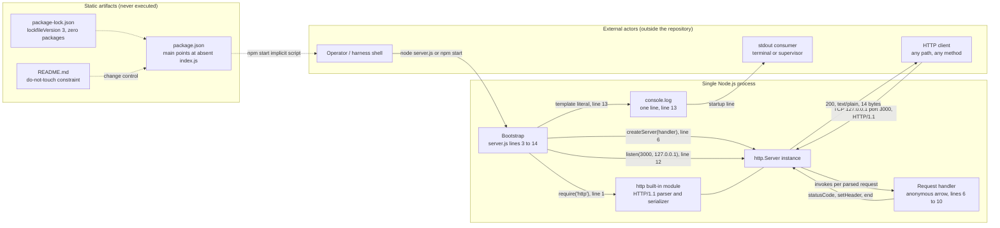

The structural point the diagram makes is the absence of edges: the handler has no outbound dependency, the process has no egress, and the artifacts feed the operator rather than the runtime.

### 5.2.6 Connection State Transition Diagram

The state that matters architecturally belongs to the listening socket and its connections, not to the application, which holds none. The transitions below are the runtime's defaults as the system exercises them: one steady listening state, a keep-alive idle window of five seconds, a runtime-generated parse-error exit, and immediate termination.

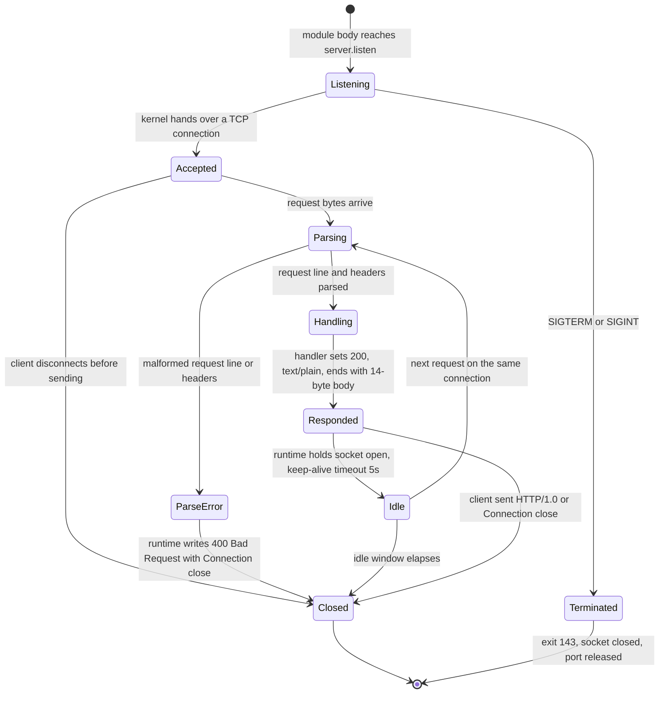

Two properties follow from the diagram. `Listening` is the only steady state the process has, and the process leaves it only by terminating — there is no degraded, draining or restarting state. And every cycle through `Handling` returns the connection and the process to a state indistinguishable from before, because the handler retains nothing.

### 5.2.7 Request Handling Sequence Diagram

The sequence covers the full observed lifecycle of one process: launch and readiness, a served request, a second request on the same keep-alive connection, the runtime-only path for malformed input, and termination.

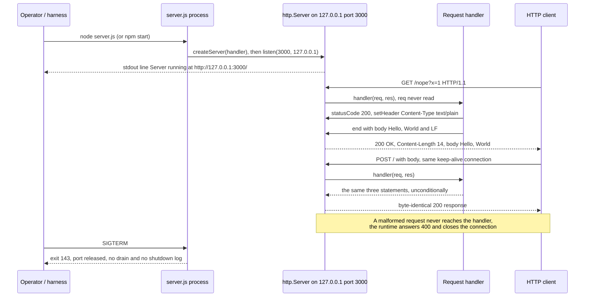

The sequence exposes the system's central architectural property: the application appears in exactly one place — between the runtime's parser and its serializer — and it transforms nothing it receives.


## 5.3 Technical Decisions

### 5.3.1 Architecture Style Decision: One Dependency-Free Module over a Web Framework

**Decision.** Implement the HTTP endpoint directly on the built-in `node:http` module inside a single CommonJS file, with no framework, no middleware and no router.

**Alternatives considered and rejected.**

| Alternative | Capability it would add | Why it was rejected for this system |
|---|---|---|
| Express, Fastify or Koa | Routing, middleware chain, response helpers, body parsing | Every path and method already receives the same response, so no route would ever be matched and no middleware would ever branch; the framework would contribute a transitive dependency graph and nothing else |
| Hand-rolled router inside `server.js` | Path/method-specific responses | `req` is never read (`server.js` line 6), so there is no input to route on; adding a router would create behavior the fixture's assertions do not expect |
| Micro-framework or static-file server | Declarative response definition | Both add dependencies to satisfy a requirement met by three statements; `package-lock.json` would no longer resolve zero packages |

**Rationale.** The requirement is one fixed response for every request. The built-in module supplies exactly the two capabilities that requirement needs — `createServer` and `listen` — and Node.js provides all protocol work beneath them. A framework's value appears only when there are multiple routes, shared middleware, request parsing or response negotiation; none exists here, and each would have to be invented to justify the dependency. The decision also preserves the property the fixture depends on most: `package-lock.json` resolves no packages, so there is no transitive code to audit, patch or drift.

**Tradeoffs accepted.** No routing or 404 behavior; no middleware or centralized error middleware; no body parsing, static file serving, compression, content negotiation or CORS handling; no framework-provided test harness. Any of these, if introduced later, is an architectural change governed by the `README.md` constraint, and each would import a dependency graph the lockfile currently proves absent.

### 5.3.2 Communication Pattern Decision: Plaintext HTTP/1.1 on Loopback

**Decision.** Expose one plaintext HTTP/1.1 socket on `127.0.0.1:3000`, answered synchronously with a single unary request/response exchange, and rely on the runtime's keep-alive defaults rather than configuring connection behavior.

**Alternatives considered and rejected.** TLS termination (requires certificate provisioning, renewal and a secret store — key management protects nothing on a segment that never leaves the host); HTTP/2 (in practice couples to TLS and adds configuration for a single 14-byte response); a Unix domain socket (would change the client contract and the "http://host:port/" readiness message); a message broker or event stream (adds a broker dependency and asynchronous delivery semantics where a synchronous assertion is wanted); compression (a 14-byte body cannot benefit).

**Rationale.** Loopback traffic never crosses a network boundary, so transport encryption protects only from a host-level attacker who already has the plaintext in memory. HTTP/1.1 over TCP is the lowest common denominator every client and harness speaks, and leaving keep-alive at the runtime default yields connection reuse — observed as `Connection: keep-alive` with `Keep-Alive: timeout=5` — at zero code cost. The readiness message and the response both derive from the same two literals, so the announced URL is always the URL actually served.

**Tradeoffs accepted.** No transport security, no mutual authentication, no compression, no content negotiation, no streaming or server-sent events, and no request-timeout tuning — the application configures none, so the deployed runtime's defaults apply. Clients must run on the same host. Changing the bind address or inserting a proxy is a security-model change, not a tuning change.

### 5.3.3 Data Storage Decision: No Persistence Tier

**Decision.** Hold no durable or shared state. No database, key-value store, file, queue, session store or in-memory cache exists; the response is a constant in the source and is not recorded anywhere.

**Alternatives considered and rejected.** An embedded store such as SQLite (introduces file writes, a driver and a schema, plus a durable artifact whose contents would differ between runs); a JSON snapshot file written per request (adds `fs` usage, a concurrency hazard and an unbounded artifact); an in-memory counter or request log (introduces mutable module state, which makes two runs of the same request produce different observable states).

**Rationale.** The fixture's value is that any run can be compared to any other and to the baseline commit. Persistence would defeat that directly: it creates state that survives restarts, needs migration, and could carry differences between hosts into an assertion about HTTP behavior. With no state, an abrupt kill at any instant is safe, there is nothing to back up or restore, and recovery is a single command.

**Tradeoffs accepted.** The system cannot report what it served. There is no audit trail, no request count, no rate-limit counter, no idempotency-key store and no ability to answer any question about its own history. Any record of served requests must be captured externally, by the operator or harness, from its own client side.

### 5.3.4 Caching Decision: No Application Cache and No Cache Directives

**Decision.** Perform no caching in the application and emit no cache metadata on the response. The only caching-adjacent behavior is the runtime's keep-alive socket reuse.

**Alternatives considered and rejected.** `Cache-Control: public, max-age=…` (the content is immutable, so any value would be defensible, but choosing one would assert consumer behavior the fixture has no basis to define); `ETag` or `Last-Modified` (conditional requests cannot be honored, because no request header is ever read); an in-process memo (meaningless when the "computed" value is a string literal); compression or `Vary` handling (no content negotiation exists).

**Rationale.** The response is a compile-time constant, so caching it would save no work: the three statements in the handler cost less than serving a cache hit. Declaring cache policy would also enlarge the response contract beyond the three literals the fixture asserts, and any intermediary acting on it would change what clients observe.

**Tradeoffs accepted.** Caching behavior is left entirely to clients and intermediaries, which may cache the greeting indefinitely because no directive forbids it. That is harmless here — the content never changes — but it also means the service gives consumers no guidance and cannot participate in invalidation. The only cache-like resource is the idle keep-alive socket, which caches no response object.

### 5.3.5 Security Decision: Isolation by Bind Address in Place of Authentication

**Decision.** Secure the service through network isolation and the absence of an input surface, rather than through authentication, authorization, encryption or rate limiting.

**Alternatives considered and rejected.** Token or basic authentication (would require a credential source, a comparison and request-header parsing — the first input surface the system would have); mTLS (certificate provisioning and rotation); an IP allowlist (redundant for a loopback bind, where the kernel already restricts the peer); a reverse proxy (relocates trust without adding any, and adds an operational component).

**Rationale.** Two independent properties make authentication unnecessary: the socket binds the IPv4 loopback literal (`server.js` line 3), so no remote host can connect, and the handler never reads `req` (line 6), so no arriving request can influence the response, the process or any later request. With nothing reachable and nothing influenceable, an identity would have no authorization decision to inform.

**Evidence of the resulting posture.** No `Authorization`, `Cookie` or `Set-Cookie` handling exists; no TLS configuration exists; no rate limiter, CSRF or CORS header is emitted; and no `Server` or `X-Powered-By` header is sent, so the responses do not advertise the runtime. The only security-relevant behavior the system adds on its own is the bind address.

**Tradeoffs and residual risk.** The entire security model rests on one literal. Mapping the port through a container, binding `0.0.0.0`, or placing the service behind a proxy would expose an unauthenticated endpoint that serves every path identically, with no rate limiting and no request-validation layer to absorb hostile input. Such a change is a security-model change requiring the owner's authorisation under the `README.md` constraint, and the option to bind off-host is a decision the fixture deliberately never made available — `PORT` and `HOST` are ignored, so it cannot be achieved by configuration at all.

### 5.3.6 Architecture Decision Tree

The tree records how each decision in this section follows from the fixture's requirement, and where each rejected alternative branches away.

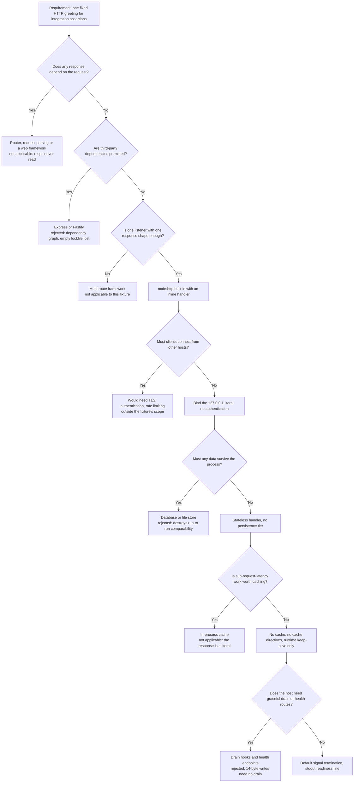

### 5.3.7 Architecture Decision Records

No ADR documents, decision logs or design notes exist in the repository: the four tracked files contain no such record, and the history is a single commit, `a6f7f58`. The records below are therefore **reconstructed from the code**, and every one carries the status "Accepted (implicit)" because the implementation embodies it and no alternative appears anywhere in the checkout. Each record's consequence is stated as the constraint it places on future change.

| ID | Decision | Status | Consequence |
|---|---|---|---|
| ADR-001 | Implement the HTTP endpoint on the built-in `http` module in a single CommonJS file | Accepted (implicit) — `server.js` line 1 | Zero dependencies and an empty lockfile must be preserved; adopting a framework or any package is a governed architectural change |
| ADR-002 | Bind configuration is a source literal, not an injected value | Accepted (implicit) — `server.js` lines 3-4 | `PORT` and `HOST` are inert; running two instances per host is impossible; changing the address requires a source edit |
| ADR-003 | The security boundary is the loopback bind plus a request-blind handler | Accepted (implicit) — `server.js` lines 3 and 6 | No authentication exists to fall back on; any off-host exposure is a security change, not a configuration change |
| ADR-004 | Every request receives one unconditional response; no method or path semantics | Accepted (implicit) — `server.js` lines 7-9 | No 404, no verb handling and no request validation exists; consumers may rely on byte-identical responses |
| ADR-005 | No persistence tier and no session state | Accepted (implicit) — no `fs` use, no store client, no `Set-Cookie` | No audit trail is possible from inside the system; the harness must record observations; restarts are always safe |
| ADR-006 | No cache layer and no cache directives on the response | Accepted (implicit) — only `Content-Type` is set | Caching is left to clients and intermediaries; conditional requests cannot be honored |
| ADR-007 | CommonJS, no build, no transpile, no type checking | Accepted (implicit) — no `type` field, no build script, no configuration file | Source is the deployed artifact; no static guarantees exist beyond the runtime's own parsing |
| ADR-008 | No graceful shutdown, health endpoint or drain logic | Accepted (implicit) — no signal handler, no route logic | Liveness must be inferred from the process and stdout; termination is immediate (exit 143 observed) and releases the port |
| ADR-009 | Packaging declares zero dependencies and an entry point that does not exist | Accepted (implicit) — `package.json` lines 5-7, `package-lock.json` lines 6-11 | The launch contract is the file path; nothing installs, publishes or loads the package by name; `npm test` fails by design |
| ADR-010 | Plaintext HTTP/1.1 with runtime-default connection handling | Accepted (implicit) — `server.js` lines 12-14 | No TLS, compression or timeout tuning exists; protocol behavior follows whichever Node.js line is deployed |


## 5.4 Cross-Cutting Concerns

### 5.4.1 Monitoring and Observability

The system contains no instrumentation. There is no metrics endpoint, no counter, no timer, no APM agent, no health route and no telemetry exporter; the only output the application code produces is the single startup line (`server.js` line 13). Observability is therefore an entirely external property, obtained by watching the process and probing the socket.

Two consequences follow from the code and shape what external monitoring can achieve:

- **The greeting doubles as an accidental liveness probe.** Any path returns `200` with the fixed body, so a probe to `/health` succeeds — but it succeeds identically for `/`, `/health` and every other path, so it can confirm that the listener is bound and answering, and nothing more. It cannot detect a wrong response body, because the probe path has no dedicated semantics to check against.
- **Nothing is measurable from inside.** Throughput, latency distribution, error rate, concurrent connections and request counts are all invisible. A monitor must derive them from its own client side.

| Signal | Available | Source | Operational use |
|---|---|---|---|
| Process liveness and exit code | Yes | OS / supervisor | Restart decision; exit 1 signals a bind failure, exit 143 an external signal |
| Listening socket on `127.0.0.1:3000` | Yes | Kernel socket table | Confirms the bind succeeded independently of stdout |
| Readiness | Yes, once | stdout startup line | Start gate for a harness; the only in-band "I am ready" event |
| Response conformance | Yes, externally | Any HTTP client | Status, content type and 14-byte body assertions |
| Request count, latency, error rate | No | None | Cannot be computed from inside the system |
| Resource and dependency health | No | None | No dependencies exist to health-check; no resource instrumentation exists |

The practical monitoring design for this fixture is a harness that records the startup line, asserts the response contract, and watches the process exit status — not a monitoring stack. Nothing in the repository needs, or can accept, an agent.

### 5.4.2 Logging and Tracing

**Logging.** The system has exactly one log statement: `console.log` with a template literal at `server.js` line 13. It is unconditional, fires once per successful bind, is written to stdout, and is neither levelled, structured, timestamped nor directed to a file. There is no logging framework (adding one would introduce the dependency the fixture exists to avoid), no request logging, no access log, no error log written by application code, and no log rotation concern — one line per process lifetime is the entire log volume.

Runtime-generated diagnostics are the only other output: when an error escapes, Node.js prints the stack trace to stderr and exits, as observed for `EADDRINUSE`. Those messages belong to the runtime, not to the application, and their format follows whichever Node.js line is deployed.

**Tracing.** No tracing exists. There is no OpenTelemetry, no span, no correlation identifier and no trace-context propagation. Distributed tracing would also be structurally impossible without a code change: the handler never reads request headers, so it could neither accept an incoming `traceparent` nor attach one to a response, and the system makes no outbound call in which a trace could continue.

| Concern | Status | Detail |
|---|---|---|
| Application log statements | 1 total | `server.js` line 13, stdout, once per bind |
| Log levels, structure, timestamps | Absent | Plain template-literal string with no severity or fields |
| Request / access logging | Absent | No handler-time output of any kind |
| Persistent log file | Absent | No `fs` use; if the consumer does not capture stdout, the line is lost |
| Error logging by the application | Absent | Errors surface only as runtime stack traces on stderr |
| Correlation IDs, tracing, spans | Absent | No header is read, so no context could be propagated |

The architectural effect is that stdout is a **readiness channel, not an observability channel**. A run leaves no record of what it served; that record can only exist on the client side, which is why the harness, not the service, must own any evidence of request activity.

### 5.4.3 Error Handling Patterns

**Pattern.** The application implements no error handling at all: no `try`/`catch`, no error-first callback, no `'error'` listener on the server, no `process.on('uncaughtException')`, no `domain`, no retry, no circuit breaker and no fallback response. The pattern is exclusively **fail fast and let the platform decide** — protocol errors are answered by the runtime, startup errors terminate the process, and no software error inside the handler is recoverable by design.

| Error class | Origin | Observed behavior | Application recovery |
|---|---|---|---|
| Malformed HTTP request (bad request line or headers) | Runtime parser | `400 Bad Request` with `Connection: close` and an empty body; the handler is never invoked; the process keeps serving | None needed — the runtime absorbs it |
| Bind failure, e.g. port 3000 already held | Kernel, surfaced as an unhandled `'error'` event | `Error: listen EADDRINUSE ...` stack trace on stderr, process exits 1, nothing listening | None — the operator must free the port and relaunch |
| Client aborts a connection mid-request | Client / kernel | No response is written, no output is produced, the process is unaffected | None needed |
| Exception inside the handler | Application | Would surface as an uncaught exception and terminate the process | Unreachable today: the three statements touch no throwing API |
| Downstream service failure | Not applicable | No outbound call, no dependency to fail | Not applicable |
| Overload / backpressure | Not applicable | No queue, no concurrency limit, no request timeout configured by the application | Not applicable |

Two properties of this posture matter operationally. First, hostile input cannot kill the process: repeated malformed and truncated probes left it serving `200` responses afterwards. Second, there are no application-defined error response bodies, so consumers must interpret status codes alone, and the `400` they see carries the runtime's shape rather than a designed contract.

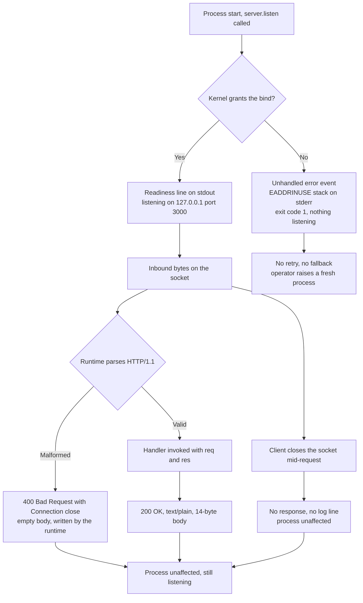

### 5.4.4 Authentication and Authorization

**Status: absent by design, and not required by the system's security model.** The framework here is the absence of one: access control is expressed solely as a bind address.

| Control | Status | Evidence |
|---|---|---|
| Authentication | None | No credential, token, header or cookie is read; `req` is never referenced (`server.js` line 6) |
| Authorization | None | There is no per-request decision to make — every request receives the identical response |
| Transport security | None | Plaintext HTTP/1.1; no TLS module, key or certificate anywhere |
| Sessions and cookies | None | No `Set-Cookie` is emitted and no cookie is parsed |
| Rate limiting / quotas | None | No counter, no clock, no state |
| CORS policy | None | No `Access-Control-*` header is emitted |
| Input validation | Not required | No input is read, so there is no input surface to validate |
| Secret management | Not required | No credential, key or configuration value exists |
| Network admission | **Present — the only control** | Loopback literal at `server.js` line 3: only processes on the same host can connect |

**The access-control model in one sentence:** the peer must already be on the host, and once it is, it receives the same read-only greeting whether it is authorised or not. Confidentiality and integrity are therefore provided by OS process and network isolation rather than by anything the application does. That is a legitimate model for a loopback-bound test fixture, and it is the reason no authentication exists: identity would have no decision to inform.

**Residual risk, stated plainly.** Every property above depends on the one bind literal. If the service were ever exposed off-host — through container port mapping, a `0.0.0.0` bind, or a reverse proxy — it would become an unauthenticated, unthrottled, unlogged endpoint answering every path identically, with no layer available to reject hostile input. The application does not merely happen to be unconfigured for that; it cannot be reconfigured for it, because `PORT` and `HOST` are ignored by design.

### 5.4.5 Performance Requirements and SLAs

No performance requirement, service-level objective, availability target or throughput figure is stated anywhere in the repository: there is no SLA document, no benchmark harness, no load generator and no assertion about latency. What can be stated precisely is the system's structural performance profile and the small number of measurements the implementation supports.

| Dimension | Value or status | Evidence |
|---|---|---|
| Declared SLA / SLO | None | No such artifact or manifest field exists |
| Application work per request | Constant: three statements, no branching | `server.js` lines 7-9 |
| Blocking or asynchronous I/O in the request path | None | No `fs`, no outbound socket, no timer, no `await` |
| Concurrency model | Single event loop, one handler invocation at a time | Node.js default; no `cluster` or worker configuration |
| Timeouts | Not configured by the application; runtime defaults apply | No timeout option is passed to `createServer` or `listen` |
| Capacity ceiling per host | One process, one fixed port | `server.js` line 4; a second instance exits 1 with `EADDRINUSE` |
| Response size | 14-byte body plus five header lines | Verified: `Content-Type`, `Date`, `Connection`, `Keep-Alive`, `Content-Length: 14` |
| Observed concurrency | Ten parallel requests all returned `200`; 50 concurrent requests all returned `200` within 32 ms (recorded in 4.6.5) | Verification in this environment |
| Load or performance test in repository | None | `scripts.test` is the npm placeholder that always exits 1 |

**Latency structure.** With no application I/O and a 14-byte body, response time is dominated by loopback TCP handling and event-loop scheduling rather than by anything the application does. The handler cannot be the bottleneck: it allocates no persistent state, performs no computation on input and calls nothing that can block.

**Availability and throughput expectations, as implied rather than declared.** The observable contract is that once the readiness line appears, every parsed request is answered, and that the answer is byte-identical each time. Availability is bounded by the single process and the single host — there is no redundancy — and throughput by one event loop and the kernel's accept backlog. Because the bind is loopback-only and the port is a literal, capacity can be added only by adding hosts, and the system cannot be placed behind a load balancer without a source change.

### 5.4.6 Disaster Recovery and Operational Resilience

**Recovery objective.** There is no data, so the recovery point objective is not applicable — nothing can be lost because nothing is written. The recovery time objective is the duration of a single command plus the bind: during verification, a terminated process released port 3000 immediately and a fresh process bound it again and printed the readiness line within about a second. Recovery therefore requires no restoration, replay or reconciliation step; it requires only that the same commit be present on the host.

| Capability | Status | Detail |
|---|---|---|
| Backups and restore | Not required | No durable state exists beyond the four committed source files |
| Replication / failover | None | One process on one host; the loopback bind rules out a shared multi-host topology |
| Automatic restart / supervision | None configured | No systemd unit, PM2/foreman config, `cluster` usage or container restart policy |
| Health-check-driven restart | None | No health route with distinct semantics; any path returns the greeting |
| Graceful shutdown and drain | None | No signal handler; `SIGTERM` terminates with exit 143, no drain, no shutdown log (verified) |
| Runbook or recovery script in repository | None | Recovery is a documented two-command procedure, not automation |
| Data-corruption exposure | None | The process writes nothing, so abrupt termination cannot leave partial state |
| Configuration drift | None | The bind address and the response are literals in the commit, not environment values |

**Recovery procedure.** Stop anything still holding the port (the previous process releases it on exit), relaunch from the checkout at commit `a6f7f58` with `node server.js` — or `npm start`, which reaches the same command through npm's implicit default script — then wait for `Server running at http://127.0.0.1:3000/` on stdout and assert the response contract. No install, build or migration step intervenes, because the source is the artifact.

| Failure mode | Impact | Detection | Recovery action |
|---|---|---|---|
| Process terminated or crashed | Total outage of the single endpoint | Failed connection; process liveness check | Relaunch the one command; the port is already free |
| Bind failure (`EADDRINUSE`) | Process exits 1, nothing listening | stderr stack trace; exit code 1 | Identify the process owning port 3000, terminate it, relaunch |
| Host failure | Total outage | External probe failure | Reprovision the host, check out `a6f7f58`, run the command |
| Node.js missing or replaced with an incompatible line | Launch failure or changed protocol defaults | Launch error, or drift in headers and timeouts | Install a compatible Node.js line; the repository declares no version to restore against |
| Malformed or hostile request flood | No service impact beyond runtime `400` responses | Visible only at the client side — the service logs nothing | No action; the process is unaffected |

**Single points of failure.** The process and the host are both irreplaceable, and that is consistent with the fixture's purpose rather than a defect in it: high availability would require either a bind-address change or a proxy, and both are architectural changes governed by the `README.md` constraint. The resilience the system actually offers is the cheapest kind — a stateless process whose worst-case recovery is a restart that cannot lose data and cannot leave inconsistency behind.

### 5.4.7 Architectural Assumptions and Constraints

Every statement in this section rests on the assumptions below. Each is stated with the evidence that supports it in the repository and the consequence if it is invalidated.

| Assumption | Basis in the repository | Consequence if invalidated |
|---|---|---|
| The only consumers are processes on the same host | Loopback literal, `server.js` line 3 | The service would be an unauthenticated plaintext endpoint for every path, with no rate limiting or validation |
| Consumers are automated checks that assert exact bytes, not humans browsing | `README.md` purpose statement; fixed literals at `server.js` lines 7-9 | Every URL would look identical, so no navigation, routing or 404 behavior exists to support human use |
| The four files are not modified | `README.md` instruction "Do not touch!" | The comparison baseline at commit `a6f7f58` is lost and these guarantees no longer describe the system |
| The deployed Node.js line behaves as the verified one (v22.23.4) | Only long-stable `http` APIs are used; no `engines` field pins a version | Header sets, timeout defaults and parser error responses could change without any source change |
| Loopback port 3000 is free at launch, and one process per host is sufficient | Port literal, `server.js` line 4; no conflict handling | A held port yields exit 1 with no service; capacity cannot be scaled on that host |
| Nothing must be auditable from inside the system | No persistence, no request logging | Request history and error counts cannot be reconstructed after the fact without an external record |
| Launching by file path is acceptable, so the package is never loaded by name | `main` names an absent `index.js`, `package.json` line 5 | Package-based consumption fails; the launch contract would have to change to use npm resolution |
| Configuration is not environment-specific, so no injection layer is needed | No `process.env` read anywhere; no configuration file | The same source cannot be pointed at a different address or port without editing it |
| Counterparties tolerate plaintext HTTP/1.1 and a body of exactly `Hello, World!` plus a trailing LF | Verified response on the wire | Strict clients expecting TLS, JSON, or a different body would fail |


## 5.5 References

Every claim in this section was established from the repository's four tracked files plus runtime observation of the process started from them. No external web source was consulted, because nothing in the section depends on an external fact.

**Files**

- `server.js` — the entire executable system (14 lines): the single `require('http')` at line 1, the `hostname`/`port` literals at lines 3-4, the inline request handler that fixes status, content type and the 14-byte body at lines 6-10, and the `listen` call with the single `console.log` readiness line at lines 12-14. Established the architecture style, every component boundary, the absence of error, signal and shutdown handling, and the entire error-handling posture.
- `package.json` — identity (`hello_world` 1.0.0), MIT licence, `main: "index.js"` pointing at an absent file (line 5), the always-failing `test` placeholder (line 7), and the absence of dependency, `engines` and build fields. Established the dependency-free packaging decision, the launch-by-path contract, and the unpinned runtime assumption.
- `package-lock.json` — `lockfileVersion` 3 with `requires: true` and a `packages` object containing only the root entry, establishing that zero third-party packages are declared, resolved or installable.
- `README.md` — the purpose statement ("test project for backprop integration") and the "Do not touch!" constraint, which establish the fixture rationale and the governance boundary applied throughout 5.3 and 5.4.

**Folders**

- `""` (repository root) — the complete artifact inventory: four files, no sub-folders, and therefore no module tree, configuration directory, test directory, pipeline definition or container asset anywhere in the system.

**Runtime observations performed for this section**

- Startup of `node server.js` on Node.js v22.23.4 — readiness line `Server running at http://127.0.0.1:3000/`.
- HTTP probes — `200 OK` with `Content-Type: text/plain`, `Date`, `Connection: keep-alive`, `Keep-Alive: timeout=5` and `Content-Length: 14` for `GET /`, `GET /nope?x=1`, `POST /` with a body, and `HEAD /` (headers only); HTTP/1.0 request without `Host` served with `Connection: close`.
- Raw-socket probes — malformed request line returned `400 Bad Request` with `Connection: close` from the runtime parser, and an abrupt mid-request disconnect produced no response; the process kept serving `200` afterwards.
- Concurrency probe — ten parallel requests all returned `200`.
- Failure probes — a second instance exited 1 with an unhandled `EADDRINUSE` error event and stack trace on stderr; `SIGTERM` produced exit status 143 with the port released immediately and no shutdown log line.

**Cross-referenced sections of this specification**

- 1.2 System Overview — project context, limitation inventory and the stated success criteria and KPIs.
- 3.2 Frameworks & Libraries — the component and version register, the libraries-in-use record and the compatibility requirements mirrored here.
- 3.6 Development & Deployment — the absence of build, container, infrastructure and pipeline stages, and the deployment procedure.
- 4.6 Technical Implementation: State Management — the process state model, persistence points, caching requirements and concurrency behavior that the connection-level view in 5.2.6 complements rather than repeats.


# 6. SYSTEM COMPONENTS DESIGN

## 6.1 Core Services Architecture

### 6.1.1 Applicability Assessment

**Core Services Architecture is not applicable for this system.** The repository contains no microservices, no distributed architecture and no distinct service components. It contains exactly one executable artifact — `server.js`, 14 lines — that stands up a single loopback HTTP listener inside one OS process. There is no second deployable unit, no inter-process call, no network dependency and no shared infrastructure, so every construct this section normally documents (service boundaries between callers and callees, discovery, load balancing, circuit breaking, auto-scaling, failover) has nothing in the repository to describe.

The verdict rests on a complete census rather than on sampling: `git ls-files` returns four files (`README.md`, `package-lock.json`, `package.json`, `server.js`) and a full working-tree scan returns the same four, with no sub-folder anywhere. A case-insensitive text search of every file for `microservice|service|cluster|load.?balanc|circuit|retry|fallback|replic|queue|docker|kubernetes|pm2|worker_threads|fork(|redis|registry|discovery|health|probe|prometheus|metric|scale|timeout|keepAlive` returns no match at all. The absence is therefore textual as well as structural: no source line and no manifest entry in the repository even mentions a service, a scale mechanism, a timeout or a health signal.

| Applicability criterion | Shape that would make it applicable | Observed in repository | Evidence |
|---|---|---|---|
| Two or more independently deployable service components | Separate processes or images, each with its own start command | One process, one file, one start command (`node server.js`) | `server.js` lines 1-14; `package.json` has no `start` script and no dependency keys |
| Inter-service communication | HTTP/gRPC client calls, message broker, event bus, shared queue | Zero outbound calls; the only `require` is the built-in `http` module | `server.js` line 1; no other `require` exists |
| Service discovery or registry | Registry client, DNS-based discovery, service mesh sidecar | Address is a source literal `127.0.0.1`; nothing is looked up | `server.js` line 3 |
| Load balancing across instances | Reverse proxy, LB tier, `cluster` module, `SO_REUSEPORT` | Fixed port literal; a second instance on the host exits 1 | `server.js` line 4; verified `EADDRINUSE` exit status 1 |
| Circuit breaking or retry toward a callee | Wrapped client with breaker/backoff state | No client, no dependency, no breaker or retry code | Full-repository text search: no match for `circuit`, `retry`, `fallback` |
| Distributed data or replication | Database, cache cluster, replicated store | No persistence, no cache, no state at all | No `fs`, `db`, `redis` or data file in the repository |
| Orchestration, scaling or IaC | `Dockerfile`, Kubernetes manifest, Terraform, CI workflow | None present; deployment is a manual host-level command | Recorded in 3.6.2 |

**What exists in its place.** One *service* in the plainest sense: a network-attached process whose boundary is a single TCP socket on `127.0.0.1:3000`, speaking plaintext HTTP/1.1 and answering every parsed request with the identical fixed response (`200`, `Content-Type: text/plain`, `Hello, World!\n`, 14 bytes). The process boundary is also the fault boundary, the scaling boundary and the trust boundary, because there is nothing else in the system to draw one between. Section 5.1.1 establishes the same boundary set from the architectural side, and 5.1.4 records that no outbound integration of any kind exists.

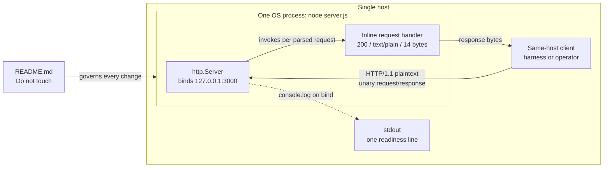

*Figure 6.1-1 — Deployment topology: what exists in place of a service architecture.* The dashed edges are non-runtime relationships (governance and a one-off log write). There is no edge between the process and any other system, because no outbound integration exists.

**How the rest of this section reads.** Because the subject is absent, 6.1.2 through 6.1.5 examine each area the section prompt requires, and for every area record what the code actually does instead, citing the line that settles the question. Where an absence is deliberate — a test fixture whose purpose is fixed, comparison-stable output under a "Do not touch" constraint (`README.md` line 2) — it is stated as a design consequence, not as a defect. Runtime facts that belong to the platform rather than to the application (HTTP parsing, keep-alive reuse, default timeouts) are attributed to the Node.js runtime and cross-referenced to 5.1.1 and 5.4.5 instead of being restated as application behavior.


### 6.1.2 Service Components

The system exposes exactly one service component: a loopback HTTP responder implemented in `server.js`. It has no peer, no callee and no subordinate service, so the "components" of this architecture are the single service, the platform that executes it and the external actor that drives it. Nothing in the repository exports a function or a module, so there is not even an internal library boundary to document.

#### 6.1.2.1 Service Boundaries and Responsibilities

The service boundary is the TCP socket, and the responsibility behind it is fixed and total: answer every parsed request with one byte-stable response. Internal decomposition is absent — `server.js` declares no class, no named function, no `module.exports`, and no configuration object; the request handler is an inline anonymous arrow bound directly to `http.createServer` (`server.js` lines 6-10).

| Component | Responsibility | Boundary it owns | Evidence |
|---|---|---|---|
| HTTP listener (module body) | Bind `127.0.0.1:3000`, accept connections, keep the socket open, announce readiness once | The inbound network boundary — the only service interface in the system | `server.js` lines 3-4, 12-14 |
| Request handler (inline arrow) | Set status `200`, set `Content-Type: text/plain`, write `Hello, World!\n` and end the response | The application boundary — the `(req, res)` callback contract; admits no data because `req` is never read | `server.js` lines 6-10 |
| Node.js runtime and `http` built-in | Parse HTTP/1.1, serialise the response, manage keep-alive, answer malformed requests with `400`, apply default timeouts | The protocol boundary — status line, headers, `Content-Length`, connection lifetime | `server.js` line 1; runtime defaults confirmed in 5.4.5 and 5.4.3 |
| Operator / harness (external) | Spawn the process, read the readiness line, issue requests, terminate the process | The process and stdout boundaries; not part of the repository | `server.js` line 13 is the only signal the service emits |

**Responsibilities the service explicitly does not hold.** It performs no routing (any path is served identically), no method semantics (no distinction between `GET`, `POST` or `HEAD`), no request parsing or validation, no authentication, no authorization, no rate limiting, no persistence, no logging of requests, and no session state. Each of these is verifiable from the code itself rather than from absence of configuration: the handler contains three statements, and the only variable it touches is `res`.

**Contract.** There is no published interface definition — no OpenAPI document, no schema, no versioned path. The de facto contract is the response byte sequence: `HTTP/1.1 200 OK`, `Content-Type: text/plain`, `Content-Length: 14`, body `Hello, World!` plus a trailing LF. Because the body and headers are assembled from literals, the contract cannot drift between runs, hosts or invocation orders.

#### 6.1.2.2 Inter-Service Communication Patterns

**There is no inter-service communication.** The call graph behind the boundary has depth 1: the runtime invokes the handler, the handler writes the response, and no other participant exists. Every pattern this area normally covers — synchronous RPC between services, asynchronous messaging via a broker, publish/subscribe, event streaming, saga coordination — is structurally impossible here, because none of the required counterparts (a callee, a broker, a queue, a subscriber) is present in the repository or reachable from it.

| Channel | Direction | Pattern | Evidence |
|---|---|---|---|
| Kernel → runtime → handler | Inbound | Unary request/response, one response per parsed request, synchronous handler that never yields the event loop | `server.js` lines 6-10; no `async`, `await`, timer or I/O in the handler |
| Handler → client socket | Outbound | Response serialisation by the runtime; no streaming, no chunking, no push | `res.end('Hello, World!\n')` at `server.js` line 9 |
| Runtime → same socket (reuse) | Inbound | Keep-alive reuse of an idle connection, up to the runtime's default 5 s window; a platform default, not an application feature | Observed header `Keep-Alive: timeout=5`; no connection header is set by the application |
| Application → stdout | One-way | Single startup event per successful bind | `console.log` at `server.js` line 13 |

```mermaid
sequenceDiagram
    participant H as Harness same host
    participant R as Node http runtime
    participant A as Request handler
    H->>R: HTTP/1.1 request, any path and any method
    R->>A: invoke handler with req and res
    A-->>R: statusCode 200, Content-Type text/plain, end 14-byte body
    R-->>H: HTTP/1.1 200 OK with Date, Connection keep-alive, Keep-Alive, Content-Length 14
    Note over H,R: No downstream participant exists. Call graph depth is 1 and there are no service-to-service edges to draw.
```

*Figure 6.1-2 — Service interaction diagram.* Every arrow terminates inside the single process or at the same-host client; no arrow leaves the host, which is why no inter-service pattern applies.

**Consequence for the reader.** Any observability or contract conversation about this system is a client-side conversation: the service neither records requests nor carries a correlation identifier, and it reads no request header, so it could neither accept nor emit distributed trace context even if a tracing backend existed (5.4.2).

#### 6.1.2.3 Service Discovery Mechanisms

**None exists, and none could function as written.** The address of the sole endpoint is a source literal, `127.0.0.1` (`server.js` line 3), consumed directly by `server.listen`; there is no lookup step between source and socket. Discovery in this system is an out-of-band human agreement recorded in the README and the source, not a runtime mechanism.

| Discovery approach | Present | Detail | Evidence |
|---|---|---|---|
| Static address in source | Yes — the only mechanism | `127.0.0.1` and `3000` are module-level literals interpolated into the ready message | `server.js` lines 3-4, 13 |
| Configuration injection (`PORT`/`HOST`) | No | No `process.env` read exists anywhere in the repository, so environment variables cannot move the endpoint | Full-repository text search: no `process.env` |
| Registry or service mesh | No | No registry client, no sidecar, no dependency at all | `package-lock.json` resolves zero packages |
| DNS-based discovery | No | No hostname is resolved; the bind and the client both use the loopback literal | `server.js` line 3 |
| Health registration / heartbeat | No | The only outbound signal is one startup line; no periodic registration of any kind | `server.js` line 13 |

**Practical effect.** Changing the endpoint requires editing the source and redeploying the file, so consumers learn the address at the same time the producer changes it. Membership is fixed at one instance: nothing registers, deregisters or reports capacity, which is consistent with a fixture whose clients are on the same host (5.1.4).

#### 6.1.2.4 Load Balancing Strategy

**No load balancing exists at any layer.** There is one instance, one port and one code path, so there is no distribution decision to make. No reverse proxy, no ingress controller, no `cluster` module usage, no `SO_REUSEPORT` option and no container replica configuration appears in the repository (confirmed by full text search and by 3.6.2's inventory of absent deployment stages).

| Layer | Balancing behaviour | Evidence |
|---|---|---|
| Application | None — one handler, one port; a second process cannot share the port | `server.js` line 4; a concurrent second instance exits 1 with an unhandled `EADDRINUSE` error event (verified) |
| Node.js | No `cluster` primary, no worker processes, no round-robin scheduling | No `cluster`, `fork` or `worker_threads` reference in the repository |
| Network / host | None — no proxy, no LB tier, no VIP; the loopback bind also makes a remote balancer impossible | `server.js` line 3; 5.1.1 records that TLS, a second socket and any proxy are absent |
| Platform | None — no container, no orchestrator, no service definition | 3.6.2 records no `Dockerfile`, no IaC and no pipeline |

**What absorbs load in place of balancing.** Two mechanisms, both platform-owned: a single event loop that serialises handler invocations (each of which is constant work with no I/O), and the kernel accept queue behind `listen()`, whose default backlog is 511 and whose effective depth the OS governs [web]. Node.js adds no queue of its own and exposes no built-in load balancing or rate limiting, so a burst is either accepted or refused by the OS rather than spread across instances [web]. Behaviour recorded in 5.4.5 — 50 concurrent requests all answered `200` within 32 ms — is the observable consequence: a queue of that size is served by the event loop, not by scaling out.

#### 6.1.2.5 Circuit Breaker Patterns

**Not applicable: there is no callee to break a circuit to.** A circuit breaker guards a call to a remote dependency, and this service makes no outbound call of any kind — no HTTP client, no database driver, no cache client, no broker client, and no third-party package at all (`package.json` declares no dependencies; `package-lock.json` resolves none).

| Breaker element | Status | Reason |
|---|---|---|
| Protected downstream call | Absent | No outbound socket, driver or SDK exists in the repository |
| Open / half-open / closed state machine | Absent | Nothing to track; no failure counter, threshold or timer in the code |
| Fallback path when open | Absent | The handler has one unconditional branch; there is no alternate response |
| Failure signal to react to | Local only | The only failures are local: bind failure (process exits 1) and malformed input (runtime answers `400`), neither of which a breaker addresses |

If a dependency were introduced later, a breaker would still be structurally awkward: the handler is a synchronous callback with no error branch, there is no logger to record state transitions, and there is no configuration layer to hold thresholds — each would be a new architectural element rather than a setting.

#### 6.1.2.6 Retry and Fallback Mechanisms

**Neither exists in the service, and the service is exceptionally safe to retry.** No retry loop, no backoff, no timeout wrapper, no idempotency key and no alternate response appear anywhere in `server.js`; a failure surfaces as a process exit (bind errors) or a runtime-generated `400` (protocol errors), as recorded in 5.4.3.

| Mechanism | In the service | Where it can exist | Justification from the code |
|---|---|---|---|
| Retry of a server-side operation | Absent | Nowhere — no operation can fail and be re-attempted | The handler calls no API that can throw and performs no I/O (`server.js` lines 7-9) |
| Client retry | Not implemented, but harmless | The harness or caller only | The handler is side-effect free and reads nothing from the request, so repeated calls are indistinguishable from the first and cannot duplicate effects |
| Fallback response | Absent | Nowhere | There is no dependency whose failure would require a substitute response; the one response is unconditional |
| Timeout / deadline | Not set by the application | Runtime defaults (`requestTimeout` 300000 ms, `headersTimeout` 60000 ms, `keepAliveTimeout` 5000 ms) [web] | No timeout option is passed to `createServer` or `listen` |
| Graceful failure of the listener | Absent | Operator action | No `'error'` listener is registered, so a bind failure is an unhandled error event and the process exits 1 (verified) |

The pattern that results is **stateless idempotence rather than active recovery**: correctness under retry is guaranteed by the absence of side effects, so the system needs no retry machinery to be retry-safe, and no fallback machinery to be predictable when it is unavailable.


### 6.1.3 Scalability Design

There is no scaling design in this system, and the reason is structural rather than incidental: the single instance's address is a pair of source literals, its work per request is constant, and there is no configuration layer through which a second instance could be given a different identity. Scalability is therefore documented as the set of paths that were evaluated and the specific line of code that blocks each one.

#### 6.1.3.1 Horizontal and Vertical Scaling Approach

**Horizontal scaling is blocked at three independent points, any one of which is sufficient.** The port is a literal `3000` with no environment override, so two processes on one host cannot both bind; the bind address is the loopback literal, so a replica on another host serves only clients on that host; and no load balancer or discovery mechanism exists to route between replicas in any case.

**Vertical scaling yields nothing measurable.** The handler performs three statements over literals, reads no request data and issues no I/O (`server.js` lines 7-9), so processor time per request is essentially the runtime's HTTP parsing and socket handling. A larger host adds cores that the single event loop cannot use, and memory beyond a small heap that nothing allocates against.

| Scale axis | Mechanism present | Blocker | Evidence |
|---|---|---|---|
| Replica on the same host | None | Fixed port literal; a concurrent second instance fails with an unhandled `EADDRINUSE` error event and exits 1 (verified) | `server.js` line 4; no `process.env` read anywhere |
| Replica on another host | None | Loopback bind makes the endpoint unreachable from other hosts; no balancer, proxy or discovery exists to reach it | `server.js` line 3; 5.1.4 records connection refusal from a non-loopback address |
| More CPU or memory on one host | OS-level resize only | Handler work is constant and non-blocking; one event loop cannot use extra cores | `server.js` lines 6-10; 5.1.1 records no `cluster` and no worker threads |
| Process-level parallelism inside one host | None | No `cluster` module, no `worker_threads`, no `child_process` | Full-repository text search: no match for `cluster`, `worker_threads`, `fork(` |
| In-place restart as a scaling tactic | Operator action only | No supervisor, unit file or restart policy is configured | 3.6.3 records no systemd, PM2 or container restart policy |

**The only legal scale-out unit** is therefore a whole host running its own copy of the four files and serving its own same-host clients. That is not horizontal scaling of a service; it is duplication of an isolated fixture, and it leaves no shared state to reconcile.

```mermaid
flowchart TD
    Client["Same-host client or harness"] --> Proc["Single process: node server.js"]
    Extra["Additional same-host clients"] --> Proc
    Proc --> Listener["http.Server bound to loopback literal port 3000"]
    Listener --> Handler["Constant-work handler: 3 statements, no I/O, no state"]

    subgraph Paths["Scale-out paths evaluated"]
        Replica["Second replica on the same host"]
        ReplicaBlock["Blocked: fixed port literal, no PORT override,<br/>second bind fails EADDRINUSE and exits 1"]
        OtherHost["Replica on another host"]
        OtherHostBlock["Blocked: loopback bind is unreachable off-host,<br/>no balancer, proxy or discovery to route to it"]
        BiggerHost["Vertical growth: larger host"]
        BiggerBlock["No gain: one event loop, handler work is constant"]
    end

    Proc -.->|"duplicate attempt"| Replica
    Proc -.->|"copy of the same four files"| OtherHost
    Proc -.->|"resize the host"| BiggerHost
    Replica --> ReplicaBlock
    OtherHost --> OtherHostBlock
    BiggerHost --> BiggerBlock
```

*Figure 6.1-3 — Scalability architecture: one instance, three evaluated scale paths, three blockers.* Solid edges carry traffic; dashed edges are the scaling actions that route to a blocker.

#### 6.1.3.2 Auto-Scaling Triggers and Rules

**No auto-scaling trigger or rule exists.** There is no autoscaler configuration, no container or orchestrator to receive one, no metrics endpoint and no health route with distinct semantics — any path returns the same `200` greeting (`server.js` lines 6-10), so a probe can confirm the listener is bound and nothing further (5.4.1).

| Trigger source | Available to an autoscaler | Detail |
|---|---|---|
| Application metrics (RPS, latency, saturation) | No | No counter, timer, exporter or endpoint; nothing is measurable from inside (5.4.4, 5.4.1) |
| Health or readiness endpoint | Partially, accidentally | Every path answers `200`; readiness is a bound socket, not a distinct contract |
| Process liveness and exit code | Yes | External supervisor can observe exit 1 (bind failure) and exit 143 (`SIGTERM`) — verified |
| stdout readiness line | Yes, once | One line per successful bind; no heartbeat, so silence cannot be distinguished from health |
| Runtime or host resource signals | Yes, host-level only | CPU, memory and file descriptors are visible to the OS, but the repository defines no thresholds to act on |

**Rule implied by the evidence.** Since no in-band signal exists, any scaling decision must be computed entirely on the client side or by the host: probe the socket, watch the process, and if the result is unhealthy the only available action is to relaunch the process on the same host — which is a restart policy, not an auto-scaling policy. Automatic scaling upward is unavailable because there is no second identity to create; automatic scaling downward would remove the only instance.

#### 6.1.3.3 Resource Allocation Strategy

**Nothing is allocated declaratively.** The repository declares no runtime version (`package.json` has no `engines` field), no memory ceiling, no CPU share, no file-descriptor limit and no container in which such limits would be expressed. Allocation is whatever the operating system and Node.js defaults give one process.

| Resource | Declared allocation | Actual basis | Evidence |
|---|---|---|---|
| CPU | None | One event-loop thread; libuv thread pool unused because no filesystem, DNS or crypto work occurs | `server.js` lines 6-10; only `require` is `http` (line 1) |
| Memory | None | Node.js default heap; per request the response is a literal, so no buffer is retained and no module-level mutable state survives | No data structure is created or stored anywhere in `server.js` |
| File descriptors | None | One per live TCP connection, released when the runtime's keep-alive window (`timeout=5`) expires or the peer closes | Observed `Keep-Alive: timeout=5`; `keepAliveTimeout` default 5000 ms [web] |
| Network ports | Exactly one, fixed | Port literal `3000` on the loopback literal | `server.js` lines 3-4 |
| Runtime version | Unpinned | Any Node.js line able to run the used `http` APIs; v22.23.4 verified in this environment | `package.json` lines 1-11 (no `engines`, no `.nvmrc`) |

**Why the absence is consistent.** The fixture's verification cost is proportional to what it allocates: a process with no configured resources, no caches and no dependencies can be started and discarded per test run without leaving state or contention behind. Declaring limits would add configuration that the `README.md` constraint ("Do not touch!") treats as out of bounds.

#### 6.1.3.4 Performance Optimization Techniques

Every performance property the service has is a consequence of its minimalism rather than of tuning. No benchmark, profiler configuration or load generator exists in the repository, so none of these properties is measured there; the one measurement available is external, recorded in 5.4.5 and 4.6.5 (50 concurrent requests all answered `200` within 32 ms).

| Technique | Status | Effect | Evidence |
|---|---|---|---|
| Zero third-party middleware or framework | Present | No routing table, no middleware chain, no body parsing on the request path | `require('http')` is the only import (`server.js` line 1); no declared dependencies |
| Synchronous, I/O-free handler | Present | The event loop is never yielded mid-request; no callback or promise overhead per request | Three statements in `server.js` lines 7-9 |
| Literal response, no serialisation | Present | No object to encode; the body is a 14-byte constant, so it fits one write and needs no buffering | `res.end('Hello, World!\n')`, `server.js` line 9 |
| No per-request logging | Present (by omission) | No stdout or file write on the hot path; the only output is the startup line | `console.log` appears once, at `server.js` line 13 |
| Connection reuse | Present (platform default) | A repeated request on a live connection skips the TCP handshake and the handler re-runs identically | Observed `Connection: keep-alive`, `Keep-Alive: timeout=5` |
| Compression, caching, HTTP/2, clustering | Absent | No compression middleware, no cache layer, no TLS/HTTP/2 support, no worker processes | Full-repository text search returns no match for these constructs |
| In-repository performance or load test | Absent | No harness, no assertion on latency or throughput | `npm test` is the placeholder that always exits 1 (`package.json` line 7) |

#### 6.1.3.5 Capacity Planning Guidelines

Capacity planning reduces to one unit — a single process on a single host — and the constraints that bound it are all platform defaults, because the application configures none of them.

| Dimension | Planning guideline | Basis |
|---|---|---|
| Instance count | Exactly one per host; the second instance cannot start | Fixed port literal (`server.js` line 4); `EADDRINUSE` exit 1 verified |
| Sustained concurrency | Bounded by the event loop and the OS accept backlog (listen default 511), not by a configured limit | No queue, rate limit or `maxConnections` setting exists [web]; 50 concurrent requests served in 32 ms (5.4.5) |
| Per-request cost | Constant: no input-dependent work, no I/O, no allocation retained | `server.js` lines 6-10 |
| Request size and header limits | Runtime defaults: `maxHeadersCount` 2000, `requestTimeout` 300000 ms, `headersTimeout` 60000 ms, `maxRequestsPerSocket` unlimited | No option is passed to `createServer`; defaults per Node.js documentation [web] |
| Slow-client exposure | An idle keep-alive connection holds a descriptor for up to 5 s; a slow header sender up to 60 s before a `408` | Runtime defaults [web]; no application-level timeout |
| Client population | Same-host only; clients elsewhere cannot connect at all | Loopback bind (`server.js` line 3) |
| Growth path | None available without a source change; adding replicas requires editing the bind or inserting a proxy, both governed by `README.md` | 6.1.3.1 above; 5.4.7 lists the same constraint |

**Stated plainly:** the repository contains no capacity target, SLO or throughput figure to plan against, and inventing one would misrepresent the system. The defensible statement is that one process comfortably serves a single test harness on the same host — the only workload the repository describes — and that any larger workload would first require an architectural change (a configurable bind, a balancer, or a proxy) rather than more capacity of the same kind.


### 6.1.4 Resilience Patterns

Resilience in this system is a property of its shape rather than of any mechanism it implements. There is no supervisor, no replica, no failover tier and no configured timeout, yet the service is hard to break — because it holds no state, calls nothing, and cannot be reached from outside the host. The patterns below are documented in that order: what containment exists, and which named pattern is genuinely absent.

#### 6.1.4.1 Fault Tolerance Mechanisms

**Fault domains coincide with the process boundary.** One process, one socket, no shared resources and no dependencies means a failure cannot propagate inward from another component (there are none) or outward to one. The tolerance that exists is entirely the platform's: the Node.js runtime absorbs malformed requests and keeps serving, and the OS isolates the process.

| Fault class | Observed containment | Recovery | Evidence |
|---|---|---|---|
| Malformed or truncated HTTP request | Runtime answers `400 Bad Request` with `Connection: close` without invoking the handler; the process keeps serving | None needed | Recorded in 5.4.3 |
| Client aborts mid-request | No response written, no output emitted, process unaffected | None needed | 5.4.3 |
| Bind failure (`EADDRINUSE`) | Process exits 1 with an unhandled error event; nothing listens | Operator frees the port and relaunches | Verified exit status 1; no `'error'` listener in `server.js` |
| Exception inside the handler | Would terminate the process as an uncaught exception | Unreachable in practice: three statements touching no throwing API | `server.js` lines 7-9 |
| Host or Node.js failure | Total outage of the endpoint | Reprovision or reinstall, then relaunch | 5.4.6; `package.json` pins no runtime version |
| Downstream service failure | Not applicable — no outbound call exists | Not applicable | 5.1.4 |

**Absent tolerance mechanisms, named explicitly:** no redundancy (single instance), no process supervision or restart policy, no `'error'` listener, no `process.on('uncaughtException')`, no dead-letter path, no circuit breaker, no configured timeouts, no health-check-driven restart, and no queue to buffer work during an interruption. Each absence is traceable to a specific line that could have contained it and does not.

#### 6.1.4.2 Disaster Recovery Procedures

**The recovery objectives follow from having no data.** The recovery point objective is not applicable — nothing is written, so nothing can be lost or left inconsistent. The recovery time objective is the duration of one shell command plus a bind, observed as about a second during verification (5.4.6).

| Objective or capability | Value or status | Basis |
|---|---|---|
| Recovery point objective (RPO) | Not applicable — no durable state exists to lose | No persistence, no file writes, no database (`server.js` reads and writes no file) |
| Recovery time objective (RTO) | One command plus bind, approximately one second | Verified: process terminated, port released, fresh process bound and printed the readiness line |
| Backup and restore procedure | Not required | The four committed files are the whole system; they are re-obtainable from Git |
| Data migration, replay or reconciliation | Not required | No state to migrate or replay |
| Runbook in the repository | Absent | Recovery is a two-command procedure, documented outside the repository |

**Procedure.** Terminate any process still holding port 3000 (the listener's descriptor is released on exit), check out commit `a6f7f58` on the target host, run `node server.js` — or `npm start`, which reaches the same command through npm's implicit default script — and wait for `Server running at http://127.0.0.1:3000/` on stdout. Then assert the response contract (`200`, `text/plain`, 14-byte body) before declaring recovery. No install, build or migration step intervenes, because the committed source is the artifact (3.6.3).

| Failure to recover from | Detection signal | Action | Residual condition |
|---|---|---|---|
| Process exited or was killed | Failed connection, exit code, missing readiness line | Relaunch from the checkout | None — the port is already free and no state is stale |
| Port 3000 held by another process | `EADDRINUSE` stack trace on stderr, exit 1 | Identify the owner of the port, stop it, relaunch | Capacity of that host cannot be increased without a source change |
| Host lost | External probe failure | Reprovision the host, check out the commit, run the command | Clients are same-host, so clients must be restored too |
| Runtime unavailable or upgraded incompatibly | Launch failure, or drift in headers and timeout defaults | Install a compatible Node.js line | The repository declares no version to restore against |

#### 6.1.4.3 Data Redundancy Approach

**There is no runtime data, so there is nothing to replicate.** The service holds no database, no cache, no session store, no file and no module-level mutable state; between requests the only state in the running system belongs to the platform (per-connection parser and response buffers, kernel socket buffers, the keep-alive timer). A crash therefore loses nothing and cannot leave a partial write behind.

| Data class | Exists | Redundancy approach | Evidence |
|---|---|---|---|
| Durable application state | No | None required | No persistence layer, no `fs` usage, no database client |
| In-flight request state | Transient only | None — the handler is synchronous and stateless | `server.js` lines 6-10; `req` never read |
| Source of truth for the system (the four files) | Yes | Git: commit `a6f7f58` on `main` and `QA-win-linux-env`, replicated to a GitHub-hosted `origin` | `git log`, `git branch -a`, `git remote -v` (3.6.1) |
| Configuration | Embedded literals | Redundancy unnecessary — the same commit yields the same bind and the same response on any host | `server.js` lines 3-4; no `process.env` read, no config file |

The only redundancy the system actually has is over its *source*, not its *runtime*: any host can be given an identical copy of the four files, and because configuration and behavior are literals, the copies cannot drift from one another. That property is what makes the absence of data replication harmless.

#### 6.1.4.4 Failover Configurations

**No failover configuration exists, in the repository or implied by it.** There is no standby instance, no active-passive pair, no virtual address, no DNS-based switch, no reverse proxy health check and no orchestrator restart policy.

| Failover element | Status | Consequence |
|---|---|---|
| Standby or secondary instance | Absent | A failure of the single process is a total outage until an operator acts |
| Same-host active/passive pair | Structurally impossible | The fixed port literal means the standby cannot bind while the primary holds it |
| Cross-host standby | Unreachable | The loopback bind serves only the local host, so a standby elsewhere serves no client |
| Health-check-driven switch | Absent | Any path returns `200`, so a checker cannot distinguish a correct response from a wrong one (5.4.1) |
| Supervisor-managed restart | Absent | No systemd unit, PM2 or foreman configuration, no container restart policy (3.6.3) |
| Traffic re-routing on failure | Absent | No proxy, no balancer surface, and the client address is compiled into the source |

**Failover, in this system, is a human procedure** — detect the failed process from outside, then relaunch it on the same host under the same literals — and that is the correct design for a loopback-bound comparison fixture whose worst failure loses no data (5.4.6).

#### 6.1.4.5 Service Degradation Policies

**The system has no degradation ladder: it is fully functional or entirely absent.** A policy of graceful degradation presumes partial functionality that can be shed — a cached response, a read-only mode, a reduced feature set, a queued request, a `503` with `Retry-After`. None of these exists here, and the code cannot express one, because the handler has a single unconditional path.

| Capability | Status | Client-visible consequence |
|---|---|---|
| Partial response or reduced feature set | Absent | Every response is the complete, identical greeting |
| Load shedding or `503` responses | Absent | No shed path: `maxRequestsPerSocket` is unset (no limit), and no queue or rate limiter exists to apply backpressure [web] |
| Request queueing during overload | Absent at the application layer | Excess connections wait in the kernel accept queue (listen default backlog 511) and are refused once it fills [web] |
| Fallback body or degraded content | Absent | There is no dependency whose failure would require a substitute response |
| Slow-client limits | Runtime defaults only | `headersTimeout` expires an incomplete request with `408`; `requestTimeout` bounds total request time; both are platform settings the application never adjusts [web] |
| Feature flags or maintenance mode | Absent | No configuration layer exists through which one could be toggled |

**Degradation model, stated as a policy:** availability is binary and unbounded by any service-level objective the repository declares. When the process is running, clients on the host receive the full contract with no variance; when it is not, they receive connection refusal or a timeout — never a partial answer, which is precisely what a fixture asserting exact bytes requires.

```mermaid
flowchart TD
    Boot["Process launch: node server.js"] --> Bind{"Port 3000 free on 127.0.0.1?"}
    Bind -->|"No"| EAddr["Unhandled error event on stderr<br/>exit code 1, nothing listening"]
    Bind -->|"Yes"| Up["Listening, readiness line on stdout"]
    Up --> Req["Inbound bytes on the loopback socket"]
    Req --> Parse{"Runtime parses HTTP/1.1"}
    Parse -->|"Malformed"| Bad["Runtime answers 400 Bad Request<br/>handler never invoked"]
    Parse -->|"Valid"| Handler["Handler: 200, text/plain, 14-byte body"]
    Bad --> Alive["Process unaffected, still accepting"]
    Handler --> Alive
    Req --> Abort["Client closes socket mid-request"]
    Abort --> Silent["No response, no log line, process unaffected"]
    Silent --> Alive
    EAddr --> Manual["Manual recovery: free the port, relaunch<br/>no retry, no standby, no automatic restart"]
    Alive -.->|"absent"| Missing["No supervisor or restart policy<br/>No replica or standby failover<br/>No circuit breaker, no configured timeout<br/>No degraded or partial response mode"]
```

*Figure 6.1-4 — Resilience pattern implementations: the containment paths that exist (solid) and the patterns that are absent (dashed).* Solid edges are observable behaviours verified in this environment or recorded in 5.4.3; the dashed edge collects the resilience patterns the repository does not implement.


### 6.1.5 Diagram Catalog

Three diagrams are required for this section — service interaction, scalability architecture, and resilience pattern implementations — and all three are present, each embedded in the sub-section whose evidence it depicts. A fourth diagram, the deployment topology, was added because the applicability verdict in 6.1.1 is itself a structural claim that reads more clearly drawn than described.

| Figure | Section | Depicts | Evidence basis |
|---|---|---|---|
| 6.1-1 Deployment topology | 6.1.1 | One process, one loopback socket, one external client, a one-way stdout line, and the `README.md` governance constraint; no edge leaves the host | `server.js` lines 1-14; `README.md` line 2; absence of dependencies in `package-lock.json` |
| 6.1-2 Service interaction | 6.1.2.2 | Unary request/response sequence from a same-host client through the runtime to the handler and back, annotated to show the call graph has depth 1 and no service-to-service edges | `server.js` lines 6-10; observed response headers and `Content-Length: 14` |
| 6.1-3 Scalability architecture | 6.1.3.1 | The single instance with its constant-work handler, plus the three evaluated scale-out paths and the specific blocker that terminates each | `server.js` lines 3-4; verified `EADDRINUSE` exit 1; no `cluster`, `worker_threads` or proxy present |
| 6.1-4 Resilience pattern implementations | 6.1.4.5 | Containment paths that exist (bind decision, runtime `400`, handler response, client abort) beside a dashed node collecting the absent patterns — supervisor, replica, circuit breaker, configured timeout, degraded mode | `server.js` lines 6-14; verified exit codes 1 and 143; 5.4.3 and 5.4.6 |

**Conventions used in all four diagrams.** Solid edges denote behaviour that exists and was verified in this environment or recorded in the cross-referenced section; dashed edges denote a relationship or mechanism that is absent, or a non-runtime relationship such as governance. Rectangular nodes are components or states; diamond nodes are decisions. Every absence drawn is traceable to a line in `server.js` or `package.json` that could have contained the mechanism and does not.

**Diagram coverage note.** No diagram in this section shows more than one deployed process, because no second process can be deployed: the port literal in `server.js` line 4 prevents a same-host peer, and the loopback literal in line 3 prevents a useful cross-host one. A conventional service interaction diagram — boxes for a gateway, several services, a broker and a datastore, joined by labelled calls — would have no evidence to rest on and is therefore not drawn. Section 5.1.3 already documents the single-request data flow, and 3.6.2 documents the delivery pipeline that is absent; both are referenced rather than duplicated here to keep each diagram the single authority for its subject.


### 6.1.6 References

- `server.js` — the only executable artifact (14 lines): `http` built-in import (line 1), bind literals `127.0.0.1` and `3000` (lines 3-4), the inline handler setting `200` / `text/plain` / `Hello, World!\n` (lines 6-10), and the single readiness log on `listen` (lines 12-14). Establishes the sole service boundary, the absence of routing, state, error handling, timeouts and clustering, and the fixed port that blocks a second instance.
- `package.json` — identity `hello_world` 1.0.0, no dependency keys, no `engines`, no `start` script, `main` naming an absent `index.js`, and the placeholder `test` script that always exits 1. Establishes the empty dependency graph and the unpinned runtime.
- `package-lock.json` — `lockfileVersion` 3 with only the root package entry. Confirms that no third-party package (client, breaker, retry, metrics or discovery library) is installed.
- `README.md` — "# hao-backprop-test" and "test project for backprop integration. Do not touch!". Establishes the fixture's purpose and the change-control constraint that governs any scaling, failover or instrumentation change.
- `""` (repository root) — contains exactly four files and no sub-folders, which is the basis for the applicability verdict; `git ls-files` and a full working-tree scan return the same four paths, and a text search of every file for service, scaling, retry, circuit, discovery, container and observability terms returns no match.
- [web] Node.js v22.23.4 `http` documentation (https://nodejs.org/docs/latest-v22.x/api/http.html) — confirmed the runtime defaults the service inherits rather than configures: `keepAliveTimeout` 5000 ms, `headersTimeout` 60000 ms (answered with `408` without invoking the listener), `requestTimeout` 300000 ms, `maxHeadersCount` 2000, `maxRequestsPerSocket` 0 (no limit), `maxConnections` unset (no cap), `server.timeout` 0; also confirmed that `node:http` provides no rate limiting, retry, circuit breaker or upstream load balancing.
- [web] Node.js v22.23.4 `net` documentation (https://nodejs.org/docs/latest-v22.x/api/net.html) — confirmed the `listen()` backlog default of 511 and that pending connections are held by the kernel accept queue with no additional Node-side queue.
- Cross-referenced specification sections rather than repeated: 5.1.1 (process and network boundaries, no child processes or workers), 5.1.2 (component table), 5.1.4 (absent outbound integrations), 5.4.1 (monitoring, accidental liveness probe), 5.4.3 (error handling, runtime `400`, no `'error'` listener), 5.4.5 (no SLA, single event loop, 50 concurrent requests in 32 ms), 5.4.6 (recovery, `SIGTERM` exit 143, no supervision), 5.4.7 (assumptions and constraints), 3.6.1-3.6.3 (tooling, absent container/IaC/CI stages, deployment prerequisites and one-process-per-host topology), 4.6.5 (concurrency measurement).


## 6.2 Database Design

### 6.2.1 Applicability Assessment

**Database Design is not applicable to this system.** The repository contains no database, no persistent store, no cache tier and no schema of any kind. Its entire executable content is `server.js`, a 14-line CommonJS module that binds one loopback HTTP socket (`server.js` lines 3-4, 12-14) and answers every request with three fixed statements (`server.js` lines 7-9). No file is opened at runtime, no query is composed, no record is read or written, and no state survives a request — or the process.

The verdict rests on a complete census, not a sample. `git ls-files` and a full working-tree scan both return the same four paths — `README.md`, `package.json`, `package-lock.json`, `server.js` — with no sub-folder anywhere, no `node_modules` directory, and no hidden configuration, container, CI or schema file. A text search of every one of those files for storage constructs (`sqlite`, `mysql`, `postgres`, `mongo`, `redis`, `database`, `orm`, `knex`, `sequelize`, `prisma`, `typeorm`, `mongoose`, `datasource`, `connection_string`, `pool`, `migration`, `schema`, `query`, `writeFile`, `readFile`, `fs.`, `localStorage`, `session`, `cookie`, `cache`, `persist`, `backup`, `archiv`, `retention`, `audit`) returns exactly two hits, and both are false positives: the string `index.js` in `package.json` line 5 and the call `console.log` in `server.js` line 13. The absence is therefore textual as well as structural — no source line and no manifest entry even mentions a store.

| Applicability criterion | Shape that would make it applicable | Observed in repository | Evidence |
|---|---|---|---|
| A schema or persisted entity model | `CREATE TABLE`, model/entity definitions, a `.sql` or schema file | None; the repository holds no schema file and no DDL | Full file census: four files, none declarative |
| A database driver, ORM or ODM | A declared package plus a `require`/`import` of it | None; the only `require` is the built-in `http` module | `server.js` line 1; `package.json` has no dependency keys; `package-lock.json` resolves zero packages |
| Connection configuration | A DSN, host/port/user read from environment or config | None; the two literals `127.0.0.1` and `3000` are the local bind address only | `server.js` lines 3-4; no `process.env` read anywhere |
| Runtime file or store access | `fs` usage, path construction, a key-value or object store client | None; nothing is opened, written or read at runtime | Only `require` is `http` (`server.js` line 1); verified at runtime: `/proc/<pid>/fd` holds no regular file |
| Cache, session or queue store | A client for Redis/Memcached/broker, or cookie/session handling | None; the handler sets one header and ends the response | `server.js` lines 6-10 |
| Migration tooling and a version table | A migrations directory, a CLI config, a schema-version record | None; there is no schema to migrate and no tool configured | Four-file census; `scripts.test` is npm's placeholder that exits 1 (`package.json` line 7) |
| Backup, replica or replication configuration | Dump jobs, replica-set membership, storage lifecycle rules | None; no CI, container or IaC file exists to carry such configuration | Repository census; deployment is a manual `node server.js` |

The absence is a property of the code, not a limitation of the platform. Node.js v22 — the runtime verified here (v22.23.4) — makes storage reachable without any dependency: `node:fs` is a stable built-in, and `node:sqlite` has shipped since v22.5.0 (experimental, unflagged from v22.13.0), while the runtime provides no built-in ORM, connection pool or cache [web]. `server.js` requires neither `fs` nor `node:sqlite`, so the dependency-free manifest is not what prevents persistence; the source deliberately declines it.

**What exists in place of a database.** The system's runtime state is entirely process-local, allocated once at module evaluation and never mutated by a request. It is the same inventory that 3.5.2 records from the storage side and 5.1.3 from the flow side; here it is expressed as the substitute for a data model.

| Data | Where it lives | Lifetime | Evidence |
|---|---|---|---|
| Bind address and port | Two module-level `const` bindings compiled into the source | Process lifetime | `server.js` lines 3-4 |
| Server object and listening socket | Heap object plus an OS socket-table entry | Startup until process exit | `server.js` lines 6, 12 |
| Request data (path, method, headers, body) | Received by the socket and discarded; `req` is bound but never read | One request dispatch | `server.js` line 6 |
| Response payload | The literal `'Hello, World!\n'` (14 bytes) produced per request | One response | `server.js` line 9 |

```mermaid
flowchart TD
    Census["Repository census<br/>git ls-files returns 4 files, 0 folders"] --> TextScan{"Storage construct present in<br/>any source or manifest line?"}
    TextScan -->|"No"| DepScan{"Persistence dependency declared<br/>or resolved?"}
    DepScan -->|"No: lockfile graph is empty"| RuntimeScan{"Regular file held open<br/>by the running process?"}
    RuntimeScan -->|"No: descriptors are sockets,<br/>pipes and eventpoll only"| Verdict["Database Design is not applicable<br/>0 entities, 0 indexes, 0 migrations, 0 replicas"]
    TextScan -.->|"2 matches, both false positives"| Noise["package.json line 5 index.js<br/>server.js line 13 console.log"]
```

*Figure 6.2-1 — Applicability gate.* Solid edges are the checks that returned a negative; the dashed edge records the only textual matches found, both unrelated to storage.

**How the rest of this section reads.** Because the subject is absent, 6.2.2 through 6.2.5 examine each area the section prompt requires and record, for every one of them, what the code actually does instead, citing the line that settles the question. Where the absence is deliberate — a comparison fixture whose output must be byte-stable under a "Do not touch!" constraint (`README.md` line 2) — it is stated as a design consequence rather than a gap, and the requirement that it stay absent is made explicit. Facts that belong to the Node.js runtime or the operating system are attributed to them and cross-referenced to 5.1.1 and 3.5 rather than restated as application behaviour.


### 6.2.2 Schema Design

No schema exists in this system — not an empty schema, but the absence of any schema-bearing artifact: there is no DDL, no model or entity definition, no migration baseline, no ORM metadata and no declarative data file. Each schema-design area below therefore records the question it normally answers, the artifact that would answer it, and the line of code that shows the artifact is absent.

#### 6.2.2.1 Entity Relationships

The persisted entity set is empty: zero tables, zero collections, zero documents, zero rows. Consequently there are zero primary keys, zero foreign keys, zero unique constraints and zero cardinality relationships to express. Nothing in the repository declares an identity for a record, because the system never creates a record.

| Relationship artefact | Normally expressed as | Present | Evidence |
|---|---|---|---|
| Primary key / identity | An id column or `_id` field with a generator | No | No model, DDL or schema file exists; `server.js` lines 1-14 contain no data declaration |
| Foreign key / association | A reference column with referential constraint | No | No second entity exists to reference |
| Cardinality (1:1, 1:N, N:M) | Junction tables, embedded arrays | No | No container of records is allocated anywhere in `server.js` |
| Constraint or validation rule | `NOT NULL`, `CHECK`, schema validator | No | The only derived quantity in the system is the runtime's `Content-Length: 14`, computed from a literal |

Candidate entity classes were evaluated and rejected individually, so the emptiness is not merely unimplemented persistence:

| Candidate | Why it resembles an entity | Why it is not persisted |
|---|---|---|
| Request data (path, method, headers, body) | The usual source of records in a web service | `req` is bound at `server.js` line 6 and never referenced; the value is discarded with the dispatch |
| Response payload | The only structured output the process produces | It is a string literal (`server.js` line 9), regenerated identically per request; no identifier, no timestamp column, no history |
| Configuration (host, port) | Often the first table in a service schema | Two module-level `const` bindings compiled into the source (`server.js` lines 3-4); no configuration store is read |
| Caller identity / session | The anchor of most relational models | No credential, cookie, session id or account concept exists; the handler sets only `Content-Type` (line 8) |
| Operational log | Frequently a table or collection | A single `console.log` at startup (`server.js` line 13) writes to stdout; nothing is retained by the process |

```mermaid
erDiagram
    RESPONSE_CONTRACT {
        int status_code "literal 200"
        string content_type "literal text/plain"
        string body "literal Hello, World! with trailing LF"
    }
```

*Figure 6.2-2 — Entity–relationship diagram of the persistable schema: empty.* The single box records the only structured value the process ever holds, and is drawn to make the emptiness explicit rather than to imply a store: it has no primary key, no foreign key, no relationship, no persisted lifetime, and it is reconstructed from literals on every request (`server.js` lines 7-9). A conventional multi-entity ERD would have nothing to stand on.

The only object graph that exists at runtime is a platform graph, not a data model: the module-level `server` binding holds an `http.Server`, which holds the inline handler closure, which receives an `IncomingMessage` and a `ServerResponse` per dispatch (`server.js` lines 6, 12). Every edge in that graph is owned by the Node.js runtime and torn down with the process.

#### 6.2.2.2 Data Models and Structures

There is no data model in the persistence sense — no record type, DTO, marshalling layer or serialisation contract. What exists is a fixed, fully enumerable set of module-level and per-request structures, none of which is mutable across requests.

| Structure | Type and role | Mutability and lifetime | Evidence |
|---|---|---|---|
| `hostname` | String constant, the bind address | Immutable; process lifetime | `server.js` line 3 |
| `port` | Number constant, the listening port | Immutable; process lifetime | `server.js` line 4 |
| `server` | `http.Server` returned by `http.createServer`; owns the socket | Assigned once; lives until exit | `server.js` line 6, 12 |
| Request handler | Inline anonymous arrow, the only function in the module | Stateless; invoked per request, holds no closure state | `server.js` lines 6-10 |
| `req` | `http.IncomingMessage` supplied by the runtime | Written by the runtime, never read by the application; discarded after dispatch | `server.js` line 6 (parameter never referenced) |
| `res` | `http.ServerResponse` supplied by the runtime | Three writes per dispatch (`statusCode`, one header, body), then ended | `server.js` lines 7-9 |

Two structural consequences follow. First, there is no serialisation layer: no `JSON.parse`, `JSON.stringify`, schema validator, encoder or template engine appears in the module, and the body written at line 9 is already the exact 14 bytes sent on the wire. Second, there is no accumulator: no array, map, counter or buffer is allocated at module scope, so no request can observe the effect of any earlier request, and a restarted process begins from an identical state (3.5.2, 5.1.3).

The two structured documents in the repository — `package.json` and `package-lock.json` — are metadata consumed by the npm CLI and by the operator, never read by the running process. `package.json` declares identity (`hello_world`, `1.0.0`, MIT) with no dependency keys; `package-lock.json` records the empty dependency graph at `lockfileVersion` 3 with a single root entry and no `resolved` URL or `integrity` hash.

#### 6.2.2.3 Indexing Strategy

**No index exists, because no indexed structure exists.** An index accelerates lookup within a collection of records; this system holds no collection and performs no lookup. The response is assembled from constants, so there is no seek, no scan and no plan cost to reduce.

| Index class | Status | Basis |
|---|---|---|
| Primary-key index | Absent | No entity, no key column, no schema |
| Secondary or composite index | Absent | No query is ever issued, so no access path could be chosen |
| Unique or functional index | Absent | No constraint exists to enforce uniqueness over |
| Full-text or vector index | Absent | No text corpus is stored; the only string is a 14-byte literal |
| In-memory lookup table | Absent | No map, object dictionary or cache is allocated at module scope |

The only sub-linear lookup the system performs is platform-owned and happens once per process: the kernel's bind of `127.0.0.1:3000` inserts one entry into the socket table, performed by `server.listen` (`server.js` line 12). Per request, the runtime's HTTP parser walks the request line and headers linearly and the handler then writes a constant, so there is no application-level access path to index.

#### 6.2.2.4 Partitioning Approach

**No partitioning, sharding or tenancy strategy exists, and there is no data to partition.** Partitioning divides a data set across independent units to bound their size or spread their load; with no data set, the question has no subject.

| Partition dimension | Present | Basis |
|---|---|---|
| Table or collection partitioning | Absent | No table, no collection, no schema |
| Horizontal sharding by key | Absent | No key, no router, no second store |
| Tenant partitioning | Absent | No tenant, account or caller identity exists; every request receives the identical response |
| Time-based or range partitioning | Absent | Nothing is stored with a timestamp; the only time value is the runtime's automatic `Date` header |
| Deployment-level separation | One unit, not a partition | A whole copy of the four files is the only separable unit, and the fixed port literal plus the loopback bind block a second instance on a host and any useful cross-host instance (6.1.3.1) |

#### 6.2.2.5 Replication Configuration

**No runtime replication exists:** no replica set, no primary/secondary pair, no read replica, no write-ahead log shipping, no snapshot or point-in-time copy, and no failover member. There is nothing to replicate, because between requests the process holds no durable state at all — verified directly: while serving, the process holds no open regular file, only sockets, pipes and event-loop descriptors.

What *is* replicated is the source itself, and this is the mechanism that makes the missing data replication harmless. The durable record of the system is the Git repository — a single commit, `a6f7f58`, whose four files are carried on both `main` and `QA-win-linux-env`, with both branches present on the GitHub-hosted `origin` remote.

| Replication concern | Status | Basis |
|---|---|---|
| Replication of runtime data | Not applicable | No data is written, so no copy of it exists on any node |
| Source replication to a remote | Present (Git) | Commit `a6f7f58` on `main` and `QA-win-linux-env`, tracked at `origin` |
| Divergence risk between copies | Eliminated by construction | Behaviour derives entirely from source literals (`server.js` lines 3-4, 7-9) and the dependency graph is empty, so identical commits cannot behave differently |
| Replication lag or consistency window | Not applicable | Copying is a `git clone`/checkout of an immutable commit, not a stream |
| Failover to a replica | Absent | No standby exists; recovery is a manual relaunch on the same host (6.1.4.2) |

```mermaid
flowchart LR
    subgraph Durable["Source of truth: durable"]
        Commit["Commit a6f7f58<br/>4 files, 39 lines"]
        BranchMain["branch main"]
        BranchQA["branch QA-win-linux-env"]
        Remote["origin on GitHub"]
        Commit --> BranchMain
        Commit --> BranchQA
        BranchMain --> Remote
        BranchQA --> Remote
    end
    subgraph Ephemeral["Runtime: non-durable"]
        BindLiteral["bind literals<br/>127.0.0.1 and 3000"]
        Proc["node server.js<br/>one process, no store"]
        BindLiteral --> Proc
    end
    Remote -->|"checkout of the same commit"| Proc
    Proc -.->|"absent"| NoReplication["No replica, no WAL shipping,<br/>no snapshot, no read replica,<br/>no failover member"]
```

*Figure 6.2-3 — Replication architecture.* The solid horizontal edge is source replication: any host receives a byte-identical copy of the same commit. The dashed edge marks the runtime replication that does not exist because there is no runtime data to copy.

#### 6.2.2.6 Backup Architecture

**There is no backup architecture, and none is required.** A backup preserves data against loss; this system retains no data between requests, so there is no recovery point to capture and no restore procedure to exercise. The objective set that normally accompanies a backup design therefore degenerates.

| Backup element | Status | Basis |
|---|---|---|
| Backup job, schedule or retention window | Absent | No state exists to capture; no scheduler, CI job, container or IaC file exists to host one |
| Restore procedure | Not required | Recovery is a checkout of the four committed files plus `node server.js` (6.1.4.2) |
| Recovery point objective | Not applicable | Nothing is written, so no committed write can be lost |
| Recovery time objective | One command plus socket bind, observed at approximately one second | Verified: process terminated, port released, fresh process bound and logged the readiness line |
| Backup of the source of truth | Git remote `origin`, commit `a6f7f58` | `git log`, `git branch -a`; the repository is the sole durable artefact |

The consequence is worth stating as a design property rather than an omission: because the deployment artefact *is* the source of truth, restoring the system and restoring its "backup" are the same operation. Adding a backup job would imply durable state that does not exist, and — under the `README.md` change constraint — would alter the fixture's character.


### 6.2.3 Data Management

Data management in this system consists of one operation: reconstructing a fixed 14-byte response from source constants on each request. There is no data set to migrate, version, archive, store, retrieve or cache, so each area below records the mechanism that exists and the evidence that nothing else does.

#### 6.2.3.1 Migration Procedures

**No migration procedure exists**, because no schema or data set exists to migrate: the repository holds no migration directory, no migration CLI, no schema-version table and no baseline DDL, and `package.json` declares no scripts beyond npm's placeholder `test` that always exits 1 (`package.json` line 7).

| Migration concern | Status | Basis |
|---|---|---|
| Forward or rollback migration | Absent | No schema, no migration tool, no version table |
| Data backfill or transformation | Absent | No data set exists to transform; nothing is read from any store |
| Install or build step preceding a change | Absent | Zero declared dependencies, so `npm install` resolves nothing and no build script exists; the committed source is the artefact |
| Change procedure that does exist | Edit source, restart process | The only values that resemble configuration are the literals at `server.js` lines 3-4; changing the endpoint means editing them and relaunching |

Two properties of that change procedure matter operationally. It carries no data step — there is nothing to drain, copy or reconcile, so a restart is safe at any moment (6.1.4.1). And it is atomic only from the system's side: because the address is compiled into the source rather than discovered at runtime (6.1.2.3), a host-local consumer must be updated together with the listener.

#### 6.2.3.2 Versioning Strategy

Versioning in this repository covers the artefact, not the data. Four version facts exist, and none of them reaches the wire.

| Version artefact | Value | What it governs | Evidence |
|---|---|---|---|
| Application version | `1.0.0` | Project identity for npm tooling only; never read by the process and never emitted in a response | `package.json` lines 1-3; `package-lock.json` repeats it on the root entry |
| Lockfile format | `lockfileVersion` 3 | Structure of the lockfile, with `requires: true` and one root entry, no resolved packages | `package-lock.json` |
| Source revision | Commit `a6f7f58`, the only commit, present on `main` and `QA-win-linux-env` | Which bytes of `server.js` will run | `git log`, `git rev-list --count HEAD` |
| Data or schema version | None | Not applicable — no schema, no record version field, no optimistic-concurrency column, no `ETag`, no versioned path | `server.js` lines 6-10 set only `statusCode` and `Content-Type` |

Because the response is built from literals, the artifact version and the behavioural version are the same thing: two hosts running the same commit produce byte-identical responses, and there is no data state that could be at a different version from the code that wrote it (6.2.2.5).

#### 6.2.3.3 Archival Policies

**Nothing is archived, because nothing accumulates.** Archival presupposes retained records that must be moved to cheaper storage while staying retrievable; this system retains no record between requests.

| Artefact | Archival treatment | Evidence |
|---|---|---|
| Response payload | Regenerated identically per request; no history is written, so no archive can exist | `res.end('Hello, World!\n')`, `server.js` line 9 |
| Startup log line | Written once to stdout and never to a file; if it is retained at all, a supervisor outside the repository captures it, and no rotation, level or retention setting exists here | `console.log`, `server.js` line 13 |
| Request activity | Never recorded in any form, so there is no log to archive | `req` is never read (`server.js` line 6); no logging call on the request path |
| Source history | One commit (`a6f7f58`), so the repository archives a single state rather than a lineage | `git log`; `git rev-list --count HEAD` returns 1 |
| Runtime state | Released on process exit; the port is freed and nothing is persisted | Verified: after termination the working tree is unchanged at four files |

#### 6.2.3.4 Data Storage and Retrieval Mechanisms

The storage mechanism is the module's own source text: the values that determine behaviour are `const` bindings compiled into `server.js` (lines 3-4) and the response body is a string literal inside the handler (line 9). At load, the Node.js runtime compiles the module and materialises those literals on the heap; at request time the handler reads them by direct reference — no file, socket, environment variable, cache or serialisation format is consulted.

| Operation | Mechanism | Where it executes | Evidence |
|---|---|---|---|
| Store a value | Compile a literal into the module (`const` binding or inline string) | V8 module initialisation at process start | `server.js` lines 3-4, 9 |
| Retrieve a value | Read the binding from the handler's enclosing module scope | Handler invocation | `server.js` lines 7-9 |
| Persist across restarts | Nothing does; the only durable record is the committed source | Git, outside the process | Repository contains no `fs` usage; one commit |
| Read from or write to disk at runtime | Does not happen | — | `/proc/<pid>/fd` while serving holds no regular file: only `/dev/null`, sockets, pipes, `eventpoll`, `eventfd` and `io_uring` descriptors |
| Emit the value | Three writes to `ServerResponse`, then end | Handler, serialised by the runtime | `server.js` lines 7-9 (14-byte body, `Content-Length: 14` observed) |

```mermaid
flowchart LR
    Literal["Source literals<br/>127.0.0.1, 3000, Hello World"] --> Heap["Module scope on heap<br/>(no store, no file, no network)"]
    Client["Same-host client"] -->|"HTTP/1.1 request"| Kernel["Kernel accept + socket buffers"]
    Kernel --> Parser["Node http parser<br/>builds IncomingMessage"]
    Parser --> Handler["Inline handler<br/>reads module literals only"]
    Heap --> Handler
    Handler -->|"status 200, text/plain, 14-byte body"| Serializer["Runtime serializer<br/>adds Date, Content-Length"]
    Serializer --> Client
    Handler -.->|"never issued"| Store["No query, no cache read,<br/>no file read, no outbound call"]
    Handler -.->|"never issued"| Persist["No write, no log line,<br/>no session state"]
```

*Figure 6.2-4 — Data flow diagram.* Every solid edge is a path exercised on each request; the dashed edges terminate at operations the handler never performs. The request value enters at `Client` and is discarded at `Parser`'s output, since the handler reads nothing from `req`.

#### 6.2.3.5 Caching Policies

**No caching policy exists at any layer of the application.** There is no memoisation, no response cache, no application cache object and no cache-control directive: the handler sets exactly one header, `Content-Type` (`server.js` line 8), and emits no `Cache-Control`, `ETag`, `Last-Modified` or `Expires` field. Cacheability therefore falls to the client's and any intermediary's default heuristics, not to a policy the system states.

| Cache layer | Present | Basis |
|---|---|---|
| Application response cache or memoisation | No | The handler has three statements and holds no state; no cache object is allocated at module scope |
| HTTP cache directives | No | Only `Content-Type` is set (`server.js` line 8); Node.js adds `Date`, `Connection`, `Keep-Alive` and `Content-Length` automatically |
| Connection reuse (not a cache) | Yes, platform default | Observed `Connection: keep-alive`, `Keep-Alive: timeout=5`; the socket is reused but no payload is stored |
| Shared or external cache tier | No | No Redis/Memcached client and no dependencies at all (`package-lock.json` resolves zero packages) |
| Cache invalidation | Not applicable | The response is a constant, so a cached copy can never become stale |

Invalidation — the hard part of any cache design — is trivially absent here for a structural reason: because the payload is a literal, no cached copy can diverge from the source of truth. That is the same property that removes the need for replication (6.2.2.5) and for schema versioning (6.2.3.2), and the section on performance records its cost consequence in 6.2.5.2.


### 6.2.4 Compliance Considerations

Compliance obligations attach to stored data. This system stores none: it holds no personal data, no credentials, no records and no audit trail, and its only durable artefacts are four source files under Git. Each compliance area below therefore states the obligation that would arise, the control that would satisfy it, and why neither has a subject here.

#### 6.2.4.1 Data Retention Rules

**No retention rule exists, because nothing is retained.** The system defines no retention period, no time-to-live, no soft-delete flag, no purge job and no deletion workflow, and it has no store in which such a rule would be enforced.

| Data class | Transient handling | Retention rule | Evidence |
|---|---|---|---|
| Request data (path, method, headers, body) | Buffered by the kernel and the runtime for the duration of one dispatch, then released; the handler never reads it | None needed — no copy is taken | `req` bound and unreferenced (`server.js` line 6); `/proc/<pid>/fd` shows no retained file |
| Response payload | Regenerated per request from a literal | None — no history is written | `server.js` line 9 |
| Startup message | One stdout line per successful bind | None in the repository; retention is whatever the supervisor applies | `server.js` line 13 |
| Source and metadata | Four files, version-controlled as a single commit | Repository lifetime | `git log`; four tracked blobs at mode `100644` |

Because no personal data reaches any store, there is also no data-subject deletion request to service, no erasure workflow to design, and no tombstone or purge semantics to test — the class of obligation these rules exist for simply has no object here.

#### 6.2.4.2 Backup and Fault Tolerance Policies

The policy follows directly from having no data: the recovery point objective is not applicable, and the recovery time objective is one command plus a socket bind, observed at approximately one second. Section 6.2.2.6 records the backup architecture and 6.1.4 the fault-tolerance and disaster-recovery detail; the policy statement that belongs here is the bound on what a failure can cost.

| Objective or policy | Value | Basis |
|---|---|---|
| Recovery point objective | Not applicable | Nothing is written, so no committed write can be lost or left partial |
| Recovery time objective | One checkout plus `node server.js`, approximately one second | Verified: process terminated, port released, fresh process bound and logged readiness |
| Redundancy | None — single process, single instance | Fixed port literal blocks a same-host peer (`server.js` line 4); loopback bind prevents a useful cross-host one (line 3) |
| Data consistency after failure | Guaranteed vacuously | The handler performs no I/O and holds no state, so no partial write can exist |
| Human action required to recover | Yes — relaunch the process | No supervisor, restart policy, `'error'` listener or signal handler exists in `server.js` |

#### 6.2.4.3 Privacy Controls

**No personal data is collected, processed or stored, so no privacy control is required — and the code enforces this structurally rather than by policy.** The decisive line is `server.js` line 6: the handler accepts `req` and never references it. Request path, method, headers (including any client-supplied identifier such as `User-Agent` or a forwarded-for header) and body are therefore never inspected, never logged and never propagated; they are discarded when the dispatch ends.

| Privacy concern | Status | Evidence |
|---|---|---|
| Collection of personal or identifying data | None | `req` never read (`server.js` line 6); no parsing, no logging on the request path |
| Cookies, session identifiers or tracking | None | Only `Content-Type` is set (`server.js` line 8); no `Set-Cookie`, no session store, no analytics client |
| Data at rest requiring protection | None | No store and no file access; the runtime holds no open regular file while serving |
| Data in transit to third parties | None | No outbound connection of any kind; the only `require` is `node:http` (`server.js` line 1) |
| Exposure to other hosts | Prevented | Bind is the loopback literal `127.0.0.1` (`server.js` line 3), so only same-host clients can connect (5.1.4) |

The residual exposure that exists is entirely outside the repository: the client's source address is visible to the kernel and the runtime while a connection is open, and stdout may be captured by a supervisor. Neither is written or decided by this code, so neither is governed here.

#### 6.2.4.4 Audit Mechanisms

**No audit mechanism exists.** The system writes exactly one log line in its lifetime — the startup message at `server.js` line 13 — and nothing at all per request: no access log, no request or correlation identifier, no actor attribution, no timestamped record of who called what and when, and no tamper-evident or append-only trail.

| Audit need | Mechanism in this system | Evidence |
|---|---|---|
| Record of requests served | None; a request produces no log output | No logging call exists on the request path (`server.js` lines 6-10) |
| Attribution of a caller | Impossible — no identity is read or established | `req` never read; no auth, no API key, no client certificate |
| Change audit of the system itself | Git: one commit, `a6f7f58`, by a recorded author | `git log`; `git rev-list --count HEAD` returns 1 |
| Error or anomaly record | Only the runtime's stderr output for a process-level failure such as `EADDRINUSE` | No `'error'` listener and no error branch in `server.js` |
| Startup / liveness evidence | One stdout line per successful bind, with no heartbeat | `console.log` at `server.js` line 13 |

The practical consequence is that any audit trail over activity must be produced outside the system — by the harness or by host-level accounting — because no record of a served request can exist inside it. This is consistent with the deliberate absence of instrumentation recorded in 5.1.1 and the accidental-liveness-probe finding in 5.4.1.

#### 6.2.4.5 Access Controls

**No authentication or authorization exists at any layer** — no credential check, no API key, no role, no token, no TLS client verification and no per-caller differentiation; every request on the socket receives the identical response. Access control in this system is entirely infrastructural, and the controls that do exist are worth naming precisely because they are the whole of it.

| Control | Mechanism | Evidence |
|---|---|---|
| Network access restriction | Bind to the IPv4 loopback literal, so only same-host clients can connect; a connection to a non-loopback interface is refused | `server.js` line 3; verified in 5.1.4 |
| Operating-system isolation | One process running as the invoking OS user; no privileged port, no elevated capability, no child process | Port `3000` is unprivileged (`server.js` line 4); no `cluster`, `worker_threads` or `child_process` |
| File access control | The four tracked files are mode `100644`, so their access is governed by ordinary filesystem ownership and permissions | `git ls-tree -r HEAD` |
| Secret material | None in any tracked file: no credential, key, token or connection string appears in the repository, and no `process.env` read exists | Full-repository scan; `server.js` line 1 is the only `require` |
| Credentials present in the working tree | The Git remote URL in `.git/config` embeds a short-lived access token; `.git/config` is untracked, so the token is not part of the committed artefact | `git remote -v` (URL not reproduced here) |

The correct reading is that the security boundary is the host boundary. Anyone who can run a process on the host can reach the socket, and anyone who can read the working tree can read the source — because the source contains no protected data. That is adequate for a fixture whose clients are same-host test harnesses (5.1.4) and is not adequate for anything exposed beyond the loopback interface.


### 6.2.5 Performance Optimization

Every performance property of this system follows from its constant work per request rather than from tuning. With no store to query, no cache to miss and no connection to acquire, the levers this area normally covers have no measurable subject; what can be stated precisely is the cost of a request and the platform defaults the application inherits instead of configuring.

#### 6.2.5.1 Query Optimization Patterns

**No query is ever issued, so there is no query plan to optimise.** The repository contains no statement construction, no driver call, no ORM and no query builder, and therefore none of the pathologies this area addresses can occur: no N+1 access pattern, no missing-join path, no unbounded scan, no lazy-loading surprise, no projection to narrow.

| Pattern | Status | Basis |
|---|---|---|
| Statement execution or query planning | Absent | No driver, no ORM, no SQL text anywhere in the repository |
| N+1 access avoidance | Not applicable | There is no upstream record set to iterate over |
| Projection or field selection | Not applicable | The only record emitted is a 4-field response contract (6.2.2.1) |
| Work per request | Constant: three statements over literals, no branch, no I/O, no allocation retained | `server.js` lines 7-9 |
| Observed cost | 50 concurrent requests all answered `200` within 32 ms on this host | Measured in 5.4.5; consistent with a data-free handler |

The performance-relevant engineering decision is therefore structural rather than a tuning choice: the entire request path is one unbranched function, so the cost is the runtime's HTTP parsing plus a single socket write, and it does not vary with input, history or load order.

#### 6.2.5.2 Caching Strategy

**There is no cache to tune, and the response needs none.** Caching improves performance on a repeat read by avoiding the cost of recomputing it; here the "cost" being avoided is already negligible — the body is a literal, so producing it involves no serialisation, no lookup and no I/O. Cache hit ratio, working-set size, eviction policy and warm-up are quantities with no referent.

| Lever | Status | Performance effect |
|---|---|---|
| Response or object cache | Absent | Zero cache memory; zero lookup latency, and nothing to warm or evict |
| Serialisation of a data structure | Absent | The 14-byte body is written as-is; no encoding step exists |
| Retained allocation per request | None | Nothing is stored at module scope, so no request increases steady-state heap |
| Connection reuse (platform) | Present by default | Repeat requests on a live socket skip the TCP handshake; observed as `Keep-Alive: timeout=5` |

The correctness-side view of caching — directives and invalidation — is recorded in 6.2.3.5; the two agree because the payload is constant, which is why no cache can serve a stale value.

#### 6.2.5.3 Connection Pooling

**Outbound pooling does not apply, and inbound connections are governed entirely by runtime defaults.** The application opens no outbound connection of any kind, so there is no client, agent, pool size, acquisition timeout or socket-reuse strategy to configure. On the inbound side the `http.Server` created at `server.js` line 6 accepts connections directly; no option is passed to `createServer` or `listen`, so every limit is the platform default.

| Pooling concern | Status | Basis |
|---|---|---|
| Outbound pool (database or HTTP client) | Absent | No client, no driver, no dependency at all; `require('http')` at line 1 is the server side |
| Inbound connection cap | Unlimited by default — `server.maxConnections` is unset | No options object passed to `createServer` (`server.js` line 6) [web] |
| Per-connection request cap | Unlimited by default — `maxRequestsPerSocket` is unset | Same; keep-alive reuse is bounded only by the 5 s idle timeout [web] |
| Connection lifetime | Runtime default `keepAliveTimeout` 5000 ms; `headersTimeout` 60000 ms; `requestTimeout` 300000 ms | Application sets none of them [web] |
| Pool exhaustion behaviour | Not reachable | The handler performs no blocking work, so a connection is never held while waiting on a resource |

The consequence is that concurrency limits come from the kernel's accept queue and one event loop rather than from a pool, which is why a burst is either served or refused rather than queued behind a bounded client (6.1.3.5).

#### 6.2.5.4 Read/Write Splitting

**There is no read or write to split.** Read/write splitting routes statements to replicas by type; this system issues no statement of either type and has no primary, replica or routing layer to consult.

| Splitting element | Status | Basis |
|---|---|---|
| Read path to a replica | Absent | No store, no replica, no replica connection string |
| Write path to a primary | Absent | Nothing is written; the process holds no open file while serving |
| Replica-lag or read-your-writes handling | Not applicable | No replication exists, so no consistency window can open (6.2.2.5) |
| Routing layer or proxy | Absent | No proxy, balancer or middleware sits between the listener and the handler (6.1.2.4) |

#### 6.2.5.5 Batch Processing Approach

**No batch processing exists: the unit of work is exactly one request, and no work accumulates between requests.** There is no queue, no scheduler, no cron entry, no bulk insert, no chunked export and no periodic job in the repository — the only code that runs is the module body at startup and the handler once per dispatch.

| Batch concern | Status | Basis |
|---|---|---|
| Queue or buffer of pending work | Absent | No data structure exists at module scope; nothing to drain |
| Periodic or scheduled job | Absent | No timer, interval, cron entry or CI schedule in the repository |
| Bulk write or bulk read | Absent | No write path of any kind (`server.js` lines 6-10) |
| Startup-time work | One log line, once | `console.log` inside the `listen` callback (`server.js` lines 12-14) |
| Work concentrated per unit | Constant, one response | Each dispatch writes a 14-byte literal and ends the response |

Because neither request nor background work accumulates, there is nothing to batch for efficiency: a "batch" of one response is precisely what the handler produces, and the smallest and largest units of work in the system are the same size.


### 6.2.6 Diagram Requirements

All three required diagram classes are present. Each is embedded in the sub-section whose evidence it depicts — so the drawing sits beside the argument it supports — and this sub-section catalogues them, states the conventions they share, and records why the conventional forms of these diagrams cannot be drawn for this system.

| Required diagram class | Figure | Embedded in | How the requirement is met |
|---|---|---|---|
| Database schema diagram (ERD) | 6.2-2 | 6.2.2.1 | An `erDiagram` of the persistable schema, showing the one structured value the process holds and making the empty entity set, the absence of keys and the absence of relationships explicit rather than implied |
| Data flow diagram | 6.2-4 | 6.2.3.4 | The full request path from client through kernel, parser and handler back to the client, with the store operations the handler never performs drawn as dashed edges |
| Replication architecture | 6.2-3 | 6.2.2.5 | The two replication domains: source replication across Git branches and the remote (solid), and the runtime data replication that is absent (dashed) |

| Figure | Depicts | Evidence basis |
|---|---|---|
| 6.2-1 Applicability gate | The four checks that produced the "not applicable" verdict, with the two false-positive textual matches shown as noise | `git ls-files` (four files, no folders), empty `package-lock.json` graph, `/proc/<pid>/fd` showing no open regular file, full-text scan |
| 6.2-2 Entity–relationship diagram | The single response-contract record, with no primary key, no foreign key, no relationship and no persisted lifetime | `server.js` lines 7-9; absence of any DDL, model or schema file |
| 6.2-3 Replication architecture | Commit `a6f7f58` on `main` and `QA-win-linux-env`, tracked at the GitHub-hosted `origin`, checked out to a process that holds no store | `git log`, `git branch -a`, `git remote -v`; `server.js` lines 3-4, 6-14 |
| 6.2-4 Data flow diagram | Client → kernel accept → runtime parser → inline handler → runtime serialiser → client, with the never-issued store and persist edges dashed | `server.js` lines 6-10; observed response with `Content-Length: 14`; runtime descriptor inventory |

**Conventions shared by all four figures.** Solid edges denote behaviour that exists and was verified in this environment or recorded in a cross-referenced section; dashed edges denote an operation or mechanism that is absent, or a non-runtime relationship such as source distribution. Rectangular nodes are components, data classes or states; diamond nodes are decisions. Every absence drawn is traceable to a line in `server.js` or a fact about the file set that could have contained the mechanism and does not.

**Coverage note on conventional forms.** A textbook ERD joins several entities with crow's-foot edges; a textbook data flow diagram routes between processes and labelled data stores; a textbook replication diagram shows a primary with replica members and a lag arrow between them. None of those can be drawn honestly here, because the evidence for every element is missing: there is no second entity, there is no data store to label on the flow, and there is no replica member. Drawing them would fabricate a design the code does not have — the exact error this section exists to avoid. The diagrams therefore show the negative space: what the schema would contain (nothing), where the data would travel (nowhere but through the handler), and what would be replicated (the source, not runtime state).

Section 5.1.3 already documents the single-request flow from the architectural side and 3.5 documents the storage inventory from the platform side; those are cross-referenced rather than duplicated, so each diagram remains the single authority for its subject.


### 6.2.7 References

- `server.js` — the only executable artifact (14 lines) and the sole basis for every verdict in this section: the single `require('http')` (line 1), the bind literals `127.0.0.1` and `3000` (lines 3-4), the `http.Server` construction (line 6), the unreferenced `req` parameter (line 6), the three-statement unconditional handler writing `200` / `text/plain` / `'Hello, World!\n'` (lines 7-9), and the single startup log (lines 12-14). Establishes that no query, file access, cache, session or model exists.
- `package.json` — identity `hello_world` 1.0.0, MIT licence, `main` naming an absent `index.js` (line 5), the placeholder `test` script that always exits 1 (line 7), and no dependency, `engines` or `type` field. Establishes the absence of any database driver, ORM, migration tool or build step, and that version `1.0.0` never reaches the wire.
- `package-lock.json` — `lockfileVersion` 3 with a single root package entry, no `node_modules/*` entries, no `resolved` URL and no `integrity` hash. Confirms the resolved dependency graph is empty.
- `README.md` — `# hao-backprop-test` and "test project for backprop integration. Do not touch!". Establishes the fixture's purpose and the change constraint that governs any addition of storage, instrumentation or schema.
- `""` (repository root) — exactly four files and no sub-folders; the census on which the applicability verdict rests, and the reason no schema, migration, seed or backup artifact can exist unobserved.
- `.git/config` (untracked) — source of the tracked remote URLs examined with `git remote -v`. Read only to establish that the sole credential in the working tree is the short-lived token embedded in the remote URL and that it is outside version control; the URL itself is deliberately not reproduced.
- Repository Git metadata (`git log`, `git rev-list --count HEAD`, `git branch -a`, `git ls-tree -r HEAD`) — one commit `a6f7f58e7f9a31d7db526458d65b6556ffdf6daf` (2026-11-16, "Add files via upload"), branches `main` and `QA-win-linux-env` tracked at a GitHub-hosted `origin`, four blobs at mode `100644`, no `.gitignore`. Establishes that the source is the only durable state and that its history is a single point rather than a lineage.
- Runtime inspection of the running process (`/proc/<pid>/fd` while `node server.js` served requests on node v22.23.4, npm 11.21.0) — descriptors limited to `/dev/null`, sockets, pipes, `eventpoll`, `eventfd` and `io_uring`, with no open regular file, and an unchanged four-file working tree after termination. Establishes that no store, journal, lock or log file is held or created at runtime.
- [web] Node.js v22 `SQLite` documentation and the v22.5.0 release notes (https://nodejs.org/download/release/latest-v22.x/docs/api/sqlite.html, https://nodejs.org/en/blog/release/v22.5.0) — confirmed `node:sqlite` ships as a core module from v22.5.0, is flagged until v22.13.0 and remains experimental throughout v22, and is a single synchronous connection with no pool. Establishes that storage is reachable without a dependency and that the repository's dependency-free state is a code choice, not a platform limit.
- [web] Node.js `File system` documentation (https://nodejs.org/api/fs.html) — confirmed `node:fs` is a stable built-in available with no dependency, so `server.js` could have read or written a file.
- [web] Node.js v22 documentation, stability overview and `http` reference (https://nodejs.org/download/release/latest-v22.x/docs/api/documentation.html, https://nodejs.org/download/release/latest-v22.x/docs/api/http.html) — confirmed the runtime provides no built-in database, cache, connection pool or ORM, and supplied the inherited defaults the application never configures: `maxConnections` unset (no inbound cap), `maxRequestsPerSocket` unlimited, `keepAliveTimeout` 5000 ms, `headersTimeout` 60000 ms, `requestTimeout` 300000 ms.
- Cross-referenced specification sections rather than repeated: 3.5 (storage inventory, state and persistence, caching, security implications), 1.3.2 and 1.3.3 (data domains in scope, persistence listed as excluded), 5.1.1 (process, network and outbound-I/O boundaries), 5.1.3 (request flow and the absence of data stores), 5.1.4 (no outbound integration; loopback reachability), 5.4.1 and 5.4.5 (no instrumentation; 50 concurrent requests within 32 ms), 6.1.2.3 and 6.1.3 (static address, single-instance blockers), 6.1.4.1 and 6.1.4.2 (fault tolerance, RPO/RTO and recovery procedure).


## 6.3 Integration Architecture

### 6.3.1 Integration Scope and Applicability

**Outbound integration architecture is not applicable for this system.** The repository consumes no external system and participates in no messaging infrastructure: there is no HTTP client, no RPC client, no message-broker producer or consumer, no third-party SDK, no database or cache driver, no webhook endpoint, no scheduled file exchange and no gateway, proxy or service-mesh configuration in any file. Its entire executable content is `server.js` — 14 lines, 11 non-blank, 342 bytes — which binds one loopback socket (`server.js` lines 3-4, 12-14) and answers every parsed request with three fixed statements (`server.js` lines 7-9). The system is therefore not an integrator at all: it consumes nothing, and it is consumed only by a client running on the same host.

The verdict rests on a complete census rather than a sample. `git ls-files` and a full working-tree scan both return exactly four paths — `README.md`, `package.json`, `package-lock.json`, `server.js` — with no sub-folder, no `node_modules`, and no hidden configuration, container, CI, proxy or API-definition file. A case-insensitive search of all four files for integration constructs (`http.request`, `https`, `fetch`, `axios`, `net.`, `tls`, `dns`, `amqp`, `kafka`, `mqtt`, `redis`, `aws`, `express`, `cors`, `swagger`, `openapi`, `proxy`, `gateway`, `webhook`, `grpc`, `soap`, `retry`, `queue`) returns only the server-side `require('http')` (`server.js` line 1), `http.createServer` (line 6), `server.listen` (line 12), the URL inside the startup log (line 13), and the `version` / `lockfileVersion` fields of the two npm manifests. Nothing in the repository even names a counterpart system.

| Integration criterion | Shape that would make it applicable | Observed in repository | Evidence |
|---|---|---|---|
| Outbound HTTP or RPC client | A client module or SDK, plus a hostname or endpoint constant | None; `http` is loaded and used only as a server, and no hostname other than the loopback literal appears | `server.js` lines 1, 3, 6, 12 |
| Message broker producer or consumer | A client for AMQP, Kafka, MQTT, Redis or an equivalent, plus a topic or queue name | None; no broker client, topic, queue or message type exists | Full-repository search: no match for broker terms |
| Third-party service or identity provider | A vendor SDK, an endpoint URL, or a credential read from configuration | None; no SDK, no URL, no `process.env` read anywhere | `package.json` has no dependency keys; `package-lock.json` resolves zero packages |
| Persistence or cache client | A driver, ORM or connection string | None; the only `require` is `node:http` | `server.js` line 1; recorded in 6.2.1 |
| Inbound webhook or callback receiver | A route or path check that distinguishes callers | None; every path is served identically, so no receiver contract can be expressed | `server.js` lines 6-10; any path returned `200` in verification |
| Gateway, proxy or ingress configuration | A reverse-proxy, ingress, CORS or TLS-termination config file | None; the listener is reached directly on the loopback interface | Repository census; `server.js` line 3 |
| Scheduled or batch data exchange | A timer, cron entry, job runner or export script | None; the only scheduled work is the one-shot startup callback | `server.js` lines 12-14 |

**What this section therefore documents.** One integration surface does exist, and it is inbound: a plaintext HTTP/1.1 endpoint on `127.0.0.1:3000` whose de facto contract is a fixed response byte sequence. That surface is a genuine integration contract — any consumer must speak it — so 6.3.2 through 6.3.5 specify it from the consumer's side: protocol, authentication, authorization, rate limiting, versioning and documentation in 6.3.2; the message- and event-processing characteristics it does and does not have in 6.3.3; the external-system, legacy-interface, gateway and contract positions in 6.3.4; and the resulting diagrams in 6.3.5. Each area records what the code actually does, citing the line that settles the question, in the same evidence-based form used in 6.1.1 and 6.2.1.

**The integration the repository is named for lives outside it.** `README.md` line 2 describes the project as a "test project for backprop integration", but the checkout contains no client, endpoint list, payload schema, credential, pipeline definition or configuration for that integration. The repository can therefore be specified only as the target fixture the external consumer calls, which is the same conclusion 3.4.2 and 5.1.4 reach from the service and integration sides. Any actual integration logic — retries, scheduling, assertions, reporting — belongs to a system not present here and is out of scope for this section.

```mermaid
flowchart TD
    Census["Repository census<br/>git ls-files: 4 files, 0 folders"] --> Outbound{"Outbound client, broker, SDK<br/>or gateway in any file?"}
    Outbound -->|"No"| Deps{"Dependency declared<br/>or locked?"}
    Deps -->|"No: resolved graph is empty"| Verdict["Outbound integration architecture<br/>not applicable for this system"]
    Outbound -->|"Only match: require('http'),<br/>used exclusively as a server"| Inbound["One inbound surface remains:<br/>plaintext HTTP/1.1 on 127.0.0.1:3000"]
    Verdict --> Inbound
    Inbound --> Scope["6.3.2 to 6.3.5 specify that surface<br/>from the consumer's side"]
    Census -.->|"README line 2 names a backprop integration<br/>with no artifact here"| External["External consumer outside the checkout:<br/>no client, contract or config in this repository"]
```

*Figure 6.3-1 — Applicability gate for integration architecture.* Solid edges are the checks that returned a negative and the single inbound surface that survives them; the dashed edge records the external consumer the README names but the repository does not contain.

**Design consequences of the absence.** Each consequence below follows from the code rather than from an operational choice, and each is the reason the absence is defensible for a comparison fixture rather than a defect to be closed.

| Property | Why it follows from the code | Cost it imposes |
|---|---|---|
| No credential or trust surface toward other systems | No outbound call exists and no credential is read, so there is no third-party trust boundary to manage or rotate | The service cannot obtain anything from another system, so no integration logic can be pushed into it |
| No availability dependency on any peer | The only runtime participants are the process, the kernel and the Node.js runtime | An outage elsewhere cannot affect the fixture; equally, the fixture cannot report to or notify anything |
| Byte-stable contract for any consumer | Status, content type and body are literals (`server.js` lines 7-9), so responses cannot drift between runs or hosts | There is no way to request a different variant; a consumer that needs one must be changed instead |
| Reachable only from the host | The bind address is the loopback literal (`server.js` line 3) | Exposing the endpoint to another host requires a source change or an interposed proxy, and both are architectural changes under the `README.md` constraint |
| One protocol, one message shape | The runtime parses HTTP/1.1 and the handler writes one body; TLS, HTTP/2, upgrade and streaming all fail or are ignored (verified) | A consumer using gRPC, HTTP/2, WebSocket or TLS cannot integrate without changing the producer |


### 6.3.2 API Design

The system's API is a single unary HTTP endpoint that behaves identically for every method and every path: it is unauthenticated, unthrottled, unversioned and undocumented. Everything a consumer can rely on is the response byte sequence, and everything an API design normally specifies — request selectors, parameter contracts, an error taxonomy, version negotiation, published documentation — is absent. Each absence below is verifiable from the three statements at `server.js` lines 7-9 plus one observation of the wire, and the wire observations were taken against the process on node v22.23.4 as started by `node server.js`.

#### 6.3.2.1 Protocol Specifications

**The protocol is plaintext HTTP/1.1 over one TCP socket on the loopback interface, with no negotiation of any kind.** The Node.js runtime supplies all protocol behaviour; the application contributes one status code, one header and one body. Because `req` is never read (`server.js` line 6), there is no request-side contract to state beyond "whatever the runtime accepts" — path, method, query string, headers and body are accepted and discarded.

| Layer | Specification | Evidence |
|---|---|---|
| Transport and address | TCP over IPv4 on `127.0.0.1:3000`; one socket, no second listener, no IPv6, no Unix socket | `server.js` lines 3-4, 12 |
| Protocol version | HTTP/1.1; an HTTP/1.0 request is answered with an HTTP/1.1 status line and `Connection: close` | Verified on the wire; runtime supplies the status line |
| TLS / HTTPS | None; a TLS handshake to port 3000 fails with "wrong version number", so the endpoint is plaintext only | `server.js` line 1 loads `node:http`; verified |
| HTTP/2 | Absent; a prior-knowledge HTTP/2 attempt is rejected ("peer does not support HTTP/2"), and no `node:http2` module is loaded | `server.js` line 1; verified |
| Message framing | `Content-Length: 14` with no chunking, no compression, no trailers | `server.js` line 9; observed headers |
| Connection semantics | `Connection: keep-alive` with `Keep-Alive: timeout=5` (runtime default); a reused connection serves further requests, and two pipelined requests were answered with two `200` responses | Runtime defaults [web]; verified |
| Payload format | `text/plain`, UTF-8, with no `charset` parameter; body is exactly `Hello, World!` plus a trailing LF | `server.js` lines 8-9; observed headers |
| Upgrade and streaming | Ignored; a request carrying `Upgrade: websocket` receives an ordinary `200` greeting and no protocol switch | `server.js` lines 6-10; verified |
| Request body | Buffered and discarded by the runtime; the application never reads it | `req` unreferenced at `server.js` line 6; verified with a POST carrying a body |

| Request form | Observed result | Determined by | Evidence |
|---|---|---|---|
| Any method (`GET`, `POST`, `PUT`, `DELETE`, `OPTIONS`, `PROPFIND`) on any path | `200` with the 14-byte body | The unconditional handler; no method or path branch exists | `server.js` lines 7-9; verified for all six methods and for `/`, `/a`, `/any/deep/path?x=1` |
| `HEAD` | `200` with the same headers and no body | Runtime suppression of the body for `HEAD`; the handler still runs | Verified; `server.js` lines 7-9 |
| HTTP/1.1 request without a `Host` header | `400 Bad Request` with `Connection: close`; the handler is not reached | Runtime parser | Verified |
| HTTP/1.0 request without a `Host` header | `200 OK` with `Connection: close` | Runtime parser tolerance for HTTP/1.0 | Verified |
| Malformed request line (e.g. `GARBAGE`) | `400 Bad Request` with `Connection: close` | Runtime parser; the handler is not invoked | Verified |
| Header count above the runtime's 2000-header default | Excess headers dropped, request still answered `200` | Runtime default; the application inspects no header | `server.js` line 6; Node.js documentation [web] |
| Incomplete headers beyond `headersTimeout` (60 s default) | `408` sent by the runtime without invoking the handler | Runtime default; no timeout option is passed to `createServer` | `server.js` line 6; Node.js documentation [web] |

| Response component | Value | Produced by |
|---|---|---|
| Status line | `HTTP/1.1 200 OK` | Application: `res.statusCode = 200` (`server.js` line 7) |
| `Content-Type` | `text/plain` | Application: `res.setHeader` (`server.js` line 8) |
| `Content-Length` | `14` | Runtime, computed from the body written at `server.js` line 9 |
| `Date` | RFC-7231 timestamp from the host clock | Runtime |
| `Connection`, `Keep-Alive` | `keep-alive`, `timeout=5` | Runtime defaults, not set by the application [web] |
| Body | `Hello, World!` plus LF, 14 bytes | Application literal (`server.js` line 9) |

**Headers the API never sends**, verified by inspecting the full response: no `Server`, `X-Powered-By`, `ETag`, `Last-Modified`, `Cache-Control`, `Expires`, `Vary`, `Access-Control-*`, `Strict-Transport-Security`, `Content-Security-Policy`, `Retry-After` or `X-RateLimit-*`. The application sets exactly one header (`server.js` line 8) and the runtime adds its framing headers only.

**Status codes the API can never return:** `201`, `204`, `3xx`, `304`, `401`, `403`, `404`, `405`, `406`, `409`, `415`, `422`, `429`, `5xx`. The application assigns only `200`; the only other status a consumer can observe is generated by the runtime before the handler runs (`400` for a malformed or `Host`-less HTTP/1.1 request, `408` on header timeout, `431` on header-size overflow beyond the 16 KiB default) [web]. There is therefore no resource-not-found concept, no method-not-allowed concept and no error body format.

#### 6.3.2.2 Authentication Methods

**No authentication method exists.** The handler reads no header, no cookie and no parameter, so a caller cannot present a credential that the system would evaluate, and every caller is indistinguishable from every other. A request carrying `Authorization: Bearer abc` was served the ordinary `200` greeting, confirming that the header is accepted by the parser and ignored by the application.

| Method | Present | Evidence |
|---|---|---|
| API key (header or query parameter) | No | `req` never read (`server.js` line 6); no key constant and no comparison anywhere in the repository |
| HTTP Basic | No | No `Authorization` header read; no credential decoding path |
| Bearer token, JWT, OAuth 2.0 or OIDC | No | No token parsing, no verification library, no identity provider (3.4.1) |
| Mutual TLS or client certificate | No | No `node:tls`, no `https.createServer`, no `requestCert`; a TLS handshake to the port fails outright |
| Cookie or session identifier | No | Only `Content-Type` is set (`server.js` line 8); no `Set-Cookie`, no session store (6.2.3.5) |
| HMAC or signed request | No | No secret, no canonicalisation, no signature check |
| Network-level allowlist | No allowlist; loopback binding is the only restriction | Bind literal `127.0.0.1` (`server.js` line 3) restricts *reachability*, not identity |

The only credential anywhere in the working tree is the short-lived token embedded in the untracked `.git/config` remote URL, used by the `git` CLI at development time; it is never read by the process (recorded in 6.2.4.5). The consequence for integration is structural: because no identity is established, no consumer can be attributed, no per-caller behaviour is possible, and the audit gap recorded in 6.2.4.4 cannot be closed without adding an application-level parser for request headers that does not exist.

#### 6.3.2.3 Authorization Framework

**No authorization framework exists, and no authorization decision is made.** There are no roles, scopes, permissions, policies, resource owners, tenants or per-path rules; every request that reaches the handler is served the same response, so access is granted vacuously and uniformly. Authorization in this system is entirely infrastructural and consists of two controls, neither of which the code evaluates.

| Framework element | Present | Evidence |
|---|---|---|
| Role, scope or permission model | No | No identity concept and no policy object anywhere in the repository |
| Policy decision or enforcement point | No | The handler has no conditional branch (`server.js` lines 7-9) |
| Resource ownership or tenancy | No | No resource is addressed; every path resolves to the same response |
| Per-method or per-path rules | No | Six distinct methods and multiple paths all returned `200` in verification |
| Delegated or federated authorization | No | No token exchange, no external decision endpoint, no outbound call at all (6.1.2.2) |
| Effective control that does exist | Bind to the IPv4 loopback literal plus OS process ownership | `server.js` line 3; `server.js` line 4 uses unprivileged port 3000 |

The practical boundary is the host: any process that can open a TCP connection to `127.0.0.1:3000` on that host is authorized for everything the API offers, and any principal that can run a process there can also replace the server. That is proportionate for a fixture whose only documented consumer is a same-host test harness (`README.md` line 2, 5.1.4), and it is the reason 6.3.4.3 treats an interposed gateway as an architectural change rather than a configuration option.

#### 6.3.2.4 Rate Limiting Strategy

**No rate limiting exists at any layer.** There is no request counter, no token bucket, no quota, no concurrency cap and no shed path in the code: two hundred sequential requests all returned `200`, and no response carried a `429`, `503`, `Retry-After` or `X-RateLimit-*` header. The handler makes no decision that could depend on prior requests, because it holds no state between them.

| Limiter layer | Present | Bound that actually applies |
|---|---|---|
| Application rate limit or quota | No | None; `server.js` lines 6-10 contain no counter, timer or threshold |
| Client-identity throttle | No | No identity exists to throttle against (6.3.2.2) |
| Inbound connection cap | No | `server.maxConnections` is never set, so no cap is enforced [web] |
| Per-connection request cap | No | `maxRequestsPerSocket` default is 0, meaning unlimited [web]; a reused connection served repeated requests |
| Header and timeout guards | Runtime defaults only | 2000 headers [web]; `headersTimeout` 60 s → `408`; `requestTimeout` 300 s; `server.timeout` 0 (no idle timeout); `keepAliveTimeout` 5 s [web] |
| Kernel-level admission | OS accept queue | `listen()` backlog default 511; beyond it the kernel refuses connections rather than the application shedding load [web] |
| Reverse proxy or gateway limiter | No | No proxy, gateway or ingress configuration exists (6.3.4.3) |

**Verified capacity behaviour**, relevant to how a consumer must pace itself: 50 concurrent connections were all answered in 35 ms, and 200 sequential requests were answered with 200 × `200`, with the process's stdout still holding the single startup line — confirming that neither request volume nor request identity is recorded anywhere.

The integration consequence is that flow control belongs entirely to the consumer: there is no backpressure signal, no `Retry-After` to honour and no quota to budget against, so the only observable overload indicator is a refused or stalled connection once the kernel backlog fills. A harness that needs to bound its own load must do so without help from the producer.

#### 6.3.2.5 Versioning Approach

**No versioning approach is implemented, and none could be negotiated.** The API exposes no version in the path, no version header, no media-type version, no version field in the body and no content negotiation. `/v1/` and `/` return byte-identical `200` responses because the handler never inspects the path, so a consumer cannot express a version preference and the producer cannot honour one.

| Versioning strategy | Present | Evidence |
|---|---|---|
| URI path versioning (`/v1/...`) | No | Any path is served identically (`server.js` lines 6-10; verified with `/`, `/a`, `/any/deep/path?x=1`) |
| Custom version header (request or response) | No | The application sets no header other than `Content-Type` (`server.js` line 8); no header is read |
| Media-type versioning (`application/vnd.x.v2+json`) | No | `Content-Type` is the fixed literal `text/plain` |
| Query-parameter version | No | The query string is never parsed; `?x=1` produced the same 14-byte body |
| Version field in the response body | No | The body is the literal `Hello, World!\n` (`server.js` line 9) |
| Deprecation or sunset signalling | No | No `Deprecation` or `Sunset` header, no changelog in the repository |
| Artefact version exposed to consumers | No | `version: 1.0.0` exists only in `package.json` and the lockfile root entry, and never reaches the wire (6.2.3.2) |
| De facto behavioural version | Git commit `a6f7f58` | The response is assembled from literals, so the running commit is the version a consumer is talking to |

**Consequence for an integrator.** Because the endpoint is deliberately byte-stable, the contract cannot drift silently *within* a commit — but a consumer also has no way to detect that it is talking to a different one. Any change to the three literals (`server.js` lines 7-9) is simultaneously a breaking change and an invisible one, detectable only by asserting the exact status, content type and 14-byte body. Under the `README.md` constraint ("Do not touch!"), such a change is a governed event rather than routine evolution, which is why the versioning gap is acceptable here and would not be in a service with more than one consumer.

#### 6.3.2.6 Documentation Standards

**No API documentation artefact exists in the repository, and no documentation standard is applied.** There is no machine-readable specification, no reference page, no schema, no example collection and no usage section; `README.md` is two lines and states the project's purpose and a change constraint, not how to call it.

| Documentation artefact | Present | Evidence |
|---|---|---|
| OpenAPI / Swagger document | No | No YAML or JSON specification file exists; the repository holds four files total |
| AsyncAPI or event schema | No | No message, topic or event exists to describe (6.3.3) |
| JSON Schema, protobuf, GraphQL SDL or RAML | No | No schema of any kind; the body is a text literal (`server.js` line 9) |
| API reference or developer guide | No | `README.md` is two lines with no endpoints, examples or install/usage instructions |
| Code-level API comments, JSDoc or type definitions | No | `server.js` has no comment, no JSDoc block, no `.d.ts` and no TypeScript |
| Example requests or a client snippet | No | No example file, no `curl` invocation, no test that exercises the endpoint |
| Changelog or compatibility notes | No | One commit (`a6f7f58`); no `CHANGELOG`, no tags, no release notes |
| Versioned documentation | No | No documentation exists to version |

**What stands in place of documentation** is the source itself, and it is unusually complete for the purpose: the response contract is three literals at `server.js` lines 7-9 (status `200`, `Content-Type: text/plain`, body `Hello, World!\n`), the bind address is two literals at lines 3-4, and the readiness line at line 13 states the reachable URL. A consumer therefore derives the whole contract by reading eleven non-blank lines — which is the documentation standard this project actually meets, and the reason 3.4.2 could state the integration requirements of the fixture from the code alone. This section, together with 5.1.3 (request flow) and 6.1.2.1 (interface contract), is the only prose specification of the API that exists.


### 6.3.3 Message Processing

There is no message processing in this system in any of the senses this area normally documents: no broker, no queue, no topic, no stream, no scheduler and no asynchronous path. The only message the system participates in is one HTTP request and its one reply, handled synchronously inside the runtime's callback and completed before that callback returns. The five areas below therefore record the platform's own event and buffering behaviour, and name each absent mechanism against the line of code that could have contained it.

#### 6.3.3.1 Event Processing Patterns

**One event pattern exists, and it belongs to the runtime: the handler is registered as the listener for the HTTP server's `request` event.** `http.createServer` is called with the inline arrow (`server.js` line 6), so the runtime invokes it once per successfully parsed request; the `listen` callback (`server.js` line 13) is the second and last listener, fired once on a successful bind. The application defines no event name, emits nothing, and loads no `EventEmitter`; the only observable effect of an event is the bytes written to the socket.

| Pattern | Present | Evidence |
|---|---|---|
| Platform request dispatch (the sole event edge) | Yes | `http.createServer((req, res) => ...)` at `server.js` line 6; invoked once per parsed request |
| Startup notification event | Yes, once per process | `listen(port, hostname, callback)` with a single `console.log` at `server.js` lines 12-14 |
| Application-defined events, pub/sub or `EventEmitter` | No | No `.on(`, `.emit(` or `EventEmitter` anywhere in `server.js`; no other module is loaded |
| Domain or business events with a payload and dispatcher | No | No event type, message schema or dispatcher exists |
| Event sourcing, CQRS or saga coordination | No | No state to source, no command handler, no compensating action |
| Outbound notification (webhook, event emission, callback URL) | No | No outbound socket is opened and no client module is loaded (`server.js` line 1) |
| Asynchronous continuation (promise, `async`/`await`, timer) | No | The handler body is three synchronous statements (`server.js` lines 7-9); no timer API is referenced |

**Verification of the absence.** Two hundred requests produced no output whatsoever: the process's stdout still held the single startup line afterwards, confirming that no request event is observed by anything other than the response. Because the handler holds no state, events are also non-accumulating — the ten-thousandth request is processed exactly as the first.

#### 6.3.3.2 Message Queue Architecture

**No message queue architecture exists: there is no broker, no queue, no topic, no producer and no consumer.** The repository declares no messaging client and its resolved dependency graph is empty (`package-lock.json` holds only the root entry), so no broker protocol can be spoken at all.

| Queue element | Present | Evidence |
|---|---|---|
| Broker or message service (AMQP, Kafka, MQTT, SQS, Redis) | No | Zero dependencies; no broker client loaded; no broker term appears in any file |
| Producer or consumer loop | No | Nothing is enqueued and nothing is drained; the only work unit is one request |
| Queue, topic or subscription declaration | No | No name, routing key or subscription exists |
| In-process queue or backlog owned by the application | No | No array, buffer or counter is allocated at module scope (`server.js` lines 3-6) |
| Dead-letter queue or retry queue | No | No failure path exists to route a message to (6.3.3.5) |
| Delivery guarantee or ordering policy | Not applicable | No message is delivered; the request/response pair is the whole unit of work |
| Buffering that does exist | Kernel only | The `listen()` accept queue (default backlog 511) and TCP socket buffers hold pending connections and bytes; both are transient and platform-owned [web] |

The only queue-shaped behaviour in the running system is therefore the operating system's: connections wait in the accept queue and are refused once it fills, and response bytes wait in the socket send buffer. Neither is durable, neither is observable from the application, and neither survives a process exit — which is why 6.1.2.4 describes the event loop plus the kernel backlog as the substitute for a load-distribution tier.

#### 6.3.3.3 Stream Processing Design

**No stream processing exists.** `node:stream` is never loaded; the handler writes the entire 14-byte body in a single `res.end` call (`server.js` line 9), so there is no chunked encoding, no flushing strategy, no incrementally produced payload and no consumption of an inbound stream. The runtime's own `IncomingMessage` and `ServerResponse` are stream objects, but the application never reads from or pipes either one.

| Stream concept | Present | Evidence |
|---|---|---|
| Readable/writable/transform streams, pipelining of streams | No | No `stream`, `pipe`, `Readable` or `Transform` reference in the repository |
| Chunked transfer, server-sent events or long polling | No | Response carries `Content-Length: 14`, so it is a single non-chunked message; `text/event-stream` never appears |
| Connection-level push (WebSocket, `Upgrade`) | No | An `Upgrade: websocket` request received the ordinary `200` greeting with no protocol switch (verified) |
| Backpressure handling, flow control, watermarks | No | One small synchronous write; no `drain`, no high-water-mark configuration, no pause/resume |
| Windowed aggregation or continuous computation | No | No window, aggregation or cursor exists |
| Sequence of exchanges over one connection (not a stream) | Yes, platform default | Keep-alive reuse serves repeated requests; two pipelined requests were answered with two independent `200` responses (verified) |

The distinction worth recording for an integrator: connection reuse and pipelining *look* like a stream of messages but are not one. Each exchange on a reused connection is dispatched independently to the same stateless handler, and nothing carries over between them — there is no session, no sequence number and no ordering obligation beyond TCP's own byte ordering on that socket.

#### 6.3.3.4 Batch Processing Flows

**No batch processing flow exists.** Nothing accumulates to be processed in bulk: there is no queue to drain, no dataset to import or export, no bulk write, no scheduled job, no cron entry, no `setTimeout`/`setInterval` and no job runner in the repository. The unit of work is exactly one request, and — because the handler performs constant work per request — the smallest and the largest units of work in the system are identical in size.

| Batch concept | Present | Evidence |
|---|---|---|
| Scheduler, cron, timer or periodic job | No | No timer API is referenced; the single callback at `server.js` lines 12-14 runs once per process |
| Queue drain, worker pool or bulk consumer | No | No queue, no worker, no `cluster` or `worker_threads` (6.1.3.1) |
| Bulk read or write (file, database, API pagination) | No | No I/O of any kind occurs in the handler; the only `require` is `node:http` |
| Startup-time work batch | Trivial — one log line | `console.log` at `server.js` line 13 |
| Work accumulated between requests | None | No module-level mutable state; each dispatch begins from identical conditions |
| Batch output or report generation | No | The only output is the per-request response and the startup line |

The storage-side view of the same finding is recorded in 6.2.5.5, and the two agree for the same structural reason: with no retained state there is nothing to accumulate, so batching for efficiency has no subject.

#### 6.3.3.5 Error Handling Strategy

**The application has no error-handling strategy: it has no error branch at all.** There is no `try`/`catch`, no callback error parameter, no `process.on('uncaughtException')`, no `server.on('error')`, no `clientError` listener and no error response body. Error handling is delegated entirely to the Node.js runtime — which answers protocol-level faults itself — and, beyond that, to the operator.

| Failure class | Handling | Observed result | Evidence |
|---|---|---|---|
| Malformed request line, or HTTP/1.1 without `Host` | Runtime parser rejects before the handler runs | `400 Bad Request` with `Connection: close`; process keeps serving | Verified; `server.js` lines 6-10 are never reached |
| Header timeout (60 s default) | Runtime default; no option passed to `createServer` | `408` sent without invoking the handler | `server.js` line 6; Node.js documentation [web] |
| Header size above the 16 KiB default | Runtime default | `431 Request Header Fields Too Large`, connection closed | Node.js documentation [web] |
| Request body larger than the client sent | Runtime buffers and discards; the application never reads the body | Request still answered `200` | `req` unreferenced at `server.js` line 6; verified |
| Client aborts mid-request | No response is written and nothing is logged | Process unaffected | Recorded in 5.4.3; no logging call exists on the request path |
| Exception inside the handler | Would surface as an uncaught exception and exit the process, since no handler is installed | Unreachable in practice — the three statements touch no throwing API | `server.js` lines 7-9 |
| Bind failure (`EADDRINUSE`) | No `'error'` listener, so the error event is unhandled | Stack trace on stderr and exit code `1`; nothing listens | Verified with a second instance |
| Application-level 4xx or 5xx response | None exists — no branch, no error body, no codes beyond `200` | Not producible | `server.js` lines 7-9 |
| Downstream dependency failure | Not applicable — no outbound call exists | Not applicable | 6.1.2.2 |

**Integration consequences.** A consumer sees exactly two outcome classes: the fixed `200` contract, or a transport-level failure — a connection refusal (process not running), a `400`/`408`/`431` produced by the runtime, or a dropped connection. There is no error payload to parse, no machine-readable error code, no correlation identifier to quote in a report and no retry hint, so a harness must treat any non-`200` outcome as a transport fault and rely on its own retry and reporting logic. Retry is safe for the same reason recorded in 6.1.2.6: the handler is side-effect free and reads nothing from the request, so repeated identical calls produce identical bytes.


### 6.3.4 External Systems

The system has no external systems to integrate with, and this area's four topics therefore document the absence from four angles: no third-party pattern exists, no legacy interface exists, no gateway sits in front of or behind it, and the only contract in force is an implicit one with a same-host consumer. Three external relationships do exist around the repository, and all three are either developer-time tooling or a consumer outside the checkout — none is reachable from the running process.

#### 6.3.4.1 Third-Party Integration Patterns

**No third-party integration pattern is implemented.** Each canonical pattern requires either an outbound client or a partner-specific protocol handler, and the repository contains neither: the single `require` is `node:http`, used only to construct a server (`server.js` lines 1, 6).

| Pattern | Present | What exists instead | Evidence |
|---|---|---|---|
| Synchronous RPC or REST client call | No | Nothing; no outbound socket is ever opened | `server.js` line 1 loads `http` for `createServer` only; no client API is referenced |
| Asynchronous messaging (broker producer/consumer) | No | Nothing; no broker client and no dependency at all | `package-lock.json` resolves zero packages |
| Inbound webhook receiver | No | Every path is served identically, so no partner-specific receiver contract can be expressed | `server.js` lines 6-10; any path returned `200` |
| Outbound webhook or notification | No | Nothing; the only outbound write is one stdout line at startup | `server.js` line 13 |
| Batch file exchange (SFTP, S3, shared drive) | No | Nothing; no filesystem API is loaded | `server.js` line 1 is the only `require` |
| Shared database or cache federation | No | Nothing; recorded in 6.2.1 and 6.2.4.5 | No driver, no DSN, no `process.env` read |
| Embedded vendor SDK, widget or agent | No | Nothing; no vendor name or endpoint appears in any file | Full-repository search |
| Identity or authorisation federation | No | Nothing; no identity concept exists | 6.3.2.2, 6.3.2.3 |

**The three external relationships that do exist**, none of which touches the runtime path:

| Relationship | Role | Runtime involvement | Evidence |
|---|---|---|---|
| npm CLI | Reads `package.json` and `package-lock.json`; would install nothing, since the dependency graph is empty | None; `npm start` reaches `node server.js` through npm's implicit default script (6.1.4.2) | `package.json` lines 1-10; `package-lock.json` |
| Git remote `origin` (GitHub-hosted) | Developer-time source distribution of the single commit `a6f7f58`, carried on `main` and `QA-win-linux-env` | None; the process reads no repository metadata | Repository Git metadata (3.6.1) |
| Backprop test harness named in `README.md` | External consumer of the fixture — the integration the project exists for | Outbound only from the consumer's side; the repository contains no client, contract, schema or configuration for it | `README.md` line 2; the same finding as 3.4.2 and 5.1.4 |

**Supply-chain statement.** Because the manifest declares no package and the lockfile locks none, the system has no vendor trust boundary, no transitive dependency to audit and no third-party code in the process image. That is the property that makes the absence of integration governance, credential rotation and dependency patching coherent rather than negligent: there is nothing to govern.

#### 6.3.4.2 Legacy System Interfaces

**No legacy system interface exists.** There is no SOAP or XML-RPC endpoint, no CORBA, DCOM or EJB bridge, no mainframe or CICS connector, no fixed-width or flat-file exchange, no FTP/SFTP transfer, no database link and no protocol-translation shim. Nothing in the repository loads a parser, a connector library or an adapter module, so no message format other than an HTTP/1.1 request could be interpreted.

| Legacy interface class | Present | Evidence |
|---|---|---|
| SOAP, XML-RPC or WS-* endpoint | No | No XML parser, envelope, WSDL or namespace anywhere; the response is `text/plain` |
| CORBA, DCOM, EJB, RMI or other RPC bridge | No | No client library and no binary protocol framing |
| Mainframe or midrange connector (CICS, 3270, AS/400) | No | No connector dependency and no host/port other than the loopback literal (`server.js` lines 3-4) |
| Fixed-width, CSV or EDI file exchange | No | No filesystem API and no file is opened at runtime (6.2.3.4) |
| FTP/SFTP or message-file drop | No | No client, no credential, no directory constant |
| Protocol translation or adapter layer (HTTP→MQ, HTTP→SOAP) | No | No second protocol implementation exists to translate between |
| Backward-compatible request tolerance that does exist | HTTP/1.0 clients | An HTTP/1.0 request without a `Host` header was served `200` with `Connection: close`; an HTTP/1.1 request without `Host` was rejected with `400` |

That last row is the full extent of legacy compatibility: it is the Node.js HTTP parser's tolerance for the older protocol version, not a decision made in the application, and it is the only interface-level concession to an older client. Any genuinely legacy counterpart — a system that speaks SOAP, exchanges files or requires a fixed record layout — could not be connected to this repository without adding a new component, because no code path exists that could carry such a message.

#### 6.3.4.3 API Gateway Configuration

**No API gateway, reverse proxy or ingress is configured, in the repository or implied by it.** The listener is reached directly on the loopback interface, and no intermediary — nginx, Envoy, HAProxy, Kong, Traefik, an AWS API Gateway stage, an Azure API Management policy, a Kubernetes ingress or an IngressRoute — appears in any file. There is no configuration file at all beyond the two npm manifests.

| Gateway capability | Present | Consequence for a consumer |
|---|---|---|
| Reverse proxy, ingress or virtual host routing | No | The consumer must address `127.0.0.1:3000` directly (`server.js` lines 3-4) |
| TLS termination | No | Traffic is plaintext; a TLS handshake to the port fails |
| Path routing, rewriting or prefix mapping | No | Every path reaches the same handler unchanged; a prefix in the consumer's URL is meaningless |
| CORS or pre-flight handling | No | No `Access-Control-*` header is emitted; browser-based consumers cannot call it cross-origin |
| Authentication or authorisation offload | No | No gateway exists to enforce either, and the application enforces none (6.3.2.2, 6.3.2.3) |
| Edge rate limiting, quota or WAF | No | No throttling anywhere in the path; admission is the kernel accept queue (6.3.2.4) |
| Request-ID injection or trace propagation | No | No header is read, so no correlation identifier can enter or leave the process |
| Upstream health check or retry policy | No | Availability is detected only by connecting; no retry exists on either side (6.1.2.6) |

**Why the absence is structural rather than a missing file.** Because the bind address is the IPv4 loopback literal (`server.js` line 3), the endpoint cannot be reached from another host at all, so a gateway would have to run on the same host and would be a new architectural element added to the deployment — not a configuration change to an existing one. If one were added, it would necessarily own every API-management concern the application lacks: TLS, authentication, authorisation, throttling, versioning, logging and admission control. The application's own contract would not change, but the effective integration boundary would move to the proxy, and the fixture's property of being reachable only from the host would be lost. Under the change constraint in `README.md` line 2 that is a governed architectural change (5.4.7), which is why this section records the gateway position as "absent by design" rather than "to be provisioned".

#### 6.3.4.4 External Service Contracts

**The only contract in force is an implicit one with a same-host consumer, and it is expressed as an observable byte sequence rather than as a negotiated agreement.** It has a single counterparty, a single direction of invocation, no service-level objective stated anywhere in the repository, and no change-management mechanism beyond the `README.md` constraint and the Git commit.

| Contract element | Provision in this system | Consumer's obligation | Evidence |
|---|---|---|---|
| Counterparty | A same-host HTTP client — the backprop harness named in `README.md` line 2 | Must run on the same host; no artifact in the repository represents it | `server.js` line 3; `README.md` line 2 |
| Transport and address | HTTP/1.1 over plaintext TCP on `127.0.0.1:3000` | Must not require TLS, HTTP/2, WebSocket or a second protocol | `server.js` lines 1, 3-4; verified protocol rejections |
| Request shape | Unconstrained — method, path, query, headers and body are all ignored | Must send a parseable HTTP/1.1 request with `Host` (or HTTP/1.0 without it) | `server.js` line 6; verified `400` for HTTP/1.1 without `Host` |
| Response shape | `200`, `Content-Type: text/plain`, `Content-Length: 14`, body `Hello, World!` plus LF | Must assert the exact status, content type and byte-exact body; nothing else identifies the producer | `server.js` lines 7-9; observed headers and body |
| Error contract | None declared; only runtime-generated `400`/`408`/`431` are possible | Must treat any non-`200` outcome as a transport fault, since no error schema exists | 6.3.3.5 |
| Availability and SLA | No SLA, SLO, uptime target or latency budget appears in any file; one process serves while running and refuses when not | Must detect refusal itself (connect attempt) and trigger its own recovery or alerting | No SLA artifact in the four files; 6.1.4.2 |
| Change management | `README.md` line 2 ("Do not touch!"), a byte-stable response and a single commit `a6f7f58` | Must re-validate its assertions after any producer change, since no version signal exists to warn it | `README.md` line 2; 6.3.2.5 |

**Contract properties worth stating plainly.** The contract is one-directional — the system supplies it and consumes none, because it has no suppliers. It is enforceable only from the consumer's side: the producer neither validates input nor reports conformance, and it emits no metric, log line or trace a consumer could reconcile against. And it is unusually stable for the same reason it is unusually thin — status, header and body are literals, so conformance is a byte comparison, which is exactly what a comparison fixture exists to make possible.


### 6.3.5 Integration Diagrams

Three diagram classes are required for this section — integration flow, API architecture and message flow — and all three are present below, each placed beside the evidence it depicts. A fourth sequence diagram was added for the two failure flows that a successful-path sequence cannot show (a runtime-rejected request and a bind failure), because those are the only flows in which the integration behaves differently.

| Required diagram class | Figure | Where it appears | Evidence basis |
|---|---|---|---|
| Integration flow diagram | 6.3-2 | 6.3.5.1 | `server.js` lines 3-4, 6-10, 12-14; absence of any outbound client in a full-repository search; `README.md` line 2 |
| API architecture diagram | 6.3-3 | 6.3.5.2 | `server.js` lines 1, 6-10; verified `400`/`408`/`431` runtime paths and the observed response headers |
| Message flow diagram (sequence) | 6.3-4 | 6.3.5.3 | Verified request/response exchange including keep-alive reuse and pipelining on node v22.23.4 |
| Failure-flow sequence | 6.3-5 | 6.3.5.3 | Verified `400` responses for a `Host`-less HTTP/1.1 request and a malformed request line; verified exit code `1` for a second instance |

**Conventions used in every figure.** Solid edges denote behaviour that exists and was verified in this environment or in a cross-referenced section; dashed edges denote a relationship or mechanism that is absent. Rectangular nodes are components, layers or states; diamond nodes are decisions. Every absence drawn is traceable to a line in `server.js` that could have contained the mechanism and does not.

#### 6.3.5.1 Integration Flow Diagram

The integration surface is a closed loop inside one host: a consumer on that host calls the loopback socket, the runtime dispatches to the handler, and the handler answers from literals. No edge leaves the host, which is why no third-party, broker, store or telemetry integration appears as a live path in the diagram.

```mermaid
flowchart LR
    subgraph Host["Same host: the only reachable domain"]
        Harness["Backprop test harness<br/>named in README line 2, absent from this checkout"]
        Client["HTTP client<br/>any method, any path"]
        Listener["http.Server<br/>binds 127.0.0.1:3000"]
        Handler["Inline handler<br/>200 / text/plain / 14-byte body"]
        Stdout["stdout<br/>one startup line per bind"]
        Harness --> Client
        Client -->|"HTTP/1.1 plaintext, unary request"| Listener
        Listener -->|"runtime dispatch, once per parsed request"| Handler
        Handler -->|"response bytes"| Client
        Listener -.->|"once, on successful bind"| Stdout
    end
    subgraph Unreached["Counterparties the code never calls"]
        NoPeer["Third-party API, identity provider,<br/>message broker"]
        NoStore["Database, cache, object store"]
        NoGateway["Gateway, proxy, load balancer"]
        NoTelemetry["Metrics, tracing or log backend"]
    end
    Handler -.->|"no outbound socket is ever opened"| NoPeer
    Handler -.->|"no driver is loaded"| NoStore
    Listener -.->|"no intermediary sits in the path"| NoGateway
    Handler -.->|"no exporter exists"| NoTelemetry
```

*Figure 6.3-2 — Integration flow: the closed loop that exists and the counterparties that are never called.* The dashed edges leave the host in principle but carry no traffic: each corresponds to a module that is not loaded and a dependency that is not declared.

#### 6.3.5.2 API Architecture Diagram

The endpoint's processing path is a fixed pipeline whose only application-owned stage is the last one. Every stage before the handler belongs to the Node.js runtime, and the three API-management layers a consumer might expect between parsing and handling do not exist — they are drawn as nodes precisely to record that the request passes through the gaps they would occupy without being affected by them.

```mermaid
flowchart TD
    Req["Inbound bytes on 127.0.0.1:3000"] --> Accept["Kernel accept queue<br/>listen backlog default 511"]
    Accept --> Parser["Runtime HTTP/1.1 parser"]
    Parser -->|"malformed, or HTTP/1.1 without Host"| Bad["400 Bad Request, Connection close"]
    Parser -->|"headers incomplete within 60 s"| Slow["408 Request Timeout"]
    Parser -->|"header block over 16 KiB"| Big["431 Request Header Fields Too Large"]
    Parser -->|"parsed request"| Dispatch["request event dispatched"]
    Dispatch --> MissAuth["Authentication layer: absent<br/>Authorization header never read"]
    MissAuth --> MissRoute["Router and version selector: absent<br/>path, query and method never read"]
    MissRoute --> MissLimit["Rate limiter and quota: absent<br/>no counter, no 429 path"]
    MissLimit --> Handler["Handler: statusCode 200,<br/>Content-Type text/plain,<br/>end 14-byte literal body"]
    Handler --> Ser["Serializer adds Date, Connection,<br/>Keep-Alive timeout=5, Content-Length 14"]
    Ser --> Resp["Response bytes returned to the client"]
    Bad --> Resp
    Slow --> Resp
    Big --> Resp
    MissAuth -.->|"nothing to enforce"| NoCtx["No identity, no correlation id,<br/>no access log, no trace context"]
```

*Figure 6.3-3 — API architecture: the runtime pipeline with the application's single stage at the end.* The three "absent" stages are on the path as pass-throughs: a request crosses each of them without being inspected, which is why the handler sees an unread request object.

#### 6.3.5.3 Message Flow and Sequence Diagrams

Two sequences describe the message flow completely. The first is the only successful exchange the system can perform; the second collects the two failure flows in which the runtime, rather than the handler, produces the outcome.

```mermaid
sequenceDiagram
    participant C as Same-host consumer
    participant K as Kernel socket
    participant R as Node http runtime
    participant H as Inline handler
    C->>K: TCP connect to 127.0.0.1:3000
    K->>R: accepted connection
    C->>R: GET /any/path with query, HTTP/1.1, Host set
    R->>R: parse request line and headers
    R->>H: invoke handler with req and res
    Note over H: req never read, no auth, no routing, no throttle
    H-->>R: statusCode 200, Content-Type text/plain, end 14-byte body
    R-->>C: 200 with Date, Connection keep-alive, Keep-Alive timeout 5, Content-Length 14
    Note over R,C: no log line, no metric, no trace, no outbound call
    C->>R: second request on the reused connection
    R->>H: second dispatch, identical work
    H-->>R: identical 14 bytes
    R-->>C: identical 200 response
```

*Figure 6.3-4 — Message flow of the only successful exchange.* Two dispatches on one connection are shown because connection reuse was verified (a pipelined pair of requests produced two `200` responses); the second dispatch is indistinguishable from the first, since the handler holds no state between them.

```mermaid
sequenceDiagram
    participant O as Operator shell
    participant S as Instance 1, node server.js
    participant X as Instance 2, node server.js
    participant C as Same-host consumer
    O->>S: launch
    S-->>O: stdout readiness line
    C->>S: HTTP/1.1 request without Host
    S-->>C: 400 Bad Request, Connection close
    Note over S: handler never invoked for a rejected request
    C->>S: malformed request line
    S-->>C: 400 Bad Request, Connection close
    S-->>C: successful request still answered 200
    O->>X: launch while port 3000 is held
    X-->>O: unhandled error event, stack trace, exit code 1
    Note over C,X: with no process bound, a connect attempt is refused
```

*Figure 6.3-5 — Failure flows: runtime-rejected requests and a failed bind.* The runtime answers protocol faults without reaching the handler, and a bind conflict is an unhandled error event rather than a recoverable condition — the two together account for every non-`200` outcome a consumer can observe.

**Message flow classes that are not drawn, and why.** No broker flow, topic topology, consumer-group diagram, dead-letter route or batch window diagram appears in this section, because no message, topic, consumer group, dead-letter queue or scheduled job exists in the repository (6.3.3.1 through 6.3.3.4). Drawing them would depict an architecture the code does not have. The message flow of this system is exactly one unary request/response exchange, repeated independently, and that is what Figures 6.3-4 and 6.3-5 show.


### 6.3.6 References

- `server.js` — the only executable artifact (14 lines, 11 non-blank, 342 bytes) and the sole basis for every verdict in this section: the single `require('http')` used exclusively as a server (line 1); the bind literals `127.0.0.1` and `3000` (lines 3-4); the `http.createServer` call that registers the handler as the runtime's `request` listener (line 6); the unreferenced `req` parameter that makes every request body, header and path inert (line 6); the three unconditional statements that define the whole response contract — `statusCode = 200`, `Content-Type: text/plain`, `res.end('Hello, World!\n')` (lines 7-9); and the single `console.log` readiness line inside the `listen` callback (lines 12-14). Establishes the absence of routing, authentication, authorization, rate limiting, versioning, request logging, error handling, TLS, streaming, queues and outbound calls.
- `package.json` — identity `hello_world` 1.0.0, description, `main` naming an absent `index.js` (line 5), the placeholder `test` script that always exits 1 (line 7), MIT licence, and no dependency, `engines` or `type` field. Establishes that no client, SDK, broker, gateway or documentation tool is declared, that `version: 1.0.0` never reaches the wire, and that the runtime version is unpinned.
- `package-lock.json` — `lockfileVersion` 3 with `requires: true` and a single root package entry, no `node_modules/*` entries, no `resolved` URL and no `integrity` hash. Confirms the resolved dependency graph is empty, so no third-party code enters the process and no vendor trust boundary exists.
- `README.md` — `# hao-backprop-test` and "test project for backprop integration. Do not touch!". Establishes the fixture's purpose, that the backprop integration is an external consumer with no artifact in the checkout, and the change constraint that governs exposing the endpoint, adding a gateway or altering the response contract.
- `""` (repository root) — exactly four files and no sub-folders, with no hidden configuration, container, CI, proxy, gateway or API-definition file; `git ls-files` and a full working-tree scan return the same four paths. This census is the basis for the applicability verdict in 6.3.1 and for the empty inventories in 6.3.2 through 6.3.4.
- Runtime verification of the running process (`node server.js` on node v22.23.4, requests issued with `curl` and with raw `node:net` sockets) — established by direct observation: identical `200` and 14-byte bodies for `GET`, `POST`, `PUT`, `DELETE`, `HEAD`, `OPTIONS` and `PROPFIND` on `/`, `/a`, `/b`, `/any/deep/path?x=1`; response headers limited to `Content-Type`, `Date`, `Connection: keep-alive`, `Keep-Alive: timeout=5`, `Content-Length: 14`; `Authorization` header ignored; `400 Bad Request` with `Connection: close` for a `Host`-less HTTP/1.1 request, a malformed request line and `GARBAGE`; `200` with `Connection: close` for HTTP/1.0 without `Host`; HTTP/2 prior-knowledge and TLS handshakes rejected; `Upgrade: websocket` answered with the ordinary greeting; two pipelined requests answered with two `200` responses; 50 concurrent connections all answered in 35 ms; 200 sequential requests all `200` with no rate-limit response and no per-request log line; `PORT=4000` ignored (the process attempted port 3000 and exited 1); a second instance exited `1` with an unhandled `EADDRINUSE` error event.
- Repository Git metadata (`git log`, `git branch -a`, `git remote -v`) — one commit `a6f7f58e7f9a31d7db526458d65b6556ffdf6daf` (2026-11-16, "Add files via upload"), branches `main` and `QA-win-linux-env` tracked at a GitHub-hosted `origin`. Establishes the commit as the only de facto behavioural version and the Git remote as a developer-time relationship rather than a runtime integration.
- [web] Node.js v22.23.4 `http` documentation (https://nodejs.org/docs/latest-v22.x/api/http.html) and the v22.x source (`lib/_http_server.js`, `lib/_http_common.js`) — confirmed the defaults the API inherits rather than configures: `keepAliveTimeout` 5000 ms (plus a 1000 ms internal buffer since v22.19.0), `headersTimeout` 60000 ms, `requestTimeout` 300000 ms, `maxHeadersCount` 2000, `maxRequestsPerSocket` 0 (unlimited), `server.timeout` 0, `http.maxHeaderSize` 16384 bytes; confirmed that an expired `headersTimeout` is answered `408` without invoking the request listener, that header-size overflow yields `431`, and that header-count overflow silently drops the excess headers rather than producing an error.
- [web] Node.js v22.23.4 `net` documentation (https://nodejs.org/docs/latest-v22.x/api/net.html) and `lib/net.js` — confirmed the `listen()` backlog default of 511, so pending connections wait in the kernel accept queue with no application-level queue behind it.
- [web] Node.js "Anatomy of an HTTP Transaction" and "Security Best Practices" guides (https://nodejs.org/learn/http/anatomy-of-an-http-transaction, https://nodejs.org/learn/getting-started/security-best-practices) — confirmed that routing, authentication and abuse control are application or reverse-proxy responsibilities that `node:http` does not provide, and that Node.js recommends an external proxy for caching, load balancing and IP filtering; the basis for treating the absent gateway in 6.3.4.3 as a structural consequence rather than a missing setting.
- [web] Node.js v22.23.4 `http2` documentation (https://nodejs.org/docs/latest-v22.x/api/http2.html) — confirmed that HTTP/2 support lives in `node:http2` with `allowHTTP1` defaulting to `false` and ALPN negotiation, so an `http` server on the same socket cannot serve an HTTP/2 client; consistent with the rejected prior-knowledge attempt.
- Cross-referenced specification sections rather than repeated: 5.1.1 (process, network and outbound-I/O boundaries), 5.1.3 (request flow and transformation points), 5.1.4 (external integration points and loopback reachability), 3.4.1 and 3.4.2 (no third-party service; the fixture's external consumer), 5.4.1 and 5.4.3 (absent instrumentation; runtime `400` handling and client aborts), 5.4.7 (assumptions and constraints), 6.1.2.1 and 6.1.2.2 (interface contract; no inter-service communication), 6.1.2.4 and 6.1.2.6 (kernel backlog; retry safety), 6.1.3.1 and 6.1.4.2 (single-instance blockers; recovery procedure), 6.2.1 and 6.2.3.2 (no persistence; artefact versus behavioural version), 6.2.4.4 and 6.2.4.5 (no audit trail; no authentication or authorization), 6.2.5.5 (no batch processing).


## 6.4 Security Architecture

### 6.4.1 Applicability Determination and Scope

**Detailed Security Architecture is not applicable for this system.** The repository contains no identity, no credential, no session, no stored data, no cryptography, no authorization decision and no third-party code, and it is reachable only from the host it runs on. There is therefore no control the code implements, no control it omits that its exposure requires, and no trust boundary inside it for a security architecture to police. What follows in 6.4.2 through 6.4.8 records each security area as absent, names the line of code that would have contained the control, and documents the standard practices the system does rely on instead.

**The determination rests on a five-part test of the code, not on an assumption.** Each part is decided by a positive observation: a request object that is never read, a manifest with no dependencies, a lockfile with no resolved packages, a handler with no branch, and a bind address that is the IPv4 loopback literal.

| Gate | Security architecture is required when | Observed in this system | Evidence |
|---|---|---|---|
| Identity | The system distinguishes callers, or a caller can present a credential it evaluates | Every caller is anonymous and indistinguishable; no header, cookie or parameter is read | `server.js` line 6 binds `req` and never references it; `Authorization: Bearer faketoken` and a `role=admin` cookie were both served the ordinary greeting |
| Sensitive data | The system stores, transmits or returns personal, financial, health or credential data | No store, no file access and no request-derived output; the body is a 14-byte literal | `server.js` line 9; `package-lock.json` resolves zero packages; marker, cookie and query payloads never appeared in the response |
| Untrusted input reaching a sink | Request data is parsed, evaluated, persisted, logged or reflected | Nothing derived from a request reaches any sink; there is no parser, no store, no log call and no reflection | `req` unreferenced at `server.js` line 6; the handler is three unconditional statements at lines 7-9 |
| Third-party code | A dependency, SDK or vendor service carries trust the system must govern | Empty supply chain: no dependency declared, none locked, no SDK, no outbound client | `package.json` has no dependency keys; `package-lock.json` holds only the root package entry; `npm ls --all` reports an empty tree |
| Exposure | The service is reachable by another host or an untrusted network | Bound to the loopback literal; a request to the host's routable address `10.11.2.21:3000` was refused | `server.js` line 3; verified (curl exit 7, connection refused) |

```mermaid
flowchart TD
    Census["Security census of 4 tracked files and 39 lines<br/>no .blitzyignore, no config, no sub-folders"] --> Identity{"Identity established<br/>or credential evaluated?"}
    Identity -->|"No: req never read"| Data{"Personal, financial, health<br/>or credential data held?"}
    Data -->|"No: 14-byte literal body, no store"| Sink{"Request data reaches<br/>a sink?"}
    Sink -->|"No: no reflection, no log, no parser"| Deps{"Third-party code<br/>in the process?"}
    Deps -->|"No: dependency graph empty"| Exposure{"Reachable off-host?"}
    Exposure -->|"No: loopback literal, routable bind refused"| Verdict["Detailed Security Architecture<br/>not applicable for this system"]
    Identity -->|"Yes, in a future state"| Required["Authentication framework required<br/>6.4.2 would become normative"]
    Data -->|"Yes"| Required2["Encryption, key management and<br/>masking controls required, 6.4.4"]
    Exposure -->|"Yes"| Required3["TLS, authorization and audit<br/>controls required, 6.4.3 and 6.4.4.4"]
    Verdict --> Practices["6.4.7 records the standard practices<br/>that substitute for the controls"]
```

*Figure 6.4-1 — Applicability gate for security architecture.* Solid edges are the five negative tests that together produce the verdict; the three dashed-intent edges leaving the diamonds name the conditions under which each area would become normative, which is the change-control boundary this section defines.

**Scope of what this section still documents.** Recording the absence is the substance here, because each absence is a fact a reviewer, auditor or future maintainer must be able to check. Five areas are covered: the authentication framework (6.4.2), the authorization system (6.4.3), data protection (6.4.4), the consolidated security control matrix (6.4.5), and the flow and zone diagrams that show where the missing controls would sit if they were ever introduced (6.4.6). 6.4.7 then records the standard security practices that are in force — reachability minimization, data minimization, input inertness, supply-chain minimization, secret exclusion and change control — and 6.4.8 records the compliance position. No area is described as satisfied when it is absent; a control appears as present only where the code, the process image or the host actually enforces it.

**Security-relevant properties that do exist.** The system's security posture is not empty; it is provided by its shape rather than by any control. Six properties hold and were verified, and each is the reason a control class can be omitted rather than postponed.

| Property in force | How it is enforced | Consequence for the control set |
|---|---|---|
| Network isolation | `server.listen(3000, '127.0.0.1', ...)` binds the IPv4 loopback literal (`server.js` lines 3, 12) | Off-host callers cannot reach the endpoint, so network-edge authentication, WAF and TLS termination have no traffic to govern |
| Empty supply chain | No `dependencies` key in `package.json`; `package-lock.json` at `lockfileVersion` 3 with one root entry | No third-party code executes, so no dependency-patching, SBOM or vendor-trust control has a subject |
| Inert request object | `req` is bound and never referenced (`server.js` line 6) | No injection, deserialization, path-traversal, SSRF or reflection class is reachable; verified with marker payloads in path, query, header and cookie |
| No state, no store | No module-level mutable variable, no database, no cache, no file I/O, no session (5.1.3, 6.2.1) | Nothing persists to be encrypted at rest, retained, classified or deleted on request |
| No credential read at runtime | No `process.env` reference, no key file, no secret constant in any tracked file | No secret-injection mechanism exists, so no secret vault, rotation job or key-management control is needed inside the process |
| Minimal, verifiable artifact | Four files, 39 lines, one commit `a6f7f58`, no build step | The entire attack surface can be audited in one pass, and the commit hash is an integrity anchor for that audit |

**Residual posture and the limits of this verdict.** The verdict is proportionate only while the three properties it depends on hold: loopback reachability, no retained data and no third-party code. Three observations bound it. First, plaintext HTTP on the loopback interface is not encrypted, so any process on the same host with sufficient privilege can read or inject on that socket; the isolation is topological, not cryptographic (6.4.4.4). Second, the repository declares no run-as user: in the environment used for this specification the process inherited `uid=0` because the harness ran as root, and the four tracked files are `-rw-r--r-- root:root`, so the privilege with which the process runs is entirely the operator's choice. Third, the checkout is not credential-free in an absolute sense — the untracked `.git/config` carries a credential embedded in the `origin` remote URL for developer-time `git` use, which the process never reads but which is a repository-hygiene obligation regardless of runtime behavior. These three are recorded as residual risks in 6.4.5 and as practices in 6.4.7 rather than as defects, because none of them is reachable by a control the code could contain.


### 6.4.2 Authentication Framework

**No authentication framework exists in the repository.** Authentication is absent at every layer: the runtime parses headers but the application reads none of them, so no credential can be presented, evaluated, challenged or recorded. Access is unconditionally granted to every caller that can open the socket, and the two wire checks that would expose an authentication path both came back negative — a request carrying `Authorization: Bearer faketoken` and a request carrying a session cookie `sid=abc123; role=admin` were each answered with the identical `200` greeting and 14-byte body. The application can emit only the status `200` (`server.js` line 7); the status codes authentication depends on — `401` with `WWW-Authenticate` and `403` — are unreachable, as recorded in 6.3.2.1, so the system has no way even to express a rejection.

| Authentication element | Present | What exists instead | Evidence |
|---|---|---|---|
| Credential intake (header, cookie, query, body) | No | Headers and body are parsed by the runtime and discarded; no cookie jar, no query parse | `req` never referenced (`server.js` line 6); `Authorization` and `Cookie` values ignored in verification |
| Credential verification | No | No comparison, no hash, no signature check, no directory lookup, no outbound call to an identity provider | No `node:crypto`, no `node:https`, no SDK; zero dependencies |
| Challenge or rejection response | No | Every request receives `200`, `Content-Type: text/plain`, `Hello, World!\n` | `server.js` lines 7-9; `401`/`403` unreachable |
| Identity propagation (subject, claims, tenant) | No | Nothing downstream exists to consume an identity; the handler consumes no input at all | `server.js` lines 6-10 |
| Authentication audit record | No | Nothing is logged per request; the only output is the startup line | `server.js` line 13; 200 sequential requests produced no additional output (6.3.3.1) |

The sections below record each authentication area in turn. In every case the finding is the same — the mechanism is absent — but the evidence differs, because each area would require a different artifact: an account store, a factor enrolment, a session record, a key or a password hash. Naming the artifact that is missing is what makes the absence checkable.

#### 6.4.2.1 Identity Management

**There is no identity management, because there is no identity.** The system holds no user account, no principal, no group, no tenant and no service account; nothing in the four tracked files describes who a caller is, and no code path could establish it. Every request arrives as an anonymous, indistinguishable peer, and the response is identical whether the caller is the first request of a run or the two-hundredth, which is why no caller can be attributed to any later record either (6.4.3.5).

The only identity-like data in the repository is build metadata that never executes and never reaches the wire: `package.json` declares `name: hello_world`, `version: 1.0.0`, `author: hxu` and `license: MIT`, and `package-lock.json` repeats name and version in its root entry. These identify the *project artifact* in tooling, not a *principal* in a request; they describe exactly one implicit actor — the operator who launches the process — and describe it identically in every run.

| Identity element | Present | Evidence |
|---|---|---|
| Account, user directory or principal store | No | No store of any kind exists (6.2.1); no identifier constant appears in `server.js` |
| Tenant, workspace or ownership scope | No | No resource is addressed or owned; every path returns the same bytes (`server.js` lines 6-10) |
| Identity provider or federation (OIDC, SAML, LDAP) | No | No SDK, no metadata document, no outbound call, no endpoint URL in any file (6.3.4.1) |
| Service-to-service identity (mTLS, SPIFFE, API key) | No | No `node:tls`, no client certificate handling, no key or secret constant |
| Anonymous-access model that is in effect | Yes, implicitly and completely | The handler reads nothing (`server.js` line 6), so every request is served as an anonymous caller with full access to the only operation the system has |

The consequence for any later control is structural rather than procedural: because no identity exists, no authorization rule in 6.4.3 can be written, no per-caller rate limit in 6.3.2.4 can be keyed, and no audit record in 6.4.3.5 can name a subject. Introducing identity would be an application change to a handler that currently reads no input, not a configuration change.

#### 6.4.2.2 Multi-Factor Authentication

**Multi-factor authentication is absent, and it is unreachable rather than merely unimplemented:** a second factor presupposes a first, and the system evaluates no factor of any kind. There is no password check (6.4.2.5), no token validation (6.4.2.4) and no session to elevate (6.4.2.3), so no factor could be enrolled, presented or challenged.

| Factor class | Present | Evidence |
|---|---|---|
| Knowledge factor (password, PIN, secret answer) | No | No credential store and no comparison anywhere in the repository; a `POST` of `user=a&password=b` returned the ordinary greeting |
| Possession factor (TOTP, push, hardware key, SMS code) | No | No TOTP/WebAuthn/push library — zero dependencies — and no enrolment record or seed value exists |
| Inherence factor (biometric, device binding) | No | No device identifier, no attestation, no client certificate; TLS is absent entirely (6.4.4.4) |
| Recovery or fallback path | No | No account lifecycle exists, so there is nothing to recover |
| Federation with an external MFA provider | No | No outbound HTTP client, no vendor SDK, no identity provider (6.3.4.1) |

The practical result is that authentication strength in this system is not "single factor" — it is zero factors with unrestricted access. That is coherent only because the reachable population is the set of processes on the host that can open a loopback socket (6.4.3.4); it would not be coherent for a listener reachable from another host, which is the trigger condition recorded in Figure 6.4-1.

#### 6.4.2.3 Session Management

**No session exists at any layer.** The application sets exactly one header — `Content-Type: text/plain` (`server.js` line 8) — so no `Set-Cookie` is ever emitted, no session identifier is minted, and no server-side session record is created or looked up. There is no login step to begin a session, no expiry to enforce, no rotation to perform and no logout to revoke one, and the process holds no store in which a session could live (6.2.1).

Two properties of the runtime can be mistaken for session behavior and are worth separating explicitly:

- **Connection reuse is not a session.** The runtime keeps a connection alive for a default five-second window (`Connection: keep-alive`, `Keep-Alive: timeout=5`, observed on the wire), and a second request on that connection is dispatched to the same stateless handler. Nothing carries over: no identity, no sequence number, no counter and no cookie. Reusing a connection confers no additional access.
- **The absence of state is not a design omission but the mechanism** that makes the response byte-stable: because the handler keeps nothing between requests, an attacker cannot accumulate privilege across requests, and a client cannot observe any influence of one request on another (5.1.3).

| Session control | Present | Evidence or consequence |
|---|---|---|
| Session identifier issuance and `Set-Cookie` | No | Only `Content-Type` is set (`server.js` line 8); no `Set-Cookie` observed in any verified response |
| Cookie attribute hardening (`HttpOnly`, `Secure`, `SameSite`, `Path`, `Max-Age`) | Not applicable | No cookie exists to attribute |
| Server-side session store, idle and absolute timeout | No | No store, no timer, no module-level mutable state (6.2.1) |
| Re-authentication, rotation, fixation defence | No | No authentication step exists to repeat, rotate or fixate (6.4.2.1) |
| Logout and server-side revocation | No | No session to terminate; process exit is the only lifecycle event |
| Connection lifetime bound that does apply | Runtime default only | `keepAliveTimeout` 5 s and `requestTimeout` 300 s defaults are inherited, not configured (`server.js` line 6 sets no options) [web] |

#### 6.4.2.4 Token Handling

**The system neither issues, accepts, validates, stores, rotates nor revokes a token.** The runtime parses an `Authorization` header if one arrives and hands it to the handler inside `req`; the handler never reads `req`, so the header is discarded without inspection. Verification confirms the observable behavior: a request bearing `Authorization: Bearer faketoken` received the same `200`, the same `Content-Type` and the same 14-byte body as a request bearing none.

| Token lifecycle stage | Present | Evidence |
|---|---|---|
| Issuance (signed token, opaque token, API key) | No | No endpoint for credential exchange exists — every path returns the greeting, including `POST /login` |
| Presentation and parsing | No, beyond the runtime's header parse | `req` unreferenced at `server.js` line 6; the `Authorization` value never reaches application code |
| Cryptographic validation (signature, MAC, expiry, audience, issuer) | No | No `node:crypto` or `node:tls` load, no JWT/JOSE library, no key material, no JWKS reference; zero dependencies |
| Storage and replay protection | Not applicable | No token is held, so none can be replayed or leaked from the process |
| Rotation, revocation and expiry | Not applicable | No token exists to rotate, revoke or expire |
| De facto bearer credential in the checkout | The Git remote credential, outside the runtime path | The untracked `.git/config` embeds a credential in the `origin` URL (`https://***@github.com/Sandeep01Kumar/existing-projects-qa-16-nov.git`, masked here); the process never reads it, and no tracked file contains a credential |

That last row is the one place a token-shaped secret exists anywhere in the checkout, and its handling follows from Git rather than from this system: it is used by the `git` CLI at development time, it is not in version control, and it is not visible to the process. Its presence is a repository-hygiene obligation (keep it out of commits, rotate it if exposed) rather than a runtime control, and it does not create a token-handling path in the application.

#### 6.4.2.5 Password Policies

**No password policy exists, because no password exists.** There is no credential store, no registration or reset flow, and no hashing or key-derivation routine: the process loads only `http` (`server.js` line 1), declares no dependency, and references no `node:crypto` API, so no `scrypt`, `pbkdf2`, `bcrypt` or `argon2` call appears anywhere. The absence is confirmed behaviorally rather than only by inspection: `POST /login` with body `user=a&password=b` was answered with the `200` greeting, which demonstrates there is no credential-evaluation path for such a body to enter.

| Password control | Present | Evidence |
|---|---|---|
| Complexity, minimum length or dictionary rules | No | No credential intake and no validation code; the runtime buffers and discards the request body (`req` unread) |
| Hashing and salting at rest | Not applicable | No secret is stored anywhere the process can reach (6.2.1, 6.4.4.2) |
| Rotation, history or maximum age | No | No account or credential lifecycle exists |
| Lockout, throttling or back-off after failed attempts | No | No authentication attempt is counted; no counter, timer or state exists (6.3.2.4) |
| Reset, recovery or self-service flow | No | No endpoint, no email path, no outbound integration (6.3.4.1) |
| MFA pairing with a password factor | No | Recorded in 6.4.2.2 |

The compensating property is data minimization: a password that is never collected cannot be leaked, reused, cracked or sprayed. The corollary for maintainers is that the policy this section would otherwise specify becomes a precondition of any future identity feature — the moment a credential is accepted, hashing, length bounds, attempt throttling and reset flows become required controls, and the code that would host them is the handler at `server.js` lines 6-10, which today contains no branch at all.


### 6.4.3 Authorization System

**No authorization system exists, and no authorization decision is made at any layer.** Because identity is absent (6.4.2.1), there is no subject to authorize; because the handler has no conditional branch (`server.js` lines 7-9), there is no point at which a decision could be rendered; and because no resource is addressed, there is no object to protect. Access is granted uniformly and vacuously to every request that reaches the handler. Verified: `GET /admin` with `Authorization: Bearer faketoken` and `Cookie: role=admin` returned the ordinary greeting, and `OPTIONS`, `TRACE` and `DELETE` on `/x` each returned `200`.

**The only access control that exists is infrastructural, and it lives outside the code.** Two host-level facts gate everything: the listener binds the IPv4 loopback literal, so a request from another host cannot reach the port (verified against `10.11.2.21:3000`, connection refused), and the OS decides which processes on the host may open that socket and which may replace the implementation files (`-rw-r--r-- root:root`). Within that perimeter access is total: any process able to connect to `127.0.0.1:3000` is authorized for everything the system offers, and any principal able to write the source can change what that means.

| Authorization element | Present | Evidence |
|---|---|---|
| Subject (principal, role, scope) | No | No identity exists to carry it (6.4.2.1) |
| Decision point (policy evaluation) | No | The handler evaluates no condition; three unconditional statements at `server.js` lines 7-9 |
| Enforcement point inside the request path | No | No middleware, no filter, no path check, no method check |
| Object or resource registry | No | No path, method, query, header or body value is read, so no object can be named |
| Effective control that does exist | Loopback bind plus OS process and file ownership | `server.js` line 3; observed file modes and process uid (6.4.1) |

#### 6.4.3.1 Role-Based Access Control

**No role model exists.** There is no role definition, no role assignment, no role hierarchy and no separation of duties, and a presented role has no effect: a request carrying `Cookie: role=admin` was served the identical `200` and 14-byte body as one carrying no cookie. Roles would require a subject to bind them to, and no subject exists.

| RBAC element | Present | Evidence |
|---|---|---|
| Role catalogue or enumeration | No | No role name, constant or configuration key appears in any tracked file |
| Role assignment or mapping to subjects | No | No subject store and no identity (6.4.2.1) |
| Role hierarchy, inheritance or separation of duties | No | No policy object or graph exists |
| Role-conditioned behavior | No | The response is a literal (`server.js` lines 7-9); nothing in it can vary by role |
| Privileged role or administrative capability | No | There is exactly one operation — return the greeting — available equally to all callers |

#### 6.4.3.2 Permission Management

**There is no permission model and nothing to administer it with.** The system defines no permission, scope, grant, delegation or consent, and it exposes no administrative interface, CLI, configuration file or seed data in which a permission set could be recorded: the repository holds four files, none of which contains an access-control list, policy document or role mapping. No policy engine is present either — the dependency graph is empty, so no Casbin, OPA/Rego, Cedar or equivalent library could be loaded.

| Permission element | Present | Evidence |
|---|---|---|
| Permission or scope catalogue | No | No identifier, scope string or permission constant in any file |
| Grant or assignment store | No | No store of any kind (6.2.1); no ACL, policy file or seed data in the repository census |
| Administrative grant/revoke interface | No | Every path returns the greeting, including `POST /grant`; no CLI, no admin endpoint |
| Policy engine or external decision service | No | Zero dependencies; no outbound call; the only `require` is `node:http` (`server.js` line 1) |
| Permission inheritance or delegation | No | No policy structure exists to inherit or delegate through |

#### 6.4.3.3 Resource Authorization

**No resource is addressed, so no resource can be authorized.** The handler never reads `req`, which means the request target is unavailable to the application: `/`, `/admin`, `/any/deep/path?x=1` and `/%3Cscript%3E` all return byte-identical responses (verified). There is consequently no concept of a protected resource, no ownership or tenancy, no per-method rule and no way to express "this caller may not touch that object" — the `403` status that would express it is unreachable, and there is no `404` either (6.3.2.1).

| Resource-control element | Present | Evidence |
|---|---|---|
| Protected resource identity | No | The path is never read (`req` unreferenced at `server.js` line 6); all paths produce the same 14 bytes |
| Ownership, tenancy or per-object ACL | No | No object model, no store, no identifier |
| Method-level restriction | No | `GET`, `POST`, `PUT`, `DELETE`, `HEAD`, `OPTIONS`, `TRACE` and `PROPFIND` all returned `200` in verification |
| Field-level or row-level filtering | Not applicable | No data is returned beyond a constant literal |
| Denial path (`401`, `403`, `404`) | No | The application assigns only `200` (`server.js` line 7); the runtime emits `400`/`408`/`431` for protocol faults only |

#### 6.4.3.4 Policy Enforcement Points

**No policy enforcement point exists inside the application.** Every conceptual layer at which access control is normally enforced is either absent or performs a non-security function. The table below walks the request path from socket to response and records what each layer actually enforces, so that the single effective gate is unambiguous.

| Layer on the request path | Enforces | Evidence |
|---|---|---|
| Network edge (firewall, gateway, WAF, IP allowlist) | Nothing in the repository; reachability is limited by the loopback bind alone | `server.js` line 3; no proxy or gateway configuration exists (6.3.4.3) |
| Kernel and OS | Socket admission: a connection is accepted only if the peer is local and the process holds the port | Loopback literal (`server.js` line 3); unprivileged port 3000; OS file ownership and modes on the four tracked files |
| Runtime HTTP parser | Protocol conformance only — `400` for malformed requests, `408` on header timeout, `431` on oversized headers; no identity check | `server.js` line 6 passes no options; runtime defaults [web]; verified `400` responses |
| Authentication filter | Nothing — the layer does not exist | No code between parser dispatch and the handler |
| Router or per-path guard | Nothing — the layer does not exist | No path or method read (`req` unreferenced) |
| Handler branch | Nothing — there is no conditional | `server.js` lines 7-9 are unconditional |
| Response path | Nothing — no output filtering is needed, since nothing input-derived is written | Response is a literal; verified with marker payloads in path, query, header and cookie |

The last conv

The consequence is that authorization in this system is decided entirely by reachability. A request that reaches the handler is authorized, and the decision is made by the operating system when it accepts the TCP connection, not by the application when it writes the response. That is adequate for a fixture whose documented consumer runs on the same host (`README.md` line 2, 6.3.4.4) and inadequate the moment the port is exposed, which is the trigger recorded in Figure 6.4-1.

#### 6.4.3.5 Audit Logging

**No audit trail is produced: there is no access log, no authentication or authorization event, no error log and no correlation identifier.** The application's only output is the single startup line `console.log` inside the listen callback (`server.js` line 13); once the listener is up, the process writes nothing at all, however many requests it serves — 200 sequential requests left the process output unchanged and no per-request line appeared.

| Audit element | Present | Evidence |
|---|---|---|
| Access log (method, path, status, peer) | No | No logging call on the request path; `req` is never read, so a peer or path could not be recorded |
| Security event records (authn success/failure, authz denial) | Not applicable | No such events exist to record (6.4.2, 6.4.3.1 through 6.4.3.3) |
| Error or exception log | No | No `try`/`catch`, no `server.on('error')`; a bind failure surfaces as an unhandled error event on stderr (6.3.3.5) |
| Log sink, rotation or forwarding (file, syslog, SIEM) | No | No filesystem API, no syslog client, no exporter, no dependency; stdout is the only stream |
| Correlation or request identifier | No | No header is read and no identifier is generated, so no record could be joined across a flow |

**What this means for accountability.** Repudiation cannot be detected from inside the system: because no caller is identified (6.4.2.1) and no request is recorded, there is no application-level evidence that a given request occurred at all. Any record that a request happened must come from outside the repository — the calling harness's own logs, OS process accounting, or a packet capture on the loopback interface — and each of those is the caller's or the operator's artifact, not the system's. This is coherent for a stateless fixture whose response contains no data worth attributing, and it is the reason the audit-logging gap is recorded here as a known property rather than as an unmitigated control failure.


### 6.4.4 Data Protection

**No data-protection control exists in the code, and there is almost no data to protect.** The process holds no store, writes no file, reads no environment variable and returns a fixed 14-byte literal; the only bytes it emits about itself are the startup line. Data protection is therefore reduced to three questions, each answered by observation: what data exists (a constant string and a loopback HTTP exchange), how it is protected in transit (plaintext, isolated by reachability), and what secrets the checkout carries (one developer-time credential outside version control). Encryption, masking and retention controls are absent because their subjects are absent, and the standard practices that stand in their place — non-collection and non-retention — are recorded in 6.4.7.

| Data-protection element | Present | Evidence |
|---|---|---|
| Classified or sensitive data handled | No | No personal, financial, health or credential data is accepted, stored or returned; body is the literal at `server.js` line 9 |
| Cryptography in the process | No | No `node:crypto`, `node:tls` or `node:https` load; `server.js` line 1 requires `http` only; zero dependencies |
| Transport protection | No | Plaintext HTTP/1.1 on the loopback socket; no certificate, no cipher configuration, no HSTS header |
| Masking, tokenisation or redaction | Not applicable | Nothing derived from a request is written anywhere, so there is no output or log in which to mask a value |
| Retention or deletion policy | Not applicable | Nothing persists (6.2.1); process exit erases all runtime state |

#### 6.4.4.1 Encryption Standards

**No encryption standard is implemented, in transit or at rest.** The transport is plaintext HTTP/1.1: a TLS handshake to port 3000 fails outright (6.3.2.1), the response carries no `Strict-Transport-Security` header, and no `node:tls` or `node:https` module is loaded. At rest there is nothing to encrypt — no database, no cache, no file write, no serialized state — and the four tracked artifacts are plaintext files readable by any local user under modes `-rw-r--r--`.

| Encryption concern | Standard in force | Evidence |
|---|---|---|
| Transport encryption | None — plaintext HTTP/1.1 over loopback | `server.js` lines 1, 12; TLS handshake rejected in verification |
| Symmetric or asymmetric primitives (AES, RSA, ECDSA) | None used | No cryptographic module loaded, no key material, no dependency providing one |
| Hashing or key derivation (SHA-2, scrypt, argon2) | None used | No password or integrity hash exists (6.4.2.5) |
| Cryptographic randomness | None used | No identifier, nonce, salt or token is generated anywhere |
| Data-at-rest protection | None — no persisted data exists | No store, no file I/O, no serialization (6.2.1) |
| Integrity mechanism that does exist | Git commit identity (`a6f7f58`) as an external baseline | Repository metadata; used as the audit anchor in 6.4.8 |

The compensating property is that the only data on the wire is a public greeting: confidentiality of the payload is not a meaningful objective, and the loopback bind keeps the exchange inside the host's network stack. The gap that remains is real but narrow — plaintext loopback traffic is not confidential against other local processes with sufficient privilege (6.4.4.4).

#### 6.4.4.2 Key Management

**There is no key management, because the process uses no key.** No secret is read, generated, stored, rotated or revoked: the application reads no environment variable (`process.env` appears in no tracked file), opens no key file, declares no secret constant and performs no cryptographic operation. There is consequently no vault, KMS, HSM, key hierarchy, envelope-encryption scheme or rotation job to describe, and no secret-injection mechanism through which one could be introduced without a code change.

| Key-management element | Present | Evidence |
|---|---|---|
| Secret or key material in the process | No | No `process.env` read, no key file open, no `node:crypto` call; the only literals are a host, a port, a header name and a body string |
| Secret store, vault or KMS integration | No | No SDK, no HTTP client, no outbound call, no credential configuration (6.3.4.1) |
| Generation, rotation, revocation procedures | Not applicable | No key exists to manage |
| Secret in version control | No in tracked files | Census of all four tracked files found no credential; the only credential is in the untracked `.git/config` remote URL (masked in 6.4.2.4) and is used solely by the `git` CLI |
| Configuration injection path (`PORT`, `HOST`, dotenv) | No | Bind values are source literals (`server.js` lines 3-4); `PORT=4000` was ignored in verification (6.3.2.5) |

Two operational obligations follow from that last row rather than from any code control, and they are recorded here because they are the complete key-management surface of the repository: the `origin` remote credential must stay untracked and be rotated if exposure is suspected, and any future secret must enter through a mechanism that does not yet exist — which means a change to the launcher and to the code, not a configuration setting.

#### 6.4.4.3 Data Masking Rules

**No masking rule is needed, because no request-derived value is written anywhere.** The response body, status and content type are literals (`server.js` lines 7-9); there is no log line per request; and there is no error path that could echo input. Verification makes this concrete: a request carrying `<script>alert(1)</script>` in the path and query string, `X-Marker: <script>alert(1)</script>`, `Cookie: sid=abc123; role=admin` and `X-Forwarded-For: 1.2.3.4` produced the standard `200` greeting, and a search of the complete response for `script`, `sid=`, `role`, `1.2.3.4` and `marker` found zero occurrences.

| Masking context | Rule in force | Evidence |
|---|---|---|
| Response body | None needed — constant literal, no interpolation of any request value | `server.js` line 9; zero marker occurrences in the returned bytes |
| Response headers | Only `Content-Type: text/plain` is set by the application; no request value is copied into a header | `server.js` line 8; observed response header set |
| Logs | None exist per request, so no field can leak into a log | No logging call on the request path; only the startup line (`server.js` line 13) |
| Errors and stack traces | No application error path; the runtime's own `400`/`408`/`431` responses carry no request content | `server.js` lines 6-10; 6.3.3.5 |
| Effective rule | Non-collection: a value that is never read cannot be masked, logged or leaked | `req` unreferenced at `server.js` line 6 |

Non-collection is the strongest form of masking available, and it is worth stating as a rule rather than as an accident: the invariant to preserve under change is that no request-derived value is ever written to the response, to stdout or to a file. Any future logging or echoing of a request field would instantiate both a masking obligation and a reflection risk that the system does not currently have.

#### 6.4.4.4 Secure Communication

**Communication is plaintext and unauthenticated in both directions, and its only protection is topological.** The system speaks HTTP/1.1 over a TCP socket bound to `127.0.0.1:3000`; the bytes never traverse a network interface, because the loopback interface is internal to the host's stack. That gives confidentiality against off-host observers by construction and gives nothing against local ones: any process on the host with sufficient privilege can read or inject traffic on that socket, since there is no TLS session to defeat and no integrity check to fail. The response also carries no browser-oriented hardening headers — no `Strict-Transport-Security`, `Content-Security-Policy`, `X-Content-Type-Options` or `X-Frame-Options` — as confirmed by inspecting the full header set.

| Communication control | Present | Evidence |
|---|---|---|
| TLS or mTLS | No | `server.js` line 1 loads `node:http` only; a TLS handshake to the port fails (6.3.2.1) |
| Certificate or trust-store management | No | No certificate, key, CA bundle or validation code exists |
| Cipher-suite or protocol-version policy | No | No `secureProtocol`, `ciphers` or `minVersion` option is passed; no `https` server is created |
| Peer authentication | No | No client certificate request, no API key, no shared secret (6.4.2) |
| Off-host reachability | No | Loopback literal (`server.js` line 3); request to `10.11.2.21:3000` refused in verification |
| Security response headers | No | Only `Content-Type` is set (`server.js` line 8); observed headers are `Content-Type`, `Date`, `Connection`, `Keep-Alive`, `Content-Length` |
| HTTP/2, HTTP/3 or WebSocket transport | No | Prior-knowledge HTTP/2 rejected; `Upgrade: websocket` answered with the ordinary greeting (6.3.2.1) |

The reasoning behind accepting plaintext here is the same reasoning that makes the verdict in 6.4.1 hold: the endpoint cannot be reached from another host, so there is no network segment on which the traffic could be observed, and the payload contains nothing but a public greeting. Both conditions are load-bearing. If the bind address were changed to `0.0.0.0` — a one-line edit at `server.js` line 3 — the system would immediately present unauthenticated, unencrypted, unthrottled service to the network, and TLS plus authentication would become mandatory rather than optional.

#### 6.4.4.5 Compliance Controls

**No compliance control is implemented in the code, and no control evidence is generated at runtime.** There is no data classification, no retention or deletion schedule, no consent record, no subject-access path, no control framework mapping in the repository and no audit artifact beyond a single startup log line. The system cannot produce evidence for any control that depends on knowing who accessed what, since it records neither (6.4.3.5).

| Compliance control element | Present | Evidence |
|---|---|---|
| Data classification and inventory | Not applicable | The only payload is a constant literal; no personal or regulated data exists to classify |
| Retention, deletion and subject-access handling | Not applicable | Nothing persists between requests; process exit removes all state |
| Control evidence generated by the system | No | No per-request log, no metric, no trace, no report; `package.json` `scripts.test` is a placeholder that always exits 1 |
| Integrity and change evidence available | Yes, externally | Single commit `a6f7f58` with a clean working tree; MIT licence declared in `package.json` line 10 and the lockfile root entry |

The compliance position is set out in 6.4.8. Stated here in data-protection terms, it is that the repository holds no regulated data and therefore triggers no data-protection obligation, and that its auditability rests entirely on artifacts outside the process — the Git commit that fixes the source and the operator's own records — rather than on anything the system emits.


### 6.4.5 Security Control Matrix

This sub-section consolidates the findings of 6.4.2 through 6.4.4 into four matrices: the control-domain matrix, which records the status of every control class; the threat-exposure matrix, which records why the missing controls are not exploitable at this exposure level; the verification matrix, which lists the assertions behind the statuses; and the residual-risk register, which records what remains even after those assertions hold. Statuses use three values only: **Infrastructural** where the host or runtime enforces the control rather than the code, **Absent** where no control exists and none is required by the current exposure, and **Not applicable** where the control has no subject.

#### 6.4.5.1 Control Domain Matrix

| Control domain | Status | Basis for the status | Residual exposure |
|---|---|---|---|
| Authentication (6.4.2) | Absent | No header, cookie or body is read (`server.js` line 6); no `401` can be emitted; `Authorization` and cookie values ignored in verification | Any local process reaching the port is served without identity |
| Session management (6.4.2.3) | Not applicable | Stateless handler; only `Content-Type` is set (`server.js` line 8), so no `Set-Cookie` exists | None — no session to hijack or fixate |
| Authorization and RBAC (6.4.3) | Absent | No conditional branch in the handler (`server.js` lines 7-9); no role, permission or policy artifact in the repository | All operations available to every caller; the operation set is one greeting |
| Policy enforcement point (6.4.3.4) | Infrastructural | OS socket admission on the loopback literal (`server.js` line 3) is the only gate on the request path | Host-local trust boundary only; no in-request decision |
| Audit logging (6.4.3.5) | Absent | Single `console.log` at startup (`server.js` line 13); no request-path logging call; 200 requests produced no output | No in-system accountability; relies on harness or OS records |
| Encryption in transit (6.4.4.1) | Absent | `node:http` only (`server.js` line 1); TLS handshake fails; no HSTS header | Loopback traffic readable by privileged local processes |
| Encryption at rest (6.4.4.1) | Not applicable | No store, no file write, no serialized state (6.2.1) | None — nothing persists |
| Key and secret management (6.4.4.2) | Absent | No `process.env` read, no key file, no secret constant, no cryptographic call | Developer-time Git credential lives in untracked `.git/config` |
| Data masking and minimization (6.4.4.3) | Infrastructural | Non-collection: `req` never read, response is a literal; zero marker occurrences in verification | None while the literal body is preserved |
| Input validation and output encoding (6.4.5 in 6.3.2.1) | Not applicable | No input is parsed or reflected; no templating, no SQL, no shell, no path construction | None reachable; no sink exists |
| Supply chain and dependency integrity (6.4.7) | Infrastructural | Zero dependencies declared and zero locked; `npm ls --all` empty; `lockfileVersion` 3 committed | Runtime version unpinned — no `engines` field |
| Error-handling confidentiality (6.3.3.5) | Infrastructural | Runtime answers `400`/`408`/`431` with no request content; no application error body or stack trace reaches a client | A bind failure prints a stack trace on stderr, operator-visible only |
| Availability and abuse control (6.3.2.4) | Absent | No counter, quota, `maxConnections` or `429` path; admission is the kernel accept queue | Any local process can occupy the socket or exhaust the backlog |
| Transport exposure control (6.4.4.4) | Infrastructural | Bind literal `127.0.0.1` (`server.js` line 3); routable-interface connect refused in verification | One-line change to the bind address removes the entire perimeter |
| Least privilege of the running process | Absent | No run-as user declared; no `engines`, no container, no service unit; process ran as `uid=0` in this environment | Privilege is whatever the operator grants |
| Change control and provenance (6.4.8) | Infrastructural | Single commit `a6f7f58`, clean working tree, MIT licence, `README.md` "Do not touch!" constraint | No signed commits, no tags, no release process |

#### 6.4.5.2 Threat Exposure Matrix

The six STRIDE classes are assessed against the actual exposure: a same-host, unauthenticated, stateless endpoint whose only output is a constant string. Each class is marked as having no subject, as mitigated by structure, or as a residual risk carried in 6.4.5.4.

| Threat class | Exposure in this system | Why | Evidence |
|---|---|---|---|
| Spoofing | No subject | No identity is claimed or evaluated, so there is no identity to forge; a caller cannot impersonate another because callers are not distinguished | `req` unread (`server.js` line 6); `Authorization` ignored in verification |
| Tampering | Structural, in process | No request data is consumed and no state is written, so no request can alter behavior; source tampering is a host-level concern governed by file ownership and Git history | `server.js` lines 6-10; files `-rw-r--r-- root:root`; one commit `a6f7f58` |
| Repudiation | Residual | Nothing is logged per request, so an action cannot be attributed or denied with in-system evidence | Only the startup line is emitted (`server.js` line 13) |
| Information disclosure | Residual, low | The payload is a public greeting, but plaintext loopback traffic is observable by privileged local processes and there is no TLS | Verified header set; TLS handshake rejected (6.3.2.1) |
| Denial of service | Residual | No rate limit, no connection cap, no per-socket request cap; the kernel backlog is the only bound | `server.js` line 6 passes no options; `maxConnections` and `maxRequestsPerSocket` unset [web] |
| Elevation of privilege | No subject | There is no privilege level to elevate to: every caller already has the only capability the system offers, and none can reach the filesystem, environment or network | `server.js` line 1 is the only `require`; no `process.env`, no file I/O, no outbound socket |

#### 6.4.5.3 Verification Matrix

Every status in 6.4.5.1 rests on an observation that can be repeated. The matrix records the assertions that were checked against the running process on Node.js v22.23.4 and against the tracked files.

| Assertion checked | Result | Method |
|---|---|---|
| Every path and method receives the identical response | Confirmed for `/`, `/admin`, `/a`, `/any/deep/path?x=1`, `/%3Cscript%3E` and for `GET`, `POST`, `PUT`, `DELETE`, `HEAD`, `OPTIONS`, `TRACE`, `PROPFIND` | Requests issued with `curl` against `node server.js` |
| No credential has any effect | Confirmed — `Authorization: Bearer faketoken`, `Cookie: sid=abc123; role=admin` and body `user=a&password=b` all returned the ordinary greeting | Same |
| No request-derived value is reflected | Confirmed — zero occurrences of `script`, `sid=`, `role`, `1.2.3.4` or `marker` in the full response | Response searched after sending marker payloads |
| No security header is emitted | Confirmed — header set limited to `Content-Type`, `Date`, `Connection`, `Keep-Alive`, `Content-Length: 14` | Full response inspection |
| The service is unreachable off-host | Confirmed — connect to `10.11.2.21:3000` refused (curl exit 7) | Request to the routable interface |
| No third-party code enters the process | Confirmed — no dependency keys in `package.json`; lockfile root entry only; `npm ls --all` empty | Manifest, lockfile and `npm ls` inspection |
| No secret is read at runtime | Confirmed — no `process.env` reference; the only credential is in untracked `.git/config` | Full-repository search for secret and environment constructs |
| No request activity is recorded | Confirmed — 200 sequential requests left stdout holding only the startup line | Process stdout captured before and after the run |

#### 6.4.5.4 Residual Risk Register

| ID | Residual risk | Severity | Position and trigger for change |
|---|---|---|---|
| R1 | Plaintext loopback traffic is observable and injectable by local processes with sufficient privilege | Low | Accepted while the payload is a public greeting; becomes high if any non-public data is served, at which point TLS is required (6.4.4.4) |
| R2 | No authentication or authorization on the endpoint | Low | Accepted because reachability is host-local and the only operation is a constant response; becomes high if the bind address changes from `127.0.0.1` |
| R3 | No audit trail for requests | Low | Accepted; accountability is delegated to the calling harness and OS records; becomes a material gap if the endpoint is shared by multiple local consumers |
| R4 | No rate limiting; any local process can consume the backlog or hold connections | Low | Accepted for a fixture; kernel accept queue is the only bound (6.3.2.4) |
| R5 | Process privilege is whatever the operator grants; `uid=0` observed in this environment | Medium | Operator control: run as an unprivileged user; the repository declares no run-as user and needs none to function on port 3000 |
| R6 | Runtime version unpinned — no `engines` field; v22.23.4 verified here | Medium | Host control: pin the runtime in the launch environment; the code uses only stable `node:http` APIs |
| R7 | Developer-time credential persists in the untracked `.git/config` | Medium | Hygiene obligation: keep it untracked, rotate on suspected exposure, never embed it in tracked files or documentation |

None of R1 through R4 can be closed without adding a component the architecture does not have — a proxy, an identity provider or a logging sink — and none is a defect in the current configuration. R5 through R7 are environment and repository-hygiene matters recorded in 6.4.7 with the practice that addresses each.


### 6.4.6 Security Flow and Zone Diagrams

Three diagram classes are required for this area — authentication flow, authorization flow and security zones — and each is drawn below against the code rather than against a control the system does not have. Because both flows are control-free, each figure shows the real path in solid edges and marks the stage where a control would sit as a dashed node: the diagram then states precisely what does not happen, which is the finding of 6.4.2 and 6.4.3 made visible.

| Required diagram class | Figure | Records | Evidence basis |
|---|---|---|---|
| Authentication flow | 6.4-2 | A credential arriving, being parsed by the runtime, and never being evaluated | `server.js` lines 6-9; `Authorization` and cookie requests answered with the greeting |
| Authorization flow | 6.4-3 | The single infrastructural gate at socket admission and the absence of any decision in the request path | `server.js` lines 3, 6-10; routable-interface connect refused |
| Security zones | 6.4-4 | The loopback perimeter and the four zones around it, including the empty supply-chain zone | `server.js` lines 1-14; repository census; `.git/config` credential |

#### 6.4.6.1 Authentication Flow Diagram

The flow below is the complete authentication path as implemented: a credential may arrive, the runtime parses it, and the application discards it. Both outcomes are shown — the successful path that always occurs, and the `401` path that cannot occur because no code can produce the status.

```mermaid
flowchart TD
    Request["Request from a same-host client<br/>any method, any path, any headers, any body"] --> Parser["Runtime HTTP/1.1 parser<br/>parses Authorization, Cookie and body"]
    Parser -->|"malformed request line or HTTP/1.1 without Host"| BadReq["400 Bad Request<br/>emitted by runtime, handler not reached"]
    Parser -->|"headers incomplete or oversized"| Timeout["408 or 431<br/>emitted by runtime"]
    Parser -->|"parsed request"| Gate["Authentication gate<br/>ABSENT: no credential read,<br/>no verification, no identity created"]
    Gate --> Handler["Inline handler<br/>statusCode 200, Content-Type text/plain,<br/>end 14-byte literal body"]
    Handler --> Success["200 greeting returned to an anonymous caller"]
    Gate -.->|"a challenge would need an identity,<br/>a factor and a denial status"| Challenge["401 with WWW-Authenticate<br/>unreachable: the code assigns only 200"]
    Success -.->|"no subject, no session, no token,<br/>no audit record created"| NoIdentity["Anonymous, unattributed exchange"]
```

*Figure 6.4-2 — Authentication flow: a credential is parsed, discarded, and never evaluated.* The two runtime-generated failure paths are the only rejections the system can produce, and both occur before the handler is invoked, so neither constitutes an authentication failure.

#### 6.4.6.2 Authorization Flow Diagram

Authorization resolves to a single decision made by the operating system when it accepts or refuses the connection. Everything after that point is unconditional, which is why the figure shows one gate and one outcome rather than a policy pipeline.

```mermaid
flowchart TD
    Parsed["Request parsed by the runtime"] --> Admission{"Kernel socket admission<br/>peer is local and port 3000 is bound?"}
    Admission -->|"No"| Refused["Connection refused<br/>no application code runs"]
    Admission -->|"Yes"| AuthN["Authentication stage<br/>ABSENT: caller remains anonymous"]
    AuthN --> AuthZ["Authorization decision<br/>NONE: no role, permission, resource,<br/>tenant or policy object exists"]
    AuthZ --> Enforce["Policy enforcement point in path<br/>NONE: loopback bind is the only control"]
    Enforce --> Handler["Handler has no conditional branch<br/>three unconditional statements"]
    Handler --> Granted["Access granted uniformly<br/>identical 200 greeting to every caller"]
    AuthZ -.->|"denial cannot be expressed"| Forbidden["403 Forbidden<br/>unreachable status"]
    Enforce -.->|"no rate limit, quota or IP allowlist"| Unbounded["Admission bounded only by the<br/>kernel accept queue"]
```

*Figure 6.4-3 — Authorization flow: one infrastructural gate at socket admission, then unconditional access.* The dashed nodes are the enforcement outcomes a conventional design would place between parsing and handling; none can be reached from this code.

#### 6.4.6.3 Security Zone Diagram

Four zones surround the running process, and the trust boundary that matters is the loopback perimeter: it is crossed only by processes on the same host. The supply-chain zone is drawn empty because the resolved dependency graph is empty, which is the property that removes an entire class of trust relationship from the system.

```mermaid
flowchart TB
    subgraph ZoneA["Zone A - Off-host network: unreachable"]
        Remote["Remote client, any origin"]
        Gateway["Gateway, proxy or WAF<br/>not configured"]
    end
    subgraph ZoneB["Zone B - Host loopback perimeter: the only reachable domain"]
        LocalClient["Local client process"]
        Socket["TCP 127.0.0.1:3000<br/>plaintext, no TLS"]
        Runtime["Node.js http runtime<br/>parser, serializer, timeouts"]
        Handler["Inline handler<br/>constant 14-byte response"]
        Stdout["stdout: one startup line per bind"]
    end
    subgraph ZoneC["Zone C - Host filesystem: source and metadata"]
        Tracked["Four tracked files, mode 644 root:root<br/>no secret inside"]
        GitConfig["Untracked .git/config<br/>developer-time remote credential"]
    end
    subgraph ZoneD["Zone D - Supply chain: empty by construction"]
        NoPackages["Zero declared dependencies<br/>zero resolved packages"]
    end
    Remote -.->|"no route: connection refused"| Socket
    Gateway -.->|"no intermediary exists in the path"| Socket
    LocalClient -->|"connect and send any request"| Socket
    Socket --> Runtime
    Runtime --> Handler
    Handler -->|"200, text plain, 14 bytes"| LocalClient
    Runtime -.->|"once, on successful bind"| Stdout
    Tracked -.->|"read at launch by the operator"| Runtime
    GitConfig -.->|"used by the git CLI only, never by the process"| Tracked
    NoPackages -.->|"nothing to load at startup"| Runtime
```

*Figure 6.4-4 — Security zones and trust boundaries.* Solid edges carry live traffic inside Zone B; every dashed edge is a relationship that exists only outside the running process, or a path blocked before any code executes. Zone D is empty, which is the structural reason the system has no vendor trust boundary (6.4.7).


### 6.4.7 Standard Security Practices in Force

Because no dedicated security architecture is required, the system relies on standard practices instead, and each practice below is one the repository can actually be held to. They are ordered from strongest to weakest in terms of what they remove from the risk surface: three eliminate a class of exposure outright, three delegate enforcement to the host or runtime, and four are obligations that fall to the operator or maintainer rather than to the code.

| Standard practice | How it is satisfied today | What it therefore replaces | Evidence |
|---|---|---|---|
| Reachability minimization | Listener bound to the IPv4 loopback literal, so no other host can reach it | Network-edge authentication, IP allowlisting, WAF and TLS termination for off-host traffic | `server.js` line 3; routable-interface connect refused |
| Data minimization and non-retention | No store, no file write, no cache, no session; a constant 14-byte response | Encryption at rest, retention schedules, classification and deletion controls | `server.js` lines 7-9; no filesystem or database call in the repository |
| Non-collection of request data | `req` is never referenced, and no request-derived value is written to any output | Input validation, output encoding, redaction and reflection controls | `server.js` line 6; zero marker occurrences in the returned response |
| Supply-chain minimization | No dependency declared, none locked, no install step; `lockfileVersion` 3 committed with a root entry only | Dependency patching, SBOM generation, component vulnerability management, vendor trust review | `package.json`; `package-lock.json`; `npm ls --all` empty [web] |
| Secret exclusion from version control | No secret in any tracked file; the only credential sits in untracked `.git/config` and is never read by the process | Secret scanning of the artifact, key vault integration and rotation automation | Full-repository census of all four files; `.git/config` inspection (masked in 6.4.2.4) |
| Protocol hardening delegated to the runtime | Node.js rejects malformed requests with `400`, times out incomplete headers with `408` and rejects oversized headers with `431`; header count and size caps apply | Application-level request validation for malformed traffic | `server.js` line 6 passes no options; runtime defaults [web]; verified `400` responses |
| Least privilege at the runtime layer | The process loads one built-in module, opens one socket and writes to stdout only; no filesystem, child process, worker or outbound network capability is exercised | Application sandboxing and capability review | `server.js` line 1 is the only `require`; no other API is referenced |
| Deterministic, reviewable artifact | Four files, 39 lines, no build step, single commit `a6f7f58`, clean working tree; the source is exactly what runs | Build-provenance attestation and artifact-diff review | Repository census and Git metadata |
| Change control | `README.md` records "Do not touch!" as the governing constraint; MIT licence declared | Formal release and approval workflow | `README.md` line 2; `package.json` line 10 |
| Operator-level hygiene | Run as an unprivileged OS user, pin the runtime version, protect the loopback boundary | Host hardening baselines and runtime patch management | Observations in 6.4.5.4 (R5, R6); no `engines` field in `package.json` |

**Practices that are deliberately not adopted, and why.** A reverse proxy, an identity provider, a secrets manager, a WAF and a log pipeline are all standard controls, and each would be the correct remedy for a service that handled identity or data. Here each would add a component whose only function would be to protect a constant greeting from an audience that cannot reach it: the loopback bind already excludes the off-host caller, and the empty response excludes the data subject. The cost of adding them would be a larger trust surface, a new dependency tree and, per the constraint in `README.md`, a governed change to a baseline that exists to stay unchanged.

**What must change before any of these practices are relaxed.** Three conditions, each traceable to a single property in the code, would make the standard practices insufficient and a real security architecture necessary: the bind address at `server.js` line 3 changing from the loopback literal, the response at `server.js` line 9 ceasing to be a constant and becoming request-derived, or any state being introduced anywhere in the process. The first exposes the endpoint to the network, the second creates an input and a reflection surface, and the third creates data that requires protection and retention rules. Until one of them occurs, the practices above are proportionate, and 6.4.1's verdict holds.

**Runtime hardening that is available but unused.** Node.js offers a permission model that restricts filesystem, child-process, worker-thread, WASI and native-addon capabilities at the process level, disabled by default and enabled with the `--permission` family of CLI flags [web]. The system does not use it; the reason it does not need to is that the process exercises no such capability — the only APIs it touches are `http.createServer`, `res.setHeader`, `res.end`, `server.listen` and `console.log`. Should the fixture ever gain functionality beyond a constant response, `--permission` would be the lowest-cost way to bound it without adding a dependency.


### 6.4.8 Compliance Requirements

**No regulatory or contractual compliance regime is engaged by this system.** The repository collects no personal data, holds no financial, health or cardholder data, creates no user accounts, emits no telemetry and integrates with no third party, so the regimes below are out of scope by absence of a subject rather than by exemption. The obligations that do apply are non-regulatory: the MIT licence notice, repository and credential hygiene, and the change constraint in `README.md`.

| Regime | Applicability | Why it does not apply | Evidence |
|---|---|---|---|
| GDPR / UK GDPR and CCPA-style privacy law | Not applicable | No personal data is collected, stored, logged or transmitted; the only payload is a constant greeting and no caller is identified | `server.js` lines 6-9; no store, no per-request log |
| HIPAA / health-data rules | Not applicable | No health data is received, processed or retained; there is no data store at all | `package-lock.json` resolves zero packages; no database or file access |
| PCI DSS | Not applicable | No cardholder data, no payment flow, no authentication, no network exposure beyond loopback | `server.js` line 3; verified routable-interface refusal |
| SOC 2 / ISO 27001 control evidence | Not applicable as a system control | The system generates no control evidence — no access log, no audit trail, no metric — so evidence would have to come from the operator | Single startup log line (`server.js` line 13); 6.4.3.5 |
| Export control and cryptography regulation | Not applicable | The process performs no cryptography and ships no cryptographic module | `server.js` line 1 loads `node:http` only |

**Obligations that do apply, and how each is met.**

| Obligation | Requirement | How it is met | Evidence |
|---|---|---|---|
| MIT licence notice | Retain the copyright and permission notice in distributions of the software | `license: MIT` is declared in the manifest and repeated in the lockfile root entry; the repository carries no separate `LICENSE` file, so the manifest declaration is the notice | `package.json` line 10; `package-lock.json` line 10 |
| Credential hygiene | No credential in version control; rotate on exposure | No tracked file contains a credential; the developer-time Git credential is confined to the untracked `.git/config` and is never read by the process | Repository census; `.git/config` inspection (masked) |
| Baseline integrity | The verified artifact must remain identifiable | Single commit `a6f7f58` with a clean working tree is the immutable baseline; the specification's assertions are tied to it | Git metadata (`git log`, `git status`) |
| Change control | No ungoverned modification of the fixture | `README.md` records "test project for backprop integration. Do not touch!" as the governing constraint | `README.md` line 2 |
| Honest verification | The declared test command must not report a false pass | `scripts.test` echoes `Error: no test specified` and exits `1`, so it fails rather than passing silently | `package.json` line 7 |

**What would bring a compliance regime into scope.** Three changes, each a single, identifiable edit, would move the system from "no regime applies" to "controls and evidence required": accepting or storing any personal or regulated data, which engages privacy and retention obligations; establishing identity for callers, which engages access-review, authentication-strength and audit-logging obligations; or exposing the listener beyond the loopback interface, which engages transport encryption, network segmentation and monitoring obligations. Until then, the compliance artifact this system offers is its own auditable minimality — four files, 39 lines, one commit, zero dependencies — and that minimality is what makes the absence of a control framework verifiable rather than merely asserted.


### 6.4.9 References

- `server.js` — the only executable artifact (14 lines, 11 non-blank, 342 bytes) and the basis for every verdict in this section: the single `require('http')` (line 1) that establishes the absence of any cryptographic or TLS module; the bind literals `127.0.0.1` and `3000` (lines 3-4) that constitute the sole effective access control; the use of the loopback literal at `listen` (line 12); the unreferenced `req` parameter (line 6) that makes every credential, token, cookie, path, method and body inert; the three unconditional statements that define the response and make `401`, `403` and `404` unreachable (lines 7-9); and the single `console.log` inside the listen callback (line 13) that is the system's entire audit output.
- `package.json` — identity `hello_world` 1.0.0, `main` naming an absent `index.js`, the placeholder `test` script that always exits 1 (line 7), `license: MIT` (line 10), and the absence of `dependencies`, `devDependencies` and `engines`. Establishes the empty supply chain, the absence of a pinned runtime, the licence obligation, and the fact that no authentication, policy or logging dependency is declared.
- `package-lock.json` — `lockfileVersion` 3 with `requires: true` and a single root package entry repeating name, version and `license: MIT` (line 10). Confirms zero resolved packages, hence no third-party code and no vendor trust boundary.
- `README.md` — `# hao-backprop-test` and "test project for backprop integration. Do not touch!" (line 2). Establishes the fixture's purpose, that the backprop integration is an external same-host consumer with no artifact in the checkout, and the change-control constraint that governs any relaxation of the practices in 6.4.7.
- `""` (repository root) — four tracked files, no sub-folders, no hidden configuration, container, CI, proxy or policy file; `git ls-files` returns the same four paths and the working tree is clean. Basis for the applicability census in 6.4.1 and for the empty inventories throughout 6.4.2 through 6.4.4.
- Runtime verification of the running process (`node server.js` on Node.js v22.23.4, requests issued with `curl`) — established by direct observation: identical `200`, `Content-Type: text/plain` and 14-byte bodies for `/`, `/admin`, `/a`, `/any/deep/path?x=1` and `/%3Cscript%3E`, and for `GET`, `POST`, `PUT`, `DELETE`, `HEAD`, `OPTIONS`, `TRACE` and `PROPFIND`; `Authorization: Bearer faketoken`, `Cookie: sid=abc123; role=admin` and body `user=a&password=b` ignored; zero occurrences of `script`, `sid=`, `role`, `1.2.3.4` or `marker` in the full response; response headers limited to `Content-Type`, `Date`, `Connection: keep-alive`, `Keep-Alive: timeout=5` and `Content-Length: 14`; connect to `10.11.2.21:3000` refused (curl exit 7); 200 sequential requests left stdout holding only the startup line.
- Host-level inspection (`stat`, `id`, `npm ls --all`, `.git/config` read with the credential masked) — established that all four tracked files are `-rw-r--r--` owned `root:root`, that the process inherited `uid=0` in this environment because the harness ran as root, that port 3000 is unprivileged, that the dependency tree is empty, and that the only credential in the checkout is the untracked Git remote credential never read by the process.
- Repository Git metadata (`git log`, `git branch -a`, `git status`, `git ls-files`, history of all added paths) — one commit `a6f7f58` ("Add files via upload"), branches `main` and `QA-win-linux-env`, clean working tree, and no other path ever added. Establishes the commit as the integrity baseline used in 6.4.4.5 and 6.4.8.
- [web] Node.js Security Best Practices (https://nodejs.org/en/learn/getting-started/security-best-practices) — confirmed the guidance relied on in 6.4.7: a reverse proxy is recommended for caching, load balancing and IP blacklisting to reduce DoS effectiveness; dependency versions should be pinned to immutable versions, lockfiles should be committed to pin every direct and transitive dependency, `npm ci` should enforce the lockfile, and `--ignore-scripts`/audit should be used in CI. Confirmed also that the guidance assigns routing, body handling and abuse control to application or front-end code rather than to `http.Server`.
- [web] Node.js v22.x `http` documentation (https://nodejs.org/docs/latest-v22.x/api/http.html) — confirmed the defaults the server inherits without configuring them (`keepAliveTimeout` 5000 ms, `headersTimeout` 60000 ms, `requestTimeout` 300000 ms, `maxHeadersCount` 2000, `maxRequestsPerSocket` 0, `server.timeout` 0, `maxHeaderSize` 16384 bytes), that an expired header timeout yields `408` and header-size overflow `431` without invoking the request listener, and that the module exposes no server-side authentication, authorization, session or security-header facility.
- [web] Node.js v22.x Permissions documentation (https://nodejs.org/docs/latest-v22.x/api/permissions.html) and Command-line API (https://nodejs.org/docs/latest-v22.x/api/cli.html) — confirmed that the permission model (`--permission` and `--allow-*`) restricts filesystem, child-process, worker-thread, WASI and native-addon capabilities, is off by default, and is the runtime-level least-privilege control referenced in 6.4.7 as available but unused.
- [web] npm documentation for `package-lock.json` (https://docs.npmjs.com/cli/v11/configuring-npm/package-lock-json) and `npm ci` (https://docs.npmjs.com/cli/v11/commands/npm-ci) — confirmed that the lockfile describes the exact tree and is intended to be committed, that `npm ci` requires it and errors on disagreement with the manifest, and that exiting lockfile-dependent behavior is what makes the committed `lockfileVersion` 3 file meaningful even when it resolves no packages.
- Cross-referenced specification sections rather than repeated: 6.4.1 and 5.1.1 (reachability and process boundaries that make authentication unnecessary), 6.3.2.1 and 6.3.2.2 (unreachable status codes; no authentication method), 6.3.2.3 (absent authorization framework from the API perspective), 6.3.2.4 (absent rate limiting and the kernel backlog as the only bound), 6.3.3.5 (runtime `400`/`408`/`431` handling and the unhandled bind error), 6.3.4.1 and 6.3.4.3 (no third-party service or identity provider; no gateway), 6.3.4.4 (the implicit same-host contract), 5.1.3 and 6.2.1 (statelessness and absence of any store), 6.2.3.2 and 6.2.4.4 through 6.2.4.5 (artifact versus behavioural version; no audit trail; no authentication or authorization in the storage view), 1.2.3 (verified isolation and response conformance).


## 6.5 Monitoring and Observability

### 6.5.1 Applicability Assessment

**Detailed Monitoring Architecture is not applicable for this system.**

The repository contains one executable artifact — `server.js`, a 15-line CommonJS script — that binds a single loopback HTTP listener inside one OS process. It makes no outbound call, opens no file, holds no state between requests and declares no dependency (`package.json` has no `dependencies`/`devDependencies`; `package-lock.json` resolves zero packages). A monitoring architecture presupposes components to instrument, telemetry to transport, a backend to store it, and responders to act on it; here there is one process with a constant-work handler (`server.js` lines 6-10) whose entire observable output is a single line written once at startup (`server.js` line 13).

The absence is textual as well as structural. A case-insensitive search of all four tracked files for `prometheus|opentelemetry|datadog|newrelic|sentry|winston|pino|bunyan|morgan|log4js|statsd|jaeger|zipkin|cloudwatch|stackdriver|grafana|alertmanager|healthz|readiness|liveness|/metrics` returns **no matches at all**, and no `process.env`, `NODE_OPTIONS` or `DEBUG` reference exists in any JavaScript or JSON file. Nothing was removed either: the repository has a single commit, `a6f7f58`, that added the four files present today.

| Monitoring capability | Present | What exists in its place | Evidence |
|---|---|---|---|
| Metrics collection / exporter | No | No counter, timer, histogram or `/metrics` exposition; the `/metrics` path answers with the greeting, not with instrumentation | `server.js` lines 6-10; verified probe returns `200`, 14 bytes on `/metrics` |
| Log aggregation pipeline | No | One plain-text line per process lifetime on stdout; no file, no collector, no shipped stream | `server.js` line 13; `/proc/<pid>/fd` shows no open log file |
| Distributed tracing | No | No span, no correlation ID, no `traceparent` handling; the handler never reads a request header, so context could neither be accepted nor emitted | `server.js` line 6 (`req` unused); the system has no callee to trace to |
| Alert management | No | No rule, receiver, route or escalation artifact anywhere in the repository | Full-repository text search returns zero matches |
| Dashboards | No | No dashboard definition, query or data source of any kind | Repository root contains exactly four files |
| Health-check endpoint | No (incidentally yes) | Every path returns the same `200` greeting, so a probe confirms the socket is bound and nothing more | Verified on `/health`, `/healthz`, `/ready`, `/readyz`, `/livez`, `/status` |
| APM agent / profiler hook | No | Zero dependencies means no agent can be present; in-process inspection is available only by relaunching with the runtime's `--inspect` flag | `package-lock.json` root entry only; verified `Debugger listening on ws://127.0.0.1:9229/...` |
| SLA / SLO definition | No | No availability target, latency budget or error budget is stated in the repository | No such artifact or manifest field exists (5.4.5) |
| Process supervision / restart policy | No | No systemd unit, PM2 configuration, container restart policy or CI gate | 3.6.2 and 3.6.3 |

**Why the gap is deliberate, not a defect.** `README.md` line 2 reads "test project for backprop integration. Do not touch!". Adding an agent, a structured logger or a metrics route is a source change on a file the repository instructs its readers not to change, and it would also break the property the fixture exists to guarantee: a comparison baseline whose response is byte-identical across runs. The fixture's verification value comes from having nothing to configure and nothing to drift (3.6.3, 5.4.7).

**What is monitored instead: a five-practice external baseline.** Everything below is obtainable from outside the process without touching a line of source, and every item was exercised while writing this section.

| Practice | Mechanism | Signal used | When it runs |
|---|---|---|---|
| Readiness gate | Capture the first line of the child's stdout | `Server running at http://127.0.0.1:3000/` | Once per launch |
| Liveness probe | TCP connect plus `HTTP GET` to `127.0.0.1:3000` on any path | A response within the harness timeout | Per check interval |
| Response-contract assertion | Compare status line, `Content-Type` and the exact 14-byte body | `200`, `text/plain`, `Hello, World!\n` | Per check, and after every restart |
| Process watch | Observe the child exit status | `0` (clean), `1` (bind failure), `143` (`SIGTERM`) | On exit |
| Startup-failure triage | Read stderr for the runtime's stack trace | `Error: listen EADDRINUSE 127.0.0.1:3000` | On launch failure |

Two escalation paths exist when those five are insufficient, and both are quiet defaults rather than features: the kernel's own socket table and counters (`/proc/net/tcp` lists the listener in state `0A` on `0100007F:0BB8`, i.e. `127.0.0.1:3000`; `/proc/net/snmp` carries the host's IP and TCP counters), and a relaunch under `node --inspect server.js`, which brings up the V8 inspector on `ws://127.0.0.1:9229/<uuid>` and serves a descriptor at `http://127.0.0.1:9229/json/list`. Neither yields request-level telemetry, because the application records none.

**What would change this verdict.** The assessment flips as soon as any of four conditions appears: a second deployable component (something to correlate across), durable state (something to audit or recover), an off-host consumer (something whose availability must be measured against an objective), or a stated service-level target. The repository exhibits none of the four, so sections 6.5.2 through 6.5.5 record what each required area would contain, and — for each — the specific line of code or absent artifact that settles it. Where a threshold or objective is offered below, it is labelled as an external harness policy, never as something the repository declares.


### 6.5.2 Monitoring Infrastructure

A monitoring infrastructure normally has five layers: collection inside the workload, transport off the host, storage and indexing, query and visualisation, and action on a threshold. Only the first layer has anything in it, and what it holds is a single `console.log`. The other four exist, if at all, entirely outside the repository, in whatever process launches and probes the server.

| Layer | Status | What occupies it | Evidence |
|---|---|---|---|
| Collection inside the workload | Minimal — one line, once | `console.log` of the readiness string on the bind callback | `server.js` lines 12-14 |
| Collection of request telemetry | Absent | Nothing; the handler's three statements write to `res` only | `server.js` lines 6-10; stdout still one line after 30+ requests |
| Transport and storage | Absent | No shipper, no file, no index; stdout is lost unless the parent captures it | `/proc/<pid>/fd` shows no open regular file during a run |
| Query and visualisation | Absent | No dashboard definition, no query, no data source | Repository root holds exactly four files |
| Detection and action | Absent | No rule, receiver, route or escalation artifact | Full-repository text search returns zero matches |

```mermaid
flowchart LR
    subgraph Proc["Inside the process — no instrumentation"]
        P1["Request handler<br/>200 / text/plain / 14 bytes"]
        P2["console.log readiness line<br/>once per launch"]
        P3["Runtime stderr<br/>EADDRINUSE stack trace"]
    end
    subgraph HostSrc["Host sources — kernel and OS"]
        H1["/proc/net/tcp<br/>LISTEN row 0100007F:0BB8"]
        H2["/proc/net/snmp<br/>IP and TCP counters"]
        H3["Child exit status<br/>0 / 1 / 143"]
    end
    subgraph Harness["External harness — the only telemetry layer that exists"]
        A1["stdout and stderr capture"]
        A2["Scheduled loopback probe"]
        A3["Process watcher"]
        A4["Response-contract assertion"]
        A5["Per-run result record"]
        A6["Dashboard view"]
        A7["Alert decision and escalation"]
    end
    subgraph Absent["Layers with no implementation in the repository"]
        X1["Metrics registry and exporter"]
        X2["Log shipper and index"]
        X3["Trace collector and spans"]
        X4["Alertmanager and on-call rotation"]
    end
    P2 -->|"stdout pipe"| A1
    P3 -->|"stderr pipe"| A1
    P1 -->|"HTTP GET over loopback"| A2
    P1 -->|"response bytes"| A4
    H1 -->|"socket state"| A3
    H3 -->|"exit code"| A3
    A1 --> A5
    A2 --> A5
    A3 --> A5
    A4 --> A5
    A5 --> A6
    A5 --> A7
    H2 -.->|"ad hoc, manual"| A5
```

*Figure 6.5-1 — Monitoring architecture: the three signals the process actually emits, the two host sources the OS adds, and the external harness that turns them into records. The dashed node group is everything a monitoring infrastructure would contain and this repository does not.*

#### 6.5.2.1 Metrics Collection

Nothing is collected inside the process. There is no instrumentation library — the only `require` in the repository is the Node.js built-in `http` module (`server.js` line 1) and the dependency graph is empty — no registry to hold a counter, no aggregator to expose one, and no scrape endpoint: a request to `/metrics` returns `200`, `Content-Type: text/plain` and the 14-byte greeting, identical to every other path. The handler also cannot count anything as written, because it holds no state between invocations (`server.js` lines 6-10).

Three signal classes exist anyway, all of them owned by something other than the application:

- **One discrete event, on stdout.** The readiness line is a single occurrence per successful launch. It carries no timestamp, so its time of arrival is only knowable from the reader.
- **Process lifecycle, owned by the OS.** Spawn time, resident memory, CPU time and exit status are all visible in `/proc/<pid>` and to the parent that spawned the child.
- **Socket state and counters, owned by the kernel.** `/proc/net/tcp` lists the listener as state `0A` (`LISTEN`) on `0100007F:0BB8`, i.e. `127.0.0.1:3000`, with its socket inode; `/proc/net/snmp` carries the host's IP and TCP counters. These describe the host, not the service — a busy neighbour is indistinguishable from a busy fixture.

Everything a metrics definition would normally name must therefore be computed by the caller from its own measurements. The definitions below are **harness-side**, not repository artifacts; none of them is emitted by the system.

| Metric (harness-defined) | Definition | Collection point | Type |
|---|---|---|---|
| `probe_latency_seconds` | Time from connect to the last body byte, measured by the client | Harness HTTP client | Histogram, client-side |
| `probe_success` | `1` when status is `200`, `Content-Type` is `text/plain` and the body is exactly 14 bytes; otherwise `0` | Harness HTTP client plus assertion | Gauge |
| `probe_failures_total` | Failed probes since the harness started | Harness HTTP client | Counter |
| `readiness_seconds` | Interval between spawning the child and the readiness line arriving on stdout | stdout capture | Gauge, per launch |
| `restart_count` | Number of `node server.js` launches observed | Process watcher | Counter |
| `exit_status` | Final exit code of the child: `0`, `1` or `143` | Process watcher | Gauge |
| `tcp_listen_present` | `1` when `/proc/net/tcp` shows a `0A` row on `0100007F:0BB8` | Kernel socket table | Gauge |
| `process_rss_bytes` | Resident set size read from `/proc/<pid>/stat` | OS | Gauge |

The scale that makes these definitions usable was measured directly: 200 sequential `GET /` requests produced client-observed latencies of **0.3 ms minimum, 0.4 ms median, 0.5 ms p95 and 0.7 ms maximum**, with a mean of 0.4 ms. Any alerting threshold expressed against this metric has three orders of magnitude of headroom before it means anything, which is what the matrix in 6.5.2.4 exploits.

#### 6.5.2.2 Log Aggregation

The system emits exactly one application log record in its lifetime: `console.log` with a template literal at `server.js` line 13, written to stdout, once per successful bind. It is unconditional, unlevelled, unstructured and untimestamped — it contains the literal URL assembled from the two module constants and nothing else. No logging framework is present (adding one would introduce the dependency the fixture exists to avoid), and the request path writes nothing at all.

| Log concern | Status | Consequence |
|---|---|---|
| Severity levels | Absent | A readiness event and a fatal error cannot be distinguished by log content |
| Structured fields or JSON | Absent | No field can be parsed or filtered; the line is a single human-readable string |
| Timestamp | Absent | Arrival time exists only if the capture layer records it |
| Request or access log | Absent | Verified: stdout holds one line after 30+ requests; nothing records what was served |
| Error log written by the application | Absent | Errors surface only as the runtime's stack trace on stderr, formatted by whichever Node.js line is deployed |
| Persistent file, rotation | Absent | No `fs` call exists; `/proc/<pid>/fd` holds no log file during a run |
| Shipping to a collector | Absent | No agent, no socket, no HTTP exporter |
| Correlation identifier | Absent | The handler never reads a request header, so no request identity can exist |

Aggregation in this system is therefore **launch-scoped capture**, performed by whoever starts the process. The complete, sufficient recipe is a pair of redirections:

```bash
node server.js > run-$(date +%s).log 2>&1   # one file per launch, stdout and stderr together
```

That single file is the whole audit trail for a run: on success it holds one line; on a bind failure it holds the runtime's `EADDRINUSE` stack trace and no readiness line, which makes the distinction between "started" and "failed to start" legible without any parsing. Volume is so low that retention, rotation and indexing are non-problems — a thousand runs produce a thousand short files. The architectural point is that stdout here is a **readiness channel, not an observability channel**: a completed run leaves no evidence of what it served, so any record of request activity must be produced by the client (5.4.2).

#### 6.5.2.3 Distributed Tracing

Distributed tracing is not merely unimplemented, it is structurally impossible in this system. A trace requires at least two participants to span, and there is exactly one: the process makes no outbound call of any kind — no HTTP client, no database driver, no cache client, no broker — and has no peer service (6.1.2.2, 5.1.4). There is also no trace-context plumbing: the handler accepts `req` and never reads it (`server.js` line 6), so an incoming `traceparent` header is discarded unread, and there is no downstream call in which a context could continue.

| Trace element | Available | Basis |
|---|---|---|
| Trace or span identifier | No | No generator, no header read, no `Set-Cookie`, no response field for one |
| Span timing inside the server | No | No timer, no clock read; the handler's three statements are untimed |
| Parent/child span relationship | No | Call-graph depth is 1; the runtime invokes the handler and nothing else is invoked |
| Context propagation (W3C `traceparent` or equivalent) | No | `req` is never read, so no inbound header is observable |
| Trace exporter or collector endpoint | No | No agent and no outbound socket |
| Per-hop latency breakdown | Client-side only | The harness can time its own request end to end; the split between connect, parse and handler is not measurable from outside |

What a single-hop substitute buys is small but real: because the handler does no I/O and returns a 14-byte literal, the client-observed latency *is* effectively the whole server-side cost, so a client-side timing (median 0.4 ms, maximum 0.7 ms over 200 requests) needs no server-side trace to be interpreted. If tracing were ever required, it would begin with a source change — reading the request headers to accept a context and writing a response header to return one — which the `README.md` constraint places outside the current scope.

#### 6.5.2.4 Alert Management

No alerting component exists in the repository: no rule definition, no threshold constant, no receiver, no route and no notification integration. Alert management is therefore entirely the harness's responsibility, and the useful engineering question is which conditions are *detectable* from outside. Exactly two failure classes are:

- **Not answering** — connect refused (the process is gone or never bound) or a timeout (the host or loopback is impaired). Both are unambiguous.
- **Answering wrongly** — a status other than `200`, a `Content-Type` other than `text/plain`, or a body that is not exactly `Hello, World!\n`. This is detectable precisely *because* the response is a constant: a fixture that returns variable output could not be asserted this way.

A third class is detectable only indirectly: a probe that succeeds on `/health` proves the listener is bound and nothing else, since `/health`, `/metrics` and `/` are indistinguishable (6.5.3.1). Every threshold below is stated concretely because an unquantified threshold cannot be acted on. None of them is declared by the repository; they are recommended policy for the external harness, calibrated against the measured baseline of 0.4 ms median latency, 0.7 ms maximum, and a readiness line that appears within about one second of spawn.

| Signal and condition | Severity | Detected by | Prescribed response |
|---|---|---|---|
| No readiness line within 2 s of spawn | Critical | stdout capture | Declare launch failure; read stderr; if `EADDRINUSE`, free port 3000 and relaunch once |
| TCP connect refused on `127.0.0.1:3000` | Critical | Harness HTTP client | Process is not listening; relaunch, then re-assert the contract |
| Probe status is not `200` | Critical | Contract assertion | Wrong behaviour or wrong artifact; compare the running file with commit `a6f7f58` |
| Body is not 14 bytes or `Content-Type` is not `text/plain` | Critical | Contract assertion | Contract drift; stop the run and investigate the deployment |
| Probe timed out (> 2 s, no response) | Critical | Harness HTTP client | Host or event loop impaired; investigate before restarting |
| Probe p95 latency exceeds 100 ms over 20 probes | Warning | Harness HTTP client | Host contention; no service change implied (baseline is 0.5 ms p95) |
| Child exit status is `1` | Critical | Process watcher | `EADDRINUSE` or launch error; triage stderr, then relaunch |
| Child exit status is `143` | Informational | Process watcher | Deliberate `SIGTERM` teardown; no action |
| More than 3 restarts in 10 minutes | Critical | Process watcher | Stop the automatic restart loop and escalate to the repository owner |
| Third-party log capture absent before a run | Informational | Harness configuration | Start the run only once stdout and stderr are being captured |

Two properties of this matrix follow from the architecture rather than from policy. First, no alert can be "suppressed by retry" inside the system, because the service does not retry anything (6.1.2.6) — every retry is the harness's and must be counted there. Second, no alert can fire on a *degraded* path, because no degraded path exists: the service is either answering with the exact contract or not answering at all (6.1.4.5).

#### 6.5.2.5 Dashboard Design

There is no dashboard, and no data source to feed one, so a dashboard for this system is a **harness artefact** built from the probe results it records. That constraint determines the layout: because the service exposes no route, method, user or tenant dimension — every request is answered identically by the same three statements — every series is single-valued and dimensionless. A wall of per-endpoint panels would be a fiction. What a reader actually needs at a glance is three things: whether the thing is up, whether it is still honouring its contract, and whether anything about it is drifting.

```mermaid
flowchart TD
    subgraph RowA["Row 1 — Current state, instant tiles"]
        A1["Service state<br/>UP or DOWN"]
        A2["Uptime since readiness<br/>hh:mm:ss"]
        A3["Restart count, rolling 24 h"]
        A4["Last probe outcome<br/>pass or fail"]
    end
    subgraph RowB["Row 2 — Contract conformance"]
        B1["Status code<br/>200 expected"]
        B2["Content-Type<br/>text/plain expected"]
        B3["Body length<br/>14 bytes expected"]
    end
    subgraph RowC["Row 3 — Latency and failure trend"]
        C1["Probe latency<br/>p50 / p95 / max"]
        C2["Failed probes per hour"]
        C3["Connection-refused events"]
    end
```

*Figure 6.5-2 — Recommended single-screen dashboard layout, three rows, all fed by harness-side measurements. Only row 3 varies with the system's behaviour; rows 1 and 2 are binary and should read identically on every healthy run.*

| Panel row | Displays | Data source | Refresh |
|---|---|---|---|
| 1 — Current state | `UP`/`DOWN`, uptime since the readiness line, restarts in 24 h, last probe result | stdout capture plus process watcher | Instant; on every probe and on process event |
| 2 — Contract conformance | Status code, `Content-Type`, body length, each compared with its expected value | Response-contract assertion | Per probe interval |
| 3 — Latency and failure trend | p50/p95/max probe latency, failed probes per hour, refused-connection events | Harness HTTP client counters | Rolling window, 1 h and 24 h |

Two design rules follow from the absence of in-service metrics. Row 1 and row 2 must be rendered as **binary tiles with an explicit expected value**, because a green tile with no expected value cannot distinguish a correct `200` from a wrong one — the failure mode this fixture exists to catch. And row 3 must be plotted against the measured baseline (p50 0.4 ms, p95 0.5 ms, max 0.7 ms) rather than an absolute axis, since on a loopback socket a 5 ms response is already a two-order-of-magnitude regression even though it looks instantaneous. A time-series database is unnecessary: one row per probe in a plain file answers every question the panels ask, and the system's own storage posture (− none) gives no reason to add one.


### 6.5.3 Observability Patterns

The patterns below are the ones a production system would implement, examined against what the code actually permits. In three of the five cases the honest answer is that the pattern collapses to a binary: the service is either answering with the exact contract or it is not, and there is nothing in between to measure.

#### 6.5.3.1 Health Checks

Node.js deployments usually distinguish three probe semantics: *liveness* (should this instance be killed), *readiness* (should traffic reach it yet) and *startup* (has initialisation finished). This system supports none of them by design and one of them by accident.

- **Liveness exists accidentally.** Any path answers `200` with the 14-byte greeting, so a probe to `/health`, `/healthz`, `/livez`, `/ready`, `/readyz`, `/status` or `/.well-known/health` succeeds — all eight were verified to return `200`, `Content-Type: text/plain`, 14 bytes, in 0.6-5.9 ms. That confirms the listener is bound and the event loop is turning, and nothing further. A reply of the wrong body would pass a status-only probe, which is the failure mode most worth catching.
- **Readiness is the one genuine, distinct signal**, and it is not on the network at all: the startup line on stdout (`server.js` line 13) is emitted exactly once, from the `listen` callback, after the socket is bound. A harness that waits for that line has a correct readiness gate; a harness that polls the socket has a weaker one.
- **Startup has no separate phase.** There is no initialisation to complete — no connection pool to warm, no migration, no cache fill — so a startup probe would be redundant with readiness.

| Probe type | Semantics it needs | What this system provides | Evidence |
|---|---|---|---|
| Liveness | A cheap answer that the process can serve | Any path returns the full greeting, so it works but proves less than it appears to | Verified on eight candidate paths |
| Readiness | A signal emitted only once the socket is bound | The stdout line, once per launch, from the `listen` callback | `server.js` lines 12-14 |
| Startup | A signal that initialisation completed | Not applicable — nothing initialises | No I/O, no client, no state in `server.js` |
| Dependency health | Reachability of a backing service | Not applicable — there is no dependency to reach | `package-lock.json` resolves zero packages |
| Deep or synthetic check | A check that exercises real logic | Only the contract assertion: status, `Content-Type`, exact body | `server.js` lines 7-9 |

The correct probe for this system is therefore **two-part**: wait for the stdout readiness line, then send one request and assert the full contract rather than the status alone. A status-only probe on `/health` would pass against a server returning an empty body, a wrong `Content-Type`, or any other artifact that happens to answer `200` — a real risk for a fixture whose entire purpose is byte-exact comparison.

#### 6.5.3.2 Performance Metrics

No performance metric is produced by the system: there is no timer, no clock read, no histogram and no request counter. Every figure below is measured by the client, and because the handler performs three statements over literals with no I/O (`server.js` lines 7-9), client-observed latency is a faithful proxy for total request cost.

| Performance metric | Definition | Measured baseline | Interpretation |
|---|---|---|---|
| Probe latency | Connect to last body byte, client-side | min 0.3 ms, p50 0.4 ms, p95 0.5 ms, max 0.7 ms over 200 sequential requests | Essentially loopback TCP and event-loop scheduling; the handler is not a measurable share |
| Sequential throughput | Requests completed per second by one client | ~190/s in the same run (dominated by client process startup per `curl` call) | Bounded by the client, not the server, at this scale |
| Concurrent capacity | Requests answered under a burst | 50 concurrent connections all answered `200` in 32-35 ms (5.4.5, 4.6.5) | One event loop serialises handler invocations, each of constant cost |
| Error rate attributable to the application | Responses other than `200` produced by the handler | Zero — the handler has one unconditional branch | Only the runtime produces other statuses, for malformed input (`400`, `431`, `408`) |
| Response size | Bytes on the wire | 14-byte body plus five header lines | Fixed by literals; cannot drift |

Saturation has no application-level metric because the application sets no limit: `maxConnections` is unset, `maxRequestsPerSocket` is 0 (unlimited) and no queue exists in Node.js — excess connections wait in the kernel accept queue (listen backlog default 511) and are then refused [web]. The only observable saturation signal is therefore a rising client-side latency followed by connection refusals, which is a host-level symptom rather than a service-level one. Timeouts, similarly, are runtime defaults rather than application settings: `requestTimeout` 300000 ms, `headersTimeout` 60000 ms and `keepAliveTimeout` 5000 ms are inherited and never configured in `server.js` [web].

#### 6.5.3.3 Business Metrics

Business metrics require a business transaction, and this system has none: no user, no account, no order, no payment, no persisted record, and no request-derived input at all — `req` is accepted and never read (`server.js` line 6). It reports no conversion, no revenue, no session and no usage figure because it performs none of the activities those figures describe.

| Business-level indicator | Applicable | Reason | What exists instead |
|---|---|---|---|
| Transactions, orders, conversions | No | No domain entity, no persistence, no state transition | A constant greeting |
| Active users or sessions | No | No identity, no cookie, no session store | Anonymous same-host callers only |
| Usage or quota consumption | No | No counter, no quota, no rate limit | Nothing is metered |
| Fixture verification outcome | **Yes — the only meaningful one** | The repository exists to prove that an integration runs; its result is pass or fail | Readiness line, contract assertion, exit status |
| Contract stability | **Yes** | The response must be byte-identical every time for comparison to be valid | Literal status, header and body; no variance observed |

The metric that actually matters here is a **fixture-run success rate**: a run passes when three conditions hold together — the readiness line appears, every probe satisfies the exact contract, and the process exits cleanly or is torn down by `SIGTERM` (exit `143`). That is a business metric in the only sense the repository supports: it measures whether the thing the project was built to demonstrate actually happened.

#### 6.5.3.4 SLA Monitoring

**No service-level agreement, objective or availability target is declared anywhere in the repository** — there is no SLA document, no SLO constant, no error-budget policy and no manifest field that could hold one. SLA monitoring in the strict sense has nothing to monitor against. What can be documented precisely is the *de-facto* service level the implementation delivers, measured while writing this section.

| Objective | Declared value | Observed capability | How it is measured |
|---|---|---|---|
| Availability | None declared | Binary: answering with the exact contract, or not answering at all | Probe result; no degraded mode exists to grade |
| Readiness latency | None declared | Readiness line within about 1 s of spawn | stdout arrival timestamp versus spawn time |
| Response latency | None declared | p50 0.4 ms, p95 0.5 ms, max 0.7 ms | Client-side timing over 200 requests |
| Response correctness | Fixed by the code, not by a commitment | Byte-identical: `200`, `text/plain`, `Hello, World!\n` (14 bytes) | Contract assertion per probe |
| Recovery time | None declared | One command plus a bind, approximately 1 s (5.4.6) | Terminate, relaunch, wait for readiness |
| Recovery point | Not applicable | Nothing is written, so nothing can be lost | No `fs` use; no state between requests |
| Throughput | None declared | 50 concurrent requests answered in 32-35 ms | Burst test (4.6.5) |

Two consequences follow. First, **an error budget is undefined**: with no objective there is no budget to burn, and with no partial-failure mode there is no rate to compute one against — availability here is a step function, not a percentage. Second, the only commitment the system actually makes is to **byte-exactness**, and it makes that commitment structurally: because status, header and body are compiled-in literals (`server.js` lines 7-9), the response cannot drift between runs, hosts or invocation orders. Where an operator needs a numeric objective — for example "the readiness line within 2 s, every probe satisfied within one interval" — it must be adopted as harness policy and recorded there, not read out of this repository.

#### 6.5.3.5 Capacity Tracking

Capacity is a single quantity here: one process, on one host, holding one fixed port. There is nothing to track over time, because nothing scales — a second instance on the same host cannot start (a concurrent bind fails with an unhandled `EADDRINUSE` error event and exits `1`), and the loopback literal means a replica elsewhere would serve no client (6.1.3.1).

| Capacity dimension | Ceiling | Observable signal | Where it would be tracked |
|---|---|---|---|
| Running instances per host | Exactly 1 | Second launch exits `1` with `EADDRINUSE` | Process watcher exit-status log |
| Listening socket | One, `127.0.0.1:3000`, fixed | `LISTEN` row on `0100007F:0BB8` in `/proc/net/tcp` | Kernel socket table |
| Concurrent connections | Unset by the application; kernel accept backlog (default 511) then refusals [web] | Rising client latency followed by connect failures | Harness probe results |
| File descriptors | One per live connection, released at keep-alive expiry (`timeout=5`) or peer close | Descriptor count in `/proc/<pid>/fd` | OS, ad hoc |
| Memory | Node.js default heap; nothing is allocated per request beyond the literal response | RSS from `/proc/<pid>/stat` | OS, ad hoc |
| CPU | One event-loop thread; extra cores unusable | CPU time from `/proc/<pid>/stat` | OS, ad hoc |
| Host networking counters | Host-wide, not per-service | IP and TCP counters in `/proc/net/snmp` | Host, ad hoc |

No tracking of any of these exists in the repository — no threshold, no sample, no report. The practical guidance is that capacity tracking for this fixture reduces to two checks an operator can perform in seconds: confirm exactly one `LISTEN` row on `0100007F:0BB8`, and confirm that the descriptor count in `/proc/<pid>/fd` is stable across a probe burst (a steadily climbing count would mean connections are being held rather than reused or closed). Anything beyond that — per-service connection counts, queue depth, pool utilisation — has no source, because no such structure exists inside the process.


### 6.5.4 Incident Response

Incident response for this system is short because its blast radius is short: one process, one host, no data, no shared dependency. What the repository does not contain — and cannot contain without a source change — is any automation of that response. There is no paging integration, no incident tracker reference (`package.json` has no `repository` field), no on-call schedule and no runbook file; recovery is a documented procedure rather than code (5.4.6).

#### 6.5.4.1 Alert Routing

No routing exists. There is no alertmanager configuration, no webhook target, no chat or paging integration and no severity taxonomy anywhere in the repository. The only receiver available to the system is **the process or console that launched it**, because the only two things the system emits — one readiness line on stdout and a stack trace on stderr — go to the file descriptors its parent gave it. Routing is therefore a property of the harness: it must decide that a failed assertion or a non-zero exit status is an incident and address it to the repository owner named in `package.json` (`"author": "hxu"`).

```mermaid
flowchart TD
    Launch["Launch: node server.js"] --> Ready{"Readiness line on stdout<br/>within 2 s?"}
    Ready -->|"No"| LaunchFail["Launch failure<br/>Critical"]
    Ready -->|"Yes"| Probe["Scheduled probe:<br/>GET 127.0.0.1:3000, any path"]
    Probe --> Conn{"TCP connect succeeded?"}
    Conn -->|"No"| Refused["Connection refused<br/>Critical"]
    Conn -->|"Yes"| Shape{"Status 200 and text/plain<br/>and 14-byte body?"}
    Shape -->|"Yes"| Pass["Record pass,<br/>update state tile"]
    Shape -->|"No"| Contract["Contract violation<br/>Critical"]
    Pass --> Probe
    LaunchFail --> Route["Route: launching console or harness log<br/>the only available receiver"]
    Refused --> Route
    Contract --> Route
    Route --> Exit{"Exit status observed?"}
    Exit -->|"1"| BindTriage["EADDRINUSE or launch error:<br/>free port 3000, relaunch once"]
    Exit -->|"143"| Teardown["Deliberate SIGTERM:<br/>close, no action"]
    Exit -->|"0"| Clean["Clean exit:<br/>close as expected"]
    Exit -->|"still running"| Drift["Wrong artifact or contract drift:<br/>compare source with commit a6f7f58"]
    BindTriage --> Verify["Re-assert the contract"]
    Drift --> Verify
    Verify --> Probe
    Route -.->|"absent"| Automation["No alertmanager, no notification channel,<br/>no on-call rotation, no severity policy"]
```

*Figure 6.5-3 — Alert flow: every detection path the external harness can implement, the single receiver it can reach, and the triage branch each exit status implies. The dashed node is the automation the repository does not provide.*

One routing rule deserves emphasis because it follows from the architecture rather than from preference: **an alert cannot be routed to the service itself.** There is no feedback channel inward — no admin endpoint, no control socket, no signal handler. `SIGTERM` terminates the process immediately with exit `143` and no drain (verified), so the only inward signal available is "stop", never "recover".

#### 6.5.4.2 Escalation Procedures

No escalation procedure is defined in the repository, and a conventional three-tier ladder would be disproportionate for a loopback fixture: there is no second responder, no follow-the-sun rotation and no severity-based paging. What is useful is a compressed ladder whose rungs are the **only actions that exist**.

| Level | Trigger | Who acts | Action available |
|---|---|---|---|
| L0 — automated | Probe failure or non-zero exit, detected by the harness | Harness | Relaunch the one command; count the restart |
| L1 — operator | L0 exhausted, or more than 3 restarts in 10 minutes | Whoever launched the process | Read stderr, free port 3000, verify the checkout is at `a6f7f58` |
| L2 — repository owner | Contract violation that survives a clean relaunch, or a host loss | Owner of `README.md` ("Do not touch!") | Authorise a change to `server.js` or the host — the only escalation that requires authority beyond an operator |

The boundary between L1 and L2 is the important one: everything an operator can do is **restart-shaped**, and every restart-shaped action leaves the source untouched. The moment the correct action would edit `server.js` — to change the bind, add a probe, or alter the response — the escalation leaves operations and enters change control, because the fingerprint of a valid deployment is the committed content of `a6f7f58`.

```mermaid
stateDiagram-v2
    [*] --> Detected
    Detected --> Triaged : read stderr and exit status
    Triaged --> Relaunch : exit 1, EADDRINUSE or crash
    Triaged --> Redeploy : contract violation with process alive
    Triaged --> Closed : exit 143, deliberate teardown
    Relaunch --> Verified : readiness line observed
    Redeploy --> Verified : readiness line observed
    Verified --> Closed : contract assertion passes
    Verified --> Triaged : contract assertion fails again
    Closed --> PostMortem : repeated within 24 h or contract breached
    PostMortem --> [*]
    Closed --> [*]
```

*Figure 6.5-4 — Incident lifecycle for the two recoverable incident classes. The loop from `Verified` back to `Triaged` is the path that escalates from L1 to L2: a second failure after a clean relaunch is no longer a restart problem.*

#### 6.5.4.3 Runbooks

No runbook file exists in the repository (5.4.6 records the same absence), and none is needed for the common case, which is a single command. The procedures below are the complete set the architecture admits, each verified while writing this section.

| Runbook | Trigger | Procedure | Verification |
|---|---|---|---|
| RB-1 Port held | Launch exits `1` with `listen EADDRINUSE 127.0.0.1:3000` on stderr | Find the process holding port 3000, terminate it, relaunch `node server.js` | Readiness line appears on stdout |
| RB-2 Not answering | Connect to `127.0.0.1:3000` refused, or probe timeout | Confirm no `LISTEN` row on `0100007F:0BB8` in `/proc/net/tcp`; relaunch from the checkout | Readiness line, then one asserted request |
| RB-3 Wrong response | Status ≠ `200`, `Content-Type` ≠ `text/plain`, or body ≠ 14 bytes | Stop the process; `git diff` the working tree against `a6f7f58`; relaunch the committed file | Contract assertion returns the exact 14 bytes |
| RB-4 Host lost | All probes fail from outside | Reprovision the host, check out `a6f7f58`, run `node server.js`, restore same-host clients | Readiness line plus contract assertion |
| RB-5 Deliberate teardown | `SIGTERM` sent | None — exit `143` is the expected path; ensure stdout was captured first | Exit status `143`, port released immediately |

RB-1, the most frequent, in full:

1. Read stderr. The distinguishing signature is a Node.js stack trace ending in `Error: listen EADDRINUSE 127.0.0.1:3000`, with no readiness line on stdout. Nothing else produces exit `1`.
2. Identify the holder of the port from the kernel's socket table — the `0A` row on `0100007F:0BB8` in `/proc/net/tcp` names the inode, and its owner is the process that must go.
3. Terminate that process and confirm the port is free; the previous instance releases its descriptor on exit, so no cleanup step follows.
4. Relaunch `node server.js` (or `npm start`, which reaches the same command through npm's implicit default script) from the checkout at `a6f7f58`.
5. Wait for `Server running at http://127.0.0.1:3000/` on stdout, then assert status `200`, `Content-Type: text/plain` and a body of exactly `Hello, World!\n`. A status-only check is insufficient — see 6.5.3.1.

Two rules make every runbook safe. Never edit the source as part of recovery: no runbook's success depends on a change to `server.js`, and a change invalidates the comparison baseline the fixture exists to provide. And never attempt a drain or graceful shutdown: there is no signal handler, `SIGTERM` exits immediately, and the service holds no state that a drain would protect.

#### 6.5.4.4 Post-Mortem Processes

No post-mortem process, template or archive exists in the repository, and given that the process writes nothing, there is no incident evidence to review inside the system after the fact — a completed run leaves no record of what it served (5.4.2). Any post-mortem therefore rests on two external artefacts: the captured stdout/stderr of the run, and the harness's probe record.

| Post-mortem field | What it contains for this system |
|---|---|
| Impact | Which same-host consumers were refused service, and for how long; never data loss, because nothing is written |
| Timeline | Harness probe timestamps, the readiness-line arrival time, the exit status and its time |
| Root cause | One of a small closed set: port contention, host loss, runtime absence or incompatibility, or a source deviation from `a6f7f58` |
| Corrective action | A restart-shaped action in almost every case; a change-control decision only when the cause is a source deviation |

The closed set of root causes is the reason post-mortems here can be one paragraph rather than a document: the handler has no input-dependent behaviour, no dependency and no state, so a fault cannot originate inside application logic. Two classes are worth recording even when they self-heal: a restart loop (which indicates a persistent port holder rather than a transient failure) and any contract violation (which means the deployed bytes are not the committed bytes, and therefore that the verification result for that run is void).

#### 6.5.4.5 Improvement Tracking

The repository tracks nothing: no issue template, no backlog file, no changelog, no `repository` field in `package.json`, and a git history of a single commit. Improvement tracking must live in tools outside the checkout, and the only durable record the repository itself offers is the commit history — which currently holds one commit and therefore cannot show whether an improvement was applied.

| Improvement | Trigger | Where the change would land | Guard before it is accepted |
|---|---|---|---|
| Distinguish probe paths (a real health route) | Repeated false passes from status-only probes | `server.js` handler | Requires owner authorisation under the `README.md` "Do not touch!" constraint |
| Configurable bind address or port | Port contention recurring (RB-1) | `server.js` lines 3-4 | Same constraint; also ends the fixed-literal comparison baseline |
| Structured logging or a log file | A need to reconstruct request history after a run | New module plus a dependency | Would break the zero-dependency property (`package-lock.json` resolves nothing) |
| Graceful shutdown with drain | A consumer that must not lose in-flight responses | `server.js` signal handling | Nothing to drain today; would add state the system does not have |
| Harness-side contract assertion and alerting | First manual detection of a wrong response | External harness only | No repository change, so no authorisation required |

The pattern in this table is the section's practical conclusion: **every improvement to observability that is possible without touching the source belongs in the harness, and every improvement that requires touching the source is a governed architectural change.** The distinction is mechanical rather than stylistic — the four committed files at `a6f7f58` are the system's identity, and any instrumentation added inside them would make two hosts running different commits indistinguishable from each other under exactly the monitoring this section describes.


### 6.5.5 Diagram Catalog

Four diagrams are required for a monitoring section — monitoring architecture, alert flow, dashboard layout, and the incident lifecycle that connects them. All four are present, each embedded in the sub-section whose evidence it depicts.

| Figure | Sub-section | Depicts | Evidence basis |
|---|---|---|---|
| 6.5-1 Monitoring architecture | 6.5.2 | The three signals the process emits (greeting response, readiness line, runtime stack trace), the two host sources the OS adds (`/proc/net/tcp`, `/proc/net/snmp`, exit status), and the external harness that assembles them; alongside the four absent layers — registry, log shipper, trace collector, alertmanager | `server.js` lines 6-14; verified `/proc/<pid>/fd` contents; verified `LISTEN` row on `0100007F:0BB8` |
| 6.5-2 Dashboard layout | 6.5.2.5 | A three-row single-screen layout: binary state tiles, contract-conformance tiles with explicit expected values, and a latency/failure trend plotted against the measured baseline | Measured p50 0.4 ms, p95 0.5 ms, max 0.7 ms over 200 requests; fixed 14-byte body at `server.js` line 9 |
| 6.5-3 Alert flow | 6.5.4.1 | Detection decisions (readiness line, TCP connect, contract shape), the single available receiver, triage branching on exit status `0`/`1`/`143`/still-running, and the absent automation | Verified probe results on eight paths; verified exit statuses `1` and `143` |
| 6.5-4 Incident lifecycle | 6.5.4.2 | The state machine from detection through triage, relaunch or redeploy, verification, closure, and the loop back to triage that escalates from operator to owner | RB-1 through RB-5 in 6.5.4.3; `README.md` line 2 governance constraint |

**Conventions.** Solid edges denote behaviour that exists and was verified in this environment; dashed edges denote a mechanism that is absent or a non-runtime relationship. Rectangular nodes are components, signals or states; diamond nodes are decisions; rounded or `?`-terminated nodes are questions asked by the harness rather than by the system.

**Coverage note.** No diagram in this section shows an in-service collection agent, a metrics pipeline, a tracing backend or a paging integration, because none exists and drawing one would misrepresent the system. The convention used instead is to draw the **external harness as the monitoring layer** — which is what actually observes this service — and to render every missing component as an explicitly labelled dashed node. That keeps each diagram true to the evidence while still showing a reader the complete shape a monitoring architecture would take.

| Required output | Where it is satisfied | Form |
|---|---|---|
| Metrics definitions | 6.5.2.1 and 6.5.3.2 | Two four-column tables: eight harness-defined metrics, five performance metrics with measured baselines |
| Alert threshold matrix | 6.5.2.4 | Ten-row matrix: signal and condition, severity, detection point, prescribed response |
| SLA requirements | 6.5.3.4 | Seven-row table of de-facto objectives with observed capability, prefaced by the explicit statement that no SLA or SLO is declared |
| Monitoring architecture diagram | 6.5.2 | Figure 6.5-1 |
| Alert flow diagram | 6.5.4.1 | Figure 6.5-3 |
| Dashboard layout diagram | 6.5.2.5 | Figure 6.5-2 |


### 6.5.6 References

- `server.js` — the only executable artifact (15 lines). `require('http')` as the sole import (line 1); bind literals `127.0.0.1` and `3000` (lines 3-4); the inline handler that sets `200`, `Content-Type: text/plain` and a 14-byte body from literals (lines 6-10), with `req` never read; and the single `console.log` readiness line in the `listen` callback (lines 12-14). Establishes that the entire monitoring surface is one log statement, that no request telemetry can exist, and that no trace context could be accepted or emitted.
- `package.json` — identity `hello_world` 1.0.0, `author: hxu`, MIT licence, `main` naming an absent `index.js`, the placeholder `test` script that always exits 1, and no `dependencies`/`devDependencies`/`engines`/`repository` fields. Establishes the empty dependency graph that rules out any APM agent, logging framework or metrics client, the absence of a test gate, and the named owner to whom L2 escalation is addressed.
- `package-lock.json` — `lockfileVersion` 3 with only the root package entry and no resolved or integrity fields. Confirms that zero third-party packages are installed, so no instrumentation library is present even transitively.
- `README.md` — "# hao-backprop-test" and "test project for backprop integration. Do not touch!" (line 2). Establishes the fixture's purpose and the change-control constraint that makes the monitoring baseline external rather than in-process.
- `""` (repository root) — exactly four files and no sub-folders, which is the basis for the applicability verdict and for the absence of dashboards, alert rules, runbooks and pipeline artefacts. A case-insensitive search of every tracked file for `prometheus|opentelemetry|datadog|newrelic|sentry|winston|pino|bunyan|morgan|log4js|statsd|jaeger|zipkin|cloudwatch|stackdriver|grafana|alertmanager|healthz|readiness|liveness|/metrics` returned no matches, and no `process.env`, `NODE_OPTIONS` or `DEBUG` reference exists in any JavaScript or JSON file.
- `git` metadata — one commit, `a6f7f58` ("Add files via upload"), branches `main` and `QA-win-linux-env`. Establishes that no monitoring code was ever added and removed, and that the commit is the fingerprint against which contract drift is diagnosed (RB-3).
- [web] Node.js v22.23.4 `http` documentation (https://nodejs.org/docs/latest-v22.x/api/http.html) — confirmed the runtime defaults the service inherits rather than configures: `keepAliveTimeout` 5000 ms, `headersTimeout` 60000 ms (answered with `408` without invoking the request listener), `requestTimeout` 300000 ms, `maxHeadersCount` 2000, `maxRequestsPerSocket` 0 (no limit), `server.timeout` 0; also confirmed that `node:http` exposes no rate limiter, request queue, retry or circuit-breaker API, so abuse control is delegated to a reverse proxy and manual timeout tuning.
- [web] Node.js v22.23.4 `net` documentation (https://nodejs.org/docs/latest-v22.x/api/net.html) — confirmed the `server.listen()` backlog default of 511 and that pending connections are held in the kernel accept queue with no additional Node.js-side queue; `maxConnections` has no documented default and is enforced only when set, so the application leaves it unlimited.
- Cross-referenced specification sections rather than restated: 3.6.1-3.6.3 (tooling inventory, absent container/IaC/CI stages, deployment and pruning-free recovery procedure), 4.6.5 (concurrency measurement), 5.1.4 (no outbound integration), 5.4.1 (no instrumentation; greeting as accidental liveness probe), 5.4.2 (single log statement; no tracing, no request logging), 5.4.3 (runtime `400`/`431` handling, no error listener), 5.4.5 (no SLA or SLO declared; observed concurrency), 5.4.6 (recovery objectives, `SIGTERM` exit 143, no supervision), 5.4.7 (assumptions and constraints), 6.1.1-6.1.4 (single-process topology, absent inter-service communication, three blocked scale paths, absent resilience mechanisms).


## 6.6 Testing Strategy

### 6.6.1 Applicability Assessment

**Detailed Testing Strategy is not applicable for this system.**

The repository is four tracked files totalling 913 bytes: `package.json` (251 bytes), `package-lock.json` (247 bytes), `README.md` (73 bytes) and `server.js` (342 bytes, 15 lines). One of them is executable. `server.js` requires the Node.js built-in `http` module, binds a single socket to `127.0.0.1:3000` from two module constants, and answers every request with the same three statements (`server.js` lines 6-10). There is no test runner, no test directory, no fixture, no pipeline, no coverage configuration and no dependency graph to exercise: `package.json` declares only `name`, `version`, `description`, `main`, `scripts`, `author` and `license`, and `package-lock.json` at `lockfileVersion` 3 resolves zero packages. The `scripts` block contains a single entry — `"test": "echo \"Error: no test specified\" && exit 1"` (`package.json` line 7) — so `npm test` prints that message and exits 1, which is itself a requirement (F-005-RQ-003) rather than a defect.

| Testing capability | Present | What exists in its place | Evidence |
|---|---|---|---|
| Test runner or framework | No | `npm test` is the npm placeholder that always exits 1 | `package.json` line 7; `npm test` run, exit 1 |
| Test sources, fixtures, golden files | No | Zero files matching `*test*`, `*spec*`, `__tests__/`, `test/` anywhere in the checkout | Full-tree filename scan; 4 tracked files |
| Coverage, lint, type-check, static analysis | No | No `nyc`/`c8` config, no ESLint/Prettier/TypeScript, no `tsconfig.json` | Repository root listing; no config file of any kind |
| CI/CD pipeline and test gates | No | No `.github/`, no `.gitlab-ci.yml`, no other pipeline definition | Absence sweep (3.6.2) |
| Integration or E2E harness | No | The only test-shaped artifact is the repository itself | `README.md` lines 1-2 |
| Containerised test environment | No | No `Dockerfile`, no compose file, no IaC | Absence sweep (3.6.2) |
| Mocks, stubs, service virtualisation | No | Nothing to mock — the process makes no outbound call and opens no file | `server.js` line 1 (`require('http')` is the only import) |

**The testing relationship is inverted.** `README.md` reads "# hao-backprop-test" and "test project for backprop integration. Do not touch!" — this repository is a *subject* of another system's tests, not a system that tests itself. Its verification value comes from being byte-identical across runs and deployments: the response is composed of compiled-in literals (`server.js` lines 7-9), so a suite added inside it would alter the artifact the external `backprop` integration compares, and the "Do not touch!" constraint places that change behind owner authorisation (F-006-RQ-002). Test coverage for this fixture is therefore *consumed* from outside, as documented in 6.5.3.1 and 6.5.4.3: a readiness gate on stdout, a two-part contract assertion on the socket, and an exit-status check.

**What remains in scope, and what does not.** Because the prompt's full testing apparatus has no subject here, the rest of this section documents the basic unit testing approach that applies — the minimum viable, zero-dependency harness that can validate `server.js` without changing a byte of it — together with the contract-level integration and end-to-end checks that the fixture's consumer must run, and the metrics that gate them.

| Item | Status in this section | Basis |
|---|---|---|
| Unit testing approach (framework, structure, mocking, coverage, naming, data) | **Documented** — 6.6.2.1 | Built-in `node:test`; patterns verified against `server.js` |
| Integration / API contract testing | **Documented** — 6.6.2.2 | The HTTP socket is the only integration boundary |
| End-to-end, performance and OS-matrix testing | **Documented** — 6.6.2.3 | Readiness-line gate plus loopback probe (6.5.3.1) |
| Security testing | **Documented** — 6.6.2.4 | Absence of input handling, auth, secrets and dependencies |
| Database, UI automation, cross-browser, service mocking, distributed tracing tests | **Not applicable** — stated and dismissed where their sub-section appears | No database, no UI, no browser target, no callee |
| CI/CD wiring, reporters, fail handling, flaky policy | **Documented as harness policy** — 6.6.3 | No pipeline exists; commands verified against Node.js v22.23.4 |
| Coverage and success-rate targets, quality gates | **Documented with measured values** — 6.6.4 | 100% line coverage of `server.js` achieved by 3 unit tests |

Two conventions apply throughout. Where a number is stated, it was **measured in this environment** on Node.js v22.23.4 with npm 11.21.0 against commit `a6f7f58`, and is a property of the code or of the runtime. Where a threshold or policy is stated, it is labelled **harness policy** — an externally adopted rule, never a commitment the repository makes, because the repository declares no test configuration at all.


### 6.6.2 Testing Approach

The approach below is the minimum harness that can validate this fixture without editing it. Every command shown runs on the toolchain already present in the checkout — Node.js v22.23.4 and npm 11.21.0 — and adds **no dependency**, because `package-lock.json` resolving zero packages is itself a requirement (F-004-RQ-001, F-004-RQ-002). Each pattern was executed against `server.js` at commit `a6f7f58` from a scratch workspace outside the repository, and the repository was confirmed unmodified afterwards.

| Tool | Origin | Role in this strategy |
|---|---|---|
| `node:test` | Node.js built-in (`node --test`) | Runner, assertion harness, spies, timeouts, concurrency control |
| `node:assert/strict` | Node.js built-in | Strict equality, deep equality and byte-length assertions |
| `--experimental-test-coverage` | Node.js built-in | Per-file line, branch and function coverage report |
| `node:child_process` | Node.js built-in | Spawns the server for the integration tier |
| `fetch` | Node.js global | Loopback HTTP client for contract assertions |

#### 6.6.2.1 Unit Testing

**Framework and tools.** `node:test` with `node:assert/strict`, invoked as `node --test`. The runner auto-discovers `test/**/*.test.js` with no configuration file, which suits a repository that has none: a bare `node --test` in the checkout root found the test files and ran them. `t.mock.method(console, 'log', ...)`, also built in, captures the readiness line without touching stdout.

**Test organization structure.** One test file per unit boundary, in a `test/` directory alongside the artifact under test, with the artifact name as the file prefix and the tier as the suffix. The repository holds a single unit, so the entire unit tier is one file.

| Path (proposed) | Tier | Exercises | Recorded result |
|---|---|---|---|
| `test/server.unit.test.js` | Unit, in-process | Handler contract, bind arguments, readiness line | 3 tests, 3 pass, 0 fail |
| `test/server.integration.test.js` | Integration, out-of-process | Readiness gate, socket contract, request independence | 3 tests, 3 pass, 0 fail |

**Mocking strategy.** `server.js` exports nothing and has module-level side effects — it calls `http.createServer` and `server.listen` on load (`server.js` lines 6, 12) — so there is no exported function to call. Exactly one in-process seam exists: replacing `http.createServer` before the module is loaded, which hands the test both the request handler and the `listen` arguments while suppressing the bind. This is stub-plus-spy in a single swap, and it validates the *registration* as well as the handler.

```javascript
http.createServer = (h) => { captured.handler = h; return { listen: (...a) => { captured.listen = a; } }; };
require(process.env.SERVER_PATH);              // side effect: registers handler, never binds
```

Two disciplines make it reliable. Delete `require.cache[require.resolve(...)]` between tests, because the module is single-load and would otherwise reuse the first captured handler; and restore the original `http.createServer` immediately after the load so the patch cannot leak into other files. The `listen` callback is never invoked by the stub, so a third test calls it directly under `t.mock.method(console, 'log')` to cover the readiness statement.

| Mocking technique | Applied to | Why it is the right seam | Alternative rejected |
|---|---|---|---|
| Swap `http.createServer` before `require` | `server.js` lines 6-10, 12-14 | The only injection point the module offers; captures handler and bind arguments together | Refactoring `server.js` to export the handler — a governed source change under `README.md` |
| Stub `res` object with `setHeader`/`end` | `server.js` lines 7-9 | Three properties are all the handler touches; no HTTP socket needed | Starting a real server per case — that is the integration tier's job |
| `t.mock.method(console, 'log')` | `server.js` line 13 | Captures the exact readiness string and its arity without parsing stdout | Reading a real child's stdout — again an integration concern |
| `delete require.cache[...]` | Module registry | Makes each test independent of load order | Module-level reset function — none exists |

**Code coverage requirements.** Coverage is required at **100% of lines, branches and functions for `server.js`**, and that is attainable with three unit tests — measured: `line 100.00%, branch 100.00%, funcs 100.00%`. The measurement is only marginally affected by trimming tests, which is what makes 100% a defensible gate rather than an aspiration: a two-test variant (without the readiness-callback test) reported `line 92.86%, branch 100.00%, funcs 50.00%`, with **line 13 — the `console.log` inside the `listen` callback — as the sole uncovered line**. One untested statement in a 15-line file is therefore exactly the readiness signal an external harness waits on, which is why it gets its own test.

| Coverage scope | Measured with 3 unit tests | Measured with 2 unit tests | Gate (harness policy) |
|---|---|---|---|
| Lines | 100.00% | 92.86% (line 13 uncovered) | `--test-coverage-lines=100` |
| Branches | 100.00% | 100.00% | `--test-coverage-branches=100` |
| Functions | 100.00% | 50.00% | `--test-coverage-functions=100` |
| Files counted | `server.js` only | `server.js` only | `--test-coverage-include=server.js` |

The gate is real, not advisory: an unmet threshold makes the runner exit non-zero — verified on a module with 66.67% function coverage, where `--test-coverage-functions=100` produced `Error: 66.67% function coverage does not meet threshold of 100%.` and exit code 1. Excluding the test files themselves from the report via `--test-coverage-include=server.js` keeps the ratio honest, since a test file is 100% covered by definition.

**Test naming conventions.** Names are declarative sentences stating the subject and the observable behaviour that is pinned, so a failure names the broken contract without opening the file: `handler answers 200 text/plain with the 14-byte greeting`, `listen is called with port 3000 on 127.0.0.1`, `listen callback announces readiness on stdout`. Avoid implementation words ("test the handler", "works") and avoid the required value in the name when the assertion already states it.

**Test data management.** There are no fixtures, no seeds, no temporary files and no teardown of persisted state, because the process writes nothing and reads nothing. Two data classes exist and are handled differently: **expected values** are the contract literals, duplicated deliberately from `server.js` so that any source change fails a test — status `200`, header `text/plain`, port `3000`, host `127.0.0.1`, readiness string `Server running at http://127.0.0.1:3000/`, and body `Hello, World!\n` asserted both as a string and as `Buffer.byteLength(...) === 14`. **Request-side data** is deliberately arbitrary where the requirement says it must not matter — paths such as `/ignored?x=1`, verbs such as `POST`, JSON payloads — because the handler must answer identically regardless (F-002-RQ-004).

| Unit test | Requirement pinned | Assertion | Observed |
|---|---|---|---|
| Handler contract | F-002-RQ-001, F-002-RQ-002, F-002-RQ-003 | `statusCode === 200`, headers deep-equal `{'Content-Type': 'text/plain'}`, body `'Hello, World!\n'`, 14 bytes | Pass |
| Bind arguments | F-001-RQ-001, F-001-RQ-003 | `listen[0] === 3000`, `listen[1] === '127.0.0.1'`, callback is a function | Pass |
| Readiness line | F-003-RQ-001, F-003-RQ-002 | `console.log` called once with the exact startup string | Pass |

#### 6.6.2.2 Integration Testing

**Service integration test approach.** The system's only integration boundary is its own listening socket: `server.js` makes no outbound call, opens no file, holds no state between requests and imports nothing but `http`. Integration tests therefore run **out of process** — a spawn-and-probe harness — because in-process assertions cannot observe the bind, the readiness ordering or the socket itself.

```javascript
const child = spawn(process.execPath, ['server.js'], { stdio: ['ignore', 'pipe', 'pipe'] });
const readiness = await firstLineWithin(child.stdout, 2000);   // readiness gate, not a sleep
```

The sequence is fixed: spawn → wait for the first stdout line within 2000 ms → assert that line byte-exactly → issue contract probes with the global `fetch` → `child.kill('SIGTERM')` in the teardown hook → assert exit code `143` and immediate port release. Sleeps before probing are prohibited; the startup line is the only valid readiness signal (6.5.3.1), because polling a not-yet-bound port yields a refusal indistinguishable from a crash.

**API testing strategy.** API testing is contract testing here, since every path and method is answered by the same three statements. Assertions are made on the status line, the `Content-Type` header and the body **bytes**, never on status alone — a status-only probe passes against a server returning an empty body, which is the failure mode this fixture exists to catch.

| Probe | Expected result | Requirement | Verified |
|---|---|---|---|
| `GET /` | `200`, `text/plain`, body 14 bytes `Hello, World!\n` | F-002-RQ-001..003 | Yes |
| `POST /nope?x=1` with JSON body | Identical status, header and body | F-002-RQ-002, F-002-RQ-004 | Yes |
| `HEAD /` | `200`, no body, no `Content-Length` | F-002-RQ-005 | Runtime-owned |
| Malformed request line or oversized headers | `400` / `431`, produced by Node.js, not the handler | F-002-RQ-005 | Runtime-owned |
| Request with `PORT=4000 HOST=0.0.0.0` in the environment | Still binds `127.0.0.1:3000`, contract unchanged | F-001-RQ-003 | Yes |

**Database integration testing.** Not applicable. No database, cache, queue or filesystem is touched by any tracked file; the process holds no state across requests and has nothing to flush or migrate on exit (F-007-RQ-003). The correct test for that property is an absence assertion — no `require` other than `http`, no `fs` use, no connection string anywhere in the checkout — not a database fixture.

**External service mocking.** Not applicable, and worth stating explicitly because it inverts the usual risk: the process has no callee, so there is no collaborator to stub and no failure mode to simulate. The only "external" party is the Node.js HTTP runtime, whose framing and error behaviour (`Date`, `Connection`, `Content-Length`, `400`, `431`) is deliberately passed through unmodified (F-002-RQ-005) and should be asserted as-is rather than mocked.

**Test environment management.** The bind address and port are compile-time literals (`server.js` lines 3-4), so **one instance exists per host and the integration tier cannot run in parallel**. This was measured rather than assumed: two integration test files run at the runner's default concurrency produced 3 pass and 3 fail, the failures being `EADDRINUSE` on the fixed port; re-run with `--test-concurrency=1` they produced 6 pass and 0 fail.

| Environment concern | Constraint | Mitigation | Verified |
|---|---|---|---|
| Port availability | `127.0.0.1:3000`, not configurable | Pre-flight check for a `0A` (LISTEN) row on `0100007F:0BB8` in `/proc/net/tcp`; free the holder before the run | RB-1 (6.5.4.3) |
| Parallelism | One listener per host | Serialize the integration tier: `--test-concurrency=1` | 6 pass vs 3 fail |
| Runtime | Node.js with global `fetch` (18+) | Pin the harness image, not the repository — no `engines` field exists | v22.23.4 used |
| Isolation | None needed | No temp dir, no database, no network egress; the working directory is irrelevant | `server.js` reads no file |
| Teardown | `SIGTERM` exits immediately with no drain | Capture stdout/stderr first, then kill and assert port release by relaunching | Exit `143` |

#### 6.6.2.3 End-to-End Testing

**E2E test scenarios.** End-to-end here means the full lifecycle an operator or external harness performs: a fresh checkout at `a6f7f58`, one launch, a readiness gate, contract probes, teardown, and a clean second launch. Each scenario below is executable with the commands in 3.6.3 and was exercised while validating this section.

| Scenario | Steps | Pass criteria | Requirement |
|---|---|---|---|
| Cold start to contract | `node server.js` → wait for readiness → `GET /` | Startup line byte-exact; `200`, `text/plain`, 14 bytes | F-001-RQ-001, F-002-RQ-003, F-003-RQ-001 |
| Teardown and restart | `SIGTERM` → confirm refusal → relaunch | Exit `143`; connection refused while down; readiness line on relaunch | F-007-RQ-001, F-007-RQ-002 |
| Port contention | Launch a second instance while the first runs | `EADDRINUSE` on stderr, exit `1`, **no** readiness line on stdout | F-001-RQ-002, F-003-RQ-002 |
| Run-to-run byte identity | Launch, probe, tear down, repeat N times | Identical status, headers and 14-byte body every run | F-002-RQ-003, F-002-RQ-004 |
| Environment invariance | `PORT=4000 HOST=0.0.0.0 node server.js` | Binds `127.0.0.1:3000` regardless | F-001-RQ-003 |
| Concurrency burst | 50 concurrent `GET /` | All `200`, all 14-byte bodies, completed in tens of milliseconds | F-002-RQ-001, F-002-RQ-004 |

**UI automation approach.** Not applicable: the system has no user interface, no browser target, no HTML and no static assets — the `Content-Type` is deliberately `text/plain` with a fixed body (F-002-RQ-002), which precludes rendering and with it the entire DOM-selector, screenshot-diff and headless-browser toolchain. The equivalent of a UI assertion here is the byte-level response assertion above; it is the same "does the user-visible artifact match expectation" check, executed with `fetch` instead of a browser driver.

**Test data setup and teardown.** Setup is process-shaped, not data-shaped: spawn the child, attach pipes, and block on the readiness line with a timeout. Teardown is a `SIGTERM` plus two confirmations — the exit status (`143` for a deliberate kill, `1` for a bind failure, `0` for a clean exit) and the absence of the listener in the socket table. No fixtures are created and none are destroyed, so there is no golden-file drift and no cleanup debt; the only artefact worth retaining is the per-launch capture of stdout and stderr, because a launched process leaves no other record of what it served (6.5.2.2).

**Performance testing requirements.** Performance testing is a client-side measurement exercise, since the process emits no timing signal of its own (6.5.3.2). The measured baseline at commit `a6f7f58` over 200 sequential `GET /` requests is **min 0.3 ms, p50 0.4 ms, p95 0.5 ms, max 0.7 ms**, and 50 concurrent connections were all answered `200` in 32-35 ms.

| Performance check | Method | Threshold (harness policy) | Basis |
|---|---|---|---|
| Sequential latency | 200 sequential `GET /`, client-timed | p95 < 100 ms — a 200× margin, so a breach means host trouble, not app regression | Measured p95 0.5 ms |
| Concurrency | 50 simultaneous connections | All `200` with 14-byte bodies within 500 ms | Measured 32-35 ms |
| Readiness latency | Wall clock from spawn to first stdout line | < 2000 ms | Observed ~1 s |
| Throughput ceiling | Sustained sequential requests | Record the figure; assert no regression run over run | Client-bound at ~190 req/s |

**Cross-browser testing strategy.** Not applicable — there is no browser, no client-side code and no rendered surface. The analogous compatibility axis for this fixture is the **operating system**, and it is only half-established: the checkout was exercised on Linux, and the presence of a `QA-win-linux-env` branch beside `main` indicates the same four files are also run on Windows, but Windows execution was not verified in this environment. A portability test suite is therefore one scenario — launch, readiness gate, contract probe, teardown — replayed per OS, with the only platform-sensitive expectations being the readiness line (identical by construction) and the runtime-generated headers.

#### 6.6.2.4 Security Testing

Security testing for this fixture is **negative-space testing**: the properties worth asserting are the absence of input handling, the absence of a reachable attack surface and the absence of supply-chain content, all of which are verifiable by assertion rather than by fuzzing.

| Security test | Assertion | Property protected | Verified |
|---|---|---|---|
| Non-reflection | Send `<script>`, `../../etc/passwd`, `' OR 1=1 --`, 10 KB paths and bodies; response is byte-identical every time | No injection sink, no echo, no parser | Handler never reads `req` (`server.js` line 6) |
| Bind scope | Connection from a non-loopback address is refused | Listener reachable only from the local host | Refused on `10.11.2.21:3000` (6.5.3.1) |
| Manifest purity | `package.json` has no `dependencies`/`devDependencies`; lockfile resolves zero packages | Zero supply-chain and licence surface | F-004-RQ-001, F-004-RQ-002 |
| No credential access | No `process.env` read, no config file, no secret in any tracked file | No secret to leak or rotate | Absence sweep |
| No coverage of privileged paths | No auth, session, TLS, upload or filesystem code exists to test | Nothing to bypass | Absence sweep |
| Governance drift | Working tree matches `a6f7f58`; any deviation fails the run | Comparison baseline integrity | F-006-RQ-002 |
| Malformed-input handling | `400`/`431` responses originate from the runtime, not the application | Error behaviour is the platform's, unweakened by app code | `server.js` has no `error` listener |

Two limits are stated so the results are not over-read. First, "no vulnerability" here means *no reachable code*, not *audited code*: the handler's only statements write literals to a response, so a scanner has nothing to analyse and a clean scan carries no assurance about anything else. Second, the loopback bind is the sole exposure control, and it is a literal (`server.js` line 3) rather than a policy — a change of bind address would convert this section's security verdict into a governed architectural change requiring owner authorisation.


### 6.6.3 Test Automation

No automation exists in the repository: there is no `.github/` directory, no `.gitlab-ci.yml`, no Jenkinsfile, no `Makefile` and no script beyond the `test` placeholder in `package.json`. Everything in this sub-section is therefore **harness policy** — the commands are verified against the toolchain in the checkout, but nothing runs them automatically today.

**CI/CD integration.** One constraint shapes every pipeline that could be written: `npm test` must not be the entry point. It runs `echo "Error: no test specified" && exit 1` (`package.json` line 7) and always exits 1, deliberately, so that no pipeline reports a passing suite the repository does not have (F-005-RQ-003). A pipeline therefore invokes the runner **directly** — `node --test` — which needs no `package.json` change and leaves the governed source untouched. Replacing the placeholder script is possible but is a source change on a file the repository instructs its readers not to modify (F-006-RQ-002).

| Stage | Command | Gate it enforces |
|---|---|---|
| 0. Pre-flight | Confirm no `0A` row on `0100007F:0BB8` in `/proc/net/tcp` | The serialized integration tier will not hit `EADDRINUSE` |
| 1. Unit tier | `node --test --experimental-test-coverage --test-coverage-include=server.js test/server.unit.test.js` | Contract, bind arguments and readiness statement, in-process |
| 2. Coverage gate | Same command plus `--test-coverage-lines=100 --test-coverage-branches=100 --test-coverage-functions=100` | Exit 1 on any uncovered line, branch or function |
| 3. Integration tier | `node --test --test-concurrency=1 test/server.integration.test.js` | Readiness gate, socket contract, request independence, teardown |
| 4. Report | Add `--test-reporter=junit --test-reporter-destination=report.xml` | Machine-readable result artifact for the pipeline UI |
| 5. Archive | Copy captured stdout/stderr per launch | Post-run evidence, since the process logs nothing else |

**Automated test triggers.** A trigger matrix for this fixture is short because a full run costs about 125 ms — six tests across two files — so there is no economical reason to run anything less than everything.

| Trigger | Tiers run | Rationale | Expected duration |
|---|---|---|---|
| Every push to `main` or `QA-win-linux-env` | Unit, coverage, integration | The entire suite is cheap; partial runs save nothing | ~125 ms plus runtime start |
| Pull request | Unit, coverage, integration, drift check against `a6f7f58` | Detects an unauthorised edit to a do-not-modify fixture | ~125 ms |
| Manual dispatch before a `backprop` integration run | Integration, then the external harness | Confirms the baseline is healthy before it is used as one | ~125 ms |
| Nightly | Full suite plus OS matrix (Linux, Windows) | Catches runtime-version drift on hosts, the only variable outside the repository | Minutes, dominated by runner start |

**Parallel test execution.** The runner executes each test *file* in its own child process, so the unit tier parallelizes for free and gains nothing measurable at this size. The integration tier must not: the bind is a fixed literal (`server.js` lines 3-4), so a second instance cannot start. This was measured: two integration files at default concurrency gave 3 pass and 3 fail with `EADDRINUSE`; the same two files with `--test-concurrency=1` gave 6 pass and 0 fail.

| Tier | Concurrency | Evidence | Correct flag |
|---|---|---|---|
| Unit (in-process, patched `createServer`) | Unlimited — no socket, no shared state | 3 pass in every configuration tried | default |
| Integration (out-of-process, real socket) | Exactly 1 | 3 fail at default, 6 pass serialized | `--test-concurrency=1` |
| Mixed suite | Unit parallel, integration serialized | A bare `node --test` ran both files in ~125 ms, 6 pass, with only one integration file present | split the tiers into separate runner invocations |

**Resource requirements.** Test execution needs one CPU core, one Node.js process for the runner plus one per test file, ~1 s of wall clock for the integration tier's readiness wait, and exactly one free TCP port — `3000` on `127.0.0.1`. No container, no service dependency, no network egress and no disk beyond the report file and the captured log are required; memory is Node.js's default heap and no application allocation occurs per request.

**Test reporting requirements.** The runner's built-in reporters were verified to produce output in all four useful formats, so reporting needs no plugin: `spec` (human console output, 11 lines for the unit tier), `tap` (TAP stream, 28 lines), `dot` (one progress line) and `junit` (14 lines of `<testsuites>`/`<testcase>` XML, the format a CI UI consumes). The `lcov` reporter emits nothing on stdout and must be paired with `--test-reporter-destination` pointing at a directory. A minimum report set is: the `junit` XML for trend history, the runner's `spec` output for the failing-test narrative, and the per-launch stdout/stderr capture for the integration tier — the last being the only record that the readiness line appeared at all.

```mermaid
flowchart TD
    subgraph Pre["Pre-flight — serialization guard"]
        A1["Checkout at commit a6f7f58"] --> A2{"Port 3000 free?<br/>no 0A row on 0100007F:0BB8"}
        A2 -->|"no"| A3["Terminate the holder"]
        A2 -->|"yes"| A4["Proceed"]
        A3 --> A4
    end
    subgraph UnitTier["Unit tier — in process, parallel"]
        B1["node --test --experimental-test-coverage<br/>test/server.unit.test.js"] --> B2{"Lines, branches,<br/>functions all 100%?"}
    end
    subgraph IntegTier["Integration tier — serialized, --test-concurrency=1"]
        C1["spawn node server.js"] --> C2{"Readiness line<br/>within 2 s?"}
        C2 -->|"yes"| C3{"200, text/plain,<br/>14-byte body?"}
        C2 -->|"no"| C4["Triage stderr:<br/>EADDRINUSE or crash"]
        C3 -->|"no"| C5["Contract drift:<br/>diff against a6f7f58"]
        C3 -->|"yes"| C6["SIGTERM, expect exit 143,<br/>port released"]
    end
    subgraph Out["Reporting"]
        D1["junit XML written<br/>to report.xml"] --> D2["Archive per-launch<br/>stdout and stderr"]
    end
    A4 --> B1
    B2 -->|"yes"| C1
    B2 -->|"no"| F1["Build red: uncovered line named<br/>in the coverage report"]
    C6 --> D1
    C4 --> F1
    C5 --> F1
    D1 --> F2["Build green: contract proven"]
```

*Figure 6.6-1 — Test execution flow. The pre-flight port check is the only serialization guard; the unit tier gates the integration tier; every failure path converges on a named cause (uncovered line, `EADDRINUSE`, contract drift) rather than a generic red build.*

**Failed test handling.** The runner exits non-zero on any failed test or unmet coverage threshold, and the server's own exit status is a separate, equally diagnostic signal. The taxonomy is closed, because the handler has one unconditional branch and no input-dependent behaviour.

| Failure signal | Meaning | Prescribed action |
|---|---|---|
| Unit assertion fails on status, header or body | `server.js` no longer matches the contract | Treat as a source change; verify authority under `README.md` before any fix |
| Uncovered line reported, threshold exit 1 | A statement was added or a test was dropped | Restore coverage; the reported line is the answer |
| `EADDRINUSE` on stderr, child exit `1`, no readiness line | Port 3000 held by another process | Free the port, relaunch once (RB-1, 6.5.4.3) |
| Readiness timeout, connect refused | Process died or never bound (bad runtime, wrong file) | Read stderr; confirm the checkout is at `a6f7f58` |
| Child exit `143` after `SIGTERM` | Expected teardown, not a failure | None — assert it rather than tolerate it |

**Flaky test management.** The suite is deterministic by construction — the response is a compiled literal and the handler reads no input — so flakiness can only enter from the environment. Three sources are known, each with a structural fix rather than a retry.

| Flake source | Symptom | Structural fix | Retry useful? |
|---|---|---|---|
| Fixed port 3000 held by a stale instance | `EADDRINUSE`, child exit 1 | Pre-flight socket-table check plus `--test-concurrency=1`; kill the holder, never retry blindly | No |
| Readiness wait too short on a cold host | Intermittent readiness timeout in the integration tier | Gate on the stdout line with a 2000 ms budget instead of a fixed sleep before probing | Only after freeing the port |
| Timing thresholds measured on a shared host | Latency assertion breach with no code change | Compare against the measured baseline (p95 0.5 ms) with a 100 ms threshold, i.e. two orders of magnitude of headroom | No — investigate the host |

Retries are the wrong tool for all three: the runner has no built-in retry, and adding one would mask the two failure classes that matter — a held port and a drifted artifact. The correct policy is to quarantine a repeatedly failing integration scenario by fixing its environment, and to treat a *contract* assertion failure as never flaky: byte-identical literals cannot vary, so a contract failure means the deployed bytes are not the committed bytes.


### 6.6.4 Quality Metrics

The repository declares no quality metric of any kind: no coverage threshold, no test-count expectation, no success-rate target, no performance budget and no gate definition — `package.json` carries no configuration field that could hold one, and no CI file exists to enforce one. Every figure below is either **measured against commit `a6f7f58` in this environment** or explicitly labelled **harness policy**. The distinction matters for one practical reason: the only quality signal the repository natively produces is `npm test` exiting 1 by design (F-005-RQ-003), so a gate built on it would be permanently red and meaningless.

| Metric | Measured value | Source | Status |
|---|---|---|---|
| Unit tests required to cover `server.js` fully | 3 | 3 tests → 100% lines, branches, functions | Measured |
| Line / branch / function coverage | 100% / 100% / 100% | `--experimental-test-coverage`, Node.js v22.23.4 | Measured |
| Coverage if the readiness test is dropped | 92.86% / 100% / 50% (line 13 uncovered) | Two-test variant | Measured |
| Full-suite wall clock | ~125 ms for 6 tests across 2 files | `node --test` in the checkout root | Measured |
| Readiness latency | ~1 s from spawn to stdout line | Integration tier teardown/startup runs | Measured |
| Sequential probe latency | min 0.3 / p50 0.4 / p95 0.5 / max 0.7 ms over 200 requests | 6.5.3.2 baseline | Measured |
| 50 concurrent probes | All `200`, 32-35 ms total | 6.5.3.2 baseline | Measured |

**Code coverage targets.** The target is **100% of `server.js` lines, branches and functions**, and it is a target that can be met rather than approximated: three unit tests achieve it, and the granularity of the file makes the number meaningful — the artifact is 15 lines, 11 of them executable. The gate is enforced by the runner itself, which exits 1 when a threshold is unmet, as demonstrated on a module reporting 66.67% function coverage against `--test-coverage-functions=100`. Coverage of test files is excluded from the ratio with `--test-coverage-include=server.js`, since a test file counts as fully covered by definition and would otherwise dilute the figure.

| Coverage gate | Threshold | Command | Effect when unmet |
|---|---|---|---|
| Lines | 100% | `--test-coverage-lines=100` | Runner exits 1 |
| Branches | 100% | `--test-coverage-branches=100` | Runner exits 1 |
| Functions | 100% | `--test-coverage-functions=100` | Runner exits 1 with `N% function coverage does not meet threshold` |
| Scope | `server.js` only | `--test-coverage-include=server.js` | Report omits test files and any harness code |

**Test success rate requirements.** The requirement is **100% pass, with a zero-flake budget** — not because the policy is strict, but because a smaller number is unrepresentable: the suite is six tests over a handler with one unconditional branch and no input dependence, so any single failure is a real, reproducible signal. A run counts as successful only when three conditions hold together: every test passes, the integration child exits `143` (deliberate teardown) rather than `1`, and port 3000 is released for the next run. Partial success is not a grade — there is no degraded mode in the service to which a percentage could correspond.

**Performance test thresholds.** Latency and concurrency thresholds are stated against the measured baseline with deliberately generous margins, so that a breach indicates host or environment trouble instead of a code regression the fixture cannot produce.

| Threshold (harness policy) | Value | Margin over baseline | Consequence on breach |
|---|---|---|---|
| Sequential probe p95 | < 100 ms | ~200× the measured 0.5 ms | Warn: host contention, no service change implied |
| Single probe ceiling | < 2 s | ~2800× the measured 0.7 ms max | Critical: treat as unresponsive |
| 50 concurrent probes | All `200` within 500 ms | ~15× the measured 32-35 ms | Critical: event loop blocked or host saturated |
| Readiness | < 2000 ms from spawn | ~2× the observed ~1 s | Critical: launch failure, read stderr |

**Quality gates.** Four gates are worth defining, and all four are advisory today because no pipeline runs them. The first two are blocking on correctness, the third on performance, the fourth on governance — the last being specific to a repository whose value is its immutability.

| Gate | Condition | Command or check | Blocking? |
|---|---|---|---|
| G1 Contract | All unit and integration tests pass | `node --test --test-concurrency=1` | Yes — a contract failure means the bytes are wrong |
| G2 Coverage | 100% line, branch and function coverage of `server.js` | `--test-coverage-*=100` | Yes — one uncovered statement is the readiness line |
| G3 Performance | p95 < 100 ms, concurrency burst clean, readiness < 2 s | Client-timed probe loop | Advisory on a shared host |
| G4 Governance | Working tree identical to `a6f7f58`; `package.json` and lockfile unchanged | `git status --porcelain` plus manifest assertion | Yes — a drift voids comparison for that run |

**Documentation requirements.** No test documentation exists in the checkout and none can be added without a governed change, so documentation lives with the harness that runs the tests. The minimum set is four artefacts: a **test-to-requirement map** (the tables in 6.6.2.1), so that a failure names the requirement it breaks rather than a file and line; a **one-line runbook** per failure class (the closed set in 6.6.3), since every recovery action is restart-shaped or change-controlled; the **captured stdout/stderr of each launch**, the only post-run evidence of what the process announced; and the **junit XML**, which supplies the trend history a post-mortem needs when a failure repeats. Test names carry part of that documentation burden by stating the contract they pin, which is why naming is specified in 6.6.2.1 rather than left to taste.


### 6.6.5 Required Diagrams

Three diagrams are required for a testing section — test execution flow, test environment architecture, and test data flow. All three are present: Figure 6.6-1 appears inline in 6.6.3, where the automation sequence it depicts lives, and Figures 6.6-2 and 6.6-3 appear below.

| Figure | Location | Depicts | Evidence basis |
|---|---|---|---|
| 6.6-1 Test execution flow | 6.6.3 | Pre-flight port guard, the unit tier and its coverage gate, the serialized integration tier with its readiness and contract decisions, and the three named failure paths that converge on a red build | 3 pass / 3 fail at default concurrency versus 6 pass with `--test-concurrency=1`; threshold exit 1; junit output |
| 6.6-2 Test environment architecture | 6.6.5 | The harness process, the server under test as both an in-process module and a spawned child, the loopback socket, the OS sources of socket state and exit status, and the five environment layers the repository does not contain | `server.js` lines 6-14; `/proc/net/tcp` listener row; measured exit statuses `0`, `1`, `143` |
| 6.6-3 Test data flow | 6.6.5 | The two data classes — duplicated contract literals as expected values, and synthetic request data that must not matter — flowing into comparison, verdict and report | `server.js` lines 6-10 with `req` unread; 14-byte body asserted as bytes; request-independence probes on `POST /nope?x=1` |

#### 6.6.5.1 Test Environment Architecture

The environment has exactly two processes: the runner and the artifact under test. Everything else in a normal test topology — container, database, service stub, browser, pipeline — is absent, and the two OS interfaces that matter (`/proc/net/tcp` for the serialization pre-flight, the child's exit status for teardown assertions) are read rather than provisioned.

```mermaid
flowchart LR
    subgraph Harness["Harness process — runner and assertions"]
        R1["node --test runner"]
        R2["Unit test file<br/>in-process, parallel"]
        R3["Integration test file<br/>out-of-process, serialized"]
        R4["Assertions<br/>node:assert/strict"]
        R5["Coverage collector<br/>--experimental-test-coverage"]
        R6["Reporters<br/>spec, tap, junit"]
    end
    subgraph SUT["Server under test — loaded in-process by the unit tier, spawned as a child by the integration tier"]
        S1["node server.js<br/>CommonJS, zero dependencies"]
        S2["Request handler<br/>server.js lines 6-10"]
        S3["http.Server.listen<br/>server.js line 12"]
        S4["stdout readiness line<br/>server.js line 13"]
        S5["stderr runtime stack trace"]
    end
    subgraph Loop["Loopback interface"]
        K1["TCP 127.0.0.1:3000<br/>LISTEN row 0100007F:0BB8"]
    end
    subgraph OS["Operating system sources"]
        O1["/proc/net/tcp<br/>socket state and holder"]
        O2["Child exit status<br/>0 / 1 / 143"]
    end
    subgraph Absent["Absent — no implementation in the repository"]
        X1["CI pipeline and triggers"]
        X2["Container or VM image"]
        X3["Database or fixture store"]
        X4["External service stub"]
        X5["Browser or UI driver"]
    end
    R1 --> R2
    R1 --> R3
    R2 -->|"patched http.createServer<br/>captures handler, never binds"| S2
    R3 -->|"spawn process.execPath"| S1
    S1 --> S2
    S1 --> S3
    S3 -->|"bind"| K1
    R4 -->|"GET / via fetch"| K1
    K1 --> S2
    S2 -->|"14-byte response"| R4
    S4 -->|"stdout pipe"| R3
    S5 -->|"stderr pipe"| R3
    R3 --> R4
    R4 --> R5
    R4 --> R6
    O1 -->|"pre-flight: port free?"| R3
    O2 -->|"teardown assertion"| R3
    R1 -.->|"not performed"| X1
    S1 -.->|"not performed"| X2
    R4 -.->|"not used"| X3
    R4 -.->|"not used"| X4
    R4 -.->|"not used"| X5
```

*Figure 6.6-2 — Test environment architecture. Two processes, one socket, two OS interfaces, and the five layers a conventional test environment would supply and this repository does not.*

Two structural properties follow from the diagram. **The socket is single-instance**, which is the whole reason the integration tier is serialized: the loopback listener is a fixed literal, so a second binding attempt fails rather than being load-balanced. And **the harness owns every observable**: the child emits one stdout line, one stderr trace on failure and an exit status, so all assertion data originates outside the process being tested.

#### 6.6.5.2 Test Data Flow

Test data splits cleanly into expected values, which are the contract literals duplicated into the assertions, and synthetic request data, which exists only to prove it has no influence. Nothing flows in the other direction — the handler never reads `req` (`server.js` line 6), so request data has no path to the response that a test could observe.

```mermaid
flowchart TD
    subgraph Expected["Expected data — contract literals duplicated in assertions"]
        E1["status 200<br/>server.js line 7"]
        E2["Content-Type: text/plain<br/>server.js line 8"]
        E3["body Hello, World! plus newline<br/>14 bytes, server.js line 9"]
        E4["readiness string<br/>server.js line 13"]
        E5["bind 127.0.0.1:3000<br/>server.js lines 3-4"]
    end
    subgraph Actual["Actual data — observed at run time"]
        A1["response status line"]
        A2["response header block"]
        A3["response body bytes"]
        A4["captured stdout line"]
        A5["child exit status 0 / 1 / 143"]
    end
    subgraph Synthetic["Synthetic request data — must not matter"]
        P1["path /nope?x=1"]
        P2["POST with JSON body"]
        P3["oversized or malformed headers"]
        P4["extra query string and headers"]
    end
    subgraph Verdict["Comparison and outcome"]
        V1["assert.equal and assert.deepEqual"]
        V2["per-test pass or fail"]
        V3["junit XML plus archived log"]
    end
    Ignored["handler never reads req<br/>server.js line 6"]
    P1 -->|"sent to 127.0.0.1:3000"| A1
    P2 -->|"sent to 127.0.0.1:3000"| A3
    P4 --> A2
    P3 -->|"answered 400 by the runtime"| A1
    P1 -.-> Ignored
    P2 -.-> Ignored
    P3 -.-> Ignored
    P4 -.-> Ignored
    E1 --> V1
    E2 --> V1
    E3 --> V1
    E4 --> V1
    E5 --> V1
    A1 --> V1
    A2 --> V1
    A3 --> V1
    A4 --> V1
    A5 --> V1
    V1 --> V2
    V2 --> V3
```

*Figure 6.6-3 — Test data flow. Expected values are duplicated literals from the source rather than generated fixtures; synthetic request data exists to demonstrate that the contract is independent of it. Dashed edges show the request path terminating at a handler that never reads its argument.*

The consequence for test data management is the one stated in 6.6.2.1: there is nothing to seed, nothing to isolate and nothing to tear down. Duplicating the literals into the assertions is the deliberate design choice — it makes any source edit fail a test rather than silently re-baselining the expectation, which is the property an immutability-governed fixture requires.

**Conventions.** Solid edges denote behaviour verified in this environment; dashed edges denote an absent mechanism or a deliberately inert path. Rectangular nodes are components, data items or signals; diamond nodes are decisions. No diagram shows a database, a service stub, a container or a browser, because none exists and drawing one would misrepresent the system under test.


### 6.6.6 References

- `server.js` — the sole executable artifact (15 lines, 342 bytes). Establishes the entire test surface: `require('http')` as the only import (line 1), the bind literals `127.0.0.1` and `3000` (lines 3-4), the module-level `http.createServer` call that makes patching the only in-process seam (line 6), the three-statement handler with `req` never read (lines 6-10), and the readiness `console.log` inside the `listen` callback whose statement is the one line left uncovered when its test is omitted (lines 12-14).
- `package.json` — `hello_world` 1.0.0, MIT, `author: hxu`, `main: index.js` (a file that does not exist), and `scripts.test` holding the placeholder `echo "Error: no test specified" && exit 1` (line 7). Establishes that no runner, dependency, `engines` field or test configuration exists, that `npm test` cannot serve as a CI entry point, and the governed file any test wiring would have to change.
- `package-lock.json` — `lockfileVersion` 3 with only the root package entry and no `resolved` or `integrity` fields. Confirms that a zero-dependency test harness is the only option consistent with the manifest, and supplies the manifest-purity assertions used in 6.6.2.4.
- `README.md` — "# hao-backprop-test" and "test project for backprop integration. Do not touch!" (lines 1-2). Establishes the fixture's purpose, the inverted testing relationship (this repository is the subject of an external system's tests), and the change-control constraint that makes every test in this section a harness-side artefact.
- `""` (repository root) — exactly four files, no sub-folders, no hidden configuration. Basis for the applicability verdict and for every absence claim in 6.6.1: a filename scan for `*test*`, `*spec*`, `*.yml`, `*.yaml`, `Dockerfile*`, `*compose*`, `.eslintrc*`, `*jest*`, `*karma*`, `*cypress*`, `*playwright*`, `.nycrc*`, `*coverage*`, `Makefile` and `*.sh` returned no matches.
- Git metadata — single commit `a6f7f58` ("Add files via upload") adding the four files, branches `main` and `QA-win-linux-env`. Establishes the baseline for the governance gate (G4) and the OS axis that replaces cross-browser testing in 6.6.2.3.
- Runtime verification, Node.js v22.23.4 and npm 11.21.0 (the toolchain present in the checkout) — all commands and figures in this section were executed against `server.js` at `a6f7f58` from a scratch workspace outside the repository, which was confirmed unmodified afterwards (`git status --porcelain` empty). Verified: `node --test` auto-discovery; `--experimental-test-coverage` reporting 100% lines/branches/functions from three unit tests and 92.86%/100%/50% from two; `--test-coverage-*` thresholds exiting 1 with `Error: N% function coverage does not meet threshold of 100%`; `--test-reporter=spec|tap|dot|junit` output; `--test-concurrency=1` turning 3 failures into 6 passes across two integration files; and the exit statuses `0`, `1` (`EADDRINUSE`) and `143` (`SIGTERM`). No external web source was consulted for this section; the runner flags are documented by `node --help` on that binary.
- Cross-referenced specification sections rather than restated: 2.2 (the 25 `F-XXX-RQ-YYY` requirements and their verification methods, which the test matrices map to), 3.6.1-3.6.3 (no build, container, IaC or CI stage; the two-step deployment and its verification step), 6.5.2.2 (launch-scoped stdout capture), 6.5.3.1 (readiness line as the only valid readiness signal), 6.5.3.2 (measured latency and concurrency baseline), and 6.5.4.3 (RB-1 port-contention runbook referenced by the flaky-test policy).


# 7. User Interface Design

## 7.1 Core UI Technologies Involved

**Determination: no user interface is required.** The repository defines no presentation tier of any kind. This is not an omission discovered by reading one file: the complete object list of every branch (`QA-win-linux-env`, `main`, `origin/main`) contains exactly four blobs — `README.md`, `package-lock.json`, `package.json`, `server.js` — and a case-insensitive `git grep` across all three branches for `<html`, `<!doctype`, `<body`, `<div`, `stylesheet`, `document.`, `window.`, `addEventListener`, `fetch(`, `innerHTML` and `createElement` returns no matches. No HTML document, stylesheet, client script, view template, component module or static asset folder has ever existed in this repository.

| UI technology class | Status | Evidence of absence |
|---|---|---|
| HTML document / markup | Absent | No `.html` file in any branch; no markup token in any tracked file |
| Stylesheet or CSS preprocessor | Absent | No `.css`, `.scss`, `.sass` or `.less` file; no `stylesheet` reference |
| Client-side JavaScript | Absent | No `.jsx`, `.tsx`, `.vue` or `.svelte` file; the only `.js` file is the CommonJS server entry `server.js` |
| SPA or component framework (React, Vue, Angular, Svelte) | Absent | `package.json` declares no `dependencies` or `devDependencies` key at all, and `package-lock.json` (`lockfileVersion` 3) resolves zero packages |
| Template engine / server-side rendering | Absent | The only response write is `res.end('Hello, World!\n')` (`server.js` L9); no template is read and no view function is invoked |
| Static asset hosting (favicon, images, bundles) | Absent | `http` is the only `require` (`server.js` L1): no `fs`, no static middleware, no asset directory |
| Component library / design system | Absent | No third-party package exists to supply one (see 3.2.3) |

**What stands in for a presentation tier.** The single human-viewable output of the system is the HTTP response the `node:http` serializer produces, with media type `text/plain`. The entire view layer is three statements in one inline callback:

```javascript
res.statusCode = 200;                          // server.js L7
res.setHeader('Content-Type', 'text/plain');   // server.js L8
res.end('Hello, World!\n');                    // server.js L9
```

Consequently, the UI technology stack of this system is a single item: the Node.js built-in `http` serializer, plus whichever client happens to request the socket. Nothing in the repository participates in presentation beyond emitting a media type and a string literal.

| UI stack layer | Present | What substitutes for it |
|---|---|---|
| View / component layer | No | One hard-coded 14-byte string literal (`server.js` L9) |
| Styling and layout | No | The viewing client's own default rendering of `text/plain` |
| Client runtime and client state | No | Nothing — no script belonging to this system ever executes in the client |
| Routing and navigation | No | One unconditional handler; every path and method receives the same response (`server.js` L6-L10) |
| Accessibility and internationalisation layer | No | Nothing — there is no markup to annotate and no externalised string |

Section 5.1.1 reaches the same conclusion from the architecture side: the system has no presentation, domain or data-access layer, and the whole application is the response-writing step. Section 3.2.3 records the corresponding tooling absences (no bundler, no transpiler, no UI framework), so no client build pipeline exists that could produce a screen.


## 7.2 UI Use Cases

**Determination: no UI use case exists.** No use case in the repository begins at a user interface, because the repository contains no interface to begin at. The three interactions that a person can actually perform against the running process are read-only observations of a fixed string, and only the first of them is mediated by a rendering client.

| Use case | Actor | What the actor observes | Evidence |
|---|---|---|---|
| Confirm the fixture is reachable in a browser | Engineer or QA analyst | A page of unformatted text reading `Hello, World!` — no navigation, no input, no page action | `GET /` returns `200`, `text/plain`, 14 bytes (verified in this environment) |
| Confirm readiness from a terminal | Operator or integration harness | The single startup line `Server running at http://127.0.0.1:3000/` | `console.log` with a template literal interpolating both bind literals (`server.js` L12-L14) |
| Exercise the service from automation | The external "backprop" integration named in the README | Status, headers and body asserted programmatically; nothing to click or see | `README.md`; response contract in 7.3.2 |

**Why no richer use case can exist.** Every UI use case class that a specification normally enumerates depends on one of three preconditions, and none is present:

| UI use case class | Precondition it needs | Status here |
|---|---|---|
| Sign-in, sign-out, account and role-specific views | Users, credentials or sessions | Absent — 1.1 records no end user, account holder, operator console or administrative role, and no code reads a header, cookie or body |
| Data display, search, list/detail, dashboard | A data source and a render of it | Absent — the system holds no data store and emits one constant literal (6.2, 5.1.3) |
| Form entry, validation feedback, create/update/delete flows | Request parsing and a mutation path | Absent — `req` is bound but never referenced (`server.js` L6), so no submitted value reaches any sink |
| Settings or admin console | Configuration surface | Absent — both bind literals are hard-coded and `process.env` is never read (`server.js` L3-L4) |

**Consequence for the fixture's purpose.** The use cases that matter to this repository are machine-to-machine: an external pipeline must be able to start the process, read one readiness line and assert a byte-stable response (1.1). A screen would add nothing to that validation, which is why none exists. Adding one — a status page, a form, a monitoring panel — would require new server behaviour, and `README.md` ("test project for backprop integration. Do not touch!") withholds that change without owner authorisation, the same constraint recorded in 3.2.4.


## 7.3 UI / Backend Interaction Boundaries

### 7.3.1 Boundary Definition

There is no UI tier, so there is no client/server split *inside* the system. What a conventional specification would call the UI/backend boundary sits entirely outside the repository, at the loopback socket: a client on the same host sends bytes, and the single application callback writes bytes back. There is no server-side rendering step, no API layer behind a front end, no client-side data fetch, no BFF, no gateway and no proxy. The application boundary admits no data — the `req` parameter is accepted and never referenced (`server.js` L6) — which means the boundary is one-directional in the only sense that matters: the client can influence nothing.

```mermaid
flowchart TD
    Browser["Browser or any HTTP client<br/>outside the repository"]
    Socket["TCP socket 127.0.0.1:3000<br/>plaintext HTTP/1.1"]
    Parser["Node.js HTTP/1.1 parser<br/>runtime-owned"]
    Handler["Inline request handler<br/>server.js L6-L10"]
    Response["200 OK, Content-Type text/plain<br/>Hello, World! plus newline, 14 bytes"]
    NoClientTier["No client application tier<br/>no HTML, CSS, script or JSON"]

    Browser -->|"any method, any path, any headers"| Socket
    Socket --> Parser
    Parser -->|"(req, res)"| Handler
    Handler -->|"statusCode, setHeader, end"| Response
    Response --> Socket
    Socket --> Browser
    NoClientTier -.->|"nothing of this system crosses the boundary"| Socket
```

### 7.3.2 The Wire Contract

The whole boundary is a fixed response. The request side is inert and the response side is constant; the only variance between two responses is the runtime's own `Date` header.

| Element | Application behaviour | Evidence |
|---|---|---|
| Method | Ignored — `GET`, `POST`, `PUT`, `DELETE`, `HEAD`, `OPTIONS` all served identically | `req` never read (`server.js` L6); `POST /some/deep/path` verified returning the standard response |
| Path and query string | Ignored — every path, including non-existent ones, is answered identically; there is no 404 | No routing call exists in the module; `/` and `/some/deep/path` verified identical |
| Request headers | Ignored — no header is inspected, including `Accept`, `Authorization` and `Cookie` | No `req.headers` access anywhere in `server.js` |
| Request body | Discarded — the runtime may buffer it, the application never reads it | `POST` with a JSON body returned the same 14-byte greeting |
| Status | Always `200` | `server.js` L7 |
| Content type | Always `text/plain`, no charset parameter | `server.js` L8 |
| Body | Always `Hello, World!` followed by one LF — 14 bytes | `server.js` L9; `Content-Length: 14` observed |
| Framework headers | `Date`, `Connection: keep-alive`, `Keep-Alive: timeout=5` added by the runtime, not the application | Observed on the wire |

Response captured from the running process on Node.js v22.23.4:

```text
HTTP/1.1 200 OK
Content-Type: text/plain
Date: Mon, 16 Nov 2026 08:34:39 GMT
Connection: keep-alive
Keep-Alive: timeout=5
Content-Length: 14

Hello, World!
```

### 7.3.3 Boundary Elements Explicitly Absent

| Interface element a UI would negotiate | Status | Consequence for any client |
|---|---|---|
| HTML payload or redirect to one | Absent | A browser has no document to parse, so it can only display the text body |
| Machine-readable payload (JSON, XML) | Absent | A client cannot render records, tables or charts; there is nothing to deserialize |
| CORS headers (`Access-Control-Allow-Origin` and peers) | Absent | No cross-origin front end could call this endpoint from a different origin |
| Cookies, sessions, `Set-Cookie` | Absent | No session, no login state, no personalisation can survive a request |
| Authentication challenge (`401`, `WWW-Authenticate`) | Absent | Every caller is anonymous; loopback binding is the only access control (6.4) |
| Content negotiation against `Accept` | Absent | The media type is fixed at `text/plain` regardless of what the client asks for |
| Application-level error response (`4xx`/`5xx`, error page) | Absent | The application never emits an error status; malformed requests are answered `400 Bad Request` by the runtime parser before the handler runs (5.4.3) |
| Streaming, server push, WebSocket upgrade or event feed | Absent | There is no channel for live UI updates; a WebSocket upgrade request receives the ordinary `200` greeting |
| Versioned endpoint (`/v1/...`) or API description document | Absent | There is no path space in which to evolve an interface contract |

Because the handler is the only source of interface behaviour and it returns one constant, this boundary is frozen: a future UI could not consume anything richer than a fixed string without changing `server.js`, which `README.md` prohibits without owner authorisation.


## 7.4 UI Schemas

**Determination: no UI schema exists.** The repository defines no component property or state model, no view model, no form schema, no client-side validation schema, no design-token file and no interface description document (OpenAPI, GraphQL SDL or similar). No schema library appears in the manifest because no dependency of any kind is declared (`package.json`) and none is locked (`package-lock.json`, `lockfileVersion` 3).

The only schema-shaped artefact is the fixed response itself, and it is the entire client-visible data model. It has one constant field and a handful of runtime-supplied headers:

| Field | Value and type | Variability | Source |
|---|---|---|---|
| Status | `200` (integer, fixed) | Constant | `server.js` L7 |
| `Content-Type` | `text/plain` (string, fixed) | Constant | `server.js` L8 |
| `Content-Length` | `14` (integer, derived) | Constant — computed by the runtime from the body literal | Runtime serializer |
| Body | `Hello, World!` plus LF (14 UTF-8 bytes) | Constant | `server.js` L9 |
| `Date` | RFC 1123 UTC timestamp | Per response | Runtime |
| `Connection`, `Keep-Alive` | `keep-alive`, `timeout=5` | Fixed runtime defaults | Runtime |

**Properties that make this a degenerate schema.** There is no key space, no optional or nested field, no enumerated value set, no error variant and no versioning discriminator. Nothing in the response is derived from input, so there is no shape for a client to validate, no contract to negotiate and no schema evolution path. Client-side data shapes that a UI specification normally records — a form model, a table row, a chart series, a filter object, a persisted preference — have nothing to bind to, and there is no client storage, cache or cookie jar for such state to live in (6.2).

**Practical consequence.** A client's only schema-level obligation is to compare 14 bytes. That is exactly what the fixture's consumers assert (7.2), and it is why the response contract is recorded once, here and in 5.1.3, rather than maintained as a formal interface definition.


## 7.5 Screens Required

**Determination: zero screens are required, and none exist.** No screen file, route, view or template is present in the repository on any branch.

| Screen | Route | Purpose | Status |
|---|---|---|---|
| — (none) | — | — | Not implemented; no screen asset of any kind exists |

**What a browser actually presents.** Opening `http://127.0.0.1:3000/` produces a client-rendered page of unformatted text whose entire content is `Hello, World!`. The server contributes the media type `text/plain` and the 14-byte body (`server.js` L8-L9); the browser supplies the chrome, font, background and window title. Two concrete consequences follow:

- **No application chrome.** There is no page title element, no header, no navigation region, no footer and no in-page controls, because there is no markup for them.
- **No favicon.** A browser's automatic `GET /favicon.ico` is answered by the same unconditional handler with `200`, `text/plain` and a 14-byte body, so no icon is ever served and the address is presented with the browser's placeholder.

**Screens canonically expected of a user-facing application, and their status here.** Each is absent for the reason given, not by oversight:

| Expected screen | Status | Reason |
|---|---|---|
| Landing / home page | Absent | No HTML is emitted; the endpoint returns text |
| Sign-in / registration | Absent | No user, credential or session concept exists (1.1, 6.4) |
| Dashboard or status view | Absent | No metrics, no data source and no per-request telemetry are produced (6.5) |
| List / detail / data-entry screens | Absent | No data store and no write path exist (6.2) |
| Error page (`404`, `500`) | Absent | The application never emits an error status; the runtime answers malformed requests with `400` (5.4.3) |
| Empty, loading and success states | Absent | All three presuppose client-side state, which does not exist |

The terminal that shows the startup line `Server running at http://127.0.0.1:3000/` (`server.js` L13) is not a screen of this system: it is the operator's shell displaying one line of stdout, and the repository contains no logic that formats it beyond a template literal.


## 7.6 User Interactions

**Determination: there is no interactive surface.** No page element, event listener, form, navigation control or client-side script exists, so there is nothing for a user to activate and no client state for an interaction to change.

| Interaction class | Status | Evidence |
|---|---|---|
| Click, tap, hover, focus, keyboard or gesture handling | Absent | No DOM and no client script in any branch; no `addEventListener` match |
| Form entry, submission and client-side validation | Absent | No form markup; the request body is never read (`server.js` L6) |
| Navigation between views, breadcrumbs, links | Absent | No routing; every path yields the identical response |
| Async loading, busy, optimistic or skeleton states | Absent | No client runtime executes at all |
| Notifications, toasts, modals, confirmations | Absent | No such component and no channel to push one |
| Session start/end, personalisation, preference changes | Absent | No cookie, session or per-user state exists |
| Feedback for invalid input | Absent | Input is discarded before any validation could occur; the application returns `200` regardless |

**The interactions that are available**, in the sense of human actions that produce a system response — each verified in this environment against the running process:

| Human action | Request produced by the client | System behaviour | Outcome for the person |
|---|---|---|---|
| Open the URL in a browser | `GET /` | `200`, `text/plain`, 14 bytes | The greeting appears as plain text; nothing further can be done |
| Navigate to a path that does not exist | `GET /some/deep/path` | Identical `200`, 14 bytes; no `404` | The same greeting, regardless of the address typed |
| Submit data | `POST` with a JSON body | Identical `200`, 14 bytes; the body is ignored | No acknowledgement, echo or error — the submission has no effect |
| Refresh or repeat the request | Second request on the keep-alive connection | Byte-identical response (runtime keep-alive default, 5.1.3) | No visible change; the response is stateless and idempotent |
| Open the URL while the process is stopped | TCP connect attempt | Connection refused — no response of any kind | The browser shows its own connection-error page, generated by the client, not by this system |

There is no feedback loop between user and system: no state transition, no acknowledgement and no error message is ever addressed to a person. The only signal the system emits for human consumption is the single startup line on stdout (`server.js` L13); no per-request event is logged, so a UI cannot display activity even for an operator (6.5).


## 7.7 Visual Design Considerations

**Determination: there is no visual design to consider.** With no markup and no stylesheet, every visual decision normally governed by a design system is either absent or delegated to the client. The two visual facts the server does control are the characters of the body literal and its declared media type `text/plain` (`server.js` L8-L9); everything a person sees — font family, colour, background, line wrapping, zoom, window title — is chosen by the browser.

| Visual concern | Status | Note |
|---|---|---|
| Branding, logo, product name in the interface | Absent | The project name `hello_world` appears only in `package.json`, never in the response |
| Colour palette, themes, dark mode | Absent | No stylesheet exists; the client's default colours apply |
| Typography, spacing, grid, layout | Absent | Layout is the client's rendering of unformatted text at its default size |
| Iconography, imagery, favicon | Absent | No asset is served; a favicon request receives the text body (7.5) |
| Responsive breakpoints | Not applicable | No viewport or media-query declaration exists to adapt |
| Accessibility affordances (landmarks, ARIA, alt text, focus order, contrast ratios) | Not applicable | There is no markup to annotate; the payload is 14 bytes of printable ASCII that any client renders legibly |
| Internationalisation and localisation | Absent | The string is hard-coded in the source (`server.js` L9), not externalised, and no locale is negotiated or read |
| Design review artefacts, browser compatibility matrix, visual regression baseline | Absent | Rendering is entirely client-determined, so the repository has no visual surface to baseline |

**Where the rendered result comes from.** The response declares `text/plain`, which instructs the client to present the body as unformatted text rather than as a document. The presentation is therefore a property of the viewing client, not a property of this system: the same bytes appear differently in different browsers and identically in any two that share default rendering rules. Nothing in the repository can produce a styling regression, because the repository ships nothing that a browser can style.

**Boundary of responsibility.** Should a designed interface ever be wanted, the first change would be emitting `text/html` and serving stylesheets and assets from the handler — a modification of `server.js` that `README.md` ("Do not touch!") prohibits without owner authorisation, consistent with the change constraint recorded in 3.2.4 and 5.1.2. Until then the correct visual-design specification for this system is: none, with appearance fully delegated to the client.


## 7.8 References

- `server.js` — the sole presentation surface: `res.statusCode = 200` (L7), `res.setHeader('Content-Type', 'text/plain')` (L8), `res.end('Hello, World!\n')` (L9), the never-read `req` parameter (L6), the hard-coded `hostname` and `port` literals (L3-L4), and the single startup log line (L13). Establishes that no markup, template, routing, static file or client script is emitted.
- `package.json` — establishes that no UI framework, component library, template engine or schema library is declared: no `dependencies` or `devDependencies` key, no build or start script beyond the placeholder `test` script, project identity `hello_world` 1.0.0 under MIT.
- `package-lock.json` — `lockfileVersion` 3 with only the root package entry: confirms that zero third-party packages, and therefore zero UI packages, are resolved into the project.
- `README.md` — the two-line purpose statement and the "Do not touch!" change constraint that governs any future addition of an interface.
- `""` (repository root) — contains exactly four files and no sub-folders; every branch (`QA-win-linux-env`, `main`, `origin/main`) carries the same four blobs, and `git rev-list --objects --all` confirms no HTML, stylesheet, template or asset file has ever existed. This is the basis for stating that no screens exist rather than that they were merely not found.
- No external source was consulted for this section; every claim rests on the tracked files above and on response headers observed from the running process under Node.js v22.23.4.


# 8. Infrastructure

## 8.1 Infrastructure Applicability Assessment

**Detailed Infrastructure Architecture is not applicable for this system.**

The repository `existing-projects-qa-16-nov` (manifest identity `hello_world` 1.0.0) contains exactly four tracked files and no sub-folders: `package.json`, `package-lock.json`, `README.md` and `server.js`. The only executable artifact is a 15-line CommonJS script that binds one loopback HTTP listener inside one OS process (`server.js` lines 1-14). There is no destination to deploy to in the infrastructural sense — no cluster, no managed platform, no provisioned resource, no data store, no message broker, no outbound call — and therefore no infrastructure to design, size, secure or cost-optimise beyond the host that runs the process.

The absence is structural rather than a documentation gap. A full sweep of the checkout shows no `Dockerfile`, `docker-compose.yml`, `.dockerignore`, Terraform/HCL, CloudFormation, Kubernetes or Helm manifest, `.github/` directory, `.gitlab-ci.yml`, `.npmrc`, `.nvmrc`, systemd unit or PM2 configuration. A text search across every tracked file for `docker|kubernetes|helm|terraform|cloudformation|aws|azure|gcp|jenkins|gitlab-ci|nginx|pm2|systemd|process.env|PORT` returns **no matches**. The manifest declares no `dependencies`, `devDependencies`, `engines`, `type`, `repository` or `publishConfig` field (`package.json` lines 1-11), and `package-lock.json` (`lockfileVersion` 3) contains only the root package entry, so zero third-party packages exist even transitively.

`README.md` line 2 states the governing constraint: *"test project for backprop integration. Do not touch!"*. The artifact is a comparison baseline consumed by an external harness, and its verification value depends on having nothing to configure and nothing that can drift. Infrastructure built around it — a pipeline, a base image, a proxy, an orchestrator — would either change the bytes under test or add machinery the fixture exists to exclude.

| Prompt area | Verdict for this system | Decisive evidence |
|---|---|---|
| Deployment environment | Minimal and local: one process on one host, loopback only | `server.js` lines 3-4 (`127.0.0.1`, `3000`); connection to the routable interface refused |
| Cloud services | Not applicable — no provider, no SDK, no IaC, no off-host reachability | Zero dependencies; loopback literal; no provider artifact in the checkout |
| Containerization | Not applicable — no image, no base image, no registry | No `Dockerfile`, `docker-compose.yml` or `.dockerignore` |
| Orchestration | Not applicable — one process, fixed port, no replicas possible | Second concurrent instance exits `1` with `EADDRINUSE` |
| CI/CD pipeline | Not present in the repository; build and release are manual and trivial | No pipeline definition; `npm test` exits `1` by design |
| Infrastructure monitoring | Not applicable — no agent, no metrics route, no telemetry transport | `console.log` at `server.js` line 13 is the only output |

This section therefore documents the minimal build and distribution requirements (8.5), the runtime environment and resource envelope the single process actually occupies (8.2, 8.7), and the operational procedures that replace a deployment pipeline (8.8). Where an infrastructural capability is absent, the sub-section records the absence, the artifact whose absence establishes it, and the observable consequence — never a hypothetical architecture presented as if it existed.

**Conditions that would flip this verdict.** The assessment changes the moment any one of five conditions appears: a second deployable component (something to place and network), durable state (something to back up and restore), an off-host consumer (something a load balancer or DNS record would front), a container or proxy in the delivery path (which would break the loopback bind), or a stated availability or latency objective. The repository exhibits none of the five. Each is a source change to a file the characteristic `README.md` constraint places under owner authorisation, so each would also require re-baselining the fixture.


## 8.2 Deployment Environment Assessment

### 8.2.1 Environment Type and Topology

The system's target environment is a **single host, on-premises or developer-workstation class**, executing one foreground Node.js process. It is not cloud, hybrid or multi-cloud: no provider is referenced anywhere in the checkout, and the bind address `127.0.0.1` (`server.js` line 3) means the listener is unreachable from any other machine, which rules out every topology that requires a network-reachable endpoint.

| Environment dimension | Observed reality | Evidence |
|---|---|---|
| Environment type | Host-level process execution; no platform, no managed service | Four tracked files; no IaC, container or platform descriptor |
| Host count | Exactly one — the socket is host-local | Verified connection to the routable address `10.11.2.21:3000` is refused |
| Instances per host | Exactly one — the port is a literal | Second launch exits `1` with `EADDRINUSE 127.0.0.1:3000` |
| Geographic distribution | None; locality is enforced by the loopback literal | `server.js` line 3; no DNS, no replica, no region concept |
| Operating-system spread | Platform-neutral source, exercised on Linux here | Only the built-in `http` module and string literals are used; branch `QA-win-linux-env` indicates Windows parity is intended |
| Environment count | One. No dev/staging/production separation exists | No configuration layer to vary per environment (8.3) |

The topology is therefore one source checkout, one OS process, one listening socket on `127.0.0.1:3000`, one stdout stream, and same-host clients. Nothing in the repository distinguishes a "development" run from a "production" run: the same four files, the same two constants and the same response are used in every invocation.

### 8.2.2 Resource Requirements and Sizing

Resource requirements were measured on the host while exercising the process, and they are uniformly negligible because the handler performs three statements over literals with no I/O (`server.js` lines 6-10) and holds no state between requests.

| Resource | Measured value | Measurement condition |
|---|---|---|
| Startup to accepting connections | 31 ms, 33 ms, 34 ms across three launches | Node.js v22.23.4, cold process spawn to `listen` callback |
| Resident memory (idle, just after bind) | 48,036 kB RSS; 750,332 kB virtual | Immediately after the readiness line appeared |
| Resident memory (after 200 requests) | 57,816 kB RSS; 1,014,012 kB virtual; 1,079,548 kB peak virtual | 200 sequential `GET /` requests |
| CPU | One event-loop thread; no additional worker or cluster process | 7 OS threads total, all runtime-internal |
| File descriptors | 23 while serving; none pointing at a log file | `/proc/<pid>/fd` during a run |
| Storage | ~1 KB of source (4 files, 40 inserted lines); no data files, no build output | `git show --stat a6f7f58`; working tree clean after installs and runs |
| Network | Loopback only, fixed local port 3000; no egress of any kind | `/proc/net/tcp` row `0100007F:0BB8`, state `0A` |

**Sizing guidance.** The floor is the Node.js runtime's own footprint, not the application's: no configuration makes the process materially smaller or larger, since there is no heap structure, connection pool, cache or buffer to size.

| Tier | Sizing | Rationale |
|---|---|---|
| Minimum viable host | 1 shared vCPU, 512 MiB RAM, 100 MB disk, loopback TCP stack | Measured RSS under 58 MB leaves ~9× headroom at 512 MiB |
| Recommended for a QA harness host | 1-2 vCPU, 1 GiB RAM, 1 GB disk | Absorbs runtime version upgrades, concurrent harness clients and stdout capture without paging |
| Not applicable | Multi-node, autoscaled or horizontally scaled sizing | One instance per host is enforced by the fixed port; `maxConnections` is unset and needs no tuning |
| Disk growth | None — the process opens no file for writing | `/proc/<pid>/fd` shows stdout/stderr only (6.5.2.2) |

### 8.2.3 Network and Port Requirements

| Requirement | Specification | Consequence if unmet |
|---|---|---|
| Loopback interface | `127.0.0.1` must exist and be up | Bind fails; process exits non-zero with a runtime error on stderr |
| Local TCP port 3000 | Must be free at launch | `Error: listen EADDRINUSE 127.0.0.1:3000`, exit status `1`, no readiness line |
| Inbound firewall rule | **None required** — traffic never leaves the host | Opening port 3000 publicly would not work anyway; the socket is not bound to the routable address |
| Outbound connectivity, DNS, proxy | **None required** — the process makes no outbound connection and resolves no name | No consequence; nothing depends on it |
| TLS certificate or key material | **None** — plaintext HTTP/1.1 only | No certificate path; adding TLS is a source change |
| Same-host client | Required for use; all clients must originate on the host | Remote connection to `10.11.2.21:3000` is refused (1.2.3) |
| Host-level port ownership | Exclusive: exactly one process may hold 3000 | A second instance cannot start, so port sharing or a second replica is impossible |

The measured response confirms the protocol surface: `HTTP/1.1 200 OK`, `Content-Type: text/plain`, `Content-Length: 14`, `Connection: keep-alive` with `Keep-Alive: timeout=5`. No compression, no content negotiation, no CORS header and no `Server` customization exists.

### 8.2.4 Compliance and Regulatory Requirements

No compliance control is implemented, claimed or referenced anywhere in the repository, and the code presents nothing that a regulatory framework would scope.

| Framework / obligation | In scope | Basis for the determination |
|---|---|---|
| Data protection (GDPR, CCPA and equivalents) | No | No personal data is collected, derived, logged or persisted; the request object is never read (`server.js` line 6) |
| Payment card (PCI DSS) | No | No payment data, no account, no credential, no session |
| Health information (HIPAA) | No | No record of any kind exists; the process opens no file |
| Access control and authentication auditing | No | No authentication, authorisation, role or identity concept exists |
| Software licensing | MIT, permissive | `"license": "MIT"` in `package.json` line 10 and in the lockfile root entry; no third-party package imposes a licence obligation |
| Supply-chain integrity | Minimal exposure | Zero resolved dependencies; `npm install` reports "audited 1 package, found 0 vulnerabilities" |
| Audit trail | Absent | One untimestamped startup line is the only output; a completed run records nothing it served (6.5.2.2) |

Any compliance obligation that applies to this fixture originates with the QA corpus or the harness that consumes it — for instance a requirement to retain run evidence — not with the code. Where such a requirement exists, the compensating control is external: capture stdout and stderr per run, and record the commit `a6f7f58` as the fingerprint of the artifact under test.


## 8.3 Environment Management and Promotion

### 8.3.1 Infrastructure as Code and Configuration Management

There is no Infrastructure as Code and no configuration management layer. The checkout contains no Terraform/HCL, CloudFormation, ARM/Bicep, Ansible, Chef, Puppet, Salt, Kubernetes manifest or Helm chart, and no provisioning script of any kind. Provisioning a host for this system reduces to installing a Node.js runtime and placing four files on it.

Configuration is likewise absent as a concept. The only configurable values in the system are two module-level constants compiled into the source:

```javascript
const hostname = '127.0.0.1';   // server.js line 3
const port = 3000;              // server.js line 4
```

| Configuration concern | State | Consequence |
|---|---|---|
| Configuration file or config store | None exists | No file to template, validate or version separately |
| Environment-variable reads | None — no `process.env` reference in any tracked file | `PORT` and `HOST` are ignored; the bind is fixed |
| Configuration drift between hosts | Not possible in the configuration plane | The bytes under test are identical by construction |
| Runtime-version drift | **Possible and unpinned** — no `engines` field, no `.nvmrc`, no `Dockerfile` to fix a base image | Two hosts may run the same source on different Node.js lines (3.6.3) |
| Hidden mutable state | None — no file opened, no cache, no connection pool | A restart yields a byte-identical service; nothing to reconcile |
| Secret material in configuration | None | No credential, key or token is read by the process |

The one genuine configuration risk is runtime-version drift, and it is not solvable inside the repository without a change the `README.md` constraint governs. An operator controls it externally, either by fixing the runtime on the host image or by recording the runtime version alongside each run's result.

### 8.3.2 Environment Promotion Strategy

No promotion strategy exists, because there is no environment set to promote across. There is one environment, defined entirely by the checkout at a given commit. The repository holds two branches — `main` and `QA-win-linux-env` — and a single commit `a6f7f58` on both heads, so the branches currently differ in name only; zero tags and zero releases exist.

| Promotion stage | Mechanism in this system | Gate |
|---|---|---|
| Source of truth | Git commit `a6f7f58` (4 files, 40 inserted lines) | Working tree clean (`git status --porcelain` empty) |
| Build / package | No stage — the committed file *is* the artifact | Not applicable |
| Development environment | The checkout on any host | None enforced |
| Staging / pre-production environment | Does not exist | Not applicable |
| Production environment | The same checkout on the harness host | Runtime contract assertion performed by the harness (8.5.2) |
| Cross-OS promotion | Same files on Windows or Linux; nothing platform-specific is used | The `QA-win-linux-env` branch name implies this is exercised, though it was verified only on Linux here |

The practical promotion procedure is a copy of the checkout plus a verification, and both steps are short enough to state in full:

| Step | Action | Expected result |
|---|---|---|
| 1 | Obtain the four files on the target host (clone, or copy) | `README.md`, `package.json`, `package-lock.json`, `server.js` present |
| 2 | Confirm the artifact identity: `git diff a6f7f58` on a clone | No output — the deployed bytes equal the committed bytes |
| 3 | `npm install` (optional; no-op) | "up to date, audited 1 package", no `node_modules` created |
| 4 | Launch `node server.js` | Readiness line `Server running at http://127.0.0.1:3000/` on stdout |
| 5 | Assert the contract, not just the status | `200`, `Content-Type: text/plain`, body exactly `Hello, World!\n` (14 bytes) |

Steps 2 and 5 are the whole promotion gate. A status-only probe would pass against any artifact that answers `200`, which is the failure the fixture exists to detect (6.5.3.1).

### 8.3.3 Backup and Disaster Recovery

The system stores nothing, so there is no data to back up and no recovery point to define. `server.js` contains no `fs` call; the process opens no regular file for writing (`/proc/<pid>/fd` shows only the inherited stdout and stderr); and the handler holds no state between invocations.

| DR concern | Position for this system | Evidence |
|---|---|---|
| Data to protect on the host | None | No persistence layer, no file write, no database |
| Authoritative backup set | The Git repository — four files, 40 lines | `git show --stat a6f7f58`; a complete recovery needs no other asset |
| Recovery point objective (data) | Not applicable — nothing to lose | Stateless request handler |
| Recovery time objective | Seconds: one checkout placed plus one command, measured 31-34 ms to bind | Three timed launches; readiness line observed within ~1 s of spawn |
| Replica / standby site | None, and none possible while the bind is loopback | Second instance on the host exits `1`; off-host replica would serve no client |
| Backup of the remote | Outside the repository's control; the checkout here has one commit, no tags | `git rev-list --count --all` returns 1 |
| Failure modes to plan for | Port held, host lost, runtime absent or incompatible, source deviated from `a6f7f58` | 6.5.4.3 runbooks RB-1 to RB-5 |

Recovery in full, for the worst case of host loss: provision a host with a Node.js runtime, place the four files at commit `a6f7f58`, run `node server.js`, wait for the readiness line, assert the response contract. Nothing else has to be restored — no schema, no volume, no secret, no certificate, no queue offset. The absence of state is what makes a one-command recovery sufficient, and it is also why the fixture cannot be made highly available in any meaningful sense: there is nothing to fail over.


## 8.4 Cloud Services, Containerization, and Orchestration

None of the three applies. Each is stated below with the artifact whose absence settles it and the structural reason it cannot be added without a source change.

| Technology family | Artifact searched for | Found | Why it is inapplicable |
|---|---|---|---|
| Cloud services | Provider SDK in the dependency graph; IaC file; region or account identifier; managed-service binding | None | Zero dependencies (`package-lock.json` resolves nothing); no provider artifact; and the loopback bind means no cloud-hosted consumer could reach the service |
| Containerization | `Dockerfile`, `.dockerignore`, `docker-compose.yml`, registry reference, base-image declaration | None | A container would need `0.0.0.0` (or the container's own address) to be reachable through a published port, which means editing the bind literal at `server.js` line 3 |
| Orchestration | Kubernetes/Helm manifest, ECS/Cloud Run service definition, cluster or task definition, probe configuration | None | One process, one fixed port, no replicas possible on a host, no health endpoint that distinguishes paths, and no configurable port for a scheduler to inject |

**Cloud services — not applicable.** The system uses no cloud service, so there is no provider selection to justify, no HA design, no cost-optimisation strategy and no cloud security posture to document. It makes no outbound call of any kind, reads no credential, resolves no DNS name and consumes no managed runtime. Its only external runtime dependency is the Node.js runtime installed on the host. Cloud hosting is possible only as an unsupported repackaging: the same process on a cloud VM would still answer nothing but loopback traffic, so the deployment would behave identically to a workstation and would be reachable by no remote caller.

**Containerization — not applicable.** No image is built, published or referenced. There is no base image to patch, no layer cache to optimise, no image tag to version and no registry to authenticate against, so the associated concerns — base-image strategy, build optimisation, image scanning cadence — have no object to act on. A container build would also change the system's observable contract, not merely its packaging: with `hostname = '127.0.0.1'` (`server.js` line 3), a port published from a container still would not reach the listener, so containerizing this fixture requires a bind-address edit and therefore re-baselining under the `README.md` "Do not touch!" constraint.

**Orchestration — not applicable.** Orchestration presupposes replicas, health semantics and adjustable placement. This system admits none of the three: the port is a literal so a second instance on the same host exits `1` with `EADDRINUSE`; the loopback bind makes a replica on another host useless to any client; and every path returns the same `200` greeting, so a liveness probe would succeed regardless of what the process actually served (6.5.3.1). There is consequently no cluster architecture, no deployment strategy (rolling, blue-green, canary), no auto-scaling configuration and no resource-request/limit policy to specify.

The one sentence a reader might reasonably want is what would *have* to change for each family to become applicable:

| To adopt | Required change | Consequence |
|---|---|---|
| Cloud hosting with remote access | Bind to a non-loopback address (or a load balancer) and add a security control, since the greeting is unauthenticated | Source change; ends the loopback isolation property |
| A container image | Bind change plus a `Dockerfile` and a tag/registry convention | Source change; adds a base image to patch |
| Orchestration | Replica-safe port (env-configurable), real health/liveness routes and graceful shutdown | Source change; adds configurability the fixture exists to omit |


## 8.5 Build and Distribution Pipeline

### 8.5.1 Build Pipeline

There is no build pipeline. What exists is a manual, three-command sequence that a human runs on the target host, and it produces no artifact beyond the four files already in the checkout.

| Build concern | Reality in this system | Evidence |
|---|---|---|
| Source-control triggers | None. No `.github/workflows`, no `.gitlab-ci.yml`, no Jenkinsfile, no hook script | Full checkout listing; no `.github/` directory |
| Commit activity | One commit, `a6f7f58` "Add files via upload", 4 files / 40 insertions, delivered by web upload rather than a pipeline | `git show --stat a6f7f58` |
| Build environment | A Node.js runtime; npm only for the optional lifecycle commands | `node --version` → v22.23.4; `npm --version` → 11.21.0 on the inspection host |
| Compilation / transpilation / bundling | None — no build script, no bundler or transpiler configuration, no `tsconfig.json` | `package.json` `scripts` holds only the `test` placeholder |
| Dependency installation | A verified no-op: "up to date, audited 1 package in 190ms / found 0 vulnerabilities", and no `node_modules` is created | `npm install` executed; tree and `git status` unchanged afterwards |
| Dependency pinning | `lockfileVersion` 3 records an empty graph; nothing to pin, no registry credential needed, no `.npmrc` | `package-lock.json` lines 1-13 |
| Artifact generation | None — the committed source is executed directly; no `dist/`, no tarball, no bundle | Working tree unchanged after install and after runs |
| Artifact storage / publication | None — no `private`, `publishConfig`, `files` or `repository` field; `main` names an absent `index.js` | `package.json` line 5 |
| Quality gates | One lifecycle script, `test`, which prints `Error: no test specified` and exits `1` by design | `npm run` lists only `test`; `npm test` verified exiting `1` |

The only gate that can meaningfully run is a runtime contract assertion, and it is external. The table below separates what the repository offers from what a build gate would need to be, given that the declared test command fails deliberately.

| Gate | Where it lives | What it must check |
|---|---|---|
| Declared test command | `package.json` line 7 (fails by design) | Nothing — unusable as a gate, and gating on it would fail every build |
| Artifact identity | Harness | Tracked files equal commit `a6f7f58` (this detects drift, which no test here can) |
| Runtime startability | Harness | Readiness line `Server running at http://127.0.0.1:3000/` on stdout |
| Response contract | Harness | `200`, `Content-Type: text/plain`, body exactly `Hello, World!\n` (14 bytes) |
| Dependency posture | Harness | Zero resolved packages; `npm install` reports no changes |

### 8.5.2 Deployment Pipeline

Deployment is a **replace-in-place restart of a single process** — the only strategy the architecture admits, because there is no traffic-routing layer to support blue-green or canary, no replica to roll, and no free port on a host for a second version to occupy.

| Deployment concern | Position | Reason |
|---|---|---|
| Deployment strategy | Stop-and-restart only | Fixed port `3000` and a single instance per host: two versions cannot coexist on one host |
| Blue-green | Not possible | A second listener on the same port exits `1`; the loopback literal gives a "green" host no client |
| Canary or percentage rollout | Not possible | No proxy, load balancer or routing layer exists to split traffic |
| Rolling update | Not possible | One instance, one host |
| Environment promotion workflow | Manual, single environment; procedure in 8.3.2 | No pipeline, no staging tier |
| Rollback | `git checkout a6f7f58` on the host, then relaunch | The commit is the artifact; there is no image tag, no migration and no data to reverse |
| Rollback time | Seconds — bind takes 31-34 ms; readiness observed within ~1 s | Three timed launches |
| Post-deployment validation | Readiness line, then a full contract assertion; exit status inspected on failure | A status-only probe would pass against any artifact answering `200` |
| Release management | No tags, no releases, no changelog; `version` is `1.0.0` in the manifest only | `git tag` empty; one commit in history |
| Change control | `README.md` line 2: "test project for backprop integration. Do not touch!" | Any source edit requires owner authorisation and re-baselines the fixture |

```mermaid
flowchart TD
    src["Checkout at commit a6f7f58<br/>4 files, 40 lines"] --> drift{"Artifact identity<br/>matches a6f7f58?"}
    drift -->|"No"| reset["git checkout a6f7f58<br/>then re-verify"]
    reset --> drift
    drift -->|"Yes"| install["Optional: npm install<br/>no-op, 0 packages"]
    install --> launch["node server.js<br/>(or npm start)"]
    launch --> ready{"Readiness line on stdout<br/>within harness timeout?"}
    ready -->|"No"| bindfail["Read stderr<br/>EADDRINUSE or launch error<br/>exit status 1"]
    bindfail --> freeport["Free local port 3000<br/>relaunch once"]
    freeport --> launch
    ready -->|"Yes"| assert{"Status 200, text/plain,<br/>14-byte body?"}
    assert -->|"No"| contractfail["Contract violation<br/>stop: artifact is not the committed source"]
    assert -->|"Yes"| inservice["In service<br/>same-host clients only"]
    inservice --> stop["SIGTERM<br/>exit 143, port released immediately"]
    stop --> src
```

*Figure 8.5-1 — Deployment workflow: the only stages the system admits. There is no build, no image, no staging tier and no traffic switch; validation is a readiness line plus a byte-exact contract assertion, and recovery is a re-checkout plus a restart.*

### 8.5.3 Minimal Build and Distribution Requirements

Because the system requires no infrastructure, the complete set of requirements to build and distribute it is short enough to enumerate exhaustively.

| Requirement | Specification | Notes |
|---|---|---|
| Node.js runtime | Any release that provides the built-in `http` module with CommonJS support; verified on v22.23.4 | No `engines` field constrains it; `lockfileVersion` 3 implies npm 9+ and therefore Node.js `^14.17.0 \|\| ^16.13.0 \|\| >=18.0.0` |
| npm CLI | Optional — needed only for `npm start`, `npm install` and `npm test`; `node server.js` bypasses it | Verified `npm start` resolves to `node server.js` through npm's implicit default script |
| Operating system | Any OS with a loopback TCP stack; no native module, no platform API, no filesystem path used | Source contains only the `http` built-in and string literals |
| Source distribution channel | Git checkout of the GitHub-hosted origin, or a copy of the four files | No registry publication; the package is not installable as a module |
| Distribution artifact | None beyond the source files (~1 KB) | No tarball, no image, no checksum file |
| Network access at install time | Not required | Zero dependencies means nothing is fetched from a registry |
| Verification tooling | A shell, plus an HTTP client such as `curl`, on the same host | Used only by the harness, never by the system |
| Disk, memory, compute | ~1 KB source; < 60 MB RSS observed; 1 shared vCPU | Sizing guidance in 8.2.2 |

Distribution is therefore file transfer plus a runtime. This is the reason the fixture is cheap to embed in a QA corpus: any environment able to run Node.js can host it, and no environment needs to be prepared beyond that.


## 8.6 Infrastructure Monitoring

No monitoring infrastructure exists in the repository: no agent, no metrics route, no collector, no dashboard, no alert rule, no log shipper. Section 6.5 documents the full applicability verdict and the harness-side substitute; this sub-section records only the **infrastructure plane** — what an operator monitoring the host can observe, and what has no source.

| Monitoring plane | Approach available | Signal | Owner |
|---|---|---|---|
| Resource — compute | Read the process from the OS; no in-process metric exists | CPU time and 7 threads from `/proc/<pid>/stat`; event loop is single-threaded | OS / operator |
| Resource — memory | Sample RSS from the OS | 48,036 kB just after bind; 57,816 kB after 200 requests | OS / operator |
| Resource — file descriptors | Count `/proc/<pid>/fd` | 23 during service; stable across requests; no log file descriptor | OS / operator |
| Resource — socket | Inspect the kernel socket table | `LISTEN` row on `0100007F:0BB8` in `/proc/net/tcp` | Kernel |
| Performance | Client-side timing only | p50 0.4 ms, p95 0.5 ms, max 0.7 ms over 200 sequential requests (6.5.3.2) | Harness HTTP client |
| Availability | Readiness line plus a contract assertion | `200`, `text/plain`, exactly 14 bytes | Harness |
| Cost | Nothing is metered and nothing is billed | Zero cloud spend; the only cost is the host that already exists (8.7) | Owner |
| Security | Configuration and exposure checks, not traffic monitoring | Bind address is loopback; no auth surface; watch for a non-loopback bind or a public proxy in front | Operator |
| Compliance auditing | External run records | Captured stdout/stderr per run plus the commit fingerprint `a6f7f58` | Harness |

**Performance metrics collection.** The application emits none — no counter, timer or histogram, and no state between requests from which a rate could be derived. Every figure above is measured by the caller, and because the handler performs three statements over literals, client-observed latency is a faithful proxy for total request cost. There is no metric to instrument at the infrastructure level either: the process uses one core, holds no pool, writes no disk and opens no outbound connection, so host-level graphs add nothing beyond "the process exists".

**Cost monitoring and optimisation.** No cloud bill, no metered service and no licence fee exists to monitor. Optimisation is bounded by the fact that the process already runs at the runtime's floor: shrinking the host below 512 MiB RAM buys nothing, and reserving more than one vCPU is wasted because the extra cores are unusable by a single event loop.

**Security monitoring.** Monitoring for this system means verifying three invariants rather than inspecting traffic:

| Invariant | Check | Failure meaning |
|---|---|---|
| The bind stays loopback | Read the local address of the `LISTEN` socket; expect `0100007F:0BB8` | A non-loopback address exposes an unauthenticated plaintext greeting to the network |
| Only one holder of port 3000 | Confirm exactly one `LISTEN` row on that port | A second listener would mean a different artifact is answering |
| The deployed bytes equal `a6f7f58` | `git diff a6f7f58` on the host checkout | Any deviation invalidates the run as a comparison baseline |

**Compliance auditing.** There is no audit log to produce, because the process records nothing it serves: one untimestamped line per launch, and no request logging. An audit trail must therefore be manufactured externally by capturing stdout and stderr per run and recording the runtime version and the commit under test. Alert thresholds, probe definitions and the incident ladder are specified in 6.5.2.4 and 6.5.4.


## 8.7 Resource Sizing, Cost, and External Dependencies

### 8.7.1 Infrastructure Cost Estimates

**Cost as delivered: zero.** The system provisions nothing, meters nothing and calls nothing. There is no cloud account, no managed service, no storage volume, no image registry, no CI runner and no licence fee — the MIT licence in `package.json` line 10 imposes none and the dependency graph is empty. The only cost is the host that already exists to run it, which is a workstation or an existing QA runner.

The rows below are **hosting options, not repository artifacts**: they answer the question "what would it cost to run this process on rented compute if the harness needed one". Prices are list rates read on 2026-11-16, monthly figures computed at 730 hours.

| Hosting option | Size | Monthly list cost | Note |
|---|---|---|---|
| Existing workstation or QA runner | 1 vCPU, ≥ 512 MiB | $0 | The delivered posture; no infrastructure is added |
| AWS EC2 `t4g.nano` (us-east-1) | 2 vCPU, 0.5 GiB, arm64 | $3.07 | Cheapest always-on instance found; burstable |
| AWS EC2 `t3.nano` (us-east-1) | 2 vCPU, 0.5 GiB, x86 | $3.80 | x86 equivalent of the above |
| Azure `B1ls` (East US) | 1 vCPU, 0.5 GiB | $3.80 | Bv1 series is announced for retirement in 2028 |
| Google `e2-micro` (us-central1) | 2 vCPU shared, 1 GiB | $6.11, or $0 inside the free tier | One free instance per month in us-central1/us-west1/us-east1 |
| Azure `B1s` (East US) | 1 vCPU, 1 GiB | $7.59 | Four times the measured RSS headroom of the smallest tier |
| CI job minutes (GitHub Actions) | Linux 2-core / 1-core | $0.006 / $0.002 per minute | Relevant only if a pipeline is ever added; jobs round up to the minute |

**Cost drivers that do not exist.** Storage cost is nil (nothing is written, ~1 KB of source). Egress cost is nil (no outbound traffic, and loopback traffic never leaves the host). Managed-database, queue, cache and object-storage costs are nil (no such component). Monitoring cost is nil (no agent, no metrics ingestion). The only cost lever an operator holds is host size, and the smallest tier already exceeds the measured requirement by roughly nine times on memory and vastly more on CPU.

### 8.7.2 Resource Sizing Guidelines

| Sizing dimension | Measured requirement | Recommended allocation |
|---|---|---|
| CPU | One event-loop thread; 7 OS threads; extra cores unusable | 1 shared vCPU suffices; a second core benefits only the harness client |
| Memory | 48,036 kB RSS idle, 57,816 kB after 200 requests, ~1.08 GB peak virtual | 512 MiB minimum; 1 GiB recommended to absorb runtime upgrades |
| Disk | ~1 KB source; no writes, no logs on disk | 100 MB usable; nothing grows |
| Network | Loopback only; no bandwidth consumed off-host | No provisioning needed |
| Ports | One local port, 3000 | Must be exclusively free; no firewall rule required |
| Startup latency | 31-34 ms from spawn to accepting connections | No warm-up budget needed |
| Concurrency ceiling | Unset by the application; kernel accept backlog then refusals | No tuning available in code (6.5.3.5) |

### 8.7.3 External Dependencies

| Dependency | Role | Constraint | Failure mode if absent |
|---|---|---|---|
| Node.js runtime | Executes `server.js`; supplies the built-in `http` module | No `engines`; any line with the used APIs and CommonJS; verified on v22.23.4 | Process cannot start; no readiness line |
| npm CLI | Optional; runs `start`, `install`, `test` lifecycle scripts | Any npm 9+ consistent with `lockfileVersion` 3 | `node server.js` still works; only the lifecycle convenience is lost |
| Operating system | Provides the loopback TCP stack and process supervision by the caller | Any OS with `127.0.0.1`; verified on Linux | Bind fails or the address is unavailable |
| Git | Distribution of the four files; identity check against `a6f7f58` | Any Git client | Files can still be copied by other means, but the drift check is lost |
| Shell and HTTP client | Harness verification only, never invoked by the system | Any POSIX shell and `curl`-like client | Cannot assert the response contract |
| npm registry | **Not required** — zero packages resolve | None | No consequence; `npm install` succeeds offline with "audited 1 package" |
| Outbound network, DNS, proxy, TLS trust store | **Not required** | None | No consequence |

Third-party services are absent entirely (3.4): there is no identity provider, payment gateway, messaging system, analytics or telemetry endpoint in the dependency graph or in the code. The system's entire external surface is the Node.js runtime and the host's loopback stack.


## 8.8 Operational and Maintenance Procedures

Operations for this system are a short, closed set of restart-shaped actions. No procedure below modifies a tracked file, and that is deliberate: the four files at `a6f7f58` are the artifact's identity, so any recovery that edits them changes what is being verified.

| Procedure | Command or action | Expected result | Failure signal |
|---|---|---|---|
| Start | `node server.js` (or `npm start`) from the checkout | Readiness line `Server running at http://127.0.0.1:3000/` | Exit status `1` with a runtime stack trace |
| Verify | `curl -i http://127.0.0.1:3000/` and compare all three parts of the response | `200`, `Content-Type: text/plain`, body exactly `Hello, World!\n` | Any different status, header or body |
| Stop | Send `SIGTERM` to the process | Exit status `143`; port released immediately; no drain | Process ignoring the signal (not observed) |
| Restart | Stop, then start; no drain or ordering constraint applies | Readiness line; identical responses | `EADDRINUSE` if the prior process still holds the port |
| Port conflict triage | `lsof -ti tcp:3000 -sTCP:LISTEN`, terminate that PID, relaunch | Port free, then readiness line | Repeated conflict means a persistent holder, not a transient fault |
| Capture run evidence | `node server.js > run-$(date +%s).log 2>&1` | One file per run: success holds one line, failure holds the stack trace | Missing capture invalidates the run record |
| Drift check | `git diff a6f7f58` on the host checkout | No output | Any diff means the deployed artifact is not the baseline |
| Runtime upgrade | Install a newer Node.js line, restart the process | Same readiness line and identical response bytes | Behaviour change would indicate an unsupported runtime |
| Host migration | Provision, place the four files, start, verify | Same as a fresh deployment (8.5.3) | Anything else means an incomplete copy |
| Capacity check | Confirm exactly one `LISTEN` row on `0100007F:0BB8` | One instance serving | A second row or none at all |

**Maintenance windows.** None are required in the usual sense: the process holds no connection pool, no cache, no scheduled job and no persisted state, so a restart is invisible to correctness — a client either gets the exact response or a refused connection. Maintenance scheduling is therefore the harness's concern, since the harness is what consumes the service.

**Patch cadence.** Nothing in the repository needs patching: no dependency, no base image, no framework. The only component that ages is the Node.js runtime on the host, and because no `engines` field, `.nvmrc` or image pins it, two hosts can silently drift onto different release lines (8.3.1). The operational control is therefore external: fix the runtime version on the host image, and record it beside each run's result so that a behavioural difference is never attributed to application code that cannot vary.

**Scaling and capacity actions.** There are none available. A second instance on the same host exits `1`; a replica on another host serves no client because the bind is loopback; and no port override exists to separate two instances. Capacity work for this system means keeping exactly one healthy process on exactly one host.

**Prohibited during recovery.** Do not edit `server.js` to change the bind, add a health route or add logging as part of an incident response (6.5.4.3); do not introduce a proxy, container or orchestrator to "fix" reachability; and do not add a package to gain a logger or an APM agent. Each of these changes the artifact under verification and would require owner authorisation under the `README.md` "Do not touch!" constraint, with the baseline re-established afterwards.


## 8.9 Required Diagrams

Four diagrams are required for an infrastructure section — infrastructure architecture, deployment workflow, environment promotion flow and network architecture. All four are present; the deployment workflow is embedded in 8.5.2 where its evidence lives, and the remaining three follow here.

### 8.9.1 Infrastructure Architecture

```mermaid
flowchart TB
    subgraph Present["Present — the entire deployed system"]
        Repo["Git commit a6f7f58<br/>4 files, 40 lines"]
        Host["Target host<br/>1 shared vCPU, 512 MiB to 1 GiB"]
        Proc["node server.js<br/>one process, 7 threads<br/>RSS 48-58 MB"]
        Socket["LISTEN socket<br/>127.0.0.1:3000"]
        Stdout["stdout: one readiness line"]
        Client["Same-host client<br/>curl or harness probe"]
    end
    subgraph AbsentPlatform["Absent — no artifact in the checkout"]
        Cloud["Cloud provider<br/>no SDK, no IaC"]
        IaC["Infrastructure as Code<br/>no Terraform or CloudFormation"]
        Image["Container image<br/>no Dockerfile, no registry"]
        Orchestrator["Orchestrator<br/>no Kubernetes or ECS definition"]
        Pipeline["CI/CD pipeline<br/>no workflow file"]
        MonBackend["Monitoring backend<br/>no agent, no metrics store"]
        LB["Load balancer or ingress<br/>no proxy, no TLS terminator"]
        Store["Data store or queue<br/>no driver, no persistence"]
    end
    Repo -->|"manual clone or file copy"| Host
    Host --> Proc
    Proc --> Socket
    Proc --> Stdout
    Client -->|"TCP over loopback"| Socket
    Cloud -.->|"not used"| Host
    IaC -.->|"not used"| Host
    Image -.->|"not used"| Proc
    Orchestrator -.->|"not used"| Proc
    Pipeline -.->|"not used"| Repo
    MonBackend -.->|"not used"| Stdout
    LB -.->|"not used"| Socket
    Store -.->|"not used"| Proc
```

*Figure 8.9-1 — Infrastructure architecture: four files, one host, one process, one loopback socket and one output stream. Every rectangular group in the lower block is machinery this system does not have; drawing it as present would misrepresent the deployment.*

### 8.9.2 Environment Promotion Flow

```mermaid
flowchart LR
    subgraph SCM["Source control — one commit"]
        Main["Branch main<br/>commit a6f7f58"]
        WinLin["Branch QA-win-linux-env<br/>same commit, Windows parity intent"]
    end
    subgraph Gate["Manual gate — no pipeline, no staging tier"]
        Identity["Artifact identity<br/>git diff a6f7f58 is empty"]
        Start["Launch node server.js"]
        Assert["Readiness line, then<br/>byte-exact contract assertion"]
    end
    subgraph Env["Single environment"]
        Single["Host running one process<br/>127.0.0.1:3000"]
        Consumer["Same-host consumers<br/>harness probe"]
    end
    Main --> Identity
    WinLin --> Identity
    Identity --> Start
    Start --> Assert
    Assert -->|"pass"| Single
    Assert -->|"fail"| Rollback["Re-checkout a6f7f58<br/>and relaunch"]
    Rollback --> Start
    Single --> Consumer
```

*Figure 8.9-2 — Environment promotion: two branch names, one commit, one environment. Promotion is a file copy plus two checks; there is no build stage, no staging tier and no traffic switch to describe.*

### 8.9.3 Network Architecture

```mermaid
flowchart TB
    subgraph LoopbackZone["Loopback zone 127.0.0.1 — the only reachable surface"]
        Listener["Listener socket<br/>127.0.0.1:3000, exclusive and fixed"]
        SameHost["Same-host clients<br/>ephemeral source ports"]
        Stack["Host TCP/IP stack"]
    end
    subgraph RoutableZone["Routable interface — nothing listens"]
        NIC["Host NIC, e.g. 10.11.2.21"]
        Remote["Remote caller"]
    end
    subgraph ExternalZone["External networks — unused"]
        Egress["Internet, DNS, proxy"]
    end
    SameHost -->|"connect to port 3000"| Listener
    Listener -->|"200, text/plain, 14 bytes"| SameHost
    Listener --- Stack
    Remote -->|"TCP 3000: connection refused"| NIC
    NIC -.->|"no bind and no port mapping"| Listener
    Listener -.->|"no outbound connection"| Egress
```

*Figure 8.9-3 — Network architecture: one loopback listener with exclusive ownership of a fixed local port, a routable interface that answers nothing, and no egress. Solid edges are exercised behaviour; dashed edges are paths that do not exist.*

### 8.9.4 Diagram Catalog

| Figure | Location | Depicts | Evidence basis |
|---|---|---|---|
| 8.5-1 Deployment workflow | 8.5.2 | Artifact identity check, optional no-op install, launch, readiness gate, contract assertion, in-service state, `SIGTERM` teardown, and the two failure branches | `server.js` lines 12-14; verified readiness line, `200`/14-byte response, `EADDRINUSE` exit `1`, and port release on termination |
| 8.9-1 Infrastructure architecture | 8.9.1 | The five present components and the eight absent platform components, with absent paths dashed | Repository listing (four files, no sub-folders); zero resolved dependencies; absence of every container, IaC, pipeline and orchestration artifact |
| 8.9-2 Environment promotion flow | 8.9.2 | Two branches at one commit, the manual identity gate, the launch and contract gate, the single environment, and the rollback path | `git branch -a`, `git log` (one commit), `git show --stat a6f7f58`, verified contract assertion |
| 8.9-3 Network architecture | 8.9.3 | The loopback-only listener, exclusive port ownership, the refused routable path and the absent egress path | Bind literals at `server.js` lines 3-4; `LISTEN` row `0100007F:0BB8`; refused connection to `10.11.2.21:3000` |

**Conventions.** Solid edges denote behaviour that exists and was verified; dashed edges denote a mechanism that is absent. Rectangular nodes are components or signals. No diagram shows a cloud resource, container runtime, orchestrator, proxy or monitoring backend as present, because none exists — the convention is to render each missing layer explicitly and dashed, so a reader sees the full shape an infrastructure for this workload *would* take without mistaking any part of it for the system as built.


## 8.10 References

- `server.js` — the only executable artifact (15 lines). `require('http')` as the sole import (line 1); the bind literals `127.0.0.1` and `3000` (lines 3-4) that make the deployment host-local and the port single-occupancy; the stateless handler that returns `200`, `Content-Type: text/plain` and a 14-byte body from literals (lines 6-10), with `req` never read; and the single `console.log` readiness line in the `listen` callback (lines 12-14). Establishes the entire runtime surface, the absence of configuration, TLS, persistence and outbound traffic, and the readiness signal every procedure depends on.
- `package.json` — identity `hello_world` 1.0.0, `description`, `author: hxu`, `license: MIT` (line 10), `main` naming an absent `index.js` (line 5), the placeholder `test` script that always exits 1 (line 7), and the absence of `dependencies`, `devDependencies`, `engines`, `type`, `repository`, `private` and `publishConfig`. Establishes the empty dependency graph, the unpinned runtime version, the unusable quality gate, and the absence of a publication path.
- `package-lock.json` — `lockfileVersion` 3 with only the root package entry, no resolved URLs, no integrity hashes and no transitive tree. Confirms that zero third-party packages are installed or locked, so `npm install` is a no-op and no registry access is required at build or deployment time.
- `README.md` — "# hao-backprop-test" and "test project for backprop integration. Do not touch!" (line 2). Establishes the fixture purpose and the change-control constraint that governs every recovery and improvement action in this section.
- `` (repository root) — exactly four tracked files and no sub-folders, which is the basis for the applicability verdict: no `Dockerfile`, `.dockerignore`, `docker-compose.yml`, Terraform/HCL, CloudFormation, Kubernetes or Helm manifest, `.github/` directory, `.gitlab-ci.yml`, `.npmrc`, `.nvmrc`, systemd unit or PM2 configuration. A text search of every tracked file for `docker|kubernetes|helm|terraform|cloudformation|aws|azure|gcp|jenkins|gitlab-ci|nginx|pm2|systemd|process.env|PORT` returned no matches.
- Git metadata — one commit `a6f7f58` ("Add files via upload", 2026-11-16 13:06:40 +0530, 4 files / 40 insertions), branches `main` and `QA-win-linux-env`, zero tags, and a GitHub-hosted `origin`. Establishes the artifact fingerprint used for drift checks, the absence of release artefacts, and the cross-OS parity intent implied by the second branch. The credential embedded in the remote URL is deliberately not reproduced here.
- [web] Amazon EC2 On-Demand pricing, Linux, US East (N. Virginia) (https://aws.amazon.com/ec2/pricing/on-demand, price list at `b0.p.awsstatic.com/pricing/2.0/meteredUnitMaps/ec2/USD/current/ec2-ondemand-without-sec-sel/`) — supplied the `t4g.nano` $0.0042/hour and `t3.nano` $0.0052/hour list rates used for the hosting cost rows in 8.7.1.
- [web] Microsoft Azure Retail Prices API, `Standard_B1s` and `Standard_B1ls`, `eastus`, Consumption meters (https://prices.azure.com/api/retail/prices) — supplied $0.0104/hour and $0.0052/hour respectively, i.e. $7.59 and $3.80 per month at 730 hours.
- [web] Google Cloud general-purpose VM pricing (https://cloud.google.com/products/compute/pricing/general-purpose) and Compute Engine free tier (https://cloud.google.com/free/docs/free-cloud-features) — supplied the `e2-micro` figure of about $6.11/month in us-central1 and the one-instance-per-month free tier that reduces it to $0.
- [web] GitHub Actions runner pricing (https://docs.github.com/en/billing/reference/actions-runner-pricing) — supplied the $0.006/minute Linux 2-core and $0.002/minute Linux 1-core rates, plus whole-minute rounding, for the CI-minute row in 8.7.1.
- Cross-referenced specification sections rather than restated: 1.2.2-1.2.3 (component inventory, loopback isolation verified from a routable address, no declared SLA), 3.4 (no third-party services), 3.6.1-3.6.3 (tooling inventory, absent container/IaC/CI stages, deployment procedure, npm-9-and-later implication of `lockfileVersion` 3 and the resulting Node.js floor), 5.1 (single-process architecture), 6.5.2-6.5.4 (monitoring applicability verdict, harness-side metrics and alert thresholds, incident runbooks RB-1 to RB-5).


# 9. Appendices

## 9.1 Supplementary Technical Information

This appendix records technical facts established in this specification's evidence base that no earlier section states. Runtime behaviour, inherited Node.js defaults, error taxonomy, resource footprint and the absent tooling inventory are already recorded in 3.6, 4.7, 5.3.7, 6.4, 6.5 and 8.7 and are cross-referenced here rather than restated. What follows is the residue: a content fingerprint of the four tracked artifacts, a reconciliation of the file-size figures quoted differently in different sections, the measured package-artifact surface, and an index of the identifier series the document uses.

### 9.1.1 Repository Baseline Fingerprint

Section 1.2.3 defines *fixture drift* as the number of tracked-file changes against commit `a6f7f58`, and 6.4.8 uses that commit as the integrity anchor. A commit hash identifies the tree only where a `.git` directory is present, while 3.6.3 and 8.7.3 both allow the four files to be distributed by other means. The per-file digests below are the identity check available in that case: they were computed at `a6f7f58` on a clean working tree and identify the content the rest of this specification describes.

| Artifact | Bytes | Newline count | SHA-256 |
|---|---|---|---|
| `README.md` | 73 | 2 | `01d06517896c3daac71340634381b86bb51840352dcf63b3dcd3a49780567b43` |
| `package-lock.json` | 247 | 13 | `46f7913cb1848efd80561b7957eb6dcb9a182c190a31d3c81108fb2ca1454612` |
| `package.json` | 251 | 10 | `799709b94f9f9bacef7aef7ec364e1a82a9cd1becdcbfdfffe4dd6856b7875f0` |
| `server.js` | 342 | 14 | `332fc2d04eb5b8f3cb230855457af80d0dfc246f958d6e49615610d656acc2e0` |

The four artifacts total 913 bytes and 39 newline characters. The digests are produced by `sha256sum README.md package-lock.json package.json server.js` run from the repository root; the byte counts are `wc -c` output for the same four paths.

### 9.1.2 File Inventory and Line-Count Reconciliation

The document quotes `server.js` as 14 lines (1.1, 3.1, 6.4.9) and as 15 lines (6.5.1, and the root folder inventory). Both figures describe one unchanged 342-byte file, because two different line conventions are in use. The same split explains `package.json` reading as 10 lines in some places and 11 in others.

| Artifact | Newline count (`wc -l`) | Numbered-line count | Cause of the difference |
|---|---|---|---|
| `README.md` | 2 | 2 | Both lines end with a newline; the conventions agree |
| `package.json` | 10 | 11 | The final `}` carries no trailing newline, so there are 11 addressable lines but 10 newline characters |
| `package-lock.json` | 13 | 13 | Final `}` is newline-terminated; the conventions agree |
| `server.js` | 14 | 15 | Final `});` is newline-terminated, so a numbered reader displays a 15th, empty line |

Neither figure is an error and no earlier statement needs correcting. Three quantities are in circulation and each is now pinned to one meaning: a *newline count* of 39 for the repository as a whole, which is what `wc -l` reports; a *numbered-line count* of 41, which is what a reader that numbers the trailing empty segment displays; and an *insertion count* of 40, which is what commit `a6f7f58` records ("4 files changed, 40 insertions"), because Git counts a final unterminated line as a line.

One related byte-level detail is worth recording because it is part of the response contract: the 14-byte body is `Hello, World!` followed by a single LF (`0x0A`), not CRLF. The HTTP header block, by contrast, is CRLF-delimited as HTTP/1.1 requires. The body's exact bytes are asserted in 4.5 and 6.6, and this is the convention they assert.

### 9.1.3 Package Artifact Surface

Section 3.6.2 records that no packaging or publication step exists, and 5.3.7 (ADR-009) records that `main` names an absent file. What a package artifact *would* contain was not previously measured. Running `npm pack --dry-run` with npm 11.21.0 against the working tree enumerates it and writes no file.

| Path | Bytes | Included in the tarball | Reason |
|---|---|---|---|
| `README.md` | 73 | Yes | Always included by npm |
| `package.json` | 251 | Yes | Always included by npm |
| `server.js` | 342 | Yes | Included because no `files` field or ignore file restricts the set |
| `package-lock.json` | 247 | No | npm cannot publish a lockfile and excludes it even if named in `files` [web] |

The run reports `hello_world@1.0.0`, target filename `hello_world-1.0.0.tgz`, `total files: 3`, `unpacked size: 666 B`, `package size: 553 B`, `shasum: 151ead41a20e47c281096dfc7588962992c457b3` and `integrity: sha512-6GBB8lnr3lhtQ…GPDqI0hTs3HQQ==`. With no `files` field the manifest defaults to including every file present, subject to npm's always-ignored set, which is why the three tracked files other than the lockfile all appear and no fourth path does.

Three consequences follow, and none of them changes the launch contract in 3.2.4 or 3.6.3.

- **The package is publishable but not installable as a module.** No `private` field exists, so nothing blocks publication; but `main` resolves to an absent `index.js` and no `bin` field provides an executable. A consumer installing by name would obtain three files with no resolvable entry point, so the launch contract remains `node server.js` by file path.
- **The lockfile is not distributed with the artifact.** The dependency posture that 1.2.3 and 6.4.7 treat as an audit property lives in a file that cannot travel inside a tarball; any supply-chain statement about a published artifact therefore rests on the manifest's absent dependency keys alone.
- **No lifecycle script is offered.** `npm run` lists exactly one lifecycle script, `test`, whose command is the placeholder that exits 1. There is no `start`, `build`, `prepublishOnly` or `postinstall` script to execute on install or publish.

### 9.1.4 Identifier Conventions Used in This Specification

Identifiers are drawn from fixed series so that a requirement, error or risk can be cited from any section. The series and their ranges are listed here once, so a reader who encounters an unfamiliar prefix can resolve it without searching.

| Prefix series | Meaning | Instances in this document | Defined in |
|---|---|---|---|
| `F-00n` | Catalogued feature | `F-001` to `F-007` | 2.1 |
| `F-00n-RQ-00n` | Functional requirement belonging to a feature | `F-001-RQ-001` to `F-007-RQ-003`, 25 in total | 2.2 |
| `A-n`, `C-n` | Assumption and constraint | `A-1` to `A-5`; `C-1` to `C-5` | 2.4.3 |
| `W-n` | Process-workflow step referenced by the 4.x flowcharts | `W-1` onwards; the start step, re-entered after a restart in the 4.7.2 chart | 4.2 to 4.8 |
| `E-n` | Error class in the error taxonomy | `E-1` to `E-8` | 4.7.1 |
| `ADR-0nn` | Architecture decision record, reconstructed from the code | `ADR-001` to `ADR-010` | 5.3.7 |
| `R-n` | Residual risk | `R1` to `R7` | 6.4.5.4 |
| `RB-n` | Operational runbook | `RB-1` to `RB-5` | 6.5.4.3 |
| `Figure X.Y-n` | Diagram number within a section | `Figure 6.4-1` to `Figure 6.5-4`, among others | Where each diagram appears |

Two further conventions run through the document. Section references are bare decimal numbers — "6.5.3.1" means the sub-section of that name, not a page or figure — and every claim of verified behaviour is attributed to a file and line range (`server.js` lines 7-9) or to an external source marked `[web]`. ADR, E, R and RB identifiers are the specification's own numbering: the repository contains no decision log, error catalogue or runbook file, as 5.3.7, 4.7 and 6.5.4.3 each record.

### 9.1.5 Baseline Verification and Drift Check

The fingerprint in 9.1.1 becomes an operational check when combined with the commit identity and the response contract. The sequence below decides, for any copy of the checkout, whether it is the baseline this specification describes.

1. Run `sha256sum README.md package-lock.json package.json server.js` from the root of the copy and compare all four digests with 9.1.1.
2. Where Git metadata is present, confirm `git log -1 --format=%H` is `a6f7f58e7f9a31d7db526458d65b6556ffdf6daf`, `git rev-list --count HEAD` is 1 and `git status --porcelain` is empty.
3. Launch `node server.js`, wait for the readiness line `Server running at http://127.0.0.1:3000/` on stdout, then assert one request against the full contract — status `200`, `Content-Type: text/plain`, body exactly 14 bytes — rather than against the status alone, for the reason given in 6.5.3.1.

```mermaid
flowchart TD
    Copy["Checkout or copied artifact<br/>four files at the repository root"] --> Hash["sha256sum over the four files"]
    Hash --> Compare{"All four digests match<br/>the table in 9.1.1?"}
    Compare -->|"No"| Drift["Drift: the artifact is not<br/>baseline a6f7f58"]
    Compare -->|"Yes"| GitPresent{"Git metadata present?"}
    GitPresent -->|"No"| Runtime["Proceed to the runtime check"]
    GitPresent -->|"Yes"| Commit{"HEAD is a6f7f58 and<br/>working tree clean?"}
    Commit -->|"Yes"| Runtime
    Commit -->|"No"| Drift
    Runtime --> Ready["node server.js, then wait for<br/>the readiness line on stdout"]
    Ready --> Assert{"Status 200, text/plain<br/>and a 14-byte body?"}
    Assert -->|"Yes"| Pass["Baseline verified:<br/>identity and contract agree"]
    Assert -->|"No"| Drift
    Drift --> Govern["Governed change: owner authorisation<br/>under the README.md constraint"]
```

Steps 1 and 2 test identity; step 3 tests behaviour. Both are needed because they can disagree: a copy whose digests match but whose response differs is running a different runtime or a different entry file, and a copy whose response matches but whose digests differ has been edited in a way the contract does not reveal. Only the digest check is available when the four files travel without Git, which is the case 3.6.3 and 8.7.3 both permit.


## 9.2 Glossary

The definitions below are the senses in which this specification uses each term. Where a term has a broader meaning elsewhere, the definition states the narrower meaning it carries here and points to the section that establishes it.

### 9.2.1 System, Process and Governance Terms

| Term | Definition as used in this document | Established in |
|---|---|---|
| Baseline | The committed state of the repository at `a6f7f58`, against which every run, copy and drift check is compared | 1.2.3, 6.4.8, 9.1.1 |
| Byte-identical response | The property that every request receives the same 14-byte body, the same status and the same content type, regardless of path, method, headers or body | 1.2.3, 6.5.3.4 |
| Contract assertion | A check that compares status, `Content-Type` and the exact body, rather than status alone | 6.5.3.1, 9.1.5 |
| Drift | Any difference between the tracked files of a copy and the baseline fingerprint, whether introduced by an edit or by a different artifact being deployed | 1.2.3, 9.1.1 |
| Fixture | The disposable, deterministic HTTP target this repository provides so that an external integration can be exercised against a known-good service | 1.1, 1.3.1 |
| Harness | The external process that starts the fixture, captures its stdout and asserts its response; the only observer the system has | 6.5.2, 6.5.3.1 |
| Readiness line | The single stdout line `Server running at http://127.0.0.1:3000/`, written once from the `listen` callback after the socket is bound | 1.2.2, 6.5.3.1 |
| Launch contract | The requirement that the process be started by file path (`node server.js` or `npm start`), never through the manifest's `main` field | 3.2.4, 8.7.3 |
| Lockfile | `package-lock.json`, which records the resolved dependency graph; here it holds only the root package entry and no third-party package | 3.3, 9.1.3 |
| Manifest | `package.json`, which carries project identity, licence and the single placeholder `test` script, and declares no dependencies | 1.2.2, 3.1.1 |
| Backprop | The external integration named in `README.md` line 2 as the reason the fixture exists; the pipeline itself is defined outside this repository | 1.2.1, 2.4.3 |
| Non-collection | The posture of never reading request-derived data, so that nothing can be logged, reflected, persisted or leaked | 6.4.4.3, 6.4.7 |
| Supervisor | Whatever process or harness owns the lifecycle of the server, since the application itself has no restart, supervision or drain logic | 3.6.3, 4.7.3 |
| Teardown | Termination by an external signal, which ends the process immediately with exit status `143` and no shutdown logging | 4.7.5, 6.5.4.3 |
| Idempotent probe | A request that may be repeated without side effect, which every request is here because the handler holds no state | 4.7.3, 6.5.3.3 |
| Oracle | The fixed, knowable answer a test compares against; this fixture's value is that its answer never varies | 1.1 |

### 9.2.2 Runtime, Protocol and Verification Terms

| Term | Definition as used in this document | Established in |
|---|---|---|
| Bind / bind address | The literal pair `127.0.0.1` and `3000` passed to `server.listen`, which fixes the listening socket and cannot be overridden by environment variables | 2.4.1, 5.3.7 |
| Loopback | The host-internal network interface addressed as `127.0.0.1`, reachable only from processes on the same host | 6.4.3.4, 6.4.4.4 |
| Keep-alive | Reuse of one TCP connection for successive requests, governed by the runtime default of a 5-second idle timeout rather than by application code | 3.2.4, 6.4.2.3 |
| Event loop | The single JavaScript execution thread on which every request handler runs; the concurrency ceiling of the whole system | 2.4.1, 8.7.2 |
| CommonJS | The module system in force because the manifest declares no `"type"` field, giving `require` its meaning and `.js` its resolution | 3.1.1, 3.1.3 |
| Source literal | A value written directly in the source rather than read from configuration, environment or input; status, header, body, host and port are all literals | 1.2.2, 2.4.3 |
| Built-in module | A module shipped with the Node.js runtime rather than installed; `http` is the only one the code loads | 3.2.1, 3.2.2 |
| Tarball | The archive `npm pack` would produce; measured at three files, 553 bytes, under the name `hello_world-1.0.0.tgz` | 9.1.3 |
| Shasum / integrity | The digest and Subresource-Integrity string npm reports for that archive, usable to identify a built artifact | 9.1.3 |
| Lifecycle script | A command in the manifest's `scripts` object that npm can run; only `test` exists, and it exits 1 by design | 3.6.1, 9.1.3 |
| Error code | The runtime's symbolic failure name, such as `EADDRINUSE`, `ECONNREFUSED` or `MODULE_NOT_FOUND`, none of which the application handles | 4.7.1 |
| Exit status | The code the process leaves behind: `1` on a launch failure, `143` when terminated by `SIGTERM`, `0` on a clean stop | 4.7.5, 6.5.4.1 |
| File descriptor | An open handle held by the process; the run holds sockets and pipes only, with no log file or data file open | 6.5.2.2, 6.5.3.5 |
| Contract drift | A response that no longer matches the literals at `server.js` lines 7-9, which voids the run as a comparison result | 6.5.4.1, 9.1.5 |


## 9.3 Acronyms

Every acronym used in this specification appears below with its expansion and the section where it is used. Acronyms that the repository itself never spells out — because they name a technology it does not contain — are marked with the section that establishes their absence.

| Acronym | Expansion | Where it appears in this document |
|---|---|---|
| ADR | Architecture Decision Record | 5.3.7, 9.1.4 |
| API | Application Programming Interface | 1.2.1, 6.3.2 |
| APM | Application Performance Monitoring | 6.5.1 |
| CCPA | California Consumer Privacy Act | 6.4.8 |
| CD | Continuous Delivery and Continuous Deployment | 3.6.2 (as CI/CD) |
| CI | Continuous Integration | 3.6.2 (as CI/CD) |
| CLI | Command-Line Interface | 3.6.1, 8.7.3 |
| CORS | Cross-Origin Resource Sharing | 2.4.2, 5.3.5 |
| CPU | Central Processing Unit | 8.7.1, 8.7.2 |
| CRLF | Carriage Return plus Line Feed, the `\r\n` pair that delimits HTTP header lines | 9.1.2 |
| CSP | Content Security Policy | 6.4.4.4 |
| DNS | Domain Name System | 8.7.3 |
| ECMAScript, ES | The standardised language JavaScript implements; ES2015 is its 2015 edition | 3.1.1, 3.1.3 |
| E2E | End-to-End | 6.6 |
| FD | File Descriptor | 6.5.2.2, 6.5.3.5 |
| GDPR | General Data Protection Regulation (EU and UK data-protection law) | 6.4.8 |
| HIPAA | Health Insurance Portability and Accountability Act (US health-data law) | 6.4.8 |
| HSM | Hardware Security Module | 6.4.4.2 |
| HSTS | HTTP Strict Transport Security | 6.4.4.1, 6.4.4.4 |
| HTML | HyperText Markup Language | 3.2.3 |
| HTTP | HyperText Transfer Protocol | throughout, from 1.2.1 |
| HTTPS | HTTP over TLS | 6.4.2.1, 8.7.3 |
| IaC | Infrastructure as Code | 3.6.2 |
| ID | Identifier | table columns passim; 4.7.1, 9.1.4 |
| IO | Input/Output | 6.5.2.1, 6.5.3.2 |
| ISO | International Organization for Standardization; ISO 27001 is its information-security standard | 6.4.8 |
| JOSE | JSON Object Signing and Encryption | 6.4.2.4 |
| JSON | JavaScript Object Notation | 3.1.1, 3.2.3 |
| JWT | JSON Web Token | 6.4.2.4 |
| JWKS | JSON Web Key Set | 6.4.2.4 |
| KMS | Key Management Service | 6.4.4.2 |
| KPI | Key Performance Indicator | 1.2.3 |
| LDAP | Lightweight Directory Access Protocol | 6.4.2.1 |
| LF | Line Feed, the single `\n` byte that terminates the response body | 9.1.2 |
| MFA | Multi-Factor Authentication | 6.4.2.2 |
| MIT | Massachusetts Institute of Technology; the permissive licence declared in the manifest | 1.2.2, 6.4.8 |
| mTLS | Mutual Transport Layer Security | 6.4.4.4 |
| OIDC | OpenID Connect | 6.4.2.1 |
| OS | Operating System | 6.4.3.4, 8.7.2 |
| PCI DSS | Payment Card Industry Data Security Standard | 6.4.8 |
| PII | Personally Identifiable Information | 2.4.2 |
| PID | Process Identifier | 6.5.2.1 |
| POSIX | Portable Operating System Interface | 8.7.3 |
| QA | Quality Assurance | 1.1, 8.3 (branch `QA-win-linux-env`) |
| RBAC | Role-Based Access Control | 6.4.3.1 |
| RSS | Resident Set Size, the resident memory figure reported for the process | 8.7.1, 8.7.2 |
| SAML | Security Assertion Markup Language | 6.4.2.1 |
| SBOM | Software Bill of Materials | 6.4.7 |
| SDK | Software Development Kit | 6.4.3.2, 6.4.4.2 |
| SHA | Secure Hash Algorithm; SHA-256 is the variant used for the fingerprints in 9.1.1 | 6.4.4.1, 9.1.1 |
| SLA | Service Level Agreement | 6.5.3.4 |
| SLO | Service Level Objective | 6.5.3.4 |
| SOC | System and Organization Controls; SOC 2 is the trust-services reporting standard | 6.4.8 |
| SPIFFE | Secure Production Identity Framework for Everyone | 6.4.2.1 |
| SSRF | Server-Side Request Forgery | 6.4.1 |
| STRIDE | Spoofing, Tampering, Repudiation, Information disclosure, Denial of service, Elevation of privilege | 6.4.5.2 |
| TCP | Transmission Control Protocol | 1.2.1, 6.4.4.4 |
| TLS | Transport Layer Security | 6.4.4.1, 8.7.3 |
| TOTP | Time-based One-Time Password | 6.4.2.2 |
| UID | User Identifier | 6.4.1, 6.4.5.4 |
| URL | Uniform Resource Locator | 6.4.2.4, 6.5.3.1 |
| UUID | Universally Unique Identifier | 6.5.1 |
| vCPU | Virtual Central Processing Unit | 8.7.1 |
| W3C | World Wide Web Consortium | 6.5.2.3 |
| WAF | Web Application Firewall | 6.4.3.4 |
| XML | eXtensible Markup Language | 3.2.3 |

Three conventions complete the list. **Node.js, npm, JavaScript, CommonJS, GitHub, V8, Git and Mermaid** are proper names rather than acronyms and are used as names throughout; npm in particular is no longer an expansion of "Node Package Manager" and is spelled as a name even at the start of a sentence. **`SIGTERM` and similar** are POSIX signal identifiers, written in capitals because the operating system names them that way; `SIGTERM` is the only one the document refers to as a behaviour. **`EADDRINUSE`, `ECONNREFUSED` and `MODULE_NOT_FOUND`** are Node.js error codes rather than acronyms; they are defined as terms in 9.2.2 and catalogued in 4.7.1.


## 9.4 References

- `server.js` - the only executable artifact (14 newline-terminated lines, 15 numbered lines, 342 bytes, SHA-256 `332fc2d0…acc2e0`); its host, port, status, header and body literals are the source of every identifier and contract this appendix indexes, and its line endings are the cause of the reconciliation in 9.1.2.
- `package.json` - identity `hello_world` 1.0.0, MIT licence, `main` naming an absent `index.js` (line 5), the placeholder `test` script (lines 6-8), and the absence of `files`, `private`, `bin`, `engines` and dependency keys. Established the package artifact surface in 9.1.3 and the launch contract referenced there.
- `package-lock.json` - `lockfileVersion` 3 with a single root package entry and no resolved packages; established that the lockfile is excluded from the tarball and that the dependency posture cannot travel inside a published artifact (9.1.3).
- `README.md` - `# hao-backprop-test` and "test project for backprop integration. Do not touch!" (line 2); established the definition of *backprop* and the governance constraint that any drift found by 9.1.5 triggers.
- `""` (repository root) - exactly four files and no sub-folders, which is the inventory reconciled in 9.1.2 and the reason the tarball contains exactly three paths.
- Git metadata (`git log`, `git rev-list --count HEAD`, `git status --porcelain`, `git ls-files`, branch list) - single commit `a6f7f58e7f9a31d7db526458d65b6556ffdf6daf` ("Add files via upload", 2026-11-16 13:06:40 +0530, 4 files / 40 insertions), branches `QA-win-linux-env` and `main`, no tags, clean working tree. Established the baseline identity and the 40-insertion figure used in 9.1.2.
- `sha256sum`, `wc -c` and `wc -l` over the four tracked files - produced every digest, byte count and newline count in 9.1.1 and 9.1.2, and confirmed the trailing-newline difference between `server.js` and `package.json`.
- `npm pack --dry-run` and `npm run` (npm 11.21.0) - produced the tarball file list, `666 B` unpacked and `553 B` package sizes, `shasum` `151ead41a20e47c281096dfc7588962992c457b3`, the `sha512` integrity string and the single-entry lifecycle script listing recorded in 9.1.3; the run wrote no file and left the working tree clean.
- Runtime verification (`node server.js` on Node.js v22.23.4, `curl` against `127.0.0.1:3000`) - confirmed the readiness line and the `200` / `text/plain` / 14-byte body that 9.1.5's verification sequence and 9.1.2's LF note describe.
- [web] npm documentation, `package.json` `files` field (https://docs.npmjs.com/cli/v11/configuring-npm/package-json) - confirmed that omitting `files` defaults to including all files and that `package.json`, README, LICENSE and the file in `main` are always included, which explains the measured three-file tarball.
- [web] npm documentation, `package-lock.json` (https://docs.npmjs.com/cli/v11/configuring-npm/package-lock-json) - confirmed that a `package-lock.json` "cannot be published" and is ignored outside the root project, which explains its exclusion from the tarball in 9.1.3.
- Cross-referenced rather than restated: 1.2.3 (fixture-drift KPI and verified response conformance), 1.3 (scope exclusions), 2.1 and 2.2 (feature and requirement identifier series), 2.4.3 (assumption and constraint identifiers), 3.2.4 and 3.6.3 (launch contract and deployment procedure), 4.2 to 4.8 (workflow steps), 4.7 (error taxonomy), 5.3.7 (ADR series), 6.4 (security, residual risks) and 6.5 (monitoring, runbooks, probe semantics), 8.7 (resource sizing and distribution by other means than Git).


